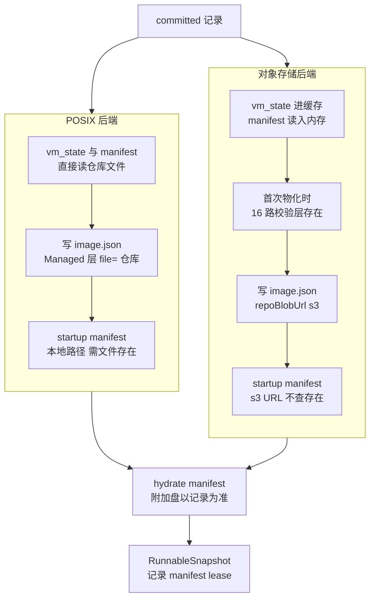
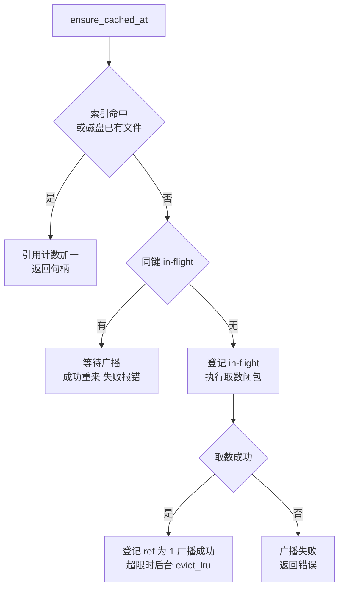

# 49 · 从记录到可运行：resolve 与本地制品缓存

> 快照仓库里的 committed 记录只写逻辑层引用，不写任何节点本地路径；Firecracker 与 ublk-daemon 却只认本地路径。
> 本篇讲两种仓库后端怎样把一条记录「解析」成一组本机可打开的文件，节点本地制品缓存怎样去重、钉住与驱逐这些文件，
> 以及 startup manifest 这个后补的制品怎样挂到记录上、又怎样在 resolve 时被交给启动路径。
>
> **读者**：工程师、存储方向的研究者。　**预备**：[第 46 篇 · 快照对象模型](46-snapshot-object-model.md)、[第 47 篇 · POSIX 仓库](47-posix-repository.md)、[第 48 篇 · 对象存储仓库](48-object-storage-repository.md)、[第 38 篇 · VirtualFile 装饰器链](38-virtualfile-chain-and-remote-io.md)。
> **代码**：`src/snapshot/repository/backends/posixfs/runtime.rs`、`src/snapshot/repository/backends/oss/resolver.rs`、`src/snapshot/runtime_support.rs`、`src/snapshot/artifact_cache.rs`、`src/snapshot/startup_pack.rs`、`src/snapshot/repository/backends/mod.rs`、`src/image/cache/{store,service}.rs`、`storage/overlaybd/src/image/image_file.rs`

---

## 0. 本篇要回答的问题

1. 一条 committed 记录要变成哪几样本地东西，沙箱启动代码才能用？这些东西放在哪里，用什么做键？
2. POSIX 后端与对象存储后端在 resolve 时各下载了什么、没下载什么？层为什么一字节都不下载？
3. 运行时 `image.json` 里一层写成 `file=` 还是 `dir=`，由谁决定？两种写法在 overlaybd 打开层时有什么不同？
4. `LocalArtifactCache` 怎样保证同一个文件只取一次、正在用的文件不被驱逐？它的「正在用」覆盖多长时间？
5. 重启、取消与失败会给这个缓存留下什么？
6. startup manifest 制品是在什么时刻、以什么协议挂到记录上的？resolve 怎样决定把它交给启动路径？

---

## 1. 问题：记录里没有路径

一份快照由 vm_state、Firecracker manifest、内存层、rootfs 层栈与附加盘层栈组成（[第 46 篇](46-snapshot-object-model.md)）。
committed 记录 `CommittedSnapshot` 只保存这些东西的逻辑描述：层是 `OverlaybdLayerRef::Managed`（仓库自管、按 digest 寻址）或
`OverlaybdLayerRef::External`（仍在某个 registry，带 `repo_blob_url`）；Firecracker manifest 里的路径字段全部 `#[serde(skip)]`
（`src/sandbox/manifest.rs` 的 `SnapshotVmStateArtifacts`、`SnapshotMemoryArtifacts` 等），持久化时只留虚拟大小与槽位数。

这样设计的理由很直接：同一条记录要能被任何节点读取，而每个节点的磁盘布局、缓存目录、能否直连仓库都不同。
代价是每个节点在启动沙箱前都要做一次翻译：把逻辑引用变成本机路径，把层列表写成 Rust 版 overlaybd 能打开的 `image.json`。
这一步叫 resolve。它的契约写在 `src/snapshot/repository/interfaces.rs` 的 `SnapshotRuntimeResolver` 注释里：
输入一条 committed 记录，输出本机可直接使用的路径；可以生成节点本地的派生文件，但**不得修改仓库里的真相**；
同一节点上的并发 resolve 应当用原子写，使读者看不到写了一半的派生配置。

有一个前提让这件事变得简单：committed 记录在提交后不再改变层与制品（唯一的例外是后补的 startup manifest 描述符，见第 7 节）。
因此派生文件可以用快照 id 做键长期复用，不需要失效协议。下文会看到，这个前提也被用来跨进程重启复用派生文件。

---

## 2. 入口与产物

入口是 `src/snapshot/manager.rs` 的 `SnapshotManager::load_runnable()`：先 `get()` 按 id 或 alias 取记录，再交给 `resolve_runnable()`，
后者调用当前后端的 `SnapshotRuntimeResolver::resolve()`。调用者有三处：创建沙箱的 `sandboxes_post()`（`src/api/impls/sandbox.rs`）、
从模板构建模板（`src/api/impls/template.rs`），以及 BuildKit 准备 builder 模板（`src/api/impls/image_build/worker.rs`，见[第 53 篇](53-buildkit-in-microvm.md)）。

resolve 的结果是 `RunnableSnapshot`（`src/snapshot/types/snapshot.rs`），三个字段：记录本身、填好本地路径的 manifest、一个不透明的 lease。
填路径由 `runtime_support.rs` 的 `hydrate_runtime_manifest()` 完成：它把 vm_state 路径与内存、rootfs 两个 `image.json` 路径写回 manifest，
并用记录里的 `attached_drives` 通过 `with_extra_drives()` **整体替换** manifest 里的附加盘列表。附加盘的层与挂载点以记录为准，manifest 只贡献形状信息。

派生文件统一放在 `snapshot.local_cache_path`（代码默认 `$AENV_HOME/snapshot-local-cache`）下，由 `RuntimeImageMaterializer` 决定路径：

```text
<local_cache_path>/
├── runtime/<snapshot_id>/
│   ├── memory/image.json            内存层栈（只有 lowers）
│   ├── rootfs/image.json            rootfs 层栈
│   └── drives/<drive_id>/image.json 每块附加盘一个
└── artifacts/<snapshot_id>/
    └── vm_state.bin                 只有对象存储后端才有
```

缓存键与相对路径同形：`runtime_image_cache_key()` 生成 `runtime/<id>/rootfs/image.json` 这样的键，vm_state 的键就是对象存储里的 key
`artifacts/<id>/vm_state.bin`。BuildKit builder 的私有命名空间把 `local_cache_path` 再加一级 `template-build/builder`
（`backends/mod.rs` 的 `builder_snapshot_config()`），与公共快照互不覆盖。

---

## 3. POSIX 后端：不复制，直接指向仓库

`posixfs/runtime.rs` 的 `PosixFsRuntimeResolver::resolve()` 按顺序做五件事：

1. 要求记录已 committed，否则返回 `InvalidRequest`（未完成的模板构建走到这里）。
2. vm_state 直接用仓库里的 `snapshots/<id>/vm_state.bin`，只检查存在，不复制；Firecracker manifest 从仓库文件读入内存。
3. 物化内存、rootfs 与每块附加盘的 `image.json`。每个 Managed 层由 `resolve_local_managed_layer()` 写成
   `file = <仓库根>/managed-layers/<digest>.overlaybd.commit`，文件不存在即 `ArtifactNotFound`；External 层保留 digest 与 `repoBlobUrl`。
   内存层允许为空，rootfs 与附加盘不允许。
4. 若开启了 `[snapshot.memory_startup_pack] consume_enabled`、记录带描述符且仓库里确有 `memory-startup.pack` 文件，
   生成一个指向该文件的本地引用（第 7 节）。
5. 把物化过程中拿到的缓存句柄装进 `CacheArtifactLease`，与记录、manifest 一起构成 `RunnableSnapshot`。

这里没有任何字节被搬到节点本地。Rust 版 overlaybd 打开 rootfs 时，每一层都直接读共享文件系统上的仓库文件；
Firecracker 加载快照时也直接读仓库里的 vm_state。收益是 resolve 几乎只是写几个小 JSON；
代价是共享文件系统的读延迟与吞吐直接决定冷启动与缺页的速度，而这些读不经过节点块缓存（另见[第 47 篇 §8](47-posix-repository.md#8-运行时直接读仓库)）——
块缓存只套在远端源上（[第 39 篇 §2.1](39-block-cache-and-background-download.md#21-位置)），`file=` 指向的仓库层是本地文件，节点的宿主页缓存是唯一的缓存。
POSIX resolver 也不消费 P2P：仓库本身可达，缺文件直接报错，不会从别的节点修补。

---

## 4. 对象存储后端：只下载小的，层留在远端

`oss/resolver.rs` 的 `OssRuntimeResolver::resolve()` 面对的是一个不能当文件打开的仓库，它的取舍是：
只把 Firecracker 必须一次读完的东西拉到本地，层一律按需读。

- **vm_state**：经 `LocalArtifactCache::ensure_cached()` 落到 `artifacts/<id>/vm_state.bin`。取数闭包先试 P2P 的 `fetch_artifact()`，
  失败（含查不到）再用 `OssClient::get_to_file()` 从对象存储下载。后者写进同目录的临时文件、`sync_all` 后 rename，读者不会看到半个文件。
  P2P 只在 `snapshot.p2p_enabled` 为真时注入（`src/bin/server.rs`）；P2P 传输本身见[第 58 篇](58-p2p-artifact-transport.md)。
- **Firecracker manifest**：同样先 P2P、再对象存储 `get_bytes()`，P2P 得到的字节解析失败也回退。它只读进内存，**不进缓存**，
  所以每次 resolve 都要取一次。
- **层**：不下载。物化 `image.json` 之前，`validate_managed_layers()` 用 16 路并发（`MANAGED_LAYER_EXISTS_CONCURRENCY`）对每个 Managed 层做一次 `exists()`，
  缺一层就以 `ArtifactNotFound` 失败；之后每层只写 digest、size、uuid，`repoBlobUrl` 统一为 `OssClient::managed_layers_repo_blob_url()`
  给出的 `s3://<bucket>/<prefix>/managed-layers`。scheme 写 `s3://` 而不是 `oss://`，是因为 Rust 版 overlaybd 的远端源按 S3 兼容协议访问（[第 38 篇 §3.5](38-virtualfile-chain-and-remote-io.md#35-oss)）。
  External 层不做存在性检查。
- **startup manifest**：记录有描述符且 `consume_enabled` 为真时，给出一个 `s3://` URL 形式的引用；这里**不检查**对象是否存在，由消费方失败后退回普通按需恢复。

这些步骤是串行的：先 vm_state，再 manifest，再内存、rootfs、附加盘。冷节点上 resolve 的耗时因此主要由 vm_state 的下载决定。

两个细节值得注意。其一，层存在性检查放在 `ensure_cached_at()` 的取数闭包里，只在 `image.json` 第一次物化时执行；
之后再 resolve 同一快照，`image.json` 已在磁盘上，检查被跳过。其二，层虽然不下载，读到的字节最终还是会经节点块缓存落盘（第 39 篇），
只是那份缓存属于 ublk-daemon，不属于这里的 `LocalArtifactCache`。

还有一处与「层留在远端」相关的取舍发生在发布侧。从对象存储快照创建的沙箱再次发布时，`repository.rs` 的
`derive_and_upload_disk_image_layers()` 把 rootfs 与附加盘里那些「没有本地文件、带 `repoBlobUrl`」的继承层记成 `OverlaybdLayerRef::External`，
`repo_blob_url` 原样写成 `s3://<bucket>/<prefix>/managed-layers`；内存层走 `derive_and_upload_memory_layers()`，被识别回 Managed。
resolve 对 Managed 层每次用当前配置重新拼 URL，对 External 层则照抄记录里的地址。于是桶地址被写死进了新记录：
换桶或修改 prefix 之后，这类快照的 rootfs 层仍指向旧位置，打开时读不到；而且 External 层不做存在性检查，失败要等到 overlaybd 真正读层时才暴露。

下图对照两条路径。



---

## 5. 物化 `image.json`：每一层落在哪里

两个后端共用 `runtime_support.rs` 里的 `materialize_image_config()`。它逐层生成 overlaybd 的 `LayerConfig`，然后写出 `ImageConfig`。

### 5.1 `file=` 与 `dir=`

一层在本机的位置由 `attach_local_layer_location()` 决定，但规则不在这个函数里，而在镜像缓存那一侧：
它把决定交给 `OverlaybdLayerStore::layer_location()`，实现是 `src/image/cache/service.rs` 的 `ImageCacheService::overlaybd_layer_location()`。
已经带了 `file` 或 `dir` 的层不再改动，所以 POSIX 的 Managed 层保持 `file=` 仓库路径。其余情况如下：

| 层的来源 | 有远端回退 | 写成 | 含义 |
|---|---|---|---|
| POSIX Managed | 不适用 | `file=` 仓库文件 | 由 POSIX resolver 预先填好 |
| OSS Managed | 是（`s3://`） | `dir=` 镜像缓存 commit 目录 | 本地有副本就用，没有就读远端 |
| External，带 `repoBlobUrl` | 是 | `dir=` 镜像缓存 commit 目录 | 同上，远端是 registry |
| External，无 `repoBlobUrl` | 否 | 镜像缓存里有大小相符的 commit 时写 `file=`，否则 `dir=` | 只有本地这一份 |

`dir=` 指向本地镜像缓存的 `commits/<digest 派生名>/` 目录（`src/image/commit_index.rs` 的 `commit_dir()`）。
Rust 版 overlaybd 打开层时（`storage/overlaybd/src/image/image_file.rs` 的 `open_localfile_path()` 与 `open_lower_layer()`）
按这个顺序找：`file` 非空就直接打开；否则在 `dir` 下找 `overlaybd.commit`，再找 sealed 文件；都没有就走远端，
用「本层的 `repoBlobUrl` 或镜像级 `repoBlobUrl`」拼出 `<url>/<digest>`；本层带 uuid 且配置了 P2P uuid 门面时，先试门面再退回 digest。

规则的用意写在 `attach_local_layer_location()` 的注释与 `service.rs` 的测试
`overlaybd_layer_location_binds_file_for_cache_local_and_dir_for_remote` 里：**能从远端恢复的层一律用 `dir=`**，
即便本地缓存里恰好有完整副本。`dir=` 只是一个「先看看本地」的提示，镜像缓存的 GC 可以随时回收那份副本，overlaybd 下次打开时自然读远端；
`file=` 没有回退，一旦指向的文件被删，打开就失败。所以只有本地唯一的副本才允许写 `file=`，而这样的层由镜像缓存的保护机制钉住（[第 20 篇 §5](20-launch-plan-and-rollback.md#5-镜像引用保护的交接)、[第 45 篇 §5](45-oci-to-overlaybd.md#5-节点本地的-image-cache)）。

这个规则顺带带来一个收益：对象存储快照里的某一层如果与本节点镜像缓存里某个已转换的层 digest 相同，
resolve 不需要知道这件事，overlaybd 打开时会自己在 `dir=` 里找到它。

### 5.2 `repoBlobUrl` 写在哪一级

overlaybd 的 `image.json` 有镜像级 `repoBlobUrl`，每层也可以有自己的。`materialize_image_config()` 先收集每层的远端 URL：
若全部一致（忽略末尾斜杠），只写镜像级字段，保持旧格式；若混有多个后端（例如 rootfs 下层在 registry、上层在对象存储），
镜像级留空，逐层写。一次 resolve 产生的 rootfs 层栈可能同时引用 registry 与对象存储，这正是第 50 篇讨论的「混源」形态。

写文件由 `write_image_config()` 完成：先写 `image.json.tmp`，再 rename 到目标路径，满足接口注释里「读者看不到半个配置」的要求。

---

## 6. `LocalArtifactCache`

前几节里所有落到 `local_cache_path` 的文件都经过 `src/snapshot/artifact_cache.rs` 的 `LocalArtifactCache`。
它要解决三件事：同一节点上并发创建同一模板的沙箱时只取一次；启动过程中用到的文件不被删；总量受控。

### 6.1 数据结构与取数流程

缓存有两张表：受 `std::sync::Mutex` 保护的索引（键 → 路径、大小、最近访问时间、引用计数，外加总大小），
和受 tokio `Mutex` 保护的 in-flight 表（键 → 一个 `watch` 通道的接收端）。`ensure_cached()` 把键映射成 `cache_root` 下的路径，
拒绝含 `..`、根或空的键，然后调用 `ensure_cached_at()`。后者是一个循环（磁盘上已有文件而索引里没有时走 `pin_local_file()`，按文件大小补登记）：



几个要点：

- **单 in-flight。** 同一键同时只有一个取数在跑，其余调用者等 `watch` 通道。成功后它们回到循环开头，从索引里拿到同一文件；
  失败时它们拿到同一条错误消息（`SharedFetchError` 只保留格式化后的文本），本轮不再各自重试。
- **句柄即钉住。** `CacheHandle` 析构时把引用计数减一。`RunnableSnapshot` 的 lease 持有本次 resolve 拿到的全部句柄。
- **驱逐。** 只有新取数成功、总大小超过上限时才在后台触发 `evict_lru()`：按最近访问时间升序删除引用计数为 0 的条目，直到降到上限的 80%（`EVICTION_TARGET_RATIO`）。
  上限来自 `backend.oss.cache_max_size_gb`，缺省 10 GiB（`DEFAULT_MAX_SIZE_BYTES`）；POSIX 后端构造缓存时传 `None`，固定 10 GiB。
- **陈旧条目。** `try_acquire()` 发现文件已被外部删除时摘掉条目并扣减总大小，回到取数路径。

### 6.2 lease 只覆盖启动窗口

lease 跟着 `RunnableSnapshot` 走。orchestrator 把它装进 `LaunchPlan`（`src/orchestrator/launch_plan.rs` 的 `CreateLaunchSource::Snapshot`），
后端只借用它的引用（`FirecrackerSandbox` 从中复制路径），`launch_sandbox()` 返回时计划被丢弃，lease 随之释放。
两个 resolver 里的注释也写明：运行时制品由「启动窗口的 lease」加「orchestrator 的运行集」共同保护。
后者指的是镜像缓存一侧的保护（第 20 篇 §5），它管的是层，不管 `LocalArtifactCache` 里的文件。

对 vm_state 来说这足够了：Firecracker 在 `snapshot/load` 时读完它，之后不再需要。但内存 `image.json` 不同。
`src/sandbox/firecracker/sandbox.rs` 在暂停一台从快照创建的沙箱时，经 `overlaybd_snapshot.rs` 的 `build_mem_snapshot_image_config()`
重新读取启动时那份内存 `image.json`，以继承它的 lowers。推论：在对象存储后端上，大的 vm_state 文件与小的 `image.json` 共享同一个容量预算，
启动窗口结束后这份 `image.json` 引用计数为 0、访问时间又最早，若在沙箱运行期间发生驱逐，之后的暂停会因读不到它而失败。
POSIX 后端里缓存只装几 KiB 的 JSON，这个情形几乎不会出现。

### 6.3 重启、取消与多实例

**索引纯内存。** `LocalArtifactCache::new()` 只 `create_dir_all` 缓存根，不扫描已有文件。重启后，磁盘上的旧文件只有在被再次请求时
才经 `pin_local_file()` 计入总量；从未再被请求的文件既不计入容量，也永远不会被驱逐。测试 `ensure_cached_reuses_existing_file_after_restart`
锁定的是「复用」这一半，「回收」那一半没有实现。对象存储后端的 vm_state 动辄数 GiB，这会让 `local_cache_path` 随重启次数单调增长。

**跨重启复用以文件存在为准。** 磁盘上已有的 `image.json` 会被直接钉住，不重新物化。这依赖第 1 节的不可变前提，代价是派生时的环境被冻结在文件里：
例如修改 `backend.posix_fs.snapshot_store` 之后，旧的 `image.json` 仍指向旧仓库路径；`dir=` 与 `file=` 的选择也停留在第一次物化时的判断。
对象存储的 vm_state 有同样的问题，且记录里没有 vm_state 的 digest，复用时不做任何校验。

**取消。** 取数闭包运行期间若调用者的 future 被丢弃，`finish_inflight()` 不会执行：in-flight 表里留下一个发送端已关闭的条目。
之后同键的调用者都会在等待时立即得到「ended without a result」错误，而该条目没有任何路径会删除它。
推论：客户端在 `POST /sandboxes` 期间断开连接，若 HTTP 框架因此丢弃 handler，对应快照在本节点上的 resolve 会一直失败，直到进程重启；
v0.2.3 的测试没有覆盖取消路径。

**多实例。** 公共快照的缓存在 `SnapshotManager` 构造时建一次；BuildKit 的 builder 命名空间却在每次构建时经 `build_builder_snapshot_backend()` 新建后端与缓存实例
（`image_build/worker.rs`），各实例的索引与 in-flight 表互不相通。正确性靠临时文件加 rename 保证，容量控制在这个命名空间里实际不起作用。

---

## 7. startup manifest 制品

startup manifest 记录一份快照恢复后首批被触碰的内存页位置，供下一次恢复时预取。它怎样录制、怎样被消费是[第 43 篇](43-startup-pack-and-prefetch.md)的内容；
这里只讲它作为仓库制品的生命周期。

**命名。** 制品文件名是 `MEMORY_STARTUP_PACK_ARTIFACT = "memory-startup.pack"`（`src/snapshot/startup_pack.rs`），但内容不是页数据，
而是魔数为 `AENVMF01` 的 manifest，只记位置不含字节；记录里的描述符 `MemoryStartupPackInfo` 有 `pack_size`、`mem_virtual_size`
与 `index_sha256` 三个字段，最后一个其实是整个 manifest 的 SHA-256，字段名为兼容旧记录保留。
代码注释里的版本称呼不统一（发布侧称 v4，`oss/resolver.rs` 称 v2），对照表见[第 43 篇 §3.3](43-startup-pack-and-prefetch.md#33-名字的混用)；本书统一称 startup manifest。

**它在提交之后才出现。** 两个后端的 `publish()` 都先完成同步提交，记录里 `memory_startup` 为空；然后在开启 `[snapshot.memory_startup_pack] enabled` 时
`tokio::spawn` 一个后续任务：等录制得到 trace、`build_startup_manifest()` 编码、写制品、最后把描述符挂到记录上。全程 best-effort，失败只记日志。

| 维度 | POSIX（`finish_posix_startup_manifest` → `catalog.attach_memory_startup()`） | 对象存储（`finish_startup_manifest` → `attach_memory_startup_descriptor()`） |
|---|---|---|
| 写制品 | 在 record 锁下先校验字节与描述符一致，再临时文件、fsync、rename 到 `snapshots/<id>/memory-startup.pack` | `put_bytes` 到 `artifacts/<id>/memory-startup.pack` |
| 挂描述符 | 同一把 record 锁下改写记录 | 读记录、改、写回，无条件写 |
| 记录已删 | 直接返回，不复活 | 删掉刚上传的制品后放弃 |
| 已有描述符 | 相同则校验或修补制品；不同则报错 | 直接返回 |
| 崩溃窗口 | 制品已写、描述符未写：孤儿制品，读者看不到；重试可复用 | 删除与挂描述符并发时可能把记录写回（注释承认） |

POSIX 的注释直说这「不是多文件持久事务」：两次 rename 之间崩溃，要么留下读者看不到的孤儿制品，要么在修补场景下留下缺制品的描述符，
用同一描述符重试可以修复。对象存储侧的读改写与 alias 绑定是同一种弱一致模型（[第 48 篇 §6.3](48-object-storage-repository.md#63-startup-描述符)）。

**关停。** 这些后续任务可能比同步发布活得久，所以它们持有捕获目录的 lease（`StartupRecording::spawn_with_capture_lease()`），
并在进程全局的 `StartupManifestShutdown` 里登记。关停时 `drain_startup_manifest_tasks()` 先禁止新任务、有界等待在途任务；
超时后只发出 abort 通知，不强行收回任务持有的资源。

**resolve 时的门控。** `resolve_startup_pack_ref()` 与 `resolve_local_startup_pack_ref()` 只在 `consume_enabled` 为真且记录带描述符时才生成引用，
两个开关缺省都关闭，可以分别打开录制与消费。引用是 `ResolvedStartupPack`：来源区分 `OssUrl` 与 `LocalPath`，另带描述符三元组。
它不被信任：本地消费路径在 `src/sandbox/firecracker/startup_pack.rs` 的 `prepare_local_prefetch()` 里限制读取上限，并逐项核对大小、SHA-256 与内存虚拟大小，
任何一项不符就放弃预取，沙箱照常按需恢复。还有一个时序上的推论：提交之后、描述符挂上之前的 resolve 看不到 startup manifest，
这段时间里从该快照创建的沙箱不预取。

---

## 8. 与 e2b infra 的对照

e2b infra 的节点按 build ID 缓存模板对象，snapfile 整体下载、memfile 与 rootfs 按块取回，缓存项没有引用计数，靠 25 小时 TTL 加命中续期兜底（见 e2b 手册第 34 篇）。
AgentENV 把层的按需读交给 ublk-daemon 里的 overlaybd，resolve 只下载 vm_state 并写几个 `image.json`，`LocalArtifactCache` 用引用计数钉住启动窗口、用 LRU 控制总量。
代价在于引用计数只覆盖启动窗口，窗口之后仍被需要的文件得靠容量宽裕来保住，这与 TTL 方案依赖「时间够长」是同一类假设。

---

## 9. 小结

- committed 记录只存逻辑层引用，resolve 把它翻译成本机路径与三类 `image.json`；记录不可变，使派生文件可以按快照 id 长期复用。
- POSIX 后端不复制任何字节：vm_state 与 Managed 层都直接指向共享文件系统上的仓库文件，读性能由共享文件系统决定，且不经节点块缓存。
- 对象存储后端只下载 vm_state（先 P2P 后对象存储），manifest 每次读入内存，层只在首次物化时并发校验存在，运行时按需读 `s3://` URL。
- 从对象存储快照继承的 rootfs 与附加盘层再次发布时被记成带桶地址的 External 引用（内存层仍是 Managed），换桶或改 prefix 后无法解析。
- 能从远端恢复的层一律写 `dir=`，使本地副本可被镜像缓存 GC 回收；只有本地唯一副本才写 `file=`。规则由镜像缓存定义，不在快照模块里。
- `LocalArtifactCache` 保证同键单 in-flight、句柄即钉住、超限后按 LRU 降到 80%；失败结果广播给所有等待者。
- lease 只覆盖启动窗口；推论：对象存储后端上，从快照创建的沙箱在暂停时要重读的内存 `image.json` 可能已被驱逐。
- 索引纯内存，重启后未再访问的旧文件永不回收；调用者在取数中途被取消会让该键在本进程内一直失败；builder 命名空间每次构建新建缓存实例。
- startup manifest 在记录提交之后由后台任务补挂：POSIX 在 record 锁下校验并原子写，对象存储是读改写；resolve 只在 `consume_enabled` 下把引用交给启动路径，消费方逐项校验后才使用。

---

## 延伸阅读 / 下一篇

- [第 46 篇 · 快照对象模型与 SnapshotManager](46-snapshot-object-model.md)：`OverlaybdLayerRef`、`RunnableSnapshot` 与三层存储。
- [第 47 篇 · POSIX 仓库与提交协议](47-posix-repository.md)、[第 48 篇 · 对象存储仓库](48-object-storage-repository.md)：resolve 读取的仓库布局与提交点。
- [第 43 篇 · 启动加速](43-startup-pack-and-prefetch.md)：startup manifest 的录制与消费。
- [第 45 篇 · 从 OCI 镜像到 overlaybd 层栈](45-oci-to-overlaybd.md)：镜像缓存的 commit 目录与 GC 保留条件。
- [第 39 篇 · 节点块缓存与后台下载](39-block-cache-and-background-download.md)：远端层字节真正落盘的地方。
- [第 58 篇 · P2P 制品传输](58-p2p-artifact-transport.md)：vm_state 与 manifest 的 P2P key。
- [e2b 手册第 34 篇 · 模板缓存与本地存储](../e2b-infra/34-template-cache-and-local-storage.md)：TTL 代替引用计数的缓存设计。
- 下一篇：[第 50 篇 · 快照 rootfs 作为 OCI 镜像](50-rootfs-as-oci-image.md)。
