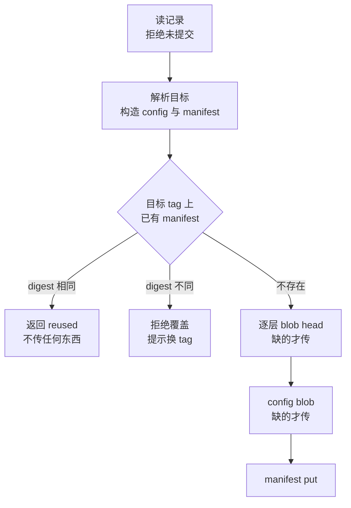
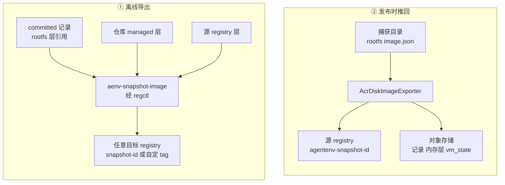

# 50 · 快照 rootfs 作为 OCI 镜像

> 一份快照的 rootfs 是一叠 overlaybd 层，平时只有 AgentENV 的快照仓库知道怎样把它们拼起来。
> AgentENV v0.2.3 有两条彼此独立的机制把这叠层写成一个 OCI 镜像：离线工具 `aenv-snapshot-image` 把已提交快照导出到任意 registry；
> 对象存储后端在发布快照时把 rootfs 推回它的源 registry，使层字节留在 registry 而不进对象存储。
> 本篇分开讲这两条路径，再对照它们的层字节流向、产物能做什么、失败时留下什么。
>
> **读者**：工程师、平台运维。　**预备**：[第 45 篇 · 从 OCI 镜像到 overlaybd 层栈](45-oci-to-overlaybd.md)、[第 46 篇 · 快照对象模型](46-snapshot-object-model.md)、[第 48 篇 · 对象存储仓库](48-object-storage-repository.md)。
> **代码**：`src/bin/aenv-snapshot-image.rs`、`src/snapshot/image_export/{service,target,regctl}.rs`、`src/snapshot/repository/backends/common/acr/{publisher,source_image,manifest,client}.rs`、`src/snapshot/repository/backends/oss/repository.rs`、`src/image/oci_image.rs`

---

## 0. 本篇要回答的问题

1. 这两条机制各自要解决什么问题？为什么它们都只处理 rootfs，产物能否恢复内存状态？
2. AgentENV 写出的 manifest 与 config 长什么样？它为什么能被 AgentENV 自己当作 overlaybd-native 镜像冷启动，却不是一个普通容器运行时能用的镜像？
3. 离线导出怎样做到「同一快照重复导出不重复传输」？目标 tag 已被占用时怎么办？
4. 发布时推回源 registry 要满足哪些条件？不满足时什么情况下回退到对象存储、什么情况下整个发布失败？
5. 两条路径在失败与删除时各留下什么？

---

## 1. 问题：一叠层在仓库之外没有名字

从 OCI 镜像冷启动的沙箱，rootfs 下层就是镜像的层（[第 45 篇](45-oci-to-overlaybd.md)）；对它做快照，得到的是「原镜像的层 + 若干运行时增量层」。
快照仓库把这叠层记成 `rootfs_layers`，每层是 `Managed`（仓库自管）或 `External`（仍在某个 registry）。
这叠层只有通过快照记录才能被找到、被拼对顺序。由此产生两个需求：

- **分发。** 用户想把某个快照的文件系统交给别的环境使用，例如另一个 AgentENV 集群，或者只想把它当一个普通镜像 tag 保存。
  这时需要一份自描述的 OCI manifest，按顺序列出层、带上运行配置。
- **不重复存放。** 对象存储后端发布快照时，默认把每个 rootfs 层上传到 `managed-layers/`（[第 48 篇](48-object-storage-repository.md)）。
  如果原镜像本来就是 overlaybd-native、层已经住在 registry 里，上传只是把同样的字节再存一份；
  只上传增量层、在源 registry 里给整叠层打一个 tag，就能让 rootfs 的全部字节留在 registry。

第一个需求由离线工具满足，第二个由发布路径满足。两者都只处理 rootfs（发布路径也处理附加盘），
**内存层与 vm_state 都不进入镜像**：前者的产物只能用来冷启动；后者的快照仍然要靠对象存储里的记录、内存层与 vm_state 才能恢复。

---

## 2. 共同的格式：overlaybd-native manifest

两条路径共用 `src/snapshot/repository/backends/common/acr/manifest.rs` 里的构造函数。一个 rootfs 镜像的 manifest 大致如下（字段为示意）：

```json
{
  "schemaVersion": 2,
  "mediaType": "application/vnd.oci.image.manifest.v1+json",
  "config": { "mediaType": "application/vnd.oci.image.config.v1+json", "digest": "sha256:c0…", "size": 812 },
  "layers": [
    {
      "mediaType": "application/vnd.oci.image.layer.v1.tar",
      "digest": "sha256:a1…",
      "size": 104857600,
      "annotations": {
        "containerd.io/snapshot/overlaybd/blob-digest": "sha256:a1…",
        "containerd.io/snapshot/overlaybd/blob-size": "104857600"
      }
    }
  ],
  "annotations": { "io.agentenv.snapshot.tag": "release-1" }
}
```

**层。** `OciDescriptor::overlaybd_layer()` 把 mediaType 写成普通 tar，但字节其实是 overlaybd 层本身，用两个注解声明这一点。
这是 accelerated-container-image 系列工具使用的约定之一。AgentENV 自己读镜像时（`src/image/oci_image.rs` 的 `classify_layer()`，分类表见[第 45 篇 §2.3](45-oci-to-overlaybd.md#23-分类)），
`blob-digest` 注解等于层 digest 的层被判为 overlaybd-native（注释称之为 mediaType-lying native），
不等的被判为 tar 包裹形式并拒绝。
为什么不直接用一个 overlaybd 专用的 mediaType？推论：registry 与 `regctl`、`skopeo` 这类通用 OCI 工具只按 mediaType 搬运 blob，并不解析内容；
用标准 tar mediaType，镜像可以被任何 registry 存放、被任何工具复制或镜像同步，只有真正读取层内容的消费者需要认识注解。所以这里写出的镜像可以被 AgentENV 按 overlaybd-native 冷启动：不下载任何 blob，运行时按需读。

**config。** `snapshot_oci_config_blob()` 以记录里保存的源镜像 OCI config 为底，用快照的 `CommandContext` 覆盖 `Env`（排序后写入）、
`WorkingDir`、`User`、`Entrypoint`、`Cmd`、`ExposedPorts`、`Volumes`、`Labels`，然后把整个 JSON 的键递归排序。
外层的 `created` 固定为 `1970-01-01T00:00:00Z`，`history` 为空，`rootfs.diff_ids` 也为空。

最后一项说明了这个镜像的边界。OCI 规范里 `diff_ids` 是每层解压后 tar 的摘要，用来校验解包结果；
这里的层不是 tar，`MinimalRootfs` 的注释写明「为 AgentENV 专用而故意留空」。
推论：Docker、containerd 默认 snapshotter 这类按 tar 解包的运行时拉取它会失败或得到错误内容；能用它的是懂 overlaybd 层的消费者。

**确定性。** 上面每一项都只取决于记录与输入参数，于是 manifest 的 digest 唯一标识一个镜像。但输入里有两个容易忽略的量：
`architecture` 取自运行导出代码的宿主（`host_architecture_for_oci()`），manifest 注解里带着 tag。
同一快照在不同架构的机器上导出、或用不同 tag 导出，得到的 manifest digest 不同；层 blob 与 config blob 不受影响，仍然共享。

---

## 3. 离线导出：`aenv-snapshot-image`

### 3.1 工具的形状

`src/bin/aenv-snapshot-image.rs` 是一个独立二进制：参数为快照 id 或 alias、可选的 `--target-repository`、`--tag`、`--config`；
标准输出恰好一行，即镜像引用，日志走标准错误，便于在脚本里组合。它不在常规安装包里，要用 `make build-snapshot-image` 自行构建。

它刻意不启动节点运行时。`src/snapshot/image_export/service.rs` 的 `SnapshotImageService::from_global_config()` 只按配置构造快照仓库
（POSIX 或对象存储）与一个「managed 层在哪里」的定位器，跳过 runtime resolver、本地制品缓存、镜像层存储与 P2P——注释原话是 intentionally skipping。
所以它可以跑在一台没有 KVM、没有 ublk 的机器上，只要能读快照仓库、能运行 `regctl`。registry 认证完全交给 `regctl` 自己读的 Docker config。

### 3.2 目标解析

`target.rs` 的 `resolve_snapshot_image_target()` 决定推到哪里：

| 情形 | 目标仓库 | 缺省 tag |
|---|---|---|
| 给了 `--target-repository` | 解析 `registry/repo`，拒绝 URL scheme 与 digest，registry 小写化并去掉 `:443` | `latest` |
| 记录里有 rootfs 发布记录（第 4 节） | 那次发布所在的仓库 | `snapshot-<id>` |
| 否则 | rootfs 的 External 层所在的**唯一** registry 仓库（`s3://` 层不算） | `snapshot-<id>` |
| 推断不出或不唯一 | 报错，提示传 `--target-repository` | — |

注意缺省 tag 是 `snapshot-<id>`，与发布路径的 `agentenv-snapshot-<id>` 不同，两者不会互相覆盖。
如果用户显式指定的目标恰好等于某条发布记录（同仓库同 tag），工具会照常工作，但打一条警告：这个引用由快照管理，删除快照时可能被一并删除。
反过来，工具推上去的镜像不写进任何记录，删除源快照时 `delete_disk_publications()` 找不到它，它会一直留在目标 registry 里，由运维自行清理。

### 3.3 发布流程



`publish_committed_rootfs()` 先在本地算出 config 与 manifest，再用 `regctl manifest head` 看目标 tag。
三种结果分别是复用、拒绝、继续。继续时 `ensure_layer_blob()` 对每层先 `blob head`，目标已有的层既不物化也不传输；缺的层按来源处理：

| 层 | 字节从哪里来 | 做法 |
|---|---|---|
| Managed，POSIX 仓库 | 仓库里的 `managed-layers/` 文件 | 原地校验大小后 `blob put` |
| Managed，对象存储仓库 | `managed-layers/<digest>` 对象 | 下载到临时目录、校验大小后 `blob put` |
| External，`s3://` URL | 同上，按 Managed 处理 | 从对象存储恢复的沙箱再做快照时，继承的层会记成这种形式（第 48 篇 §4.3） |
| External，跨 registry | 源 registry | `regctl blob get` 管道接 `blob put`，不落盘 |
| External，同 registry 不同仓库 | 源 registry | `regctl blob copy`，由 registry 端完成 |
| External，同仓库 | — | head 已证明缺失，无处可取，报 `ArtifactNotFound` |

全部层就位后上传 config blob，最后 `manifest put`。`regctl.rs` 的封装让 payload 从文件描述符流入子进程，
重试、GOMAXPROCS 上限与 404 判定沿用 `src/image/oci_image.rs` 的 `regctl` 调用约定（[第 45 篇 §6](45-oci-to-overlaybd.md#6-调用-regctl-的两条约束)）。

这个流程用 manifest digest 代替了状态记录：工具本身不记任何东西，重复运行时要么在 head 处直接复用，要么只补传上次没传完的 blob。
代价是「先 head、后 put」不是原子的。推论：两个进程同时用同一个 tag 导出不同内容时，两者都可能看到 tag 不存在，后写者覆盖先写者，
「拒绝覆盖」只对串行的调用者成立。

---

## 4. 发布时推回源 registry

### 4.1 启用条件

这条路径只存在于对象存储后端：`[snapshot.image_publish] enabled = true` 时，`backends/mod.rs` 把存储策略设为
`SnapshotImageStoragePolicy::SourceRegistry`。POSIX 后端没有对应实现，配置了也不生效。模块名 `acr` 来自阿里云容器镜像服务，
但客户端 `AcrClient` 是一个通用 OCI distribution 客户端，凭证由 `AcrClient::from_docker_config()` 从 Docker config 读取。

开启之后，`oss/repository.rs` 的 `export_disk_image()` 对 rootfs 与每块附加盘都先交给 `AcrDiskImageExporter::export()`
（`acr/publisher.rs`）。后者用 `source_image.rs` 的 `load_source_registry_image()` 检查捕获目录里的 `image.json` 是否是它能处理的形态：

1. 镜像级 `repoBlobUrl` 非空，且是 `https://<registry>/v2/<repo>/blobs` 形式；
2. 每个远端 lower 有 digest 与 size，且没有逐层 `repoBlobUrl`；
3. 本地 lower（`file=`）必须是运行时生成的增量层，靠文件名识别：`snapshot.commit`、`snapshot.zfile.commit` 或 `managed-base.commit`
   （`src/image/local_layer.rs` 的 `rootfs_layer_is_runtime_generated_delta()`）；
4. 所有远端 lower 在前、本地增量在后，且至少有一个远端 lower；
5. 不含 `targetFile`、`gzipIndex` 等上游复杂形态。

换句话说，它只接受「一个 overlaybd-native 镜像 + 这台沙箱自己写出的增量」。

### 4.2 推送

满足条件时，`export()` 依次：

- 生成 tag：rootfs 是 `rootfs_snapshot_image_tag()` 给出的 `agentenv-snapshot-<id>`；附加盘在其后接 `-drive-<净化后的 drive id>-<12 位哈希>`。
  drive id 可以含 OCI tag 不允许的字符，`sanitize_drive_tag_component()` 把它们替换成 `-` 并截到 32 个字符；
  替换与截断可能让两个不同的 drive id 变成同一个串，所以再接上原 id 的 SHA-256 前 12 位十六进制，保证同一快照内各盘的 tag 互不相同。
- `ensure_manifest_absent()`：tag 已存在即报错。快照 id 是新生成的 UUIDv7，正常情况下不会撞上。
- 远端 lower 直接引用，不传字节。本地增量经 `prepare_layer_upload()` 上传：开启 `[snapshot.publish_compression]` 时 raw 层被重封装成 ZFile，
  manifest 注解与记录里的 digest、size 描述的是上传后的字节；稀疏层先做 dense 导出再上传。上传前 `blob_exists()` 探测，已有即跳过。
- 上传 config：rootfs 用第 2 节的快照 config，附加盘用只含空 `Env` 与 `WorkingDir` 的最小 config。
- `put_manifest()`，得到 manifest digest，返回一条 `PersistedDiskImagePublication`（引用、tag、manifest digest、仓库 URL）。

返回的层列表**全部记成 `External`**，`repo_blob_url` 指向源 registry。这叠层从此在快照记录里与原镜像的层没有区别。
下一次有人从这份快照创建沙箱，resolve 写出的 `image.json` 镜像级 `repoBlobUrl` 就是这个 registry（[第 49 篇 §5.2](49-resolve-and-artifact-cache.md#52-repobloburl-写在哪一级)），
它再做快照时仍满足上面的条件，增量链可以一直留在 registry 里。API 层通过 `SnapshotRecord::published_rootfs_image_ref()` 按 tag 找出 rootfs 那条发布记录，
作为快照的 `imageRef` 返回；这个引用可以直接用于冷启动。

### 4.3 回退与失败

`export()` 不认识的形态返回 `RepositoryError::Unsupported`，`export_disk_image()` 据此二选一：

- `fallback_to_object_storage_would_mix_sources()` 为假，即所有非 `file=` 的 lower 都指向本仓库的 `managed-layers` URL（或根本没有远端 lower），
  就回退到普通的对象存储发布。本地转换来的标准 OCI 镜像（lower 全是镜像缓存里的 `file=`）走的就是这条。
- 否则，即至少有一个 lower 在别的远端（例如逐层 `repoBlobUrl` 指向另一个 registry），整个发布失败，错误写明「source-registry export is unsupported for this remote-backed disk image」。

后一种取舍的理由是一致性：回退到对象存储时这些远端层仍会被记成 External，快照的 rootfs 就同时依赖 registry 与对象存储，
而开启这个开关的意图正是让 rootfs 只依赖 registry。代价是同一个沙箱在开关打开前能发布、打开后可能发布失败。`config/default.toml` 的注释如实写了这一点。

发布的其余步骤失败时，`publish_with_local_layers()` 删除 `artifacts/<id>/` 前缀，并按逆序对每条发布记录调用 `rollback_publication()`：
按 manifest digest 删除 manifest。已上传的增量 blob 不删，注释写「留给 registry GC」。
删除快照时，对象存储后端在删掉记录之后 best-effort 地删除这些 manifest，失败只记警告（`delete_disk_publications()`）。
每个快照的 manifest 都列出整叠层，所以后代快照自己的 manifest 仍引用祖先的 blob，删除祖先的 manifest 不会让后代失去引用。
推论：从被删快照创建、尚未再做快照的沙箱（运行中或暂停中）只通过那份被删的 manifest 间接引用这些 blob，registry 端若按「无 manifest 引用」回收 blob，它们的 rootfs 会在下次按需读时失败。

这里有一个可见性窗口：rootfs 的 tag 在第 1 步就推上去了，而记录要到最后才写。在此之间，registry 里已经能看到 `agentenv-snapshot-<id>`，
快照 API 却还查不到这个 id；发布失败且回滚也失败时，tag 会一直留在 registry 里。

---

## 5. 两条路径对照

下图对照两条路径的输入、字节来源与产物落点。



| 维度 | 离线导出 `aenv-snapshot-image` | 发布时推回源 registry |
|---|---|---|
| 触发 | 运维手动运行，针对已提交快照 | 对象存储后端每次发布，开关打开时 |
| 仓库后端 | POSIX 与对象存储都支持 | 只有对象存储 |
| 输入 | committed 记录 | 捕获目录里的运行时 `image.json` |
| 范围 | 只有 rootfs | rootfs 与附加盘 |
| 目标 | 任意 registry，可推断或指定 | 只能是 rootfs 的源 registry 仓库 |
| 传输工具 | `regctl` 子进程 | 进程内 `AcrClient`（HTTP，8 MiB 分块） |
| 对快照记录的影响 | 无，不写记录 | 层记为 External，写入发布记录 |
| 产物能做什么 | 冷启动 | 冷启动；快照本身仍可经对象存储恢复内存 |
| 重复执行 | 同 digest 复用，同 tag 不同 digest 拒绝 | tag 已存在即失败 |
| 失败残留 | 已传的 blob | 已传的 blob；回滚失败时还有 tag |
| 删除快照时 | 不受影响（没有记录可循） | best-effort 删除 manifest，blob 留给 registry GC |

一个值得注意的不对称：两条路径用了两套 registry 客户端。离线工具与镜像解析器一样调用 `regctl`，发布路径则在 `server` 进程里用自研的 HTTP 客户端，
有自己的 token 缓存、重试（缺省 2 次）与重定向策略。推论：这避免了在发布热路径上为每个 blob 起子进程，代价是认证与重试逻辑有两份实现要分别维护。

---

## 6. 小结

- 两条机制互相独立：离线导出把已提交快照的 rootfs 写成一个新镜像；发布时推回让对象存储快照的 rootfs 字节留在源 registry。都不包含内存层与 vm_state。
- manifest 用「tar mediaType + `blob-digest` 注解等于层 digest」声明层是 overlaybd 字节，AgentENV 自己把它识别为 overlaybd-native；`diff_ids` 为空，普通按 tar 解包的运行时用不了它（推论）。
- config 与 manifest 是确定的，manifest digest 唯一标识镜像；但它随导出宿主的架构与 tag 注解变化。
- 离线工具跳过整个节点运行时，只依赖仓库与 `regctl`；以目标 tag 上的 manifest digest 决定复用、拒绝或继续，只传目标缺的 blob；先 head 后 put 不是原子的。
- 推回源 registry 只接受「overlaybd-native 镜像 + 运行时增量」；成功时层全部记为 External，增量链可以持续留在 registry。
- 不支持的形态在没有混源风险时回退到对象存储，否则整个发布失败；这是为保住「rootfs 只依赖 registry」所付的代价。
- 发布失败按 manifest digest 回滚、blob 留给 registry GC；tag 先于记录可见，回滚失败时会残留。
- 两条路径各用一套 registry 客户端：`regctl` 与进程内 `AcrClient`。

---

## 延伸阅读 / 下一篇

- [第 45 篇 · 从 OCI 镜像到 overlaybd 层栈](45-oci-to-overlaybd.md)：`classify_layer()` 与 overlaybd-native 镜像的冷启动。
- [第 48 篇 · 对象存储仓库](48-object-storage-repository.md)：发布七步、`managed-layers/` 与发布压缩；[§4.3](48-object-storage-repository.md#43-继承层的两种记法) 讲 `s3://` External 引用。
- [第 49 篇 · 从记录到可运行](49-resolve-and-artifact-cache.md)：External 层在 resolve 时怎样写进 `image.json`。
- [第 35 篇 · ZFile 压缩](35-zfile-compression.md)：发布压缩产生的层格式。
- [第 37 篇 · 封存、restack 与 compact](37-seal-restack-compact.md)：运行时增量层从哪里来。
- 下一篇：[第 51 篇 · fork：同节点的内存分叉](51-fork.md)。
