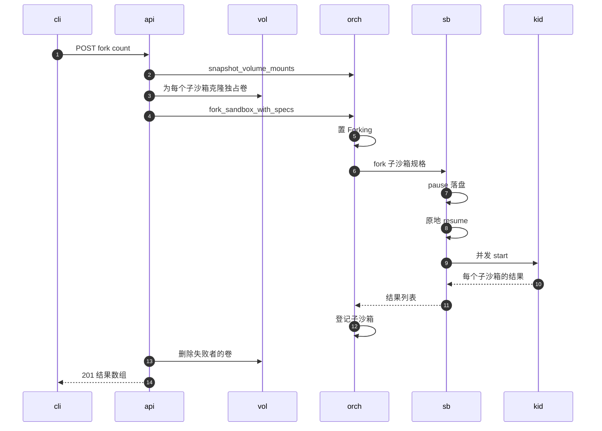
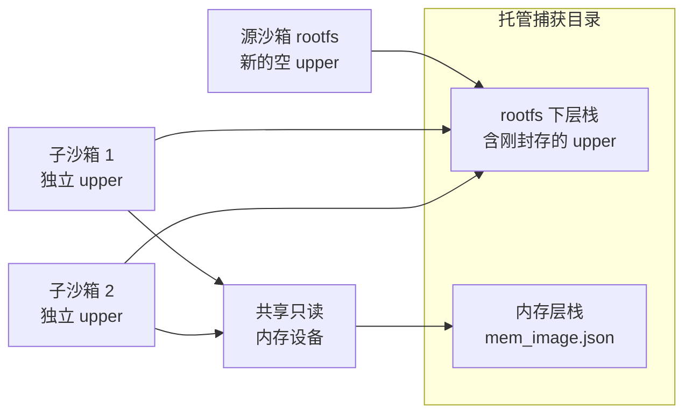

# 51 · fork：同节点的内存分叉

> fork 把一台正在运行的沙箱在某一刻的完整状态 —— 内存、rootfs、附加盘与卷 —— 复制成 1 到 100 台新沙箱，源沙箱只停顿一次捕获的时间。
> 它看起来像「快照 + N 次从快照启动」，实际上一个字节也不进快照仓库：子沙箱直接从源沙箱节点本地的捕获目录恢复，共享封存的下层，各自拿一个新的可写层。
> 本篇沿 API、orchestrator、后端三层走一遍这条链路，讲清楚这种设计换来了什么、又把 fork 限制在了哪里。
>
> **读者**：要使用或修改 fork 的工程师。　**预备**：[第 19 篇 · 状态机与并发控制](19-state-machine-and-concurrency.md)、[第 27 篇 · 启动、暂停与恢复的 Firecracker 调用序列](27-start-pause-resume-sequences.md)、[第 37 篇 · 封存、restack 与 compact](37-seal-restack-compact.md)
> 　**代码**：`src/api/impls/sandbox.rs`（`sandboxes_sandbox_id_fork_post`、`prepare_volume_fork_specs`）、`src/orchestrator/service.rs`（`fork_sandbox_with_specs`、`fork_sandbox_inner`）、`src/sandbox/firecracker/sandbox.rs`（`fork`、`snapshot_config_for_fork`、`from_snapshot_config_with_override`）、`src/sandbox/backend.rs`、`src/volume.rs`

---

## 0. 本篇要回答的问题

1. 一次 `POST /sandboxes/{id}/fork` 在三层里各做了什么，源沙箱在哪一段被停住？
2. 子沙箱与源沙箱共享哪些数据、各自独占哪些数据？捕获目录活多久，由谁决定？
3. 为什么 fork 只能落在源沙箱所在的节点上？
4. 挂了卷的沙箱怎样 fork？为什么子沙箱只能「替换」快照里已有的盘、不能追加？
5. 一个子沙箱启动失败时，源沙箱和其它子沙箱会怎样？
6. pause、snapshot、fork 三种捕获操作在落盘位置、源沙箱去向与跨节点能力上有什么区别？

---

## 1. 问题：从一个运行中的状态长出多台

agent 场景里常见这样的需求：一个环境已经装好依赖、加载好数据、跑到某个中间状态，接下来要并行尝试几种不同的动作，
每种动作都需要一份**从这一刻开始**的独立环境。重新冷启动再重放前面的步骤太慢，而且前面的步骤未必可重放。

AgentENV 已有的两条路都能拼出这个效果，但代价不同：

- **snapshot + 多次 create**：`POST /sandboxes/{id}/snapshots` 把状态发布进快照仓库，再用这个快照创建 N 台沙箱（[第 16 篇](16-snapshot-and-volume-api.md)）。
  发布要上传内存层、rootfs 增量与 vm_state，还要写记录与别名；之后每次创建还要走 resolve（[第 49 篇](49-resolve-and-artifact-cache.md)）。
  收益是快照可以跨节点、可以长期保存。
- **pause + resume**：暂停只能恢复成**同一台**沙箱，产物属于这台沙箱自己（[第 22 篇](22-persistence-across-restarts.md)）。

fork 取两者之间：像 snapshot 一样让源沙箱继续运行，像 pause 一样只在节点本地落盘，然后用同一份捕获产物恢复出 N 个新身份的 VM。
它放弃的是跨节点与持久性，换来的是捕获之后不需要任何上传与仓库提交。

---

## 2. 端到端链路

下图中 `cli` 是客户端，`api` 是 handler，`vol` 是 `VolumeManager`，`orch` 是 orchestrator，`sb` 是源沙箱的后端对象 `FirecrackerSandbox`，`kid` 代表子沙箱的后端对象。

### 2.1 API 层：参数与卷的预处理

`sandboxes_sandbox_id_fork_post()` 先查源沙箱的元数据（找不到返回 404），再读请求体：
`count` 缺省 1，必须在 1 到 100 之间，否则 400；`timeout` 给出时成为子沙箱的 TTL（`NewTimeout::Set`），缺省为 `NewTimeout::UseExisting`，即沿用源沙箱的 TTL 长度、从现在起算（[第 23 篇](23-auto-eviction-and-ttl.md)）。
spec（`src/api/openapi.yml` 的 `/sandboxes/{sandboxID}/fork`）写明源沙箱保留自己的 ID 与过期时间。

源沙箱没有挂卷时，handler 直接生成 `count` 个只带新 `SandboxId` 的 `SandboxForkChildSpec`。
挂了卷时多三步（消息 2–3）：调 `orchestrator.snapshot_volume_mounts()` 把可写卷的 upper 封存成卷本地的新下层（这是一次只处理卷的「借出 Running」，见[第 20 篇 §6](20-launch-plan-and-rollback.md#6-借出-running快照卷快照与-fork)），
调 `recover_backings()` 确保卷记录指向本地的 `image.json`，再由 `prepare_volume_fork_specs()` 为每个子沙箱构造规格。§4 专门讲卷。

### 2.2 orchestrator：一次 CAS，N 次登记

`fork_sandbox_with_specs()` 把工作包进 `run_cancellation_safe("fork", …)`，请求被取消也会做完（[第 19 篇 §6](19-state-machine-and-concurrency.md#6-取消安全操作不随请求一起死)）。
`fork_sandbox_inner()` 依次：

1. `ensure_accepting_lifecycle_operations()`：进程关闭期间拒绝。
2. 校验子沙箱 ID 互不相同、不等于源 ID、在 store 里不存在。
3. 用 `update_if_state(…, &[SandboxState::Running], …)` 把源沙箱 CAS 到 Forking。Killing 映射为 404，其它状态返回 `InvalidSandboxState`，handler 映射为 409。
4. 为每个子沙箱生成后端规格 `SandboxForkSpec`：源沙箱是 secure 时，`access_tokens.generate(child_id)` 为子沙箱派生新令牌，否则不带令牌。
5. 在源沙箱句柄的锁内调后端 `fork()`。
6. 无论子沙箱结果如何，先把源沙箱 CAS 回 Running。
7. 逐个处理子沙箱结果：失败的记成结果项里的错误；成功的复制源元数据，换上新 ID、Running 状态、新的 `created_at`、空的 `paused_state`、自己的 `volume_mounts`，按 `new_timeout` 设 TTL，
   然后 `store.add()`、插入句柄表、`upsert_proxy_route()`、发一条 `SandboxLifecycleEventType::Fork` 事件。登记中任何一步失败，都用 `stop_failed_fork()` 停掉这台子 VM。

子沙箱不经过 Creating，也不走启动流水线（[第 19 篇 §3](19-state-machine-and-concurrency.md#3-转换图与转换表)）：后端交回的已是就绪的 VM。

### 2.3 后端：停一次，起 N 台

`FirecrackerSandbox::fork()`（`src/sandbox/firecracker/sandbox.rs`）的主体只有三段：

1. **捕获**：调 `FirecrackerSandbox::pause()`，在托管快照根下新建一个 UUIDv7 目录并执行 `pause_to_dir()`：
   有可写卷时先经 envd 在 guest 里 `sync`，然后 `PATCH /vm Paused`、只写状态的快照、读脏页写成内存层、restack rootfs 与附加盘（[第 27 篇 §5](27-start-pause-resume-sequences.md#5-暂停把一台-paused-的-vm-写成快照)）。
   返回的 `FirecrackerSnapshotConfig` 带着 `managed_snapshot_root`。失败交给 `recover_capture_failure()`，可恢复的错误会先把源 VM 恢复运行。
2. **立即恢复源**：`FirecrackerSandbox::resume()` 只发一次 `PATCH /vm Resumed`。这一步失败被标成 `SandboxCaptureError::Terminal`。
   源沙箱停顿的时间因此只包含本地捕获，不包含任何子沙箱的启动。
3. **构造并并发启动子沙箱**：对每个规格，先检查 `replace_drive_ids` 没有指向物理附加盘，再用 `snapshot_config_for_fork()` 克隆出子沙箱的快照配置，
   交给 `from_snapshot_config_with_override(config, child_id, token)` 构造后端对象；然后 `futures::future::join_all` 并发 `start()`。
   某个子沙箱 `start()` 失败时就地 `stop()` 它，错误写进对应位置的结果。

`from_snapshot_config_with_override()` 是「恢复暂停的沙箱」与「fork 的子沙箱」共用的构造函数：它用传入的令牌覆盖快照里的令牌，
把 MMDS 元数据里的 `sandbox_id` 换成新 ID、令牌哈希按新令牌重算（[第 28 篇](28-mmds-and-envd.md)），其余照搬快照配置，以 `LaunchMode::Resume` 构造。
随后的 `start()` 就是一次普通的从快照恢复：分配网络槽位、建块设备、`PUT /snapshot/load`、补丁、恢复、`/init`（[第 27 篇 §4](27-start-pause-resume-sequences.md#4-从快照恢复)）。
所有槽位的 guest 地址相同，所以 N 台 VM 从同一份内存恢复不会产生地址冲突（[第 29 篇 §2.3](29-network-slots.md#23-为什么-vm-地址必须固定)）。

---

## 3. 共享什么、独占什么

捕获目录的位置是 `managed_snapshot_base()/<源沙箱 ID>/<uuidv7>/`，基目录是 `[firecracker] work_dir/managed-snapshots`，未配置时在系统临时目录下。
目录里有 `vm_state.bin`、内存层与 `mem_image.json`、`rootfs/` 下封存的层与 `image.json`、`drives/` 下各附加盘的封存层。

**rootfs**：restack 之后，源沙箱的 live 设备把刚封存的旧 upper 当作最新的下层，写入落进新的空 upper（[第 37 篇 §3](37-seal-restack-compact.md#3-restack封存并换上新-upper)）。
`stage_overlaybd_snapshot_from_live_runtime()` 写出的捕获目录 `image.json` 只列下层、`upper` 为空。
每个子沙箱启动时，daemon 物化运行时镜像发现没有 upper，就在子沙箱自己的工作目录里新建一个（[第 26 篇 §5.1](26-sandbox-block-devices.md#51-运行时物化)）。
于是源与全部子沙箱读同一组封存层，写各自的 upper。附加盘同理。

**内存**：子沙箱的内存配置都指向同一个 `mem_image.json`。节点按规范化后的 image.json 路径去重只读设备（`get_or_create_shared_readonly()`），
所以 N 台子 VM 打开的是同一个 ublk 内存设备，读命中同一份宿主页缓存（[第 26 篇 §4](26-sandbox-block-devices.md#4-共享只读设备与两级引用计数)）。
源沙箱则不同：它没有重新加载，内存仍在原来的 Firecracker 进程里；它的 `launch` 配置没变，下一次暂停时内存层仍叠在它自己启动时的内存层栈之上（`build_mem_snapshot_image_config()` 读的是 `self.launch` 的内存配置）。
本次 fork 写出的内存层只服务子沙箱。

**捕获目录的寿命**由 `PersistentSnapshotRootGuard`（`src/sandbox/firecracker/config.rs`）决定。它是 `<源沙箱 ID>` 这一级目录的守卫，析构时 `remove_dir_all` 整个目录。
源沙箱在 `live_snapshot_root()` 里持有一份 `Arc`；每个子沙箱的快照配置克隆自同一份 `FirecrackerSnapshotConfig`，也持有一份；
子沙箱自己以后再做快照或 fork 时，`live_snapshot_root()` 优先沿用启动配置里的这个根，所以孙辈的捕获目录同样落在最初那台源沙箱的根下。
只有源沙箱与全部后代都析构后，目录才会被删除。

这个安排有两个后果。其一，删除源沙箱不影响子沙箱：子沙箱持有的 `Arc` 让封存层留在原处。
其二，代码里没有按单个 UUID 目录回收的逻辑（除捕获失败时的清理外，`remove_dir_all` 只出现在守卫的析构里）：
一台长期运行、被反复 fork 的沙箱，它的每一次捕获目录（包括只被子沙箱使用的内存层）都会留到整棵树结束。
层数方面，restack 每次给 live 栈加一层，预算与 compact 的规则见[第 37 篇 §5](37-seal-restack-compact.md#5-运行时层数预算)。
另外，restack 前已有的运行时层（位于托管根或持久化目录下的层）在写出新捕获目录时会被硬链接或复制进该目录的 `inherited-layers/`（`rewrite_lowers_with_runtime_roots()`），
每个捕获目录在运行时层这一段是自足的，不引用别的捕获目录。

**为什么只能同节点**：子沙箱的全部依赖 —— 捕获目录、封存层、共享内存设备 —— 都是这个节点的本地文件与本地设备，快照配置里写的是绝对路径。
gateway 侧与此一致：fork 请求按源沙箱 ID 路由到源沙箱所在节点，`services/gateway/internal/server.go` 用 `extractForkSandboxIDsFromResponse()` 从 201 响应体里取出每个子沙箱 ID，逐个 `RecordAssignment` 绑定到同一节点。
要把状态带到别的节点，只能走 snapshot：发布进仓库，再在目标节点创建。

---

## 4. 卷：克隆独占卷，共享只读卷

卷是会被多台沙箱看到的持久对象，不能像附加盘那样让子沙箱各拿一个 upper 就完事：子沙箱删除时卷的内容要发布进仓库（[第 21 篇](21-deletion-and-volume-capture.md)），两台沙箱不能把同一个独占卷当作自己的。
`prepare_volume_fork_specs()` 对源沙箱的每个挂载：

- **Exclusive 卷**：`create_child_for_owner()` 以源卷为父、源沙箱为 `source_owner`、子沙箱为新 owner，创建名为 `volume-fork-<uuid>` 的子卷。
  父卷正被预留时，`create_with_source_owner()` 从父卷的本地 `image.json` 克隆出子卷的 backing（`create_child_backing()`），因为本地可能有尚未发布的新层。
  子卷的 ID 记进 `replace_drive_ids`，形成「源卷 drive → 子卷 drive」的替换对。
- **ReadOnly 卷**：子沙箱挂同一个卷 ID，不替换。

随后对子沙箱的挂载表调用 `resolve_volume_mounts()`，得到它的 `extra_drives`。任何一步失败，`cleanup_fork_volume_children()` 解除 owner 并删除已建的子卷，整个请求失败。
fork 结束后，handler 只为启动失败的子沙箱清理子卷；orchestrator 返回外层错误时清理全部子卷。

**替换而不追加**：`snapshot_config_for_fork()` 在源快照配置的 `extra_drives` 里按 drive id 找到源卷那一项，原位换成子卷；
如果子规格里有某块盘在快照里找不到对应项，直接报错 `fork cannot append drive … to captured Firecracker state`。
`fork()` 另外拒绝替换前 `physical_extra_drive_count` 块物理附加盘（`fork replacement drives must refer to launch-time volume drives`）。
原因在 Firecracker 的快照状态：设备集合在捕获时已经固定，guest 内核里这些块设备已经存在、卷已经挂在对应路径上（[第 31 篇 §1](31-extra-drives-and-volumes.md)）。
原位替换只改变某个槽位背后的文件，guest 看到的设备拓扑不变；追加则意味着 guest 内存里根本没有这块设备的状态。
fork 请求本身也没有卷参数，子沙箱的挂载完全镜像源沙箱，正常路径上不会出现追加，这个检查是一道防御。
物理附加盘不需要替换：它的封存层在捕获目录里，每个子沙箱启动时自建 upper。

**一个时间窗口**：卷的封存（消息 2）发生在 `fork_sandbox_with_specs()` 之前，二者之间源沙箱处于 Running。
子卷克隆自消息 2 那一刻的卷状态，子沙箱的内存却来自消息 7 那一刻。推论：如果 guest 在这两点之间写过卷，子沙箱恢复后，
guest 页缓存与文件系统元数据记得的那部分写入在子卷上并不存在，可能读到不一致的文件系统。这个顺序的来由也是推论：
子卷必须在后端构造子沙箱之前存在，而后端的捕获与子沙箱构造在同一个 `fork()` 调用里完成，中间没有回调 `VolumeManager` 的入口。

---

## 5. 失败语义

`SandboxBackend::fork()` 的文档（`src/sandbox/backend.rs`）规定了两级错误：

| 失败发生在 | 返回形式 | orchestrator 的处理 | API 响应 |
|---|---|---|---|
| 捕获出错、可恢复 | 外层 `Recoverable` | 源沙箱 CAS 回 Running | 500，不尝试任何子沙箱 |
| 捕获后无法恢复源 | 外层 `Terminal` | 摘句柄与路由、`stop()`、`finalize_terminal_volumes()`、删除源记录 | 500 |
| 某个子沙箱构造或启动失败 | 该位置的 `Err` | 记入结果项，兄弟不受影响 | 201，该项带 `error` |
| 子沙箱登记失败 | orchestrator 内部 | `stop_failed_fork()`，记入结果项 | 201，该项带 `error` |

关键约束写在文档里：外层错误只用于子沙箱启动开始之前；源沙箱一旦恢复，实现必须尝试每一个子沙箱并按规格顺序返回结果，成功的子沙箱在兄弟失败时保持运行。
测试 `fork_sandbox_keeps_successful_siblings_when_one_start_fails` 与 `fork_sandbox_terminal_failure_removes_source_and_cleans_up_metrics`（`src/orchestrator/tests.rs`）锁定了这两条。
于是 201 的含义是「源沙箱已被捕获并恢复，fork 已被尝试」，客户端必须逐项检查 `sandbox` 与 `error`；spec 的 `SandboxForkResult` 规定二者恰有其一。
计数器上，每个子沙箱计一次创建成功或失败（`record_create_success` / `record_create_fail`）。

有三点边界：

- 登记阶段没有关闭检查点：进程在后端 `fork()` 返回之后开始关闭，子沙箱仍会被登记（[第 20 篇 §6](20-launch-plan-and-rollback.md#6-借出-running快照卷快照与-fork)）。
- `fork_sandbox_inner()` 不检查节点容量，`count` 最多 100。推论：fork 可以在 scheduler 不参与的情况下让节点上的沙箱数一次增加 100，scheduler 只能从后续心跳里看到结果。
- 子沙箱以自己的 ID 走 start-resume，扩展 hook 照常触发；源沙箱的原地捕获不触发任何 hook（[第 33 篇](33-custom-extension-hooks.md)）。

---

## 6. pause、snapshot、fork 对照

三者共用 `pause_to_dir()`（[第 27 篇 §6](27-start-pause-resume-sequences.md#6-capture-与-pause同一段代码四种收尾)），差别在目录归属、收尾方式与卷的处理：

| 维度 | pause | snapshot | fork |
|---|---|---|---|
| 过渡状态 | Pausing | Snapshotting | Forking |
| 落盘位置 | 持久化目录 `artifacts/<id>/<uuidv7>/` | 托管根下 `<uuidv7>/`，随后发布 | 托管根下 `<uuidv7>/` |
| 是否进快照仓库 | 否 | 是，生成记录与可选别名 | 否 |
| 源沙箱之后 | 停机，记录为 Paused | 原地恢复，继续 Running | 原地恢复，继续 Running |
| 产物的使用者 | 同一台沙箱的下一次 resume | 任何节点上的新沙箱 | 本节点上的 N 个新沙箱 |
| 跨节点 | 否 | 是 | 否 |
| 独占卷 | 本地 restack，不发布 | 捕获后发布卷层，记进快照 | 先封存，再为每个子沙箱本地克隆 |
| 产物寿命 | 到 resume 或删除 | 仓库里长期保存 | 到源与全部后代析构 |

---

## 7. 与 e2b infra 的对照

e2b infra 2026.09 的 API 没有 fork 端点；最接近的是 `POST /sandboxes/{id}/snapshots` 把运行中的沙箱打成快照模板、再从模板创建（e2b 手册第 18 篇），产物要经过上传与模板缓存，可在任何节点使用。
AgentENV 的 fork 把这条路缩短为节点本地的一次捕获与 N 次恢复，代价是子沙箱被钉在源节点上，产物也不会留存。

---

## 8. 小结

- fork 是「一次本地捕获 + 原地恢复源 + N 次并发恢复」，源沙箱只停顿捕获的时间，子沙箱的启动发生在源恢复之后。
- fork 不经过快照仓库：没有记录、没有别名、没有上传；捕获目录在 `managed-snapshots/<源 ID>/` 下，子沙箱用绝对路径引用它，所以只能同节点，gateway 也把子沙箱绑定到源节点。
- 源与子沙箱共享封存的 rootfs 与附加盘下层，各自拥有独立 upper；子沙箱共享同一个只读内存设备，源沙箱的内存留在原进程里。
- 捕获目录的寿命由根目录守卫的 `Arc` 决定，只有源与全部后代都析构才删除；中间不按单次捕获回收。
- 子沙箱的身份由 `from_snapshot_config_with_override()` 覆盖：新 ID、新令牌（仅 secure）、重写的 MMDS；元数据其余部分复制自源沙箱，TTL 缺省沿用源沙箱的长度。
- 独占卷为每个子沙箱克隆一份并原位替换快照里的卷 drive，只读卷共享；不允许追加 drive，也不允许替换物理附加盘。
- 卷的封存早于内存捕获，二者之间源沙箱在运行，子卷与子内存可能不在同一时刻（推论）。
- 外层错误只出现在子沙箱启动之前；之后每个子沙箱独立成败，201 响应必须逐项检查。
- 子沙箱不经过 Creating、不走启动流水线、不受关闭检查点与节点容量约束。

## 延伸阅读 / 下一篇

- [第 16 篇 · 快照与卷 API](16-snapshot-and-volume-api.md)：snapshot 的三个阶段，可与 fork 对照。
- [第 20 篇 · launch plan 与失败回滚](20-launch-plan-and-rollback.md)：「借出 Running」模式与 Terminal / Recoverable 约定。
- [第 31 篇 · 附加盘与卷](31-extra-drives-and-volumes.md)：卷槽位、替换与热插。
- [第 42 篇 · 内存快照](42-memory-snapshot-over-ublk.md)：内存层怎样由脏页区间写成。
- [e2b 手册第 18 篇 · 沙箱生命周期 API](../e2b-infra/18-sandbox-lifecycle-api.md)：e2b infra 的快照模板。
- 下一篇：[第 52 篇 · 模板构建器](52-template-builder.md)。
