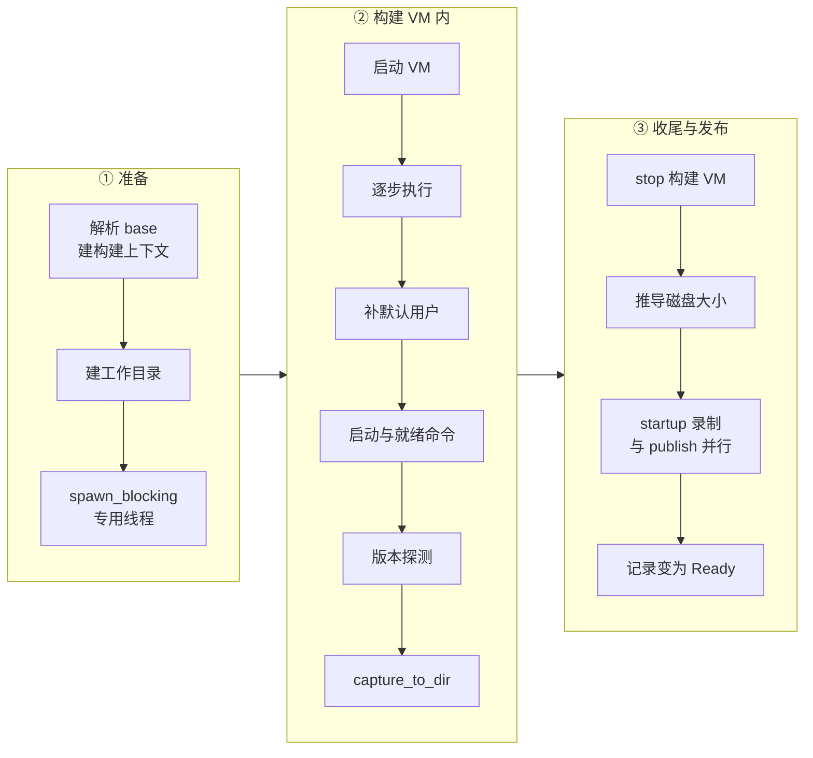

# 52 · 模板构建器

> 模板是一台「已经跑到就绪状态」的 VM 的快照：rootfs 上装好了软件，内存里启动命令已经在运行。
> AgentENV 用一台临时 microVM 逐条执行构建步骤，跑起启动命令、等就绪命令通过，然后把整台 VM 捕获下来、发布成一条模板记录。
> 本篇讲 `src/template/` 里这条流水线：两种起点、独立线程上的 runner、每一步在 guest 里怎样执行、发布与构建日志，以及「没有逐步缓存」这个选择的代价。
>
> **读者**：要构建模板或修改构建器的工程师。　**预备**：[第 15 篇 · 模板构建 API](15-template-build-api.md)、[第 27 篇 · 启动、暂停与恢复的 Firecracker 调用序列](27-start-pause-resume-sequences.md)、[第 28 篇 · MMDS 与 envd](28-mmds-and-envd.md)
> 　**代码**：`src/template/builder.rs`、`src/template/runner.rs`、`src/template/step_executor.rs`、`src/template/build_spec.rs`、`src/template/logs.rs`、`src/api/impls/template.rs`、`src/snapshot/types/version.rs`

---

## 0. 本篇要回答的问题

1. 从镜像构建与从已有模板构建，各自在什么约束下进行？为什么后者不能改 CPU 与内存？
2. 构建 VM 为什么跑在一个独立的 OS 线程与单线程 tokio runtime 上，而不经过 orchestrator？
3. RUN、ENV、WORKDIR、USER 等步骤分别在哪里生效？哪些进了 guest，哪些只改了记录？
4. 启动命令与就绪命令怎样执行？为什么步骤路径不再从 ENTRYPOINT / CMD 推导启动命令？
5. 构建日志怎样从 tracing 事件与进程输出汇集起来、写进快照仓库？
6. 整个构建只产生一个快照、没有逐步层缓存，这个选择换来了什么、付出了什么？

---

## 1. 问题：把一串命令变成一个可恢复的状态

Docker 式的构建把每条指令的结果做成一层文件系统差分，相同前缀的指令可以命中缓存。
这套模型针对的是「文件系统内容」；而 E2B 风格的模板还要求**进程状态**：启动命令（start command）在模板里已经跑着，
从模板创建沙箱时直接恢复内存，服务不必重新启动。文件系统差分装不下进程，只有 VM 快照装得下。

AgentENV 的选择是让整个构建都发生在一台 microVM 里：先把基础 rootfs 启动成 VM，在 guest 里依次执行步骤，
跑起启动命令，然后用与暂停相同的 `pause_to_dir()` 把内存、rootfs 增量与 VM 状态一次捕获下来（[第 27 篇 §6](27-start-pause-resume-sequences.md#6-capture-与-pause同一段代码四种收尾)）。
产物是**一个**快照：一个 rootfs 增量层压在基础镜像的层栈之上，加一份内存层与 vm_state。
步骤之间没有中间快照，也就没有可复用的中间结果。§7 讨论这个取舍。

API 怎样受理构建、记录怎样从 Waiting 走到 Building 在[第 15 篇](15-template-build-api.md)；本篇从后台任务调用 `TemplateBuilder` 开始。

---

## 2. 两个起点

`v2_templates_template_id_builds_build_id_post()`（`src/api/impls/template.rs`）的后台任务按 base 分两支：
镜像 base 先 `resolve_template_rootfs_image()` 把 OCI 镜像解析、转换成 overlaybd 层栈（[第 45 篇](45-oci-to-overlaybd.md)），
再调 `TemplateBuilder::build_and_publish_with_id()`；模板 base 先 `load_runnable()` 加载基础模板，再调 `build_from_snapshot_and_publish()`。
两者都先构造一个 `TemplateBuildContext`（`src/template/runner.rs`），再交给同一个 `execute_and_publish()`。

### 2.1 镜像 base：冷启动

`prepare_fresh_context()` 要求 spec 带 rootfs base，资源缺省取 `[machine]` 的 vCPU 与内存，初始命令上下文取镜像 config 解析出的 `base_context`
（环境变量、用户、工作目录、ENTRYPOINT / CMD）。`prepare_base_rootfs()` 只接受 `TemplateBuildRootfsBase::Overlaybd`，
检查 `image.json` 存在，按 `[ublk.overlaybd]` 的只读与可写层模式生成 `UblkConfig`。工作目录是系统临时目录下的 `snapshot-<id>-*`（`create_local_dir()`），
捕获产物写在这里，直到发布与 startup 录制结束。

`TemplateBuildRunner::build_template()` 随后用 `FirecrackerSandboxConfig::from_global_config_with_user_image()` 构造冷启动配置，
填入请求的 vCPU 与内存、集群 CPU 交集模板（`cpu_config_json`，来自 `TemplateBuilder::with_cpu_config()` 持有的共享值，[第 57 篇](57-heartbeat-and-cpu-intersection.md)）、
初始上下文里的环境变量、默认用户与默认工作目录。这里有一处与[第 26 篇 §5.2](26-sandbox-block-devices.md#52-可写层的模式) 相同的写法：
用户镜像配置写的是 `UpperMode::LogStructured`，但紧接着 `config.common.ublk_config` 被换成 builder 按全局配置生成的那份，实际可写层模式以全局配置为准。
tools 盘版本取节点当前解析出的版本（`resolved_tools_version()`）。

### 2.2 模板 base：从快照恢复

`prepare_snapshot_base_context()` 的约束都源于「构建 VM 是从基础模板的内存快照恢复出来的」：

| 约束 | 原因 |
|---|---|
| 目标 ID 不能等于基础模板 ID | 新构建是一条新记录 |
| 不能再指定 rootfs base | rootfs 来自基础快照 |
| 基础模板的虚拟化模式必须与本节点一致 | KVM 与 PVM 的快照不能互相恢复 |
| CPU 与内存不能改 | vCPU 数与内存大小固化在快照里，恢复时不能改 |
| 别名不继承 | 别名属于新记录 |
| 命令上下文继承基础模板 | 新步骤在旧上下文上叠加 |
| 启动命令未覆盖时继承基础模板 | 覆盖时若未给 shell，沿用基础模板的 shell |

`build_template_from_snapshot()` 用 `FirecrackerSandbox::from_snapshot(&base, &launch_config)` 构造构建 VM，tools 盘版本沿用基础快照记录的版本，
不像冷启动那样取节点当前版本（版本钉在快照上的理由见[第 26 篇 §7.3](26-sandbox-block-devices.md#73-版本钉在快照上)）。

CPU 与内存的检查有一个容易踩到的后果。`template_build_spec_from_start_request()`（`src/api/impls/template_helpers.rs`）**总是**把 Waiting 记录里的资源写进 spec，
而这份资源在 `POST /v3/templates` 时就已确定，客户端没给就是 `[machine]` 的缺省值（[第 15 篇 §3.1](15-template-build-api.md#31-时序)）。
推论：基础模板的规格只要不等于节点缺省值，客户端就必须在登记时显式给出相同的 `cpuCount` 与 `memoryMB`，否则构建在后台任务里以
`snapshot-based build cannot change CPU or memory` 失败，记录变为 Error。

---

## 3. runner 跑在哪里

`execute_and_publish()` 先经 `execute_in_background()` 把 `TemplateBuildRunner::execute()` 放进 `tokio::task::spawn_blocking`；
`run_template_build()` 在里面再用 `std::thread::spawn` 起一个专用线程，在线程里建一个 `new_current_thread()` 的 tokio runtime，`block_on` 整个构建，最后 `join`。

这样绕一圈，是因为 `SandboxExecutor` 是 `#[async_trait(?Send)]`（`src/sandbox/backend.rs`）：注释说明 `FirecrackerSandbox` 持有的 tonic 客户端不是 `Sync`，
所以 `run_command_with_opts()` 这类方法生成的 future 不是 `Send`。非 `Send` 的 future 不能交给多线程 runtime 的 `tokio::spawn`，
只能在单个线程上被驱动；专用线程 + 单线程 runtime 是最直接的办法，`spawn_blocking` 则保证主 runtime 的工作线程不被 `join` 阻塞。
测试 `template_execution_keeps_runtime_responsive_and_artifacts_alive`（`src/template/builder.rs`）在单线程测试 runtime 上锁定了后一点：构建运行期间，调用方的 runtime 仍能推进别的任务。
`spawn_with_trace_context()` 把当前 tracing span 与 dispatcher 带进新线程，§6 的日志截获依赖这一点。

构建 VM 不经过 orchestrator。`build_template()` 与 `build_template_from_snapshot()` 都用 `SandboxId::new()` 生成一个新 ID，直接构造 `FirecrackerSandbox`，
它不在 orchestrator 的 store 与句柄表里：没有 TTL，不参与自动驱逐，不计入 orchestrator 的沙箱计数与心跳里的沙箱名单（构建 ID 另行登记），进程关闭时也不在 pause 名单里。
API 层用 `register_template_build()` 登记的是构建 ID，只为路由与心跳服务（[第 15 篇 §3.1](15-template-build-api.md#31-时序)）。
扩展 hook 却照常触发：hook 挂在 `FirecrackerSandbox` 自己的启动与停止路径上（`CustomExtensionClient::global()` 存在即调用），镜像 base 触发 start-fresh、模板 base 触发 start-resume，构建结束的 `stop()` 触发 stop（[第 33 篇 §3](33-custom-extension-hooks.md#3-在生命周期里的位置)）。
扩展因此会看到一个 API 查不到、也不在心跳的沙箱名单里的 `sandboxId`（心跳里登记的是构建 ID）。
`SandboxLaunchConfig::new()` 不设出站策略、不设 envd 令牌，推论：构建 VM 按缺省策略放行公网，RUN 里的包管理器可以联网。

---

## 4. 构建 VM 里的流程

`run_template_build()` 把第 ② 列包在一个 async 块里；无论成败，块结束后都调 `sandbox.stop()`，运行错误与停止错误合并返回。

### 4.1 逐步执行

`TemplateStepExecutor::execute()`（`src/template/step_executor.rs`）按顺序处理 `TemplateBuildStep`，维护一个 `CommandContext`：

| 步骤 | 在哪里生效 | 做法 |
|---|---|---|
| `Run` | guest | 经 envd 执行 `/bin/bash -lc <cmd>`，cwd 与环境变量取当前上下文；退出码非零即失败 |
| `Workdir` | guest 与上下文 | 解析成规范化绝对路径，经 envd 文件服务 `create_dir_all()` 建目录，再写入上下文 |
| `Env` | 上下文 | 追加环境变量，后续 RUN 与最终模板都可见 |
| `User` | 上下文 | 记下用户 |
| `ExposedPort`、`Volume`、`Label` | 上下文 | 只进记录，不改 guest |

WORKDIR 不 exec `mkdir`，注释给的理由是 scratch、distroless 一类镜像可能根本没有用户态工具，而 Docker 自己创建 WORKDIR 时也不依赖镜像（[第 28 篇 §6](28-mmds-and-envd.md#6-executor宿主在-guest-里的手)）。
`resolve_workdir()` 只做词法规范化（处理 `.` 与 `..`），不访问文件系统。
RUN 则要求镜像里有 `/bin/bash`：一个只有 BusyBox `sh` 的镜像，第一条 RUN 就会失败。

失败原因里的 `step` 必须是从 1 开始的数字字符串。`execute()` 的注释说明，e2b 官方 SDK 把这个字段当作本地记录的步骤栈的下标来解析，
非数字会让 Python SDK 在抛出真正的构建错误之前就崩溃；所以消息里放指令文本，`step` 里放 `source_step`（一个客户端步骤展开成多个内部步骤时保留客户端编号）或位置序号。

USER 的语义需要特别说明。RUN 经 `SandboxExecutor::executor()` 拿到的 `Executor`（`src/sandbox/process.rs`）`root_user` 为假，只有 `with_root_user()` 才会让 envd 以 root 执行；`ProcessOpts` 只有环境变量、cwd、超时与输出回调，没有用户字段，
所以命令以 envd 的默认用户执行，即构建 VM 启动时 `/init` 设定的 `defaultUser`（[第 28 篇 §4.2](28-mmds-and-envd.md#42-init-的内容)），对镜像 base 来说就是镜像 config 里的 USER。
`User` 步骤只改上下文。推论：构建中途的 `USER foo` 不会让之后的 RUN 换成 `foo` 执行，这与 Dockerfile 的语义不同；
`foo` 只在模板发布后、从模板启动的沙箱里成为默认用户。

### 4.2 补默认用户

`ensure_default_user()` 处理一个兼容性问题：e2b SDK 假定模板的默认用户存在（`from_dockerfile` 在 Dockerfile 没写 USER 时会注入 `USER user`），
任意 OCI 镜像却不一定有这个账户，envd 解析不了默认用户时，之后每个文件系统调用都会失败。
函数对 `USER name[:group]` 里的组与账户分别调用 `ensure_entity()`：root、空值、纯数字跳过（数字 UID 由 envd 初始化时解析）；不像合法 Unix 名的值只告警。
它在 guest 里用 `/bin/sh -c` 跑一段脚本：已存在则退出 0；否则按镜像里有哪个工具 `exec useradd -m` / `groupadd`，或 `adduser -D` / `addgroup`；两者都没有则以约定的退出码 66 退出。
每条命令限时 60 s（`PROVISION_TIMEOUT`）。

结果分三类：退出 0 通过；66 只告警、构建继续（这类镜像在此功能出现之前就能构建，只是解析默认用户的 envd 调用会在运行时失败）；
其它非零退出码或执行器错误都让构建失败。注释的理由是：工具存在却失败，说明模板带着一个已知解析不了的默认身份，与其让每个 SDK 调用在运行时失败，不如在构建时失败。

### 4.3 启动命令与就绪命令

`prepare_startup()` 决定要不要跑启动命令：两者都空则不跑；只有启动命令时，就绪命令缺省为 `/agentenv/bin/busybox sleep 20`（`DEFAULT_READY_WITH_START_CMD`，注释说与 E2B 的缺省一致）；
请求覆盖了启动命令时，把最终的构建上下文作为启动命令的上下文。

`run_startup_commands()` 用 `start_process()` 后台启动启动命令（shell 与参数来自 `StartupCommand::shell_command()`），输出以步骤名 `finalize` 进日志；
再由 `run_ready_command_with_logs()` 每 2 s 跑一次就绪命令，直到退出 0 或 10 min 截止（`READY_TIMEOUT`）。每轮之前都检查启动命令：
已经以 0 退出就不再追踪，非零退出立即失败；就绪之后再检查一次。于是被捕获的是「启动命令正在运行、就绪命令刚刚通过」的那一刻。

`prepare_startup()` 里有一段被注释掉的代码：原本在请求没给启动命令时，用 `CommandContext::effective_start_cmd()` 把 ENTRYPOINT 与 CMD 拼成启动命令。
TODO 注释给出的原因是：启动命令经 `/bin/sh -c` 执行，s6-overlay 这类要求自己是 PID 1 的镜像会以「can only run as pid 1」失败。
BuildKit 路径的 `build_startup_commands()`（`src/api/impls/image_build.rs`）却仍然调用 `effective_start_cmd()` 推导启动命令（[第 53 篇](53-buildkit-in-microvm.md)）。
结果是同一份镜像经两条前端构建，模板里的启动命令不同，`aenv build` 仍会遇到 PID 1 的问题。

模板 base 还有一个推论层面的问题。基础模板捕获时启动命令就在内存里运行；请求没有覆盖启动命令时，`prepare_snapshot_base_context()` 继承基础模板的 `startup`，
`prepare_startup()` 原样返回它，`run_startup_commands()` 于是在已经跑着一份的 guest 里**再启动一份**。代码里没有跳过这一步的条件。
推论：对监听固定端口的服务，第二份会因端口占用退出，若退出码非零，构建失败；否则模板里会有两份进程。

### 4.4 版本探测与捕获

`SnapshotRuntimeVersions::probe()`（`src/snapshot/types/version.rs`）并发探测三项：guest 内核版本、宿主上 VMM 二进制的版本、guest 里 `envd --version` 的输出。
前两项失败记为 unknown；envd 探测失败则构建失败。连同 tools 盘版本，它们记进模板，供以后判断兼容（[第 46 篇](46-snapshot-object-model.md)）。

最后 `capture_to_dir(output_dir)` 把 VM 捕获到工作目录：与暂停走同一段 `pause_to_dir()`，但不恢复 VM（[第 27 篇 §6](27-start-pause-resume-sequences.md#6-capture-与-pause同一段代码四种收尾)）。
它返回 `SandboxSnapshotManifest` 与一个不透明的捕获载荷（其实是 `FirecrackerSnapshotConfig`），后者留给 startup 录制使用。

---

## 5. 发布

`execute_and_publish()` 拿到 `TemplateBuildExecution` 之后：

1. 把工作目录包进 `Arc`，作为租约同时交给发布流程与 startup 录制，谁后结束谁负责删除目录（测试 `startup_recording_retains_template_workspace_until_continuation_finishes`）。
2. 用 manifest 里 rootfs 的 `virtual_size` 向上取整到 MiB，写进资源的 `disk_size_mib`。
3. 把捕获载荷 downcast 成 `FirecrackerSnapshotConfig`，`record_startup_pack()` 在后台启动录制，使一次性的录制 VM 与层上传重叠（[第 43 篇](43-startup-pack-and-prefetch.md)）。
4. 调 `SnapshotManager::publish()`，`source` 为 `SnapshotPublishSource::Template`，带上最终命令上下文、启动命令、版本、虚拟化模式、镜像 config；
   `volume_snapshots` 为空；`custom_extension_params` 固定为 `None`，注释说明扩展参数是每台沙箱的用户设置，不是镜像内容，即使基础模板有也不传播。

发布成功即把 Waiting / Building 记录提交为 Ready（提交协议在[第 47 篇](47-posix-repository.md)、[第 48 篇](48-object-storage-repository.md)）。
任何一步失败，后台任务经 `mark_v2_build_error()` 标记 Error；`build_failure_reason()` 沿错误链找 `TemplateBuildFailure` 里带 `step` 的原因，找不到时用一条通用消息。

---

## 6. 构建日志

日志有两个来源，汇进同一个按构建 ID 索引的缓冲区（`src/template/logs.rs`）：

- **进程输出**：RUN、启动与就绪命令的 `ProcessOpts` 带输出回调，`BuildLogger::output()` 按行切分，stdout 记 Info、stderr 记 Warn，步骤字段是步骤序号或 `finalize`。
- **tracing 事件**：`src/logging.rs` 在全局 subscriber 上挂了 `BuildLogLayer`，只接收 `agentenv::` 目标、DEBUG 及以上的事件。
  层在 `on_new_span()` 里给带 `build_id` 字段的 span（以及它的子 span）打上标记；`on_event()` 沿事件的 span 链找到构建 ID，再到全局表 `ACTIVE_BUILD_LOGS` 里取对应缓冲区。
  构建任务的 span 带着 `build_id`，runner 线程又继承了这个 span，所以构建 VM 内部各模块的日志都会被归到这次构建。

缓冲区有三道上限：单条 16 KiB（超出截断并加 `[truncated]`）、总量 8 MiB、条数 32768。触及后者时追加一条 Warn「Build log limit reached; subsequent output is omitted」，之后的输出全部丢弃，提示只出现一次。
时间戳取 `max(now, 上一条)`，保证偏移顺序不因时钟调整或并发写入而乱。

`BuildLogs::start()` 起一个写入任务，每 1 s 检查一次：有新条目就把**完整列表**交给 `write_build_logs()`。POSIX 后端用临时文件加 rename 写 `snapshots/build-logs/<id>.json`，
OSS 后端用一次 put 覆盖同名 key，读者看到的总是某一时刻的完整日志。`finish()` 先封住缓冲区，再刷写一次，失败时每秒重试、至多三次，随后把缓冲区从两张表里移除。
每次刷写都重写整份日志，写入量随日志总量增长；8 MiB 的上限也限制了这一项。

---

## 7. 没有逐步缓存：取舍

整个构建是一台 VM 的连续运行，步骤之间不落快照，代价与收益都很直接：

- **代价**：改动任何一步都要从 base 重新跑完全部步骤；`force` 字段被接受但不读取，因为本来就没有可跳过的东西（[第 15 篇 §3.2](15-template-build-api.md#32-支持的步骤)）。
  并发构建之间也不共享中间结果。
- **收益**：每次构建只有一次启动、一次捕获，没有逐层暂停、上传、恢复的往返；产物只有一个 rootfs 增量层，模板的层栈不随步骤数变深；
  不需要设计缓存键，也就没有「本该失效却命中」的正确性问题。
- **另一条出路**：需要逐层缓存的用户可以走 Dockerfile 路径，由 builder VM 里的 BuildKit 用自己的缓存执行 Dockerfile，再把结果镜像交给本篇的构建器（[第 53 篇](53-buildkit-in-microvm.md)）。
  从已有模板构建（§2.2）也可以当作手工的「层」：把稳定的前半段做成基础模板，只重跑后半段，代价是不能改 CPU 与内存。

---

## 8. 技术债与边界

- **Ext4 base 是死代码**：`TemplateBuildRootfsBase::Ext4` 与 `TemplateBuildSpec::from_existing_rootfs()` 只有测试使用；生产路径进入 `prepare_base_rootfs()` 就报 `overlaybd-only publish mode does not support ext4 rootfs bases`。
- **两条前端的启动命令推导不一致**（§4.3）。
- **模板 base 的资源比较**：spec 总带着登记时的资源，与基础模板不同就失败（§2.2，推论）。
- **继承的启动命令被再启动一次**（§4.3，推论）。
- **USER 不影响后续 RUN**（§4.1，推论）。
- **构建 VM 游离于 orchestrator 之外**：进程关闭不会停止或等待它，记录停在 Building 的后果见[第 15 篇 §3.3](15-template-build-api.md#33-这条路径没有会话)；推论：SIGKILL 时这台 VM 的 Firecracker 进程与工作目录同样无人回收。
- **RUN 依赖 `/bin/bash`**，补默认用户与版本探测依赖 `sh`；只有 WORKDIR 不依赖镜像里的工具。

---

## 9. 与 e2b infra 的对照

e2b infra 把构建拆成若干阶段，每个阶段算一个层 hash，命中缓存就跳过，未命中的阶段各起一台沙箱、执行后暂停并上传，下一阶段从上一层的快照恢复（e2b 手册第 42、45 篇）；
它的 RUN 以上下文里当前的用户执行，USER 步骤会改变之后 RUN 的身份（e2b 手册第 44 篇）。AgentENV 在一台 VM 里跑完全部步骤、只捕获一次，省掉了逐层暂停与上传，代价是没有步骤级缓存，也没有逐步切换用户。

---

## 10. 小结

- 模板构建在一台临时 microVM 里完成：启动 → 逐步执行 → 补默认用户 → 启动与就绪命令 → 版本探测 → `capture_to_dir` → stop → 发布，整个构建只产生一个快照。
- 镜像 base 冷启动，可指定 CPU 与内存并带上集群 CPU 模板；模板 base 从基础模板的快照恢复，不能改 CPU 与内存、不能换 rootfs，继承命令上下文与启动命令，不继承别名与扩展参数。
- runner 跑在专用 OS 线程的单线程 runtime 上，因为 `SandboxExecutor` 的 future 不是 `Send`；外层用 `spawn_blocking` 等待它。
- 构建 VM 用自己生成的 ID，不进 orchestrator，没有 TTL 与关闭处理，但会触发扩展 hook。
- RUN 经 envd 以 `bash -lc` 执行，WORKDIR 经 envd 文件服务建目录，ENV、USER、EXPOSE、VOLUME、LABEL 只改上下文；RUN 的身份是构建 VM 启动时的默认用户。
- 启动命令在后台运行、就绪命令每 2 s 轮询、至多 10 min；被捕获的是服务已就绪的那一刻。
- 步骤路径不再从 ENTRYPOINT / CMD 推导启动命令，BuildKit 路径仍在推导，两条前端不一致。
- 发布时 startup 录制与层上传并行，工作目录由二者共享的租约保活；扩展参数一律不进模板。
- 构建日志由 tracing layer 与进程输出回调汇集，带三道上限，每秒整份重写一次，原子替换。

## 延伸阅读 / 下一篇

- [第 15 篇 · 模板构建 API](15-template-build-api.md)：受理、状态与日志接口。
- [第 43 篇 · startup pack 与预取](43-startup-pack-and-prefetch.md)：发布时并行进行的录制。
- [第 46 篇 · 快照对象模型](46-snapshot-object-model.md)：模板记录的字段与状态。
- [e2b 手册第 42 篇 · 阶段流水线](../e2b-infra/42-build-phases.md)、[e2b 手册第 45 篇 · 层与构建缓存](../e2b-infra/45-layers-and-build-cache.md)：e2b infra 的逐层构建与缓存。
- [e2b 手册第 44 篇 · 构建期沙箱与命令](../e2b-infra/44-build-sandbox-and-commands.md)：e2b infra 的 RUN 怎样按上下文用户执行。
- 下一篇：[第 53 篇 · BuildKit：在 microVM 里跑 Dockerfile](53-buildkit-in-microvm.md)。
