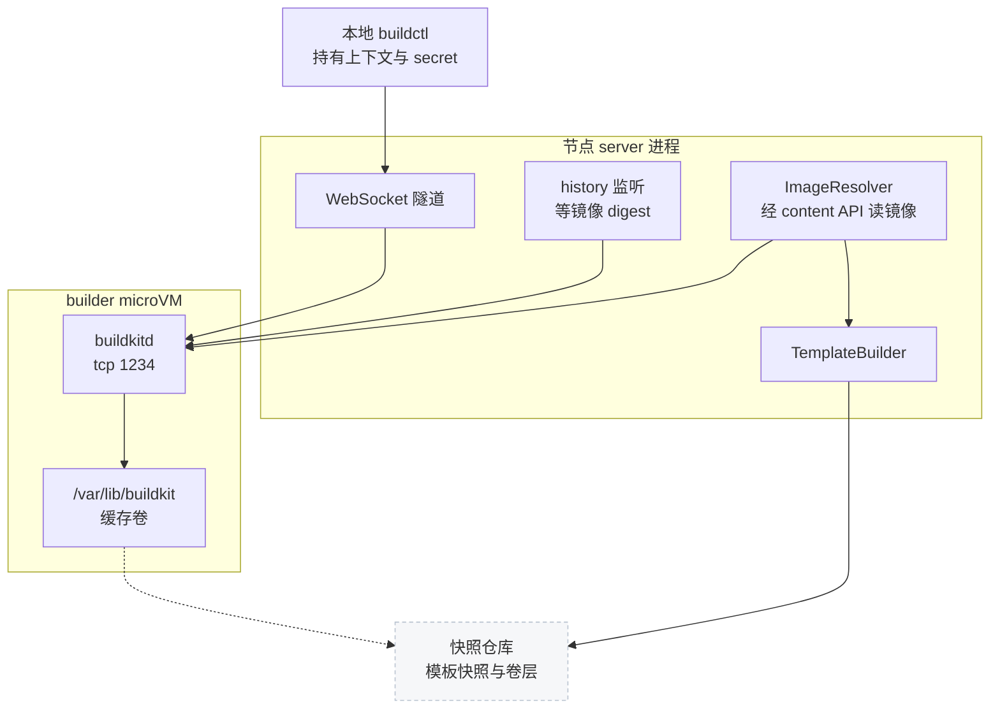
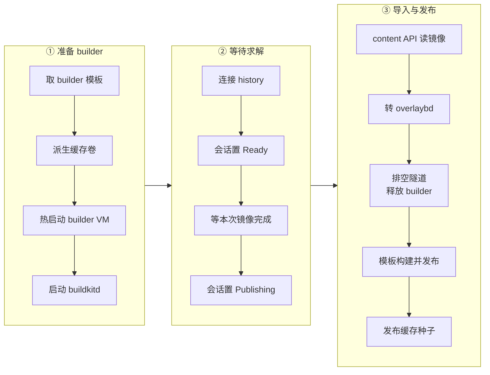
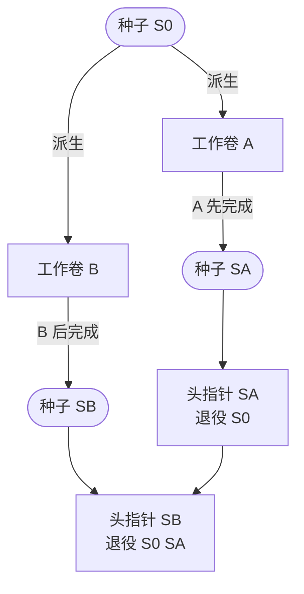

# 53 · BuildKit：在 microVM 里跑 Dockerfile

> Dockerfile 构建要执行用户写的任意 `RUN` 命令，还要在构建之间保留缓存；AgentENV 把 buildkitd 放进一台从快照热启动的 builder microVM，
> 把它的缓存目录做成一块在快照仓库里逐代传递的卷，构建产物经 BuildKit 的 content API 直接取走、转成 overlaybd，再走一次普通的模板构建。
> 本篇讲 builder 模板从哪里来、一次构建的数据怎样流动、缓存种子怎样在并发构建之间演进。API 与会话在第 15 篇，这里不重复。
>
> **读者**：工程师。　**预备**：[第 15 篇 · 模板构建 API](15-template-build-api.md#4-dockerfile-与-buildkit-路径)、[第 31 篇 · 附加盘与卷](31-extra-drives-and-volumes.md)、[第 45 篇 · 从 OCI 镜像到 overlaybd 层栈](45-oci-to-overlaybd.md)。
> **代码**：`src/api/impls/image_build.rs`、`src/api/impls/image_build/{worker,cache,cleanup}.rs`、`src/image/buildkit.rs`、`src/image/buildkit/history.rs`、`src/image/oci_image.rs`（`fetch_content_manifest`、`convert_content_image`）、`src/snapshot/repository/build_cache.rs`、`crates/aenv/src/commands/build.rs`

---

## 0. 本篇要回答的问题

1. 为什么 buildkitd 不跑在宿主上，而是跑在一台 microVM 里？这台 VM 为什么从快照热启动，而不是每次冷启动？
2. builder 模板的 alias 由哪些输入决定？它为什么放在快照仓库的私有命名空间里？两个节点同时首建会怎样？
3. 服务端怎样在 buildkitd 的历史记录里认出这一次构建，又怎样在不经过任何 registry 的情况下取走镜像？
4. 一次构建在 builder VM 之外还会再启动一台 VM，为什么？启动命令从哪里推导？
5. 构建缓存怎样从一次构建传到下一次？并发构建时谁的缓存留下来，旧缓存什么时候删除？

---

## 1. 问题：一个需要特权、需要记忆的构建器

Dockerfile 的语义由 BuildKit 实现：它解析 Dockerfile、在快照器上逐层执行 `RUN`、导出镜像。
把 buildkitd 直接放在宿主上有两个问题。第一，它要以 root 运行容器，而 `RUN` 里是用户写的任意命令；
宿主上的一个容器逃逸，影响的是整台节点和上面所有沙箱。第二，AgentENV 的节点是可替换的，多节点部署下每次构建可能落在不同节点上，
宿主本地目录里的 BuildKit 缓存在换节点后就失效了。

AgentENV 的回答分成三部分：

- **隔离**：buildkitd 跑在 builder microVM 里，和普通沙箱有同样的 guest 内核边界；`RUN` 的容器运行在这台 VM 内部。
- **记忆**：buildkitd 的根目录 `/var/lib/buildkit` 挂一块卷（[第 31 篇](31-extra-drives-and-volumes.md)）。卷的层存在快照仓库里，任何节点都能挂载；
  每次构建从上一次成功构建留下的「缓存种子」派生一块可写卷。
- **产物**：镜像不推送到 registry，留在 buildkitd 的 content store 里，由服务端经 BuildKit 的 gRPC 接口读出、转换成 overlaybd，
  再交给模板构建器（[第 52 篇](52-template-builder.md)）做成一份普通的模板快照。

代价有三处：每次构建至少启动两台 VM（builder 与最终的模板 VM）；缓存粒度是 BuildKit 自己的，不是可直接恢复的快照层；并发构建的缓存不合并（第 5 节）。

---

## 2. 组件与数据路径

下图把一次构建涉及的部件放在一起。`buildctl` 在用户本地运行，经 WebSocket 隧道连到 builder VM 里的 buildkitd（隧道与会话见[第 15 篇 §4](15-template-build-api.md#4-dockerfile-与-buildkit-路径)）；
服务端另开两条 gRPC 连接：一条监听构建历史，一条读取 content store。



`crates/aenv/src/commands/build.rs` 拉起本地 `buildctl` 时用的参数决定了产物去向：
`--frontend dockerfile.v0`，构建上下文与 Dockerfile 目录都以 `--local` 交给 BuildKit 的会话协议，
输出是 `--output type=image,name={image_name},oci-mediatypes=true`。没有 `push=true`，所以镜像只写进 buildkitd 的 content store。
`image_name` 是服务端在受理时返回的 `aenv-build:{build_id}`（`src/image/buildkit/history.rs` 的 `build_image_name()`），后面靠它认领构建记录。

buildkitd 的启动参数在 `image_build/worker.rs` 的 `START_BUILDKIT` 脚本里：`--root /var/lib/buildkit`、监听 `tcp://0.0.0.0:1234`、
只开 OCI worker（`--containerd-worker=false`），并且 `--oci-worker-net host`，即 `RUN` 容器直接用 VM 的网络栈。
VM 本身就是隔离边界，这里省掉容器内的网络命名空间，换来更简单的出站路径。

---

## 3. builder 模板

### 3.1 alias 由什么决定

builder VM 不是从镜像冷启动的，而是从一份事先构建好的「builder 模板」快照恢复。
`worker.rs` 的 `initialize_builder_template()` 先算 alias：

```rust
let inputs = serde_json::to_vec(&(
    1,
    &builder.builder_image,
    builder.builder_cpu_count,
    builder.builder_memory_mb,
    BUILDER_READY,
    config.virtualization_mode,
))?;
let alias = format!("builder-{:x}", Sha256::digest(inputs));
```

元组里的六项分别是格式版本、builder 镜像（`[template_build] builder_image`，缺省 `docker.io/moby/buildkit:v0.33.0`）、
CPU 数（缺省 16）、内存（缺省 32768 MiB）、就绪命令 `BUILDER_READY` 与虚拟化模式。凡是会改变快照内容或者让快照无法恢复的输入都在里面：
换镜像、改规格、在 KVM 与 PVM 之间切换，都会得到新的 alias，从而构建一份新的 builder 模板。
alias 是内容寻址的，所以它也是跨节点的协调键：哪个节点先发布，其它节点就直接复用。

推论：私有命名空间没有回收路径，改配置之后旧的 builder 模板一直留在仓库里。

### 3.2 私有命名空间

`src/snapshot/repository/backends/mod.rs` 的 `build_builder_snapshot_backend()` 用同一套持久后端，但改写了位置：
POSIX 后端的 `snapshot_store` 下加一级 `template-build/builder`，OSS 后端的前缀后面追加同样的路径，本地制品缓存也分开一个子目录，
并且不传 P2P transport。函数注释说明了目的：builder 有自己的 catalog，不能经公共模板 API 列出或删除。
用户模板与内部 builder 因此不会重名，`GET /templates` 也看不到它们。

### 3.3 首建与并发首建

`builder_template()` 把初始化放进 `BuildSessions` 里的一个 `tokio::sync::OnceCell`，再在 `tokio::spawn` 出的任务里调用 `get_or_try_init()`。
spawn 的理由写在注释里：一个被取消的请求不能取消其它构建共享的初始化。`OnceCell` 只在成功时记住结果，失败后的下一次构建会重新尝试。

初始化先用私有 catalog 的 `SnapshotManager::load_runnable(&alias)` 查找；找不到就 `image_resolver.resolve(builder_image)` 把 builder 镜像转成 overlaybd，
然后构造一个 `TemplateBuildSpec`：以 root 运行、启动 shell 为 `/bin/sh`、就绪命令为

```text
command -v buildkitd && command -v buildctl && mkdir -p /var/lib/buildkit /run/aenv-buildkit
```

再交给 `TemplateBuilder::build_and_publish()`。就绪命令只检查二进制存在并建好目录，**不启动** buildkitd。
原因在于缓存卷要等 VM 恢复之后才挂上 `/var/lib/buildkit`（新卷在 load 之后热插，见[第 31 篇](31-extra-drives-and-volumes.md)），
buildkitd 必须在那之后启动才会把状态写进卷里。推论：步骤路径不从 ENTRYPOINT 推导启动命令（[第 52 篇](52-template-builder.md)），
这恰好让 moby/buildkit 镜像的 ENTRYPOINT 不会在模板构建时把 buildkitd 跑起来并冻结进快照。

两个节点可能同时为第一次构建准备 builder 模板。发布时后到的一方会在提交 alias 时得到 `RepositoryError::AliasConflict`；
`initialize_builder_template()` 沿错误链查找这个变体，找到就当作对方已经赢了，转而 `load_runnable(&alias)` 加载对方的快照。
这是一个乐观并发：两边都可能完整做一遍镜像转换与 VM 构建，只是输的一方的结果被丢弃。判定输赢的强度取决于后端。
POSIX 后端在 alias 锁内完成检查、写 alias 与写 record（[第 47 篇 §5](47-posix-repository.md#5-锁按名字加不设全局锁)），后到者一定得到 `AliasConflict`。
对象存储后端的 `bind_alias()` 是无锁的读-写-回读，用「alias 指向的记录是否存在」判断陈旧；而 builder 模板由 `build_and_publish()` 生成新 id 直接发布，
事先没有 Waiting 记录，恰好落在[第 48 篇 §6.1](48-object-storage-repository.md#61-alias读-写-回读) 描述的窗口里。
推论：两个节点可能都发布成功、各用自己的快照，alias 只指向其中一个，另一条记录无人引用也不回收；
并发的 `load_runnable(&alias)` 还可能把正在提交的 alias 当作陈旧删掉，下一次构建再首建一遍。
两份快照输入相同、功能等价，只带来重复工作与仓库残留。

---

## 4. 一次构建的阶段

受理之后（预留名额、`try_start_build()`、写 journal，见[第 15 篇](15-template-build-api.md#4-dockerfile-与-buildkit-路径)），
后台任务 `run_image_build()` 依次完成三个阶段。`try_start_build()` 排除别的节点重复启动同一构建，这只在 POSIX 仓库上成立（record 锁内检查 Waiting）；
OSS 上它是普通读改写，两个节点可能都写成 Building、各起一台 builder（推论，[第 48 篇 §6.2](48-object-storage-repository.md#62-模板状态普通的读改写)）。



前两个阶段在 `wait_for_image_build()` 里，受同一个截止时间（请求 `timeout`，缺省 3600 s）与会话的取消信号约束；
第三阶段的镜像导入另有 3600 s 上限，之后的步骤只受 builder 沙箱自身 TTL 的兜底约束。

### 4.1 热启动 builder VM

`prepare_builder()` 先调 `fork_build_cache()` 得到这次构建的缓存卷（第 5 节），用 `resolve_volume_mounts()` 把它预留并挂到 `/var/lib/buildkit`，
再调 orchestrator 的 `create_template_builder()`。请求的要点：

| 字段 | 取值 | 含义 |
|---|---|---|
| `source` | builder 模板快照 | 从快照恢复，不是冷启动 |
| 沙箱 ID | 构建 ID | 心跳上报与 gateway 路由都用它 |
| `timeout` / `timeout_action` | 请求 `timeout` + 3900 s / Delete | 构建任务失控时的兜底 |
| `secure` / `allow_public_traffic` | true / false | envd 要 token，入口私有 |
| `volume_mounts` | 缓存卷 → `/var/lib/buildkit` | 恢复后热插 |

出站策略用缺省值，`RUN apt-get` 之类的命令可以访问外网。准备完成后，服务端用 `proxy_lookup_for()` 取到 VM 的 IP，
构造一个经 envd 下发命令的 `Executor`，在 90 s 上限内执行 `START_BUILDKIT`：后台拉起 buildkitd，最多 60 次、每秒一次用 `buildctl debug workers` 探测，
进程提前退出就把日志打到 stderr 并失败。

`prepare_builder()` 在 spawn 出的任务里执行，并持有会话的 `cleanup` 互斥锁：即使调用方此时取消，缓存卷也要挂完；
清理流程在同一把锁上等待之后才删除 worker、释放卷，不会出现「卷已被清理、VM 还在挂它」的中间态。

### 4.2 在 history 里认出自己

`BuildkitHistory::wait_for_image()` 调 BuildKit Control 服务的 `ListenBuildHistory`。这个流会先**重放**已经完成的记录，再推送实时事件。
重放是必要的：服务端连接时，用户的求解可能已经提交甚至完成。
但重放也带来一个陷阱：缓存卷是从种子派生的，buildkitd 的历史记录也存在 `/var/lib/buildkit` 里，所以流里会出现**以前构建**的记录。

认领规则因此不能是「第一条完成的记录」，而是看导出器：记录的 `exporters` 中有一个 `type == "image"` 且 `attrs["name"]` 等于 `aenv-build:{build_id}`。
构建 ID 每次不同，旧记录不会匹配。`completed_image()` 只处理事件类型为 COMPLETE 的记录：记录带非零错误码就让构建失败；
否则按该导出器在列表中的下标，到 `record.result.results` 里取导出的描述符。注释特意说明不能依赖 `ExporterResponse` 里的 `containerimage.digest`，
因为那是前端元数据，不保证存在。取到的 digest 必须是小写的 `sha256:` 加 64 位十六进制（`validate_digest()`）。

流断开时，只有 `Unavailable`、`Cancelled`、`DeadlineExceeded` 三种状态码会在 250 ms 后重连，其余错误直接返回；重连次数不设上限，由外层的截止时间与取消信号兜底。
认出记录后，`collect_status()` 另开一个 `Status` 流把顶点进度与进程输出写进构建日志。重连后状态会被重放，
它用（顶点、时间戳、流、消息 SHA-256）的出现次数去重，既不重复写日志，也不吞掉内容相同的多行输出；去重表与顶点表各有 32768 项的上限，防止一个巨大的构建撑爆内存。

### 4.3 经 content API 取镜像

拿到 digest 后，`BuildkitContent::connect()` 连同一个端口上的 containerd content 服务（`src/image/content.proto`），
`ImageResolver::resolve_buildkit()` 经它读出镜像。读取只用 `Read` 这一个 RPC，每次读都做三项检查：
分块的 offset 必须连续，累计字节不得超过上限，结束时整体 SHA-256 必须等于请求的 digest。manifest 与 config 这类元数据上限 4 MiB，
单层上限 64 GiB（`MAX_METADATA_BYTES`、`MAX_IMAGE_BYTES`）。

`oci_image.rs` 的 `fetch_content_manifest()` 在此之上做镜像级校验：遇到 index 就按宿主架构选子 manifest；
manifest 必须是标准 OCI 层（不接受 overlaybd-native），层数不超过 1024、压缩后总大小不超过 64 GiB，每层 digest 合法；
config 的 `os` 与 `architecture` 必须是 linux 与宿主架构。

builder VM 运行着用户代码，content store 里的字节不可信；digest 校验保证服务端拿到的就是历史记录里声明的那个镜像。
推论：历史记录本身也来自 VM 内部，被攻破的 VM 可以声明任意镜像；这不会越权，因为产出的模板本来就属于发起构建的用户。

### 4.4 只转缺失的层

`resolve_buildkit()` 要求 `convert_standard_oci` 开启，然后复用第 45 篇的本地 image-cache：
先按 manifest digest 查整份镜像是否已有转换结果，命中就直接返回；否则进入与 registry 路径共用的逐层流水线 `convert_standard_oci_layers_pipeline_inner()`。
流水线对每一层先按链式的 `LayerConversionKey` 查已转换的层（[第 45 篇](45-oci-to-overlaybd.md)），只有未命中时才调用生产者取 blob。
这里的生产者是 `ContentLayerSource`，它的 `wait_layer_blob()` 从 content store 下载这一层。

所以重复构建时，没有变化的基础层既不会从 VM 里读出来，也不会再转换一次；只有 Dockerfile 改动之后产生的新层要走一遍下载与 `overlaybd-apply`。

### 4.5 释放 builder，再做一次模板构建

镜像导入完成后，`run_image_build()` 最多等 10 s 拿隧道的写锁（排空，见第 15 篇），然后 `release_builder()`：

1. 经 envd 执行 `STOP_BUILDKIT`（40 s 上限）：发 SIGTERM，最多等 30 s 进程退出或变成僵尸。成功才把 `cache_ready` 置为 true。
2. `delete_sandbox()` 删除 builder VM。删除是卷内容进入仓库的提交点（[第 21 篇](21-deletion-and-volume-capture.md#1-问题删除是卷的提交点)），缓存卷在这里被冻结、封存并发布。
   builder VM 的内存与 rootfs 不保存。
3. 卷状态回到 Ready 才最终认定 `cache_ready`；最后 `release_cache_lease()` 解除构建 ID 对工作卷的持有。对父种子的只读租约要到清理阶段才释放（5.5 节）。

buildkitd 先正常退出、再冻结文件系统，是为了让缓存卷里的元数据一致；停止失败时保留上一个种子。

接着服务端用导入得到的 overlaybd 镜像构造 `TemplateBuildSpec`：alias 与 CPU、内存来自模板记录，`with_resolved_overlaybd_image()` 指向转换结果，
命令上下文来自镜像 config 的环境变量、工作目录与用户，然后调 `build_and_publish_with_id()`，以构建 ID 作为快照 ID 发布。
这一步会从镜像冷启动一台新的 VM，执行启动与就绪命令后捕获（[第 52 篇](52-template-builder.md)）。
产物里只有最终镜像的文件系统与 config，Dockerfile 的中间 stage 与 build-arg 不进入模板。builder VM 在这台 VM 启动之前已经删除，
推论：一次构建在任一时刻只占一台 VM 的资源，代价是 builder 的规格（缺省 16 CPU、32 GiB）与最终模板的规格是两套配置。

### 4.6 启动命令的推导

`build_startup_commands()` 决定模板的启动与就绪命令：

- 启动命令：请求的 `startCmd`，否则 `CommandContext::effective_start_cmd()`，即镜像的 ENTRYPOINT 与 CMD 逐项 shell 转义后拼接。
- 就绪命令：请求的 `readyCmd`，否则 `dockerfile_ready_command()` 从镜像 config 的 `Healthcheck.Test` 推导。
  `CMD-SHELL` 形式用镜像的 `Shell`（缺省 `/bin/sh -c`）包裹；`CMD` 形式直接使用参数；`NONE` 或空表示没有就绪命令；其它形式报错。

回顾：步骤路径已禁用这一推导，因为启动命令经 `/bin/sh -c` 执行，要求自己是 PID 1 的镜像会失败（[第 52 篇 §4.3](52-template-builder.md#43-启动命令与就绪命令)）。
BuildKit 路径没有同步这一改动。推论：`aenv build` 构建这类镜像时，未显式给 `startCmd` 就会在模板构建阶段失败；这处不一致汇总在[第 68 篇](68-known-issues-and-debt.md)。

---

## 5. 缓存种子

### 5.1 种子、工作卷与仓库里的头指针

缓存由三类对象组成：

| 对象 | 名字 | 模式 | 生命周期 |
|---|---|---|---|
| 种子 | `aenv-buildkit-seed-{build_id}` | ReadOnly | 成为头指针后被后续构建派生；被替换后退役 |
| 工作卷 | `aenv-buildkit-work-{build_id}` | Exclusive | 一次构建独占，构建结束后删除 |
| 头指针 | 仓库内 `template-build/cache-head.json` | — | `BuildCacheState { current, retired }` |

头指针与卷目录一样存在快照仓库里，不属于任何节点或模板（`SnapshotRepository::get_build_cache_head()` 的注释），所以集群里所有节点共享同一条种子链。

### 5.2 派生

`cache.rs` 的 `fork_build_cache()`：

1. 读头指针。读失败只打 warn，按空缓存继续。
2. 有种子时，先把它作为 `parent` 写进本地 journal，再做派生；这样崩溃之后清理流程知道要释放哪个租约。
3. 校验种子是 ReadOnly 且大小等于当前的 `cache_size_mb`（缺省 65536 MiB）。不匹配说明配置改过，种子与当前 builder 不兼容。
4. `VolumeManager::reserve(&seed, id)` 给种子加一个只读挂载者，作为这次构建的租约；然后 `create_build_cache()` 以种子为父创建独占的工作卷。
   函数注释说明它不会先发布父卷未改变的 backing。
5. 任何一步失败都退回空缓存：释放租约、把 journal 里的 `parent` 清掉，创建一块无父的工作卷。

缓存的任何故障都不让构建失败，只让它变慢。

### 5.3 发布与替换

模板发布成功、且 `cache_ready` 为真时，`publish_build_cache()` 才执行：要求工作卷是 Ready 且已无人预留，
以它为源创建一块 ReadOnly 的种子卷，再调 `replace_build_cache_head(&seed.id)`。`BuildCacheState::replace()` 把新种子放进 `current`，
把旧的 `current` 放进 `retired`，并拒绝把已退役的 ID 再次设为头。这一步失败只打 warn，构建仍算成功，头指针保持旧值。

模板记录在缓存发布之前就已是 Ready；status 接口在会话仍处于 Publishing 时报 Building（第 15 篇），让顺序执行的下一次构建拿到新种子。

并发构建的结果是线性的「最后成功者胜出」。下图中两次构建 A、B 都从种子 S0 派生，A 先完成：



B 的工作卷派生自 S0，不含 A 写入的缓存；B 成为头之后，A 的缓存随 SA 一起退役。缓存内容不合并，因为两块卷是同一父卷的两个独立分支，
把 BuildKit 的元数据库合并成一份在块层面没有可行的做法。代价是并发构建会互相丢掉对方新增的缓存。

### 5.4 头指针的条件写

`replace_build_cache_head()` 与 `forget_retired_build_cache()` 都是「读、改、写」，两种后端各自保证原子性：

- POSIX：`posixfs/catalog.rs` 的 `update_build_cache()` 先取名为 `aenv-buildkit-cache-head` 的卷 alias 锁（`flock`），再用临时文件加 rename 写回。
- OSS：`oss/repository.rs` 的 `update_build_cache()` 用 ETag 做条件写：读出时带 ETag，写回时 `put_bytes_conditionally()` 带 `if-match`（对象不存在时是 `if-none-match`），
  失败就重读重试，最多 `MAX_VOLUME_CAS_ATTEMPTS` 次；读不到 ETag 直接拒绝。

这与 OSS 上 `try_start_build()` 的普通读改写（§4）不同：头指针用真正的条件写，并发发布不会覆盖对方的退役记录，否则被覆盖的旧种子会永远留在仓库里。

### 5.5 退役与回收

退役的种子不能马上删：还在运行的构建可能正从它派生，持着它的只读租约。`collect_build_cache()` 的规则是：
卷不存在视为已回收；卷正是当前头指针则跳过；否则尝试删除，`VolumeError::Reserved`（还有租约）返回「暂不能删」。
`collect_retired_build_caches()` 遍历 `retired`，删成功才调 `forget_retired_build_cache()` 从集合里移除。
它在启动时的 `recover_image_builds()` 末尾运行，之后随每 30 s 一次的清理扫描运行（[第 15 篇 §4.6](15-template-build-api.md#46-崩溃恢复)）。

每次构建结束的 `cleanup_build_cache()` 再做三件事：释放对父种子的租约并尝试回收它；回收本构建名下的种子 `aenv-buildkit-seed-{id}`
（若它已是头则跳过，若替换头指针失败它就是一块孤儿种子，在这里被删）；删除工作卷。种子是从工作卷克隆出来的，引用的是仓库里同一批层，删工作卷不影响种子。

这里删除的是卷记录与本地数据；卷引用的 managed 层在仓库里不会被回收（[第 47 篇](47-posix-repository.md)）。
推论：每一代种子新增的层都永久留在仓库里，频繁构建会让仓库持续增长。

---

## 6. 失败与取消的边界

取消、超时与重启恢复的流程在第 15 篇；本篇数据流上的失败点与后果如下：

| 失败点 | 后果 | 缓存 |
|---|---|---|
| builder 模板准备失败 | 构建失败，下次构建重试初始化 | 无影响 |
| 种子不可用或不兼容 | 构建继续 | 本次从空缓存开始 |
| 求解超时、被取消、BuildKit 报错 | 构建失败，清理释放 builder | 工作卷被删，头不变 |
| 导入超过 3600 s 或校验失败 | 构建失败 | 同上 |
| `STOP_BUILDKIT` 失败 | 构建可以成功 | 不发布新种子 |
| 模板发布失败 | 构建失败 | 不发布新种子 |
| 头指针替换失败 | 构建成功 | 孤儿种子在清理时删除 |

所有路径最终都汇入 `retry_image_build_cleanup()`：标记记录、`release_builder()`、`cleanup_build_cache()`、删 journal。
任何一步失败 journal 都保留，下一轮扫描再试。builder 沙箱自己的 TTL（请求 `timeout` + 3900 s，到期删除）是这些机制都失效时的最后一道兜底。

---

## 7. 与 e2b infra 的对照

e2b infra 自己解释构建步骤，在构建沙箱里逐步执行，每一层都是一次 pause 产出的快照差分，层缓存的键由该层的输入计算（见 e2b 手册第 41、45 篇）。
AgentENV 把 Dockerfile 语义整个交给 microVM 里的 BuildKit，构建只产出一份模板快照，缓存是 BuildKit 自己的、以一块卷的形式在仓库里传递。
代价是缓存命中只能省下 BuildKit 内部的工作，省不掉最终模板 VM 的启动与捕获，而且每次构建要多启动一台 builder VM。

---

## 8. 小结

- buildkitd 跑在从快照热启动的 builder microVM 里，`RUN` 容器用 VM 的网络（`--oci-worker-net host`），隔离边界是 VM 本身。
- builder 模板的 alias 是镜像、规格、就绪命令与虚拟化模式的 SHA-256；放在 `template-build/builder` 私有命名空间，公共模板 API 看不到；旧配置的 builder 模板不回收。
- 并发首建靠 alias 提交的 `AliasConflict` 判输赢，输的一方复用赢家的快照；这只在 POSIX 后端严格成立，对象存储后端可能两方都发布成功（推论），代价是重复工作与孤儿 builder 记录。进程内用 `OnceCell` 共享初始化，且不随单个请求取消。
- builder 模板不运行 buildkitd，buildkitd 在缓存卷热插到 `/var/lib/buildkit` 之后才启动。
- 服务端按导出器名 `aenv-build:{build_id}` 在重放的 history 里认领记录，按导出器下标取镜像 digest；缓存种子里的旧历史因此不会被误认。
- 镜像经 containerd content API 逐块校验 offset、上限与 SHA-256 后读出，不经 registry；只有未命中转换缓存的层才会被下载与转换。
- builder 在最终模板 VM 启动前就被删除；删除即缓存卷的提交点，buildkitd 正常退出才允许发布新种子。
- 启动命令在这条路径上仍从 ENTRYPOINT / CMD 推导，与步骤路径不一致；就绪命令从 HEALTHCHECK 推导。
- 缓存种子是仓库里的一条线性链：头指针用 flock 或 ETag 条件写替换，并发构建不合并、最后成功者胜出；退役种子等所有租约释放后才删除。
- 缓存相关的任何失败只让构建退回空缓存或保留旧种子，不让构建失败；managed 层不回收使仓库随种子代数增长。

---

## 延伸阅读 / 下一篇

- [第 15 篇 · 模板构建 API](15-template-build-api.md)：受理、会话状态、隧道、取消与崩溃恢复。
- [第 21 篇 · 删除与卷的捕获提交](21-deletion-and-volume-capture.md)：builder 删除时缓存卷怎样被冻结与发布。
- [第 45 篇 · 从 OCI 镜像到 overlaybd 层栈](45-oci-to-overlaybd.md)：逐层转换流水线与转换缓存。
- [第 52 篇 · 模板构建器](52-template-builder.md)：最终模板 VM 里发生的事。
- [e2b 手册第 41 篇 · 构建总览](../e2b-infra/41-template-build-overview.md)、[e2b 手册第 45 篇 · 层与构建缓存](../e2b-infra/45-layers-and-build-cache.md)：e2b infra 的逐层构建与缓存键。
- 下一篇：[第 54 篇 · 控制面总览与 proto 契约](54-control-plane-overview.md)。
