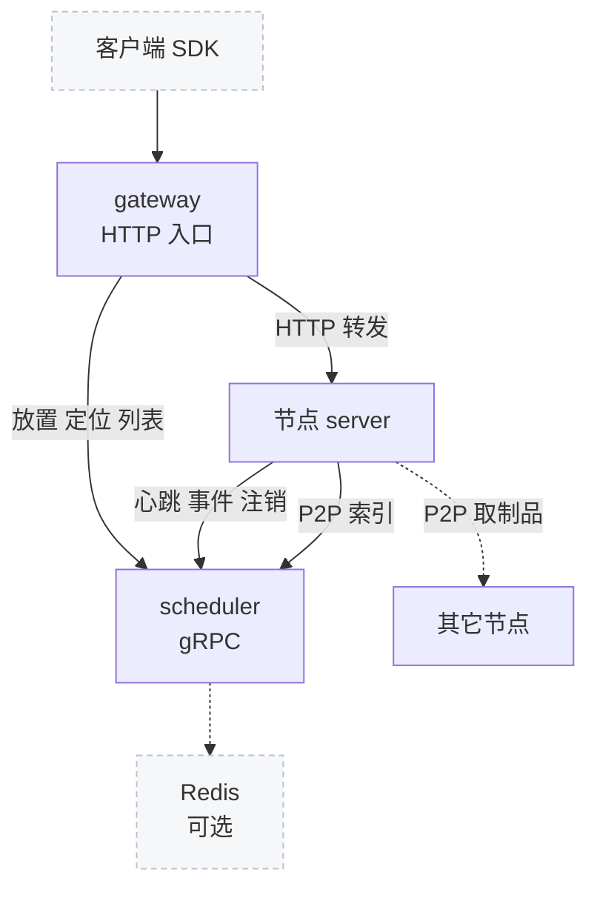

# 54 · 控制面总览与 proto 契约

> 一台节点自己就是一个完整的 AgentENV：API、orchestrator、反向代理都在同一个 `server` 进程里。
> 节点变成多台之后，才需要回答「新沙箱放到哪里」「沙箱 X 在哪台节点上」「别的节点有没有我要的制品」这三个问题，控制面就是为它们而设的。
> 本篇讲控制面的三个角色、它们之间唯一的契约 `scheduler.proto` 里的 13 个 RPC，以及契约之外那些只靠约定维持的耦合。gateway 与 scheduler 的内部在第 55–57 篇。
>
> **读者**：工程师、运维。　**预备**：[第 08 篇 · 系统架构](08-system-architecture.md#4-多节点gateway-与-scheduler)。
> **代码**：`services/api/proto/scheduler.proto`、`build.rs`、`src/proto.rs`、`services/Makefile`、`services/README.md`、`services/scheduler/internal/service.go`、`services/scheduler/cmd/main.go`、`services/gateway/internal/server.go`、`services/gateway/internal/schedule_hint.go`

---

## 0. 本篇要回答的问题

1. 为什么单节点部署不需要 gateway 与 scheduler？加上它们之后，节点本身改变了什么？
2. 三个角色之间谁调用谁？为什么 scheduler 从不主动调用节点？
3. `scheduler.proto` 的 13 个 RPC 怎样分组，每一组由谁调用、在 scheduler 里落到什么状态上？
4. 节点状态是怎样推导的？proto 注释里的推导表与实现一致吗？
5. 这份 proto 在 Go 与 Rust 两侧怎样生成代码，两侧的不对称带来什么风险？
6. 哪些跨进程的约定不在 proto 里，改动时容易漏掉？

---

## 1. 问题：一台节点什么都不缺

单节点部署时，客户端直接访问节点的 `:8000`。创建请求由本节点的 orchestrator 处理，沙箱 ID 到 VM 的映射在本节点内存里（[第 10 篇](10-node-process-and-object-model.md)），
数据面请求由本节点的反向代理按这张表转发（[第 17 篇](17-reverse-proxy.md)）。没有任何东西需要在进程之外协调。
相应地，节点与控制面相关的配置缺省全是关闭的：`config/default.toml` 里 `[cluster] scheduler_endpoint` 被注释掉，
`[observability.scheduler_report] enabled = false`，`[p2p] enabled = false`。`src/observability/reporter.rs` 的 `ReporterConfig::resolve()`
在开关关闭，或开关打开但没有配置 scheduler 地址时返回 `None`，心跳循环根本不会启动。

把节点扩成多台，客户端仍希望面对一个地址、一套 E2B 兼容的 API。这时出现三个单节点没有的问题：

- **放置**：一个 `POST /sandboxes` 应该交给哪台节点？
- **定位**：之后对沙箱 X 的 pause、connect 或数据面流量，要送到创建它的那台节点；沙箱的内存状态与暂停产物都不会自己迁移（[第 08 篇 §5](08-system-architecture.md#5-存储拓扑什么是真相)）。
- **共享**：一个节点要冷启动某个快照，而另一个节点本地已经有它的制品，能不能直接从邻居取？

AgentENV 把前两个问题交给 scheduler 的绑定表与放置算法，把第三个交给 scheduler 里的 P2P 索引，把 HTTP 入口交给无状态的 gateway。
节点的 API 本身不变：gateway 转发给节点的仍是同一份 `src/api/openapi.yml` 里的请求，节点并不区分请求来自客户端还是 gateway。
节点多出来的只有一个主动发起的 gRPC 客户端。

---

## 2. 三个角色与调用方向

下图标出控制面里所有的调用。箭头从调用方指向被调用方，边上写的是用到的 RPC 或协议。

三点值得注意。

**scheduler 是被动的。** 它只实现 gRPC 服务端，从不调用节点。它知道的一切都来自两类输入：发现（静态配置里的节点列表，或 Kubernetes 的 EndpointSlice，见[第 56 篇](56-scheduler.md)）
与节点每隔 `interval_secs`（缺省 5 s）发来的心跳。节点资源、沙箱名单、P2P 端点、CPU 配置都是节点**推**上来的。
这样 scheduler 不需要维护到每个节点的连接，也不需要知道节点的 HTTP API；代价是它的视图最多落后一个心跳周期，节点失联只能靠超时发现。

**gateway 不碰节点的 gRPC，也不碰 P2P。** gateway 调用的六个 RPC 全是放置、定位与观测，P2P 四个 RPC 只有节点调用。

**节点之间只有 P2P 一条直连。** 节点不知道彼此的存在，除非 P2P 打开、并经 scheduler 的 `ListP2pPeers` 或 `LookupP2pArtifact` 拿到对端地址（[第 58 篇](58-p2p-artifact-transport.md)）。

---

## 3. 13 个 RPC

### 3.1 分组

`scheduler.proto` 只定义一个服务 `scheduler.v1.Scheduler`。按用途分成五组：

| 组 | RPC | 调用方 | 落到 scheduler 的什么状态 |
|---|---|---|---|
| 调度与发现 | `Schedule`、`ListNodes` | gateway | 发现列表 + 最近心跳快照；`ListNodes` 含下线中的节点 |
| 绑定 | `LookupNode`、`RecordAssignment` | gateway | 绑定表（内存或 Redis） |
| 观测 | `Heartbeat`、`ReportSandboxEvent` | 节点 | 观测记录、绑定表、CPU 交集 |
| 观测查询 | `ListObservedNodes`、`GetNode` | gateway | 观测记录，读取时推导状态 |
| P2P | `ListP2pPeers`、`RecordP2pArtifact`、`ForgetP2pArtifact`、`LookupP2pArtifact` | 节点 | P2P 制品索引（仅 primary 内存） |
| 生命周期 | `UnregisterNode` | 节点 | 删观测记录、清该节点绑定与 P2P 索引 |

调用方一列是读代码得到的：gateway 侧的调用在 `services/gateway/internal/server.go`（`Schedule`、`LookupNode`、`RecordAssignment`）、`cluster_list.go`（`ListNodes`）、
`node_list.go`（`ListObservedNodes`、`GetNode`）、`sandbox_metrics.go`（`LookupNode`）；节点侧在 `src/observability/reporter.rs`（`heartbeat`、`report_sandbox_event`、`unregister_node`）
与 `src/p2p/discovery/scheduler.rs`（四个 P2P 方法）。

这张表里有一个空心的 RPC：`ReportSandboxEvent`。节点订阅 orchestrator 的生命周期广播，把 CREATE、DELETE、PAUSE、RESUME、FORK 事件批量上报，
而 `service.go` 的实现只打一条 debug 日志「scheduler ignored sandbox event batch」就返回。绑定的同步完全靠心跳名单（[第 57 篇](57-heartbeat-and-cpu-intersection.md)）。
proto 为将来的事件驱动调度留了接口，现在它只是网络与日志开销。

### 3.2 消息设计里的几个决定

**节点身份是 `Node { node_id, endpoint }`。** `endpoint` 是节点 HTTP API 的地址，gateway 直接拿它做转发目标。
`RecordAssignment` 要求请求里的 `node_id` 与 `endpoint` 都和发现列表一致（`isKnownNode()` → `Contains()`），否则 InvalidArgument；
所以绑定只能指向 scheduler 已知的节点，不能被写成任意地址。

**调度 hint 是结构化的 oneof。** `ScheduleRequest` 的字段 1 被 `reserved`，注释写着它原来是 `string hint`；现在的字段 2 是 `ScheduleRequestHint`，
只有 `NewColdSandboxHint`（CPU、内存、涉及的镜像、metadata）与 `NewSandboxHint`（metadata）两种。保留字段号而不复用，
是 protobuf 跨版本兼容的标准做法：旧客户端发来的字段 1 会被新服务端当作未知字段忽略，而不是被误解成新类型。
两种内置策略目前都不使用 hint，只把它写进日志（[第 56 篇](56-scheduler.md)）。

**心跳是唯一的「下行通道」。** scheduler 不调用节点，那它要告诉节点的事只能放进 `HeartbeatResponse`。这条消息里只有一个字段 `cpu_config_json`，
用来下发同一 cluster 内所有节点 CPU 配置的交集（[第 57 篇 §5](57-heartbeat-and-cpu-intersection.md#5-cpu-模板交集)）。
以后要加任何「scheduler 通知节点」的功能，都得走这里，并接受最多一个心跳周期的延迟。

**快照把运行中与暂停分开计数。** `NodeSnapshot` 的 `sandbox_count`、`allocated_cpu`、`allocated_memory_bytes` 只算运行中的沙箱，
暂停的另记在 `paused_*` 三个字段里。注释的理由是：暂停沙箱已经释放了 VM 侧的 CPU 与内存，但仍在节点上占着持久化状态，
scheduler 可以把两组字段合起来实现「含暂停」的容量限制。

**多租户的痕迹是 `cluster_id`。** 心跳、观测查询与四个 P2P RPC 都带 `cluster_id`。P2P 索引与 CPU 交集按它分区，
所以一个 scheduler 可以服务多个逻辑集群；但绑定表与 `Schedule` 不看它，放置时所有发现到的节点都是候选。推论：真正需要隔离的集群应当各用一个 scheduler。

**`UnregisterNode` 带 `service_instance_id`。** scheduler 只在它与观测记录里的值一致时才注销（`UnregisterObserved()`，不一致返回 FailedPrecondition）。
同一个 `node_id` 的节点重启后会换一个实例 ID 并先发心跳；如果旧实例的注销请求迟到，它不会把新实例的绑定清掉。

### 3.3 错误码约定

scheduler 用四个 gRPC 状态码表达失败，gateway 的 `writeSchedulerError()` 再把它们映射成 HTTP：

| gRPC 状态 | 典型原因 | gateway 返回 |
|---|---|---|
| InvalidArgument | 缺字段；节点不在发现列表中 | 400 |
| NotFound | 绑定不存在或已过期；观测记录不存在 | 404 |
| Unavailable | 没有可用节点；绑定存储（Redis）不可达 | 503 |
| FailedPrecondition 及其它 | 注销时实例 ID 不符；内部错误 | 502 |

节点侧没有这样的映射，心跳失败只进入指数退避（[第 57 篇](57-heartbeat-and-cpu-intersection.md)）。
这张表意味着 gateway 收到的 404 有两个来源：scheduler 说「不知道这个沙箱在哪」，或节点说「这里没有这个沙箱」；客户端从状态码上分不出来。

### 3.4 query-only 服务

scheduler 进程带 `--query-only` 启动时（`services/scheduler/cmd/main.go`），注册的不是 `Service` 而是 `QueryOnlyService`。
它嵌入生成代码里的 `UnimplementedSchedulerServer`，只覆盖 `LookupNode`，其余 12 个 RPC 返回 Unimplemented；它只读 Redis 里的绑定，不需要发现配置，也不接收心跳。
gateway 用单独的 `query_only_scheduler_addr` 连接它，只把按沙箱定位的 `LookupNode` 发过去，未配置时回落到 primary。
proto 本身没有区分这两种服务，「哪些 RPC 在副本上可用」是部署约定，不是契约的一部分。高可用的边界在[第 56 篇](56-scheduler.md)。

---

## 4. 节点状态

`NodeStatus` 有四个有效值，proto 在枚举上方用一张表给出它们的推导规则：

| 发现状态 | 心跳情况 | 状态 | 含义 |
|---|---|---|---|
| active | 心跳正常 | READY | 接受新沙箱 |
| active | 从未心跳 | CONNECTING | 已发现，尚未确认 |
| active | 心跳超时 | UNHEALTHY | 心跳丢失 |
| lingering | 心跳正常 | LINGERING | 正在终止，排空已有工作 |
| lingering | 从未心跳 | CONNECTING | 正在终止，从未确认 |
| lingering | 心跳超时 | UNHEALTHY | 正在终止，心跳丢失 |

节点在心跳里自报的状态恒为 READY（`reporter.rs` 构造请求时写死 `NodeStatus::Ready`），其余状态全由 scheduler 结合发现列表与 `report_ttl`（缺省 30 s）推导。
推导发生在读取时（`node_registry.go` 的 `deriveObservedNodeViewLocked()`），不存储。

这张表与实现有两处出入，[第 57 篇 §3.3](57-heartbeat-and-cpu-intersection.md#33-节点状态由谁推导)已逐条核对：
「从未心跳 → CONNECTING」的两行没有对应代码，因为没有心跳就没有观测记录，这样的节点不出现在 `ListObservedNodes` 里；
推导出的状态只用于展示、指标与 P2P 对端过滤，`Schedule` 并不按它排除 UNHEALTHY 节点（[第 56 篇](56-scheduler.md)）。
读者读 proto 时应当把这张表当作意图，而不是行为。

---

## 5. 一份 proto，两种生成方式

### 5.1 Go：生成后入库

`services/Makefile` 的 `proto` 目标用 `protoc` 加 `protoc-gen-go` 与 `protoc-gen-go-grpc` 生成 `services/api/proto/scheduler.pb.go` 与 `scheduler_grpc.pb.go`，两个文件提交在仓库里。
gateway 与 scheduler 都 import 这个包（`schedulerv1`），构建时不需要 protoc。生成文件头部记录了生成器版本（`protoc-gen-go v1.36.11`、`protoc v3.21.12`）。
Go 的生成名把 `P2p` 写成 `P2P`（`ListP2PPeers`），读代码搜索时要注意大小写。

### 5.2 Rust：构建期生成，只要客户端

仓库根的 `build.rs` 用 `tonic_prost_build` 编译同一个 `services/api/proto/scheduler.proto`，配置是 `build_server(false)`、`build_client(true)`，
输出到 cargo 的 `OUT_DIR`，由 `src/proto.rs` 的 `tonic::include_proto!("scheduler.v1")` 引入；生成代码不入库。
`cargo:rerun-if-changed` 指向这份 proto，所以改了 proto 之后下一次 `cargo build` 自动重新生成。
同一个 `build.rs` 还编译了 BuildKit 的 content 与 build history 两份 proto，那两份同时生成了服务端，供测试里搭假的 buildkitd（[第 53 篇](53-buildkit-in-microvm.md)）。

### 5.3 不对称的后果

Rust 侧永远与 proto 同步，Go 侧取决于有没有人记得跑 `make proto`。`.github/workflows/services-ci.yml` 只做 build、test、fmt-check 与 vet，
没有「重新生成并比较」的步骤。v0.2.3 的入库文件与 proto 一致（13 个方法、`ScheduleRequestHint` 都在），但这个一致没有自动化保证。
推论：若有人改了 proto 却忘了重新生成 Go 代码，Rust 节点会按新 schema 编码，Go 服务按旧 schema 解码；新增字段被静默忽略，不会报错，问题只会表现为功能缺失。

Rust 只生成客户端也划定了一条边界：节点不可能扮演 scheduler，控制面只能用 Go 实现。这与仓库的分工一致，`services/` 是独立的 Go module，与 cargo workspace 互不依赖。

---

## 6. 契约之外的耦合

proto 只约束 gRPC。多节点能工作，还依赖若干没有写进任何 schema 的约定。

**gateway 的路径模式。** gateway 不解析 OpenAPI，它用手写的函数识别哪些路径带 sandbox ID（`isSandboxControlPlaneRequest()`）、
哪些是模板构建（`isTemplateBuilderAllocation()`、`templateBuildIDFromPath()`）、哪些创建请求要写绑定（`shouldRecordAssignment()`）。
节点新增一个按沙箱路由的端点时，必须同步改这些函数，否则请求会被当作新建请求随机放置。v0.2.3 两边是对齐的，细节与后果见[第 55 篇 §3.3](55-gateway.md#33-隐式耦合)。

**调度 hint 的字段镜像。** `services/gateway/internal/schedule_hint.go` 里的 `newColdSandboxBody` 注释写明它镜像 `src/api/openapi.yml` 里 `NewColdSandbox` 的一个子集
（`image`、`cpuCount`、`memoryMB`、`metadata` 等）。节点 API 改了字段名，hint 就会悄悄变空；因为策略目前不用 hint，这个漂移现在不会被察觉。
gateway 最多读 64 KiB 请求体来提取 hint（`maxHintBodyBytes`），注释说明这一步发生在上游认证之前，所以必须有上限。

**路由头与响应头。** gateway 认 `x-agentenv-sandbox-id` / `e2b-sandbox-id` 与对应的端口头，并从创建响应的 `x-agentenv-sandbox-id` 头或 JSON 体里取新沙箱 ID 写绑定。
这些名字在 Go 与 Rust 两侧各自写成常量，没有共享定义。

**绑定的键空间不只是沙箱。** BuildKit 构建的 builder VM 以构建 ID 为沙箱 ID，节点经 `list_sandbox_ids()` 把进行中的构建 ID 放进心跳名单；
gateway 对 `…/builds/{id}/builder`、`status`、`logs` 按构建 ID 调 `LookupNode`。绑定表因此同时承载沙箱与构建两种 ID，靠 UUID 不重叠保证不冲突。

**必须在所有节点上一致的配置。** 下面这些值不经过 scheduler 校验，配错时症状各不相同：

| 配置 | 不一致的后果 | 依据 |
|---|---|---|
| API key | gateway 放行、节点拒绝，或相反 | gateway 与节点各验一次（[第 13 篇](13-authentication.md)） |
| 沙箱 token 种子 | 沙箱迁到别的节点恢复后，旧 token 失效 | `src/sandbox/access.rs` 在配置了 scheduler 时对节点本地种子打 warn |
| `node_id` | 心跳被拒（InvalidArgument），节点只打日志并退避 | 必须等于发现列表里的 ID，Kubernetes 下是 Pod 名 |
| `cluster_id` | P2P 找不到对端，CPU 交集分成多组 | P2P 与交集按它分区 |
| 快照仓库 | 别的节点看不到模板与快照 | `posix_fs` 缺省在节点本地（[第 08 篇 §5](08-system-architecture.md#5-存储拓扑什么是真相)） |
| 直方图桶 | 节点与控制面的延迟直方图无法合并 | `crates/observability` 与 `services/shared/observability/buckets.go` 注释要求同步 |

---

## 7. 信任边界

scheduler 的 gRPC 没有任何认证。`services/gateway/cmd/main.go` 的 `newSchedulerConn()` 用 `insecure.NewCredentials()` 建立明文连接，
scheduler 的 `grpc.NewServer()` 只挂了一个指标拦截器，节点侧用普通的 `http://` tonic channel。
控制面因此把「能连到 scheduler 端口」等同于「是集群的一员」。

推论：任何能访问 scheduler 端口的进程都可以调 `RecordAssignment` 把一个沙箱改绑到另一台已知节点，可以伪造某个已知 `node_id` 的心跳改写它的名单（进而让 `ReconcileNode` 删除它的绑定），
也可以先用 `ListObservedNodes` 读出某节点的 `service_instance_id`，再用 `UnregisterNode` 注销它。这些都不越过节点自身的鉴权，节点仍会对每个请求验 API key 与沙箱 token，
但足以让沙箱暂时不可达。部署时 scheduler 端口应当只对 gateway 与节点所在的网络开放；Kubernetes 清单里它是 ClusterIP Service，这一点由集群网络保证。

---

## 8. 与 e2b infra 的对照

e2b infra 的 api 进程直接持有到每个 orchestrator 的 gRPC 连接，周期性地主动拉取节点信息并在 api 内部做放置（见 e2b 手册第 19、21 篇）。
AgentENV 反过来，由节点推送心跳、scheduler 只做被动的服务端，gateway 本身不保存节点视图。
代价是 scheduler 无法主动探测节点、也无法向节点下发即时指令，所有下行信息都要搭心跳响应的便车。

---

## 9. 小结

- 单节点部署不需要控制面，节点侧的心跳与 P2P 缺省关闭；多节点时节点 API 不变，只多一个主动调用 scheduler 的 gRPC 客户端。
- 三个角色中 scheduler 完全被动：gateway 调它的 6 个 RPC，节点调另外 7 个；scheduler 从不调用节点，节点之间只有 P2P 直连。
- 13 个 RPC 分为调度与发现、绑定、观测、观测查询、P2P、生命周期；`ReportSandboxEvent` 在 scheduler 端是空实现。
- `HeartbeatResponse` 是 scheduler 到节点唯一的下行通道，目前只承载 CPU 配置交集。
- `RecordAssignment` 只接受发现列表里的节点；`UnregisterNode` 用 `service_instance_id` 防止旧实例误注销新实例。
- proto 里的节点状态推导表是意图：「从未心跳 → CONNECTING」没有对应代码，`Schedule` 也不按推导状态过滤。
- Go 生成代码入库、CI 不校验是否最新；Rust 由 `build.rs` 每次构建生成且只生成客户端，两侧可能静默不一致。
- gateway 路径模式、hint 字段镜像、路由头名、绑定键空间与六项全集群一致的配置，都在契约之外靠约定维持。
- scheduler 的 gRPC 明文且无认证，能连到它的进程即被视为集群成员。

---

## 延伸阅读 / 下一篇

- [第 08 篇 · 系统架构](08-system-architecture.md)：单节点与多节点的全景、三种流量。
- [第 55 篇 · gateway](55-gateway.md)：路由判定、认证分界与写绑定。
- [第 56 篇 · scheduler](56-scheduler.md)：放置、绑定存储与 HA。
- [第 57 篇 · 心跳与 CPU 模板交集](57-heartbeat-and-cpu-intersection.md)：心跳内容、状态推导与注销。
- [第 58 篇 · P2P 制品传输](58-p2p-artifact-transport.md)：P2P 四个 RPC 的使用方。
- [e2b 手册第 19 篇 · 节点管理与放置](../e2b-infra/19-node-management-and-placement.md)、[e2b 手册第 21 篇 · 集群与发现](../e2b-infra/21-clusters-and-discovery.md)：e2b infra 的拉取式节点视图。
- 下一篇：[第 55 篇 · gateway：路由判定与反向代理](55-gateway.md)。
