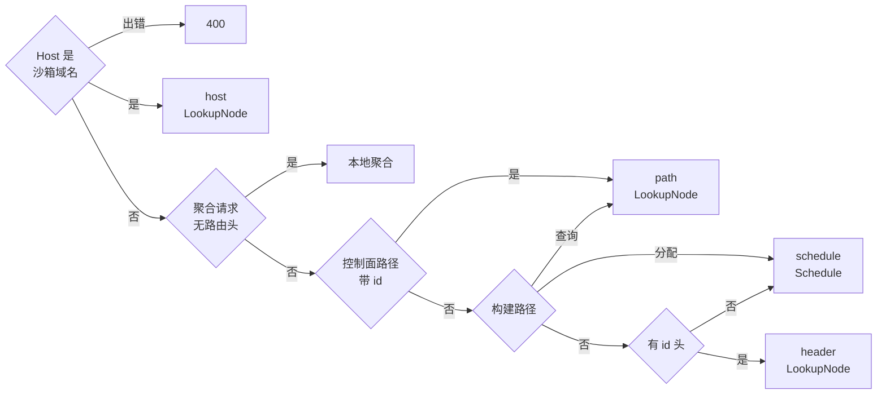
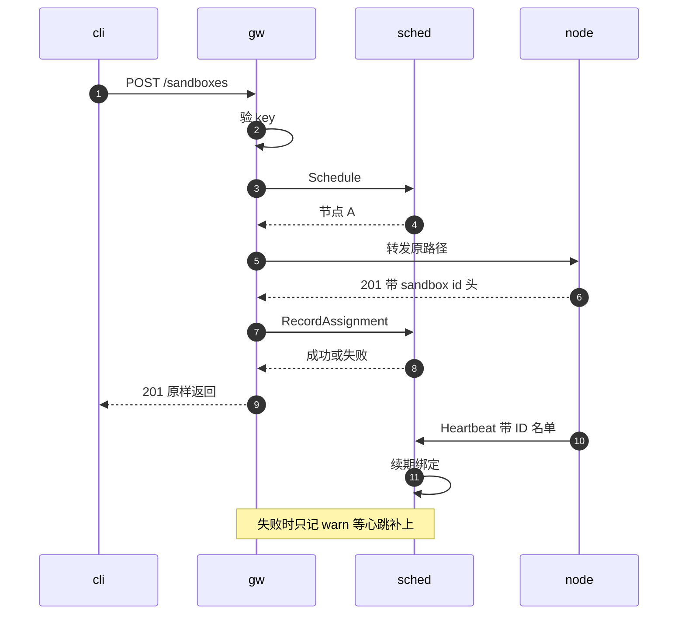

# 55 · gateway：路由判定与反向代理

> 多节点部署里，客户端只认识一个地址。gateway 站在这个地址上，对每个请求回答三个问题：要不要验 API key、该送到哪台节点、怎样转发过去。
> 它自己不保存任何沙箱状态，路由所需的一切都向 scheduler 查询；它只认识若干条路径模式，不解析节点的 API 规范。
> 本篇讲认证分界、六种路由来源的判定顺序、转发时的改写与超时、建立绑定的时机，以及三类由 gateway 自己聚合的请求。
>
> **读者**：工程师、运维。　**预备**：[第 08 篇 §4](08-system-architecture.md#4-多节点gateway-与-scheduler)、[第 13 篇 · 认证与凭据](13-authentication.md)、[第 17 篇 · 反向代理](17-reverse-proxy.md)。
> **代码**：`services/gateway/internal/server.go`、`host_route.go`、`schedule_hint.go`、`cluster_list.go`、`node_list.go`、`sandbox_metrics.go`、`metrics.go`，`services/gateway/cmd/main.go`，`services/shared/config/config.go`

---

## 0. 本篇要回答的问题

1. gateway 为什么只对控制面验 API key？它判定「数据面请求」的规则与节点上的 `require_auth()` 有哪些不同？
2. 一个请求按什么顺序被归入 host、gateway 本地、path、模板构建、header、schedule 六种路由来源？为什么不用 `http.ServeMux`？
3. 转发时 gateway 改写了哪些东西？超时怎样施加，流式请求与 WebSocket 为什么例外，这与节点代理的两阶段超时差在哪里？
4. 绑定在哪些响应之后写入，sandbox ID 从哪里取？为什么普通沙箱写绑定失败只记警告，模板构建却返回 503？
5. 集群沙箱列表、节点列表与批量指标三类请求由 gateway 自己聚合，它们的失败语义是什么？
6. gateway 自己会返回哪些状态码，各对应什么情况？

---

## 1. 问题：一个没有状态的入口

单节点部署里，客户端直接访问节点上的 `server` 进程，节点自己就知道每台沙箱在哪、是否 secure、是否允许公开访问。
多节点时，沙箱分散在若干节点上，而 SDK 只配置一个 `E2B_API_URL`。于是需要一个入口进程把请求送到正确的节点，
并且它最好**不持有**沙箱状态：否则它就要和节点、scheduler 一起维护第三份一致性。

gateway 是 `services/` 里的一个 Go 程序。`services/gateway/cmd/main.go` 的 `main()` 读 JSON 配置与 API key（只认 `AENV_API_KEY` 与 `/run/secrets/api-key`，从不自动生成，见[第 13 篇 §2](13-authentication.md#2-部署级-api-key)），
建两个到 scheduler 的 gRPC 客户端，起业务端口（缺省 `:8080`）与 Prometheus 端口（缺省 `:9102`），收到 SIGTERM 后给 10 s 优雅关闭。到 scheduler 的连接用 `insecure.NewCredentials()`，没有 TLS，部署时要把这段链路放在可信网络里。

两个 gRPC 客户端分别指向 `scheduler_addr`（primary）与可选的 `query_only_scheduler_addr`。后者未配置时，`NewServer()` 让它退回到 primary。
gateway 对 scheduler 只用六个 RPC：`Schedule`、`LookupNode`、`RecordAssignment`、`ListNodes`、`ListObservedNodes`、`GetNode`，
其中只有 `LookupNode` 走 query-only 客户端，其余都走 primary。这个划分决定了 primary 不可用时哪些请求还能工作（[第 56 篇](56-scheduler.md)）。

每个请求要依次回答：要不要验 API key（gateway 不知道沙箱的 ingress 策略，只能按请求形状分类）；送到哪台节点（有 sandbox ID 就查绑定，否则让 scheduler 选）；
怎样转发（数据面改写成节点认识的入口，新建请求还要从响应里取 ID 写回绑定）。

---

## 2. 认证分界

### 2.1 规则

`Handler()` 把核心分派函数包在两层中间件里：外层 `instrumentGatewayHTTP()` 记指标，内层 `authenticate()` 做认证。
`authenticate()` 只有两种结果：数据面请求与 `/health`、`/metrics` 直接放行；其余请求要求恰好一个 `X-API-Key` 头，
`singleHeaderMatches()` 先比长度、再用 `crypto/subtle` 做恒定时间比较，不匹配就返回空 body 的 401。重复的 `X-API-Key` 头一律视为不匹配（测试 `TestGatewayRequiresExactAPIKey`）。

数据面的判定在 `isSandboxDataPlaneRequest()`，满足任意一条即可：

1. 路径是 `/proxy` 或以 `/proxy/` 开头；
2. `Host` 能被 `parseHostRoute()` 解析成 `{port}-{sandboxID}.{domain}`（`domain` 取自 `sandbox_proxy_domains`）；
3. 同时带有 sandbox ID 头与端口头（`x-agentenv-sandbox-id` / `e2b-sandbox-id` 与 `x-agentenv-target-port` / `e2b-sandbox-port`），且路径不是控制面路径、不是模板构建路径。

为什么不在 gateway 验数据面凭据？数据面的放行条件取决于沙箱元数据：是否 secure、是否 `allow_public_traffic`、envd 端口是多少，
而 token 的校验还要用节点上的种子（[第 13 篇 §4.3](13-authentication.md#43-数据面)）。gateway 两者都没有。
测试 `TestGatewayLeavesDataPlaneAuthorizationToRuntime` 锁定了两面：带各种 token 的数据面请求都进入 `LookupNode`、不被 401；
而同一个 traffic token 放在 `POST /sandboxes/{id}/pause` 上，即使带了路由头也得到 401。

gateway 不清洗任何凭据头。`X-API-Key`、`X-Access-Token`、`e2b-traffic-access-token` 原样送到节点，由节点的 `require_auth()` 删除有效的 API key、
只保留验证过的 envd token（[第 13 篇 §4.4](13-authentication.md#44-转发前的头清洗)）。控制面请求因此在 gateway 与节点各验一次，用的是同一把 key。

### 2.2 与节点判定的差别

节点上的 `proxy::is_sandbox_proxy_request()` 与这里的规则形状相同，细节有三处不同：

| 维度 | gateway `isSandboxDataPlaneRequest()` | 节点 `is_sandbox_proxy_request()` |
|---|---|---|
| Host 解析出错 | **不**算数据面，要 API key；有 key 时 400，无 key 时 401 | 算数据面，直接 400 |
| 路由头 | sandbox ID 头与端口头都要有 | 有 sandbox ID 头即可 |
| 「是不是控制面」 | 用一张硬编码的路径模式表判断 | 看请求是否匹配到 axum 路由 |

第三点是根本差别。节点有完整的路由表，「没有匹配到任何路由」是一个精确的判据（[第 13 篇 §4.1](13-authentication.md#41-控制面还是数据面)）；
gateway 不解析 OpenAPI 规范，只能用 `isSandboxControlPlaneRequest()` 与 `templateBuildIDFromPath()` 列出的模式近似。
两者不一致的后果有界：错判成控制面只是多要一次 API key，错判成数据面节点仍会再判一次。真正的耦合在路由上（§3.3）。

---

## 3. 路由判定

### 3.1 为什么手写分派

`Handler()` 的注释说明了不用 `http.ServeMux` 的原因：ServeMux 会规范化请求路径，把 `%2F` 解码成 `/`，并对「不规范」的路径回 301 重定向。
这对一个反向代理是破坏性的：envd 的文件接口用 `/files/%2F...` 这样的百分号编码传路径，被解码后语义就变了。
gateway 于是在一个 `http.HandlerFunc` 里手写判断，转发时用 `requestEscapedPath()` 取原始转义路径（`URL.RawPath`，取不到时从 `RequestURI` 重新解析），
测试 `TestHandleProxyPreservesEncodedPathSegments` 锁定 `%2F`、`%252F`、`%20` 都原样到达节点。

进入 `handleProxy()` 之前，核心函数先处理两类特殊请求：

- 路径是 `/proxy` 前缀但路由头不全：直接 400（`sandbox id header required` 或 `target port header required`），不调用 scheduler（测试 `TestGatewayRejectsIncompleteProxyRouteBeforeScheduling`）。
- `/health` 与 `/metrics`：带了 host 路由或路由头时当作普通数据面请求转进沙箱；否则 `/health` 本地返回 204 供负载均衡探活，`/metrics` 返回 404——gateway 自己的指标只在独立的 metrics 端口上。

### 3.2 六种路由来源

`handleProxy()` 按固定顺序给请求定一个 `routeSource`，并据此决定用 `LookupNode` 还是 `Schedule` 选节点：

逐条说明：

1. **host。** `parseHostRoute()` 去掉端口与末尾的点、转小写后，逐个尝试配置的域名。Host 恰好等于某个域名时按非沙箱处理；
   去掉 `.{domain}` 后的 label 必须是单个不含点且含 `-` 的 DNS label，否则跳过这个域名；按第一个 `-` 切开后，端口须在 1–65535，sandbox ID 须是小写字母数字与连字符组成的合法 label，
   不合法就返回 400（测试 `TestHandleProxyHostBasedRoutingRejectsInvalidHost`）。Host 与路由头不一致时以 Host 为准，只打一条 debug 日志。
2. **gateway 本地。** 仅当既没有 host 路由、也没有任何路由头时，`GET /sandboxes/metrics`、`GET /sandboxes`、`GET /v2/sandboxes`、`GET /nodes` 与 `GET /nodes/{id}` 由 gateway 自己处理（§6）。
   带了路由头的 `GET /sandboxes` 因此不是列表请求，而是送进某台 guest 的应用请求，这与节点上「数据面入口优先」的口径一致（[第 17 篇 §2](17-reverse-proxy.md#2-三个入口)）。
3. **path。** `isSandboxControlPlaneRequest()` 按方法与路径段数匹配下表，`sandboxIDFromPath()` 取出 `/sandboxes/` 之后的第一段作为 ID。
4. **模板构建。** `PUT /templates/{t}/builds/{b}/builder` 与 `POST /v2/templates/{t}/builds/{b}` 是**分配**：构建要在某台节点上开始，走 `Schedule`。
   `/templates/{t}/builds/{b}/` 下的 `status`、`logs` 与 `builder`（`GET` 隧道、`DELETE` 取消）用构建 ID 当作 sandbox ID 去 `LookupNode`。
   其中 `GET status` 与 `GET logs` 在绑定不存在时退回到 `Schedule`：注释说明已完成的与旧的构建记录在共享模板仓库里，任何节点都能回答（测试 `TestTemplateBuildStatusFallsBackOnlyForMissingBindings`）。
5. **header。** 取 `x-agentenv-sandbox-id`，没有时取 `e2b-sandbox-id`。这里只要求有 ID；缺端口的请求照样被路由，由节点返回具体的 400。
6. **schedule。** 以上都不匹配。`POST /sandboxes`、`POST /v2/sandboxes`、`POST /sandboxes-cold` 属于此类；模板、快照、卷等不带 sandbox ID 的管理接口也属于此类，
   被送到 scheduler 选出的任意一台节点。推论：这些接口能在任意节点上得到同样的答案，前提是它们的状态在共享的快照仓库里，这也是多节点必须配置共享仓库的原因之一（[第 08 篇 §5](08-system-architecture.md#5-存储拓扑什么是真相)）。

`isSandboxControlPlaneRequest()` 认识的路径：

| 方法 | 路径 |
|---|---|
| `GET`、`DELETE` | `/sandboxes/{id}` |
| `GET` | `/sandboxes/{id}/metrics`、`/sandboxes/{id}/custom-extension-params` |
| `PATCH` | `/sandboxes/{id}/custom-extension-params` |
| `POST` | `/sandboxes/{id}/` 下的 `pause`、`resume`、`fork`、`connect`、`timeout`、`refreshes`、`snapshots`；`/v2/sandboxes/{id}/connect` |
| `PUT` | `/sandboxes/{id}/network` |

### 3.3 隐式耦合

上表与节点 `src/api/openapi.yml` 里所有带 `{sandboxID}` 的路径逐条对应，v0.2.3 没有遗漏。但这种对应只靠人工维护：
节点新增一个按 sandbox 路由的端点而 gateway 没有同步，这个请求就会落到第 6 类，被 `Schedule` 送到任意节点。
推论：在 N 个节点的集群里，它大约只有 1/N 的机会碰到正确的节点，其余时候得到那台节点的 404，单节点测试发现不了。
proto 契约一侧的同类耦合在[第 54 篇](54-control-plane-overview.md)讨论。

显式 `/proxy` 前缀还有一处行为值得注意。它被判为数据面，路由来源是 header，而 `upstreamTargetPath()` 对 header 与 host 两类来源**无条件**在路径前加 `/proxy`。
推论：客户端经 gateway 访问 `/proxy/x`，节点收到的是 `/proxy/proxy/x`，节点只剥一层前缀（[第 17 篇 §2](17-reverse-proxy.md#2-三个入口)），guest 看到的是 `/proxy/x`；
同一个请求直接发给单节点时，guest 看到的是 `/x`。仓库测试只覆盖了不完整的 `/proxy` 请求被拒，没有覆盖完整请求的上游路径。
多节点下应当用路由头加原始路径（或 Host 路由），不要再拼 `/proxy`。

---

## 4. 选节点

有 sandbox ID 时，`handleProxy()` 调 `queryOnlyScheduler.LookupNode()`。注意它不区分数据面与控制面：`handleProxy()` 对 host、path、header 三类来源调用的是同一个 `queryOnlyScheduler`，path 类的 pause、resume、delete 也走 query-only 客户端（测试 `TestLookupNodeUsesQueryOnlySchedulerClient` 只覆盖了 header 类）。
`services/README.md` 把 query-only 的高可用描述为「只覆盖数据面」，代码实际覆盖的是「一切按已有沙箱路由的请求」，而 fork 的子沙箱绑定、列表与新建仍需要 primary。

没有 sandbox ID 时，先由 `buildScheduleHint()` 构造一个调度 hint，再调 primary 的 `Schedule()`。hint 只对三个创建路径生成：
`/sandboxes-cold` 的 hint 带 CPU 数、内存、镜像列表与 metadata，`/sandboxes` 与 `/v2/sandboxes` 的只带 metadata。
`captureRequestBody()` 最多缓冲 64 KiB，超过时把已读前缀与剩余部分拼回 `prefixedBody`、跳过 hint，请求体仍完整转发；上限防止客户端迫使 gateway 缓冲任意大的 body。
代价是：两种内置策略都不读 hint（[第 56 篇](56-scheduler.md)），这段缓冲与解析目前只服务于 scheduler 的 debug 日志。

两个 RPC 都在 `routingCtx` 下进行，它是请求上下文加上 `request_timeout` 的超时。
gRPC 错误由 `writeSchedulerError()` 映射成 `text/plain` 的 HTTP 响应：

| gRPC 状态 | HTTP | 典型来源 |
|---|---|---|
| `InvalidArgument` | 400 | sandbox ID 为空 |
| `NotFound` | 404 | 绑定不存在或已过期：`sandbox assignment not found` |
| `Unavailable` | 503 | 没有可用节点；Redis 绑定存储不可用 |
| 其它 gRPC 状态 | 502 | `scheduler error` |
| 非 gRPC 错误 | 502 | `scheduler unavailable` |

客户端拿到 404 时无法区分「沙箱不存在」与「绑定暂时缺失」（如节点刚重启、尚未心跳），而且它是纯文本，不是节点的 JSON `Error`。

---

## 5. 转发

### 5.1 改写了什么

选出节点后，`joinUpstream()` 把节点的 `endpoint` 与请求路径拼成上游 URL，同时拼解码路径与转义路径；query 原样保留。
对 host 与 header 两类数据面来源，`upstreamTargetPath()` 在路径前加 `/proxy`；path、schedule 与本地聚合的转发原样保留路径。

`proxyRequest()` 每个请求新建一个 `httputil.ReverseProxy`，在 `Rewrite` 回调里做四件事：

- 改写 scheme、host、路径与 query，但 **保留原始 `Host` 头**（`req.Out.Host = req.In.Host`）；
- `injectForwardedHeaders()` 设置 `X-Forwarded-For`（覆盖而不是追加，只留直接对端的地址）、`X-Forwarded-Host`、`X-Forwarded-Proto`、`X-Forwarded-Method`、`X-Forwarded-URI`；
- host 路由时把解析结果写成 `x-agentenv-sandbox-id` 与 `x-agentenv-target-port`，覆盖客户端可能带来的同名头；
- 其余请求头原样转发。

这样节点看到的数据面请求永远走 `/proxy` 前缀入口，路由信息永远在头里。节点的 Host 分类器遇到 `/proxy` 开头的路径直接放行（[第 17 篇 §2](17-reverse-proxy.md#2-三个入口)），
所以节点不需要配置与 gateway 相同的 `[sandbox_proxy].domains`，Host 头被保留也不会让节点把请求再解析一遍。
`X-Forwarded-Proto` 按 gateway 自己的连接决定，而 gateway 只监听明文；推论：TLS 在 gateway 之前终止时它恒为 `http`。

`debug_mode` 打开时，`ModifyResponse` 把 `x-agentenv-node-id` 写到响应上，供运维确认请求落在哪台节点；缺省关闭。

### 5.2 超时

gateway 只有一个可配置的超时 `request_timeout`。`config.go` 的 `defaultConfig()` 里它是 30 s；
仓库附带的三份配置（`services/config/local.json`、`deploy/docker/config/default.json`、`deploy/k8s/base/config/gateway.json`）都写成 90 s。

`requestContextForProxy()` 决定上游请求用哪个上下文：

- **长连接请求**用客户端连接自己的上下文，不受 `request_timeout` 约束；`FlushInterval` 设为 −1，每次写都立即刷出。
  `isWebSocketRequest()` 认 `Upgrade: websocket` 加 `Connection: upgrade`；`isStreamingRequest()` 认 `application/grpc*`、`application/connect+*`、`Connect-Protocol-Version` 头、`Accept: text/event-stream` 与 `TE: trailers`。
- **其余请求**用 `routingCtx`：从进入 `handleProxy()` 算起，选节点、连接上游、上传请求体、等待响应、下载响应体，**全部**要在 `request_timeout` 内完成，超时得到 504 `upstream timeout`（测试 `TestProxyRequestContextDeadlineReturnsGatewayTimeout`）。

这与节点代理的做法不同。节点把超时分成「上传期间按数据帧重置的空闲计时」与「上传结束后等响应头」两段，响应头之后不再计时（[第 17 篇 §5.2](17-reverse-proxy.md#52-两阶段超时)）。
gateway 用的是一个覆盖整个交换的截止时间。推论，有两个后果：

- 经 envd 的普通 HTTP 文件接口上传或下载大文件，总耗时超过 `request_timeout` 就会被 gateway 截断，尽管节点本身允许；
- 节点上的自动恢复最多等 60 s（[第 17 篇 §4](17-reverse-proxy.md#4-自动恢复)）。代码缺省的 30 s 小于它，访问暂停沙箱的请求可能在 gateway 先超时；附带配置的 90 s 避开了这一点。

### 5.3 错误与重试

`ReverseProxy` 的 `ErrorHandler` 把转发失败分成四类：客户端主动断开（`context.Canceled`）只记日志、不写响应，`POST /process.Process/StreamInput` 的断开降为 debug 级；
截止时间到达返回 504；`ModifyResponse` 返回的 `proxyResponseError` 按其自带的状态码返回（§6.1）；其余错误返回 502 `upstream unavailable`。

gateway 不重试。创建请求被节点以 5xx 拒绝时原样透传，不会换一台节点再试；连接节点失败时客户端得到 502。
重试要求知道请求是否幂等、节点上是否已有副作用，gateway 两者都不知道。

---

## 6. 写绑定

### 6.1 时机与 ID 来源

scheduler 的绑定以节点心跳为真相源（[第 56 篇](56-scheduler.md)），但心跳每 5 s 一次。一台刚创建的沙箱在下一次心跳之前也要能被路由，
所以 gateway 在创建成功后**提前**写一条绑定。`shouldRecordAssignment()` 规定了哪些请求需要写：

- 模板构建的两种分配请求；
- 路由来源为 schedule 的 `POST /sandboxes`、`POST /v2/sandboxes`、`POST /sandboxes-cold`；
- 路由来源为 path 的 `POST /sandboxes/{id}/fork`：它按源沙箱路由到源节点，但为每个子沙箱写绑定，子沙箱必然与源沙箱在同一节点上。

写入发生在 `ReverseProxy` 的 `ModifyResponse` 里，只对 2xx 响应进行。`recordAssignmentFromResponse()` 用客户端连接的上下文加 `min(request_timeout, 5 s)` 的超时，按顺序找 ID：

1. `POST /v2/templates/{t}/builds/{b}`：ID 取自路径中的构建 ID（测试 `TestV2TemplateBuildBindsFromPathWithoutResponseHeader`）。
2. `PUT …/builder`：取响应头 `x-agentenv-build-id`，缺失或与路径中的构建 ID 不一致都返回 502，不写绑定（测试 `TestTemplateBuildAllocationRequiresRoutingBinding`）。
3. 响应头 `x-agentenv-sandbox-id`：节点的规范为三个创建端点声明了这个响应头，有它时不读响应体（测试 `TestRecordAssignmentFromResponseUsesHeaderWithoutReadingBody`）。
4. 否则读响应体，上限 `forward_response_size`（缺省 4 MiB），超限返回 502 `upstream response too large`。普通响应从 `sandboxID`、`sandboxId`、`sandbox_id` 三种拼写、顶层与 `data` 下、以及 `sandboxes` 数组里取 ID；
   fork 的响应是一个数组，由 `extractForkSandboxIDsFromResponse()` 取每一项的 `sandbox.sandboxID`。读完的响应体放回内存、重设 `Content-Length` 再交给客户端。

下图是一次创建的完整时序。`cli` 是客户端，`gw` 是 gateway，`sched` 是 scheduler，`node` 是被选中的节点：

### 6.2 失败时的两种处理

步骤 3、4 里 `recordAssignment()` 的返回值被丢弃：RPC 失败只记一条 `record assignment failed` 警告，客户端照样拿到 201。
步骤 1、2 则把失败包成 503 `failed to route allocated build`。为什么不对称？

普通沙箱返回错误反而更糟：沙箱已经创建，客户端以为失败、不会用也不会删，它会占着资源直到 TTL 到期。
而节点在 `wait_for_ready()` 之前就把沙箱加进了 store（[第 20 篇](20-launch-plan-and-rollback.md)），下一次心跳的名单里就有它，scheduler 会补上绑定。
代价是一个最长约一个心跳周期的窗口：这段时间里对该沙箱的请求得到 §4 的 404。

模板构建的分配之后紧跟着依赖绑定的请求：BuildKit 路径在 `PUT …/builder` 返回后立即发起 `GET …/builder` 的 WebSocket 隧道（[第 15 篇 §4](15-template-build-api.md#4-dockerfile-与-buildkit-路径)），
这个请求只能靠 `LookupNode` 找到节点，绑定缺失就是 404 而不是退回调度。推论：返回 503 是让客户端明确知道「构建已受理但无法路由」，而不是让紧随其后的隧道莫名失败；
被受理的构建本身仍在节点上运行，它的构建 ID 也会经心跳名单进入绑定（[第 57 篇](57-heartbeat-and-cpu-intersection.md)）。

---

## 7. gateway 本地聚合

### 7.1 集群沙箱列表

`GET /sandboxes` 与 `GET /v2/sandboxes` 的答案分散在所有节点上。`handleClusterList()` 先调 primary 的 `ListNodes()`——它返回发现列表里的全部节点，包括下线中（lingering）的节点，
也不排除心跳已经超时的节点——然后 `fetchClusterList()` 为每个节点起一个 goroutine，用克隆的请求头（包括 API key，由节点再验一次）并发请求同一路径。

失败语义是**全有或全无**：任何一个节点出错就取消其余请求；节点返回的 4xx 原样透传（测试 `TestHandleProxyClusterListPropagatesUnauthorized`），其它错误一律 502 `cluster list unavailable`；
节点列表为空同样是 502。不返回部分结果，是因为部分结果对调用方来说无法与「沙箱不存在」区分。
代价是可用性随节点数下降：静态发现模式下一台宕机的节点仍在 `ListNodes()` 里，它会让整个列表接口失败，直到运维把它从配置中删除（测试 `TestHandleProxyClusterListFailsWhenNodeFails`）。

合并时 `listedSandbox` 只解出排序所需的三个字段，其余保留节点返回的原始 JSON，新增字段因此能透传。
`sortListedSandboxes()` 按 `startedAt` 排序（缺省降序，同一时刻按 ID 打破平局），`dedupListedSandboxes()` 按 ID 去重、保留第一个；注释说明沙箱迁移实现之后要换成按权威归属裁决。

v1 接口返回全部结果。v2 接口在 gateway 里重新分页：转给节点的 query 去掉 `limit` 与 `nextToken`，节点返回全量；gateway 在合并后的列表上按游标切页。
游标是 `base64url("{startedAt}__{sandboxID}")`（升序加 `__asc`），页满时设置 `x-next-token`，格式与节点自己的分页一致（[第 14 篇 §8.3](14-sandbox-api.md#83-游标分页)），
代价是每翻一页都要把所有节点的全量列表拉一遍，开销正比于集群里的沙箱总数而不是页大小。

### 7.2 节点列表与节点详情

`GET /nodes` 由 gateway 直接用 primary 的 `ListObservedNodes()` 拼出 JSON，不访问任何节点；其中的 `status` 是 scheduler 按心跳与发现状态推导的，可能是 `unhealthy` 或 `lingering`。
`GET /nodes/{id}` 则不同：`handleNodeDetail()` 先用 `GetNode()` 解析出该节点的地址，再把请求原样转发给那台节点，由节点自己回答。
节点自己的 `/nodes/{id}` 恒报 Ready（[第 12 篇 §6](12-spec-driven-server.md#6-最小的实现health-与-nodes)），所以同一台节点在两个接口里可能显示不同的状态；判断节点健康应看 `GET /nodes`。

### 7.3 批量沙箱指标

`GET /sandboxes/metrics?sandbox_ids=…` 由 `handleSandboxMetricsList()` 处理：最多 100 个互不重复的 UUID，以 16 为并发上限逐个 `LookupNode`、按节点分组，再向每个节点请求它那一组。
绑定不存在的 ID 被静默跳过；任一节点失败则整体 500，注释说明这是为了不把「节点不可用」伪装成「guest 没有样本」。它从不调用 `Schedule`。

---

## 8. gateway 自己产生的状态码

节点返回的状态码被原样透传，下表只列 gateway 自己产生的：

| 状态码 | 情形 |
|---|---|
| 204 | 不带路由信息的 `/health` |
| 400 | 非法的沙箱 Host；`/proxy` 前缀缺路由头；scheduler 返回 `InvalidArgument`；读不出请求体；列表的 `order`、`limit`、`nextToken` 非法；批量指标的 `sandbox_ids` 非法 |
| 401 | 控制面请求缺少或带错 API key |
| 404 | 不带路由信息的 `/metrics`；绑定不存在或已过期 |
| 500 | 批量指标中任一节点失败 |
| 502 | scheduler 未知错误；连接节点失败；响应体超过 `forward_response_size`；builder 响应缺构建 ID 或 ID 不符；集群列表失败 |
| 503 | scheduler 无可用节点或绑定存储不可用；模板构建分配后写绑定失败 |
| 504 | 非长连接请求超过 `request_timeout` |

`metrics.go` 另有三个直方图：HTTP 请求（标签含 `route_source`）、上游转发与 scheduler RPC；`gatewayRouteLabel()` 把路径归一成有限的模板，避免指标基数随 sandbox ID 增长。

---

## 9. 与 e2b infra 的对照

e2b infra 把两件事拆在两个进程里：控制面请求直接打到 api，由 api 自己做放置；数据面请求打到 client-proxy，它从 api 写入的 Redis 沙箱目录查节点（见 e2b 手册第 53、55 篇）。
AgentENV 用一个 gateway 同时承担控制面转发与数据面入口，放置交给独立的 scheduler，绑定表的主要维护者是节点心跳而不是创建者。
这样 gateway 可以完全无状态，代价是 gateway 必须用路径模式区分两类流量，并且绑定在创建之后有一个靠心跳兜底的短暂窗口。

---

## 10. 小结

- gateway 只对控制面验 API key（恰好一个头、恒定时间比较）；数据面与 `/health`、`/metrics` 直接放行，凭据头原样交给节点，由节点按沙箱元数据授权。
- gateway 判定数据面的规则与节点同形但不同细节：Host 解析出错要 key、路由头要 ID 与端口齐全、「控制面」靠硬编码路径表而不是路由匹配。
- 路由来源按 host → gateway 本地聚合 → path → 模板构建 → header → schedule 的顺序判定；Host 优先于路由头，带路由头的列表路径被送进 guest。
- 节点新增按 sandbox 路由的端点必须同步改 `isSandboxControlPlaneRequest()`，否则请求被调度到任意节点；v0.2.3 两边是对齐的。
- 所有按已有沙箱路由的请求（包括 pause、delete）都经 query-only 客户端 `LookupNode`；新建经 primary `Schedule`，hint 被构造但不被策略使用。
- 数据面转发统一改写成 `/proxy` 前缀加路由头，并保留原 Host；显式 `/proxy` 请求经 gateway 会多出一层前缀（推论）。
- 非长连接请求的整个交换受 `request_timeout` 约束（代码缺省 30 s，附带配置 90 s），比节点的两阶段超时更严；gRPC、Connect、SSE 与 WebSocket 不受约束。gateway 不重试。
- 创建与 fork 成功后从响应头或响应体取 ID 写绑定；普通沙箱写失败只记警告、靠心跳补上，模板构建分配写失败返回 503。
- 集群列表全节点扇出、全有或全无、在 gateway 里重新分页；`/nodes` 用 scheduler 的推导状态，`/nodes/{id}` 转给节点自己回答。

---

## 延伸阅读 / 下一篇

- [第 13 篇 · 认证与凭据](13-authentication.md)：节点上的数据面授权与头清洗。
- [第 17 篇 · 反向代理](17-reverse-proxy.md)：gateway 转发之后，节点上的 `/proxy` 入口、自动恢复与两阶段超时。
- [第 54 篇 · 控制面总览与 proto 契约](54-control-plane-overview.md)：三个角色与 RPC 分组。
- [第 57 篇 · 心跳、节点可观测与 CPU 模板交集](57-heartbeat-and-cpu-intersection.md)：维持绑定的心跳名单从哪里来。
- [e2b 手册第 53 篇 · client-proxy](../e2b-infra/53-client-proxy-edge.md)、[e2b 手册第 55 篇 · 沙箱目录与路由](../e2b-infra/55-sandbox-catalog-and-routing.md)：e2b infra 的数据面入口与路由表。
- 下一篇：[第 56 篇 · scheduler：放置、绑定与 HA](56-scheduler.md)。
