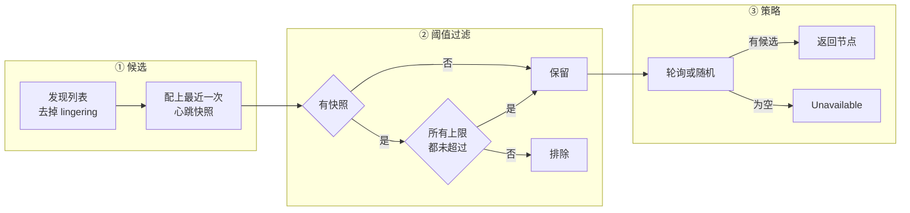
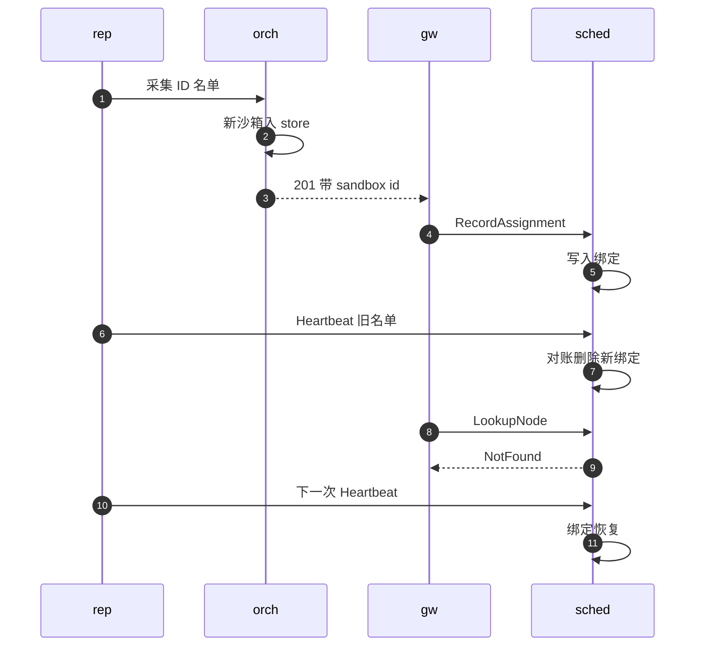

# 56 · scheduler：放置、绑定与 HA

> scheduler 是多节点控制面里唯一有状态的进程。它回答两个问题：新沙箱放到哪台节点，已有沙箱在哪台节点。
> 前者是一次「发现列表 → 资源过滤 → 轮询或随机」的两段式选择，后者是一张带 TTL、以节点心跳为真相源的绑定表。
> 本篇讲放置算法与它不做的事、绑定表的两种实现与一致性模型、两种节点发现方式、primary 加 query-only 副本的 HA 边界，最后逐条整理失败模式。
>
> **读者**：工程师、运维。　**预备**：[第 55 篇 · gateway](55-gateway.md)、[第 24 篇 §2](24-metrics-and-events.md#2-容量快照现算而不是累加)。
> **代码**：`services/scheduler/internal/service.go`、`node_registry.go`、`filter.go`、`strategy.go`、`store.go`、`redis_store.go`、`kubernetes_discovery.go`，`services/scheduler/cmd/main.go`，`services/shared/config/config.go`，`services/api/proto/scheduler.proto`

---

## 0. 本篇要回答的问题

1. `Schedule()` 用哪些信息选节点？资源上限怎样判定，哪些节点会被排除、哪些不会？调度 hint 起什么作用？
2. 绑定表存什么、TTL 多长、谁写谁删？为什么说「心跳名单即真相」，`RecordAssignment` 在其中扮演什么角色？
3. 内存实现与 Redis 实现有什么不同？Redis 的 Lua 脚本保证了什么，又为什么不能用于 Redis Cluster？
4. static 与 kubernetes 两种发现方式怎样产生节点表？lingering 是什么，节点 ID 从哪里来？
5. primary 宕机时，有 query-only 副本与没有副本分别还剩下哪些功能，能维持多久？
6. 节点宕机、scheduler 重启、Redis 不可用、心跳与绑定写入交错时，系统分别表现为什么？

---

## 1. 问题：两张表与一个选择

gateway 无状态（[第 55 篇](55-gateway.md)），状态都在 scheduler 里。它维护两张表：

- **节点表**：有哪些节点、地址是什么、最近一次心跳报了什么。前半来自发现（静态配置或 Kubernetes），后半来自节点每 5 s 一次的 `Heartbeat`。
- **绑定表**（binding）：sandbox ID → 节点。它让 gateway 能把一个带 sandbox ID 的请求送到那台沙箱所在的节点。

沙箱在 AgentENV 里不迁移：运行中的 VM、暂停后的产物都在原节点本地（[第 08 篇 §5](08-system-architecture.md#5-存储拓扑什么是真相)），fork 的子沙箱也在源节点上。
所以绑定一旦建立，正常情况下只会被删除，不会改指向。这个事实让绑定表可以做得很简单：它不需要版本号，也不需要在迁移时做原子切换，
只需要回答「此刻这个 ID 归哪个节点」，并在节点自己说「我这里没有它了」时删掉。

`services/scheduler/cmd/main.go` 的 `main()` 按配置装配这两张表：`createBindingStore()` 在 `redis_addr` 非空时建 Redis 绑定存储（启动时 Ping，连不上就退出），否则建内存绑定存储；
正常模式再建 `AtomicNodeRegistry`，按 `discovery.mode` 起静态或 Kubernetes 发现，最后注册 `Service` 与 gRPC health 服务。缺省监听 `:9090`，指标在 `:9101`；
收到 SIGTERM 后先把 health 置为 NOT_SERVING，再给 `GracefulStop()` 10 s，超时强停。

---

## 2. 放置

### 2.1 两段式选择

`Service::Schedule()` 的全部逻辑是下面几步：



1. `nodes.Snapshot(false)` 取发现列表，去掉 lingering 节点，按 ID 排序。
2. 对每个节点调 `PeekObserved()` 取最近一次心跳带来的原始 `NodeSnapshot`，没有心跳过的节点得到 nil，组成 `[]RichNode`。
3. `FilterByResourceLimit()`（`filter.go`）按配置的 `node_resource_limit` 过滤，未配置时不过滤。
4. `strategy.Select()` 从剩下的候选里选一个；候选为空时返回 `codes.Unavailable "no nodes available"`，gateway 映射成 503。

### 2.2 资源上限

`config.NodeResourceLimit` 的每一项都是可选的指针，未设置即不限制。`withinLimit()` 逐项比较心跳快照里的数字：

| 配置项 | 比较的量 |
|---|---|
| `max_sandbox_count` | `sandbox_count`，即运行集计数，不含 starting |
| `max_sandbox_starting_count` | `sandbox_starting_count`（Creating 与 Resuming） |
| `max_cpu_used_percent` | 宿主 CPU 使用率 |
| `max_cpu_allocated_percent` | `allocated_cpu × 100 / cpu_count`，可超过 100 表示超卖 |
| `max_memory_used_percent`、`max_memory_allocated_percent` | 已用 / 已分配内存占总内存的百分比 |
| `max_sandbox_count_including_paused` | 运行集计数加暂停沙箱数 |
| `max_allocated_cpu_including_paused`、`max_allocated_memory_bytes_including_paused` | 活跃分配加暂停沙箱的预留 |

后三项把暂停沙箱算进来，衡量「如果都恢复会不会超卖」；各项计数在节点上怎样算出见[第 24 篇 §2](24-metrics-and-events.md#2-容量快照现算而不是累加)。`services/README.md` 的限额表漏列了这三项。

这个过滤有四个值得注意的语义：

- **严格大于才排除。** 每一项都是 `值 > 上限` 时返回 false，计数恰好等于上限的节点仍可被选中。配置 `max_sandbox_count: 10` 的效果是「最多到 11 台再停」。
- **starting 不计入运行集。** `max_sandbox_count` 看不到正在创建的沙箱；要限制并发启动得另设 `max_sandbox_starting_count`。
- **快照是陈旧的。** 它是最多一个心跳周期前的数字。推论：一波并发创建在下一次心跳前看到的都是同一份快照，可以让节点越过上限；上限因此是软的，硬准入要靠节点自己。
- **没有快照就不过滤。** 从未心跳过的节点（刚发现、或已注销）原样保留，注释的理由是「没有指标可供评估」。

### 2.3 策略

`strategy.go` 只有两种策略。`RoundRobinStrategy` 用一个原子计数器对候选数取模；`RandomStrategy` 用 `math/rand` 均匀选一个。
`NewStrategy()` 遇到未知名字时**静默**退回 `round_robin`，配置校验也不检查 `strategy` 字段，拼错的策略名不会报错。
轮询计数器是全局的而候选集合每次可能不同（过滤结果在变），所以「轮询」只在候选集合稳定时才严格轮转。

`Strategy` 接口的 `Select(nodes, hint)` 收得到调度 hint，`RichNode` 的注释也说策略可以用快照做负载感知调度。
但两种实现都把 hint 参数写成 `_`：gateway 为 `/sandboxes-cold` 解析出的 CPU、内存、镜像列表，目前只出现在 `summarizeScheduleHint()` 的 debug 日志里。
接口为负载感知与镜像亲和留了位置，v0.2.3 没有实现任何一种。

### 2.4 不排除 UNHEALTHY 节点

`scheduler.proto` 的 `NodeStatus` 注释给出了一张状态推导表，并说明 READY 是「接受新沙箱」的状态。推导由 `node_registry.go` 的 `deriveObservedNodeViewLocked()` 完成：
距上次心跳超过 `report_ttl`（缺省 30 s）为 UNHEALTHY；不在发现列表中为 CONNECTING；lingering 为 LINGERING；否则用节点自报的状态（节点恒报 READY）。

但 `Schedule()` 不用这个推导。它调的 `Snapshot(false)` 只按 `lingeringIDs` 过滤，注释「filtered by their derived status」与实现不符；
`PeekObserved()` 的注释也明说它返回原始快照、不推导状态。推导出的状态只用于 `ListObservedNodes()`、`GetNode()`（即 gateway 的 `/nodes`）与 P2P peer 过滤。
测试 `TestScheduleOnlyConsidersReadyNodes` 名不副实：它只构造了一个 active 与一个 lingering 节点，验证的是「不选 lingering」，从未构造心跳超时的节点。

后果在静态发现模式下最明显：一台宕机的节点仍在发现列表里，`FilterByResourceLimit()` 还用它宕机前最后一次的快照判断，
round-robin 照常把它选中，这部分创建请求在 gateway 得到 502 `upstream unavailable`（gateway 不重试，[第 55 篇 §5.3](55-gateway.md#53-错误与重试)）。
推论：N 个节点里坏一个，约 1/N 的创建请求失败，直到运维把它从配置里删除。Kubernetes 模式下 readiness 失败的 Pod 会从 EndpointSlice 的 serving 集合中消失（§4.2），这个问题被部分缓解。

---

## 3. 绑定

### 3.1 接口与写入者

`store.go` 的 `BindingStore` 只有三个方法：

- `Get(sandboxID)`：`LookupNode` 用，不存在或过期返回未命中，gateway 得到 404。
- `Record(sandboxID, node)`：`RecordAssignment` 用，写入一条绑定并设 TTL。`RecordAssignment()` 先用 `Contains()` 校验节点 ID 在发现列表中且 endpoint 一致，否则 `InvalidArgument`。
- `ReconcileNode(node, sandboxIDs)`：`Heartbeat` 与 `UnregisterNode` 用，把一个节点名下的绑定整体对齐到给定名单。

`ReconcileNode()` 的语义是整套设计的核心：名单内的 ID 全部 upsert 到这个节点并续期；这个节点名下、不在名单里的绑定全部删除；空名单删光这个节点的全部绑定。
节点的名单来自 `Orchestrator::list_sandbox_ids()`：store 里的全部沙箱（含暂停的）加上进行中的模板构建 ID。
于是**绑定的真相源是节点自己的名单**。`RecordAssignment` 只是在「创建成功」与「下一次心跳」之间提前写入一条，让新沙箱立即可路由；
它写错、写失败或根本没写，下一次心跳都会纠正。scheduler 收到的生命周期事件（`ReportSandboxEvent`）只记一条 debug 日志就丢弃，不参与绑定（[第 24 篇 §4](24-metrics-and-events.md#4-生命周期事件)）。

绑定的 TTL 是 `binding_ttl`，缺省 30 s，是心跳间隔的 6 倍。TTL 的作用不是让绑定按时过期，而是在节点**停止心跳**时自动撤掉它名下的绑定：
节点失联 30 s 后，它的沙箱在 gateway 上变成 404，而不是继续把请求送到一个不响应的地址。

### 3.2 内存实现

`InMemoryBindingStore` 用一个互斥锁保护两张 map：`bindings`（sandbox → 节点与过期时刻）与反向索引 `nodeBinding`（节点 → sandbox 集合）。
反向索引让 `ReconcileNode()` 只扫一个节点名下的绑定；upsert 时若绑定原本指向别的节点，先从旧节点的集合里摘掉，保证每个 ID 只在一个集合里。
过期是惰性的：只有 `Get()` 碰到过期记录时才删除。推论：一个永久消失的节点，如果它的沙箱再也没有被查询过，这些过期记录会一直留在内存里，直到 scheduler 重启。

内存实现的绑定随进程重启全部丢失。之后每个节点的下一次心跳把自己的名单重新写回，空窗最长约一个心跳周期（节点心跳失败时还要加上它的退避）。

### 3.3 Redis 实现

配置 `redis_addr`（`host:port` 或 `redis://` URL）后用 `RedisBindingStore`。键布局如下（前缀 `agentenv:scheduler:bindings`）：

```text
agentenv:scheduler:bindings:sandbox:{sandboxID}   STRING  {"node":{"node_id":"…","endpoint":"…"}}   PX = binding_ttl
agentenv:scheduler:bindings:node:{nodeID}         SET     该节点名下的 sandboxID                     PX = 1 h，每次非空对账时续期
```

`Get()` 是一次普通的 `GET`，过期交给 Redis 的 `PX`。`Record()` 与 `ReconcileNode()` 各是一段 Lua 脚本，在 Redis 里原子执行：

- `redisRecordBindingScript`：读出旧绑定，若指向别的节点就从旧节点的集合里 `SREM`；写新绑定、`SADD` 到新节点的集合、续期集合。
- `redisReconcileNodeScript`：遍历该节点集合中不在名单里的 ID，只有当它的绑定**仍指向本节点**时才 `DEL`，然后 `SREM`；
  对名单里的每个 ID，若旧绑定指向别的节点就从那个节点的集合里摘掉，再写绑定、加入集合；空名单时删掉整个集合。

原子性保证的是两个结构互相一致：一个 ID 不会同时出现在两个节点的集合里，一次对账不会删掉刚被另一个节点认领的绑定。
每次 Redis 操作的超时是 2 s，出错时 `LookupNode`、`RecordAssignment`、`Heartbeat` 都返回 `Unavailable "binding store unavailable"`。

代价是不兼容 Redis Cluster。两段脚本都在脚本内部用 `ARGV` 里的前缀拼出 `KEYS` 之外的键（旧节点的集合、各 sandbox 的绑定键）并访问它们；
Redis Cluster 要求脚本访问的键都在 `KEYS` 里声明且落在同一个 slot，这两点都不满足。推论：只能用单实例或主从 Redis。

---

## 4. 节点发现

### 4.1 static

`discovery.mode` 缺省为 `static`，节点表就是配置里的 `nodes` 数组（每项 `id` 与 `endpoint`），启动时 `registry.Set(nodes, nil)` 一次写入，此后不变。
节点 ID 必须与节点进程的 `[node_identity] node_id`（或环境变量 `AENV_NODE_ID`）完全相同：`AtomicNodeRegistry::Heartbeat()` 只接受发现列表里的节点，
否则返回 `ErrNodeNotInRegistry`，scheduler 映射成 `InvalidArgument`，节点侧只在日志里提示检查 `AENV_NODE_ID`。
注意节点的 endpoint 从不取自心跳：`Heartbeat()` 用发现列表里的地址构造观测记录，节点无法通过心跳把自己的地址改成别的。

### 4.2 kubernetes

`kubernetes_discovery.go` 用 client-go 的 informer 监听 `agentenv-system` 命名空间里属于 `service_name`（部署清单里是 headless Service `agentenv-nodes`）的 EndpointSlice，
可选地再监听两个 Pod 选择器。每当缓存变化，`syncFromStore()` 重新算出完整的节点表并整体 `Set()`：

- 只取端口与 `port` 配置相符的 slice，只取 `Serving` 为真的 endpoint（注释强调用 Serving 而不是 Ready），取第一个可解析的 IP，IPv6 加方括号。
- 节点 ID 是 endpoint 的 `TargetRef.Name`，即 **Pod 名**；部署清单把 `AENV_NODE_ID` 也设成 Pod 名，两边因此一致。
- `Terminating` 为真的 endpoint 进入 **lingering**：仍在节点表里、仍能被列表与按 ID 路由访问，但 `Schedule()` 不再选它。
- 匹配 `ignore_pod_selector` 的 Pod 整个忽略；匹配 `no_schedule_pod_selector` 的 Pod 强制算 lingering，可用来手动排空一台节点。

lingering 与 DaemonSet 的 `preStop` 配合完成排空：Pod 进入 Terminating 后不再接新沙箱，`preStop` 轮询节点的沙箱数直到为零，`terminationGracePeriodSeconds` 为 3600（[第 60 篇](60-deployment.md)）。

`Set()` 替换节点表时，删除不再存在的节点的观测记录并使相应集群的 CPU 交集失效（[第 57 篇](57-heartbeat-and-cpu-intersection.md)），但**不碰绑定**：消失节点的绑定靠 TTL 自然过期。
`main.go` 的 `runKubernetesDiscoveryWithRetry()` 在初始化失败时按 1 s 起、30 s 封顶指数退避重试；唯一例外是 `rest.ErrNotInCluster`（不在集群内运行），
这时发现循环永久退出而进程继续运行，节点表为空，所有 `Schedule` 都返回 503，gRPC health 却仍是 SERVING。

---

## 5. 一致性：心跳与提前写入的交错

绑定有两个写入者，节点心跳（经 `ReconcileNode`）与 gateway（经 `RecordAssignment`），它们之间没有协调。
下图中 `rep` 是节点上的心跳 reporter，`orch` 是节点的 orchestrator，`gw` 是 gateway，`sched` 是 scheduler：



推论（仓库没有覆盖这一交错的测试）：心跳在采集名单（步骤 1）之后、到达 scheduler（步骤 6）之前，若恰好有一台新沙箱进入 store 并完成 `RecordAssignment`，
这次对账会把刚写入的绑定当作「节点上已不存在」删掉，直到下一次心跳（缺省 5 s 后）才恢复，期间对该沙箱的请求得到 404。
窗口的大小取决于心跳从采集到送达的耗时。普通创建在 `wait_for_ready()` 之前就进入 store（[第 20 篇](20-launch-plan-and-rollback.md)），采集通常已经能看到它；
fork 的子沙箱在后端返回后才以 Running 加入 store、紧接着返回响应，更可能落进这个窗口。

反方向的交错是无害的：沙箱被删除后，绑定最多在一个心跳周期内仍指向原节点，请求被送到原节点，由节点自己返回 404。
gateway 写绑定失败只记警告（[第 55 篇 §6](55-gateway.md#6-写绑定)）与这个竞态叠加，得到的是同一种症状：短暂的 404，下一次心跳自愈。
这套设计的选择是：接受「新沙箱偶尔短暂不可路由」，换取绑定表没有任何跨组件协议，任何一个写入者丢失都能自愈。

---

## 6. HA：primary 与 query-only

### 6.1 两种角色

`scheduler --query-only` 启动的进程只注册 `QueryOnlyService`：它只实现 `LookupNode`，其余 RPC 返回 `Unimplemented`，不建节点表、不需要发现配置，但要求配置 `redis_addr`。
它与 primary 共享同一个 Redis，从里面读绑定。gateway 用 `query_only_scheduler_addr` 指向它，所有按已有沙箱路由的请求都经它查节点（[第 55 篇 §4](55-gateway.md#4-选节点)）。

primary 之外的一切都只在 primary 的内存里：节点表与观测快照、CPU 交集、P2P 制品索引（`InMemoryArtifactStore`，LRU 容量缺省 100 万条，[第 58 篇](58-p2p-artifact-transport.md)）。
primary 只能有一个：两个 primary 各自维护节点表与 round-robin 计数器，彼此不知道对方。

### 6.2 primary 不可用时

| 功能 | 无 query-only | 有 query-only |
|---|---|---|
| 按已有沙箱路由（数据面、pause、delete 等） | 失败 | 可用，直到绑定过期 |
| 新建、fork 的子沙箱绑定、模板构建分配 | 失败 | 失败 |
| 集群列表、`/nodes`、节点详情 | 失败 | 失败 |
| 心跳、P2P 发现与索引 | 失败，节点退避重试 | 失败，节点退避重试 |

「直到绑定过期」是关键限定。Redis 里的绑定键带 `PX = binding_ttl`，能续期它的只有 `Record` 与 `ReconcileNode`，而两者都只在 primary 上执行；
心跳只发往节点配置的 `[cluster] scheduler_endpoint`，query-only 也不实现 `Heartbeat`。
推论：primary 停机后，每条绑定在它最后一次被续期之后 `binding_ttl`（缺省 30 s）过期，query-only 副本随之对所有沙箱返回 NotFound。
query-only 覆盖的是 primary 的**短暂**重启或升级；要覆盖更长的停机，只能调大 `binding_ttl`，代价是节点真正失联后它的沙箱要更久才从路由里消失。
`services/README.md` 把这种模式描述为「只覆盖数据面」，代码实际覆盖所有按已有沙箱路由的请求，但时间上受 TTL 限制。

部署清单与这套 HA 之间还有距离：Kubernetes base 里 scheduler 与 gateway 都是 `replicas: 1`，没有 Redis，也没有 query-only 的部署清单；Compose 部署同样不含 Redis。

### 6.3 primary 重启之后

- **绑定**：内存实现全部丢失，靠各节点下一次心跳重建；Redis 实现中未过期的绑定保留。
- **节点表**：static 模式从配置重建；Kubernetes 模式在 informer 同步之前为空，这段时间到达的心跳被拒为 `InvalidArgument`，节点按 5 s 起、每次翻倍、60 s 封顶退避（`src/observability/reporter.rs`）。推论：重启后个别节点可能要到下一次退避结束才重新出现在路由里。
- **观测快照**：全部丢失，在节点重新心跳前资源过滤对它们不生效（§2.2）。CPU 配置只随节点的首个成功心跳上报一次，重启后不会重报，交集的后果在[第 57 篇](57-heartbeat-and-cpu-intersection.md)讨论。
- **P2P 索引**：全部丢失，P2P 查找退化为向所有 peer 询问（[第 58 篇](58-p2p-artifact-transport.md)）。

---

## 7. 失败模式一览

| 场景 | 表现 | 依据 |
|---|---|---|
| 没有节点通过过滤 | 创建得到 503 | `Schedule()` → `Unavailable` |
| 静态模式下节点宕机 | 仍被选中，约 1/N 的创建得到 502；集群列表整体 502；它的绑定 30 s 后过期，已有沙箱 404 | §2.4、[第 55 篇 §7.1](55-gateway.md#71-集群沙箱列表) |
| 节点从未心跳或已注销 | 不做资源过滤，照常被选中 | `FilterByResourceLimit()` |
| 节点 ID 不在发现列表 | 心跳被拒，只有节点日志提示 | `Heartbeat()` → `InvalidArgument` |
| 节点优雅关闭 | 先 `UnregisterNode` 清空其绑定，重启并首次心跳前它的暂停沙箱 404；静态模式下关闭期间仍可能被调度 | [第 22 篇 §7](22-persistence-across-restarts.md#7-崩溃一致性边界)、`UnregisterNode()` |
| Redis 不可用 | 查找、写入、心跳都得到 503；心跳的观测记录仍会更新 | `lookupNode()`、`Heartbeat()` |
| primary 宕机 | 见 §6.2 | |
| 心跳与 `RecordAssignment` 交错 | 新沙箱短暂 404，下次心跳自愈（推论） | §5 |
| 不在集群内跑 Kubernetes 发现 | 发现永久停止，全部创建 503，health 仍为 SERVING | `runKubernetesDiscoveryWithRetry()` |
| 策略名拼错 | 静默使用 round_robin | `NewStrategy()` |

`UnregisterNode()` 用 `service_instance_id` 防止误注销：观测记录里的实例 ID 与请求不符时返回 `FailedPrecondition`，旧进程迟到的注销不会撤掉新进程刚建立的绑定。
但注销只删除观测记录与绑定，不改发现列表。静态模式下一台正在关闭的节点仍在 `Snapshot(false)` 里，而且已经没有快照、不受资源过滤，
推论：它在关闭期间还会被 round-robin 选中，新建请求被它以关闭中拒绝；Kubernetes 模式下 Pod 处于 Terminating，已是 lingering，不受影响。

---

## 8. 与 e2b infra 的对照

e2b infra 没有独立的 scheduler：放置在 api 进程内完成，用 best-of-K 采样加按 vCPU 过量分配率打分，并只接受 Ready 节点、失败时换节点重试；路由表由 api 在沙箱就绪时写入 Redis，TTL 是兜底而不是主要失效手段（见 e2b 手册第 19、55 篇）。
AgentENV 的放置只有阈值过滤加轮询，不看节点健康状态、不重试；路由表由节点心跳整体对账、短 TTL 自动失效。
前者的放置质量更高，后者的绑定表更容易在任何组件丢失后自愈，代价是新沙箱与失联节点各有一个以心跳周期计的不一致窗口。

---

## 9. 小结

- `Schedule()` = 发现列表去掉 lingering → 配最近心跳快照 → 阈值过滤 → round-robin 或 random；调度 hint 被构造、被传入，但两种策略都不读。
- 资源上限严格大于才排除，starting 不计入运行集，快照最多滞后一个心跳周期，没有快照的节点不过滤：这些上限是软的。
- `Schedule()` 不排除 UNHEALTHY 节点，推导状态只用于 `/nodes` 与 P2P；`TestScheduleOnlyConsidersReadyNodes` 只验证了 lingering。
- 绑定的真相源是节点心跳名单：`ReconcileNode()` 续期名单内、删除名单外；`RecordAssignment` 只是提前写入，生命周期事件不参与。
- `binding_ttl` 缺省 30 s，它的作用是让停止心跳的节点自动从路由中消失。
- 内存实现惰性过期、重启即丢；Redis 实现用两段 Lua 脚本原子维护绑定与反向索引，但脚本访问未声明的键，不兼容 Redis Cluster。
- static 发现的节点 ID 必须与 `AENV_NODE_ID` 一致；kubernetes 发现以 Pod 名为 ID，Serving 决定是否在表中，Terminating 决定是否 lingering。
- query-only 副本只回答 `LookupNode`，而绑定只能由 primary 续期，所以它覆盖的是长度不超过 `binding_ttl` 的 primary 停机。
- 节点表、观测快照、CPU 交集、P2P 索引只在 primary 内存中，任何部署形态下都不在 HA 范围内。

---

## 延伸阅读 / 下一篇

- [第 55 篇 · gateway](55-gateway.md)：绑定的读者与提前写入者。
- [第 24 篇 · 指标与生命周期事件](24-metrics-and-events.md)：心跳快照里各项计数的定义。
- [第 57 篇 · 心跳、节点可观测与 CPU 模板交集](57-heartbeat-and-cpu-intersection.md)：绑定的真相源从哪里来。
- [第 58 篇 · P2P 制品传输](58-p2p-artifact-transport.md)：scheduler 上的制品索引怎样被使用。
- [e2b 手册第 19 篇 · 节点管理与放置](../e2b-infra/19-node-management-and-placement.md)、[e2b 手册第 55 篇 · 沙箱目录与路由](../e2b-infra/55-sandbox-catalog-and-routing.md)：e2b infra 的放置算法与路由表。
- 下一篇：[第 57 篇 · 心跳、节点可观测与 CPU 模板交集](57-heartbeat-and-cpu-intersection.md)。
