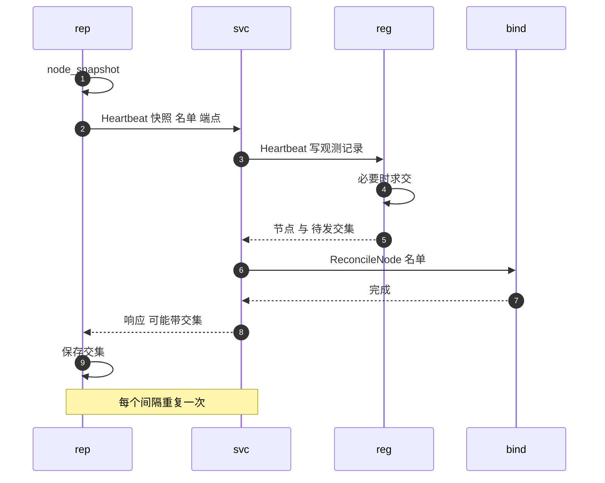
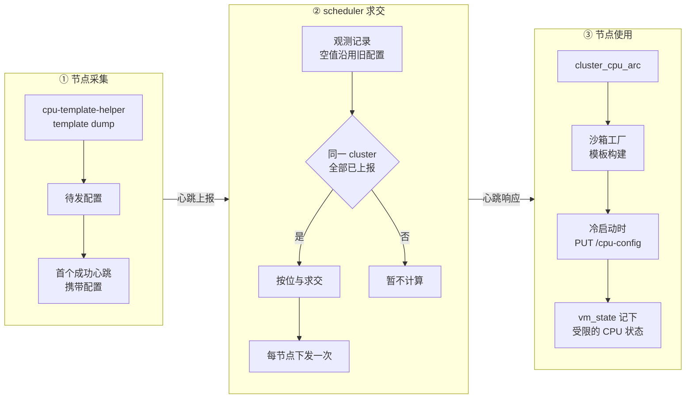

# 57 · 心跳、节点可观测与 CPU 模板交集

> 多节点部署里，scheduler 对节点的全部认识都来自节点每隔几秒推上来的一次心跳：容量、沙箱名单、P2P 地址，以及只发一次的本机 CPU 配置。
> 本篇讲这次心跳装了什么、怎样发、scheduler 怎样消化它，以及搭在心跳上的一个容易被忽视的跨节点机制：
> scheduler 把各节点的 CPU 配置按位求交，再下发给所有节点做冷启动的 CPU 模板，让快照能在不同型号的 CPU 之间恢复。
>
> **读者**：工程师、运维。　**预备**：[第 24 篇 · 指标与生命周期事件](24-metrics-and-events.md)、[第 54 篇 · 控制面总览](54-control-plane-overview.md)、[第 27 篇 · 启动、暂停与恢复的 Firecracker 调用序列](27-start-pause-resume-sequences.md)。
> **代码**：`src/observability/service.rs`、`src/observability/host.rs`、`src/observability/machine.rs`、`src/observability/reporter.rs`、`src/bin/server.rs`、`src/identity.rs`、`crates/observability/src/lib.rs`、`services/scheduler/internal/node_registry.go`、`services/scheduler/internal/cpu_template.go`、`services/scheduler/internal/service.go`、`services/api/proto/scheduler.proto`

---

## 0. 本篇要回答的问题

1. 一次心跳里有哪些数据？主机 CPU 使用率是怎么算出来的，算的是哪段时间？
2. 心跳多久发一次、失败怎样退避？scheduler 收到后做了哪几件事？节点状态 READY、UNHEALTHY、LINGERING 是谁推导的？
3. 节点关闭时为什么要先注销？`service_instance_id` 防的是什么，在缺省配置下防得住吗？
4. 为什么需要「CPU 模板交集」？它从哪里采集、在哪里计算、怎样下发、被谁使用？
5. 交集在哪些情况下算不出来、发不下去或者过期？后果是什么？
6. 节点与控制面的 Prometheus 直方图为什么要共用一组桶？

---

## 1. 问题：scheduler 凭什么做决定

scheduler 要回答三类问题：新沙箱放到哪台节点（容量），某个沙箱在哪台节点（绑定），某个制品哪些节点有（P2P 对端）。
这三类信息的真相都在节点上。scheduler 可以主动去问（拉），也可以等节点来报（推）。

AgentENV 选择推：每个节点的 `server` 进程定期调用 scheduler 的 `Heartbeat` RPC，把自己的完整现状发过去。
「完整」是关键。心跳每次都带全量的容量快照与全量的沙箱 ID 名单，scheduler 只需用最新一次覆盖旧值，不需要累积增量。
[第 24 篇 §4.3](24-metrics-and-events.md#43-为什么这样也能工作) 把这称为电平触发：丢一次心跳，下一次自然补齐。
代价是感知滞后最多一个心跳周期，以及每次都要传整份名单。

心跳装着四样东西：容量与主机指标、沙箱 ID 名单、P2P 端点（[第 58 篇](58-p2p-artifact-transport.md)），以及只在首次成功心跳里出现的本机 CPU 配置（§5）。

---

## 2. 节点快照

### 2.1 `node_snapshot()` 拼了什么

`ObservabilityService::node_snapshot()`（`src/observability/service.rs`）在每次被调用时现算一个 `NodeSnapshot`，它有两个调用方：`GET /nodes` 的处理函数与心跳上报。
各字段的来源如下。

| 字段组 | 来源 | 何时求值 |
|---|---|---|
| 版本、commit、节点 ID、集群 ID、服务实例 ID | `NodeIdentity::from_config()`（`src/identity.rs`） | 进程启动时一次 |
| CPU family / model / model name / 架构 | `detect_machine_info()` 读 `/proc/cpuinfo`（`src/observability/machine.rs`） | 构造服务时一次 |
| running / starting / paused 计数，已分配 CPU 与内存 | `Orchestrator::metrics_snapshot()` | 每次调用现算 |
| 主机 CPU%、CPU 数、内存、磁盘 | `HostMetricsCollector::collect()`（`src/observability/host.rs`） | 每次调用现算 |
| 沙箱 ID 名单 | `Orchestrator::list_sandbox_ids()` | 每次调用现算 |

容量计数怎样从元数据存储现算、八个状态各计入哪一类，在[第 24 篇 §2](24-metrics-and-events.md#2-容量快照现算而不是累加) 已经讲过，这里不重复。
沙箱 ID 名单值得再强调一次：`list_sandbox_ids()`（`src/orchestrator/service.rs`）返回存储里的全部 ID（包括暂停的沙箱）再并上 `template_build_ids`。
后者由两条模板构建路径（`src/api/impls/template.rs` 与 `src/api/impls/image_build.rs`）在构建期间登记，于是对构建状态、日志的请求也能经 gateway 路由回这台节点。

### 2.2 主机指标

`HostMetricsCollector` 每次被调用都重新读一遍主机状态：

- **CPU 使用率**：`read_cpu_sample()` 读 `/proc/stat` 的聚合 `cpu ` 行，`total` 是各列之和，`idle` 是第 4、5 列（idle 与 iowait）之和。
  `cpu_percent_between()` 用两次采样的差值算 `(Δtotal − Δidle) / Δtotal`，截断成整数百分比。
- **两次采样之间是哪段时间**：采集器把上一次的样本存在 `previous_cpu` 里，下一次调用拿它当基线。
  所以 CPU% 是「自上一次有人调用以来」的平均值，而不是一个固定窗口。`GET /nodes` 与心跳共用同一个 `ObservabilityService`，也就共用同一个基线：
  有人频繁调 `GET /nodes` 时，心跳里的 CPU% 只覆盖最近这次调用之后的一小段时间。
- **首次调用**：没有基线，`collect_host_metrics()` 先采一次，`std::thread::sleep()` 100 ms（`FIRST_REQUEST_CPU_SAMPLE_WINDOW`），再采一次。
  这是 async 函数里的同步睡眠，会占住一个 tokio worker 线程，只发生一次。
- **CPU 数与内存**：CPU 数取 `available_parallelism()`，若进程所在 cgroup 的 `cpu.max` 有配额，取 `quota / period`（至少 1）与之取小；
  内存优先用 cgroup 的 `memory.max` 与 `memory.current`（限制不超过主机总量时才采用），否则用 `/proc/meminfo` 的 `MemTotal − MemAvailable`。
- **磁盘**：遍历 `/proc/self/mounts`，只保留 ext2/3/4、xfs、btrfs、overlay 与 tmpfs，逐个 `statvfs()`。

这里有一处口径不一致：CPU 数与内存按 cgroup 收窄，CPU 使用率却读的是整机 `/proc/stat`。
推论：在容器里运行、cgroup 配额小于整机时，scheduler 看到的 `cpu_percent` 反映的是整台宿主的繁忙程度，而不是本节点配额内的使用率，
`max_cpu_used_percent` 这类过滤（[第 56 篇 §2.2](56-scheduler.md#22-资源上限)）据此做出的判断会偏离配额语义。

---

## 3. 心跳循环

### 3.1 节点侧：`ObservabilityReporter`

`src/bin/server.rs` 在 orchestrator 建好之后构造 `ObservabilityService`，再构造 `ObservabilityReporter` 并调用 `start()`。
`ReporterConfig::resolve()` 决定 reporter 是否存在：`[observability.scheduler_report] enabled` 为假（`config/default.toml` 的缺省）就不建；
为真但 `[cluster] scheduler_endpoint` 为空时记一条 warn 后同样不建。间隔取 `interval_secs`（缺省 5），至少 1 s。
gRPC 通道用 `connect_lazy()` 建立，构造时不连 scheduler。

`start()` 起两个任务。事件循环订阅生命周期广播、批量调用 `ReportSandboxEvent`；scheduler 端只记一条 debug 日志就丢弃它，见[第 24 篇 §4.2](24-metrics-and-events.md#42-谁在收)。
心跳任务是本篇的主角，它的循环如下：

1. 首轮等待 100 ms，之后每轮等待 `wait`。等待期间监听关闭信号。
2. `send_heartbeat()`：调用 `node_snapshot()`，把待发的 CPU 配置（§5.2）塞进 `machine_info.cpu_config_json`，
   用 `build_heartbeat_request()` 组装请求，以 10 s 超时（`GRPC_CALL_TIMEOUT`）调用 `Heartbeat`。
   请求里的节点状态**恒为 READY**：节点从不自报别的状态，其它状态全部由 scheduler 推导（§3.3）。
3. 成功：清掉待发的 CPU 配置；响应里的 `cpu_config_json` 非空时调用 `store_cluster_cpu_config()` 保存；`wait` 与 `backoff` 都复位为间隔。
4. 失败：`wait = backoff`，`backoff` 翻倍，上限 60 s（`MAX_REPORT_BACKOFF`）。以缺省 5 s 间隔计，连续失败时的等待依次是 5、10、20、40、60、60 … s。
   如果失败是 scheduler 以 InvalidArgument 拒绝「node is not in scheduler node list」，错误被识别为 `HeartbeatNodeNotConfigured`，
   改记 error 级日志并提示检查 `AENV_NODE_ID`，退避逻辑不变。

心跳失败只影响 scheduler 对本节点的认识，节点上的沙箱照常运行。

### 3.2 scheduler 侧：`Heartbeat()`

下图是一次心跳在两端经过的步骤。参与者：`rep` 是节点上的心跳任务，`svc` 是 scheduler 的 `Service`（`services/scheduler/internal/service.go`），
`reg` 是节点注册表 `AtomicNodeRegistry`（`node_registry.go`），`bind` 是绑定存储（内存或 Redis）。

`Service.Heartbeat()` 先检查 `node_id` 与 `service_instance_id` 非空，然后做两件事：

- **写观测记录**：`AtomicNodeRegistry.Heartbeat()` 要求节点 ID 在发现列表 `nodesByID` 里，否则返回 `ErrNodeNotInRegistry`，被映射成上面那个 InvalidArgument。
  发现列表来自 static 配置或 Kubernetes 发现（[第 56 篇 §4](56-scheduler.md#4-节点发现)），心跳本身不能让一个新节点「加入」集群。
  心跳只发往 primary，query-only 副本不实现 `Heartbeat`（[第 54 篇 §3.4](54-control-plane-overview.md#34-query-only-服务)）。
  通过检查后，它用请求内容整体替换该节点的 `observedNodeRecord`：快照、机器信息、P2P 端点、`LastSeenUnixMs = now`。
  CPU 交集的计算也在这里，见 §5.3。
- **刷新绑定**：`ReconcileNode(node, sandbox_ids)` 让绑定表与名单一致——名单内的续期，名单外的删除。这就是「心跳名单即真相」，它与 gateway 提前写入之间的竞态见[第 56 篇 §5](56-scheduler.md#5-一致性心跳与提前写入的交错)。
  绑定存储不可用时返回 Unavailable，节点按失败退避。

### 3.3 节点状态由谁推导

观测记录只是原始数据。对外展示的状态由 `deriveObservedNodeViewLocked()` 在每次读取时推导，按顺序判断：

| 条件 | 推导出的状态 |
|---|---|
| 距 `LastSeenUnixMs` 超过 `report_ttl`（缺省 30 s） | UNHEALTHY |
| 节点不在发现列表中 | CONNECTING |
| 节点在发现列表中、标记为 lingering（Kubernetes 中 Pod 正在终止） | LINGERING |
| 其它 | 节点自报的状态，即 READY |

`scheduler.proto` 注释里那张六行推导表见[第 54 篇 §4](54-control-plane-overview.md#4-节点状态)，其中两行「从未心跳 → CONNECTING」在代码里没有对应：
从未心跳过的节点没有观测记录，`ListObserved()` 不列出它，`GetNode` 返回 NotFound，`GET /nodes` 里就看不到它。
反过来，表里没有的「不在发现列表中」分支实际几乎不可达：`Heartbeat()` 拒绝不在列表里的节点，`Set()` 替换发现列表时会删掉消失节点的观测记录。

推导出的状态被三处使用：`GET /nodes` 等展示、scheduler 每 15 s 刷新一次的 `agentenv_scheduler_observed_nodes` gauge，以及 P2P 对端过滤（只保留 READY）。
`Schedule` 不看它，它只按发现列表去掉 lingering 节点；一台已经 UNHEALTHY 的节点仍可能被选中（[第 56 篇 §2.4](56-scheduler.md#24-不排除-unhealthy-节点)）。
UNHEALTHY 的观测记录也不会被自动删除，它一直留在 `observed` 里，直到节点注销或从发现列表消失。

---

## 4. 注销与关闭

### 4.1 `UnregisterNode`

`ObservabilityReporter::shutdown()` 先发关闭信号并等两个任务退出，然后调用 `UnregisterNode(node_id, service_instance_id)`，最多试 3 次，间隔 200 ms × 第几次。
如果进程生命期内从未有一次心跳成功（`ever_heartbeat_succeeded` 为假），就跳过注销：此时 scheduler 多半不可达或配置有误，注销只会白白等待超时。

scheduler 端的 `Service.UnregisterNode()` 做三件事：

1. `UnregisterObserved()`：记录不存在则直接成功；记录里的 `service_instance_id` 与请求不一致则返回 FailedPrecondition；一致则删掉观测记录，并让本集群的 CPU 交集失效（§5.3）。
2. `ReconcileNode(node, nil)`：用空名单撤掉这个节点名下的全部绑定。
3. `artifacts.ForgetNode()`：从 P2P 制品索引里删掉这个节点（[第 58 篇](58-p2p-artifact-transport.md)）。

`service_instance_id` 检查要防的场景是：同一个节点 ID 的新进程已经起来并心跳过，旧进程的注销姗姗来迟，把新进程的记录删掉。
这个检查只有在每个进程的实例 ID 不同时才有意义。`NodeIdentity::from_config()` 在配置为空时生成 UUIDv7，但 `config/default.toml` 写死了 `"service-instance-a"`，
仓库里的 Compose 与 Kubernetes 部署都不覆盖它；缺省部署下这道防护形同虚设（[第 54 篇 §3.2](54-control-plane-overview.md#32-消息设计里的几个决定)）。

### 4.2 关闭顺序带来的两个窗口

`src/bin/server.rs` 的清理任务先停 reporter（注销），再调 `Orchestrator::shutdown()` 把运行中的沙箱暂停落盘（顺序表见[第 10 篇 §3.1](10-node-process-and-object-model.md#31-触发与并发结构)）。
注销会撤掉这个节点名下的全部绑定，于是从注销到新进程首次心跳成功之间，gateway 对这个节点上任何沙箱的查找都得到 NotFound，客户端拿到 404。
这个窗口与它对暂停沙箱、自动恢复的影响在[第 22 篇 §7](22-persistence-across-restarts.md#7-崩溃一致性边界) 已经讲过，两篇口径一致。

还有一个容易被误解的地方：注销删掉的是**观测记录与绑定**，不是发现列表里的节点。`Schedule` 用的是发现列表，
所以在 static 发现下，正在关闭的节点仍可能被选中承接新的创建请求；而 axum 的优雅关闭已经停止接受新连接，推论：这类请求在 gateway 上表现为 502。
Kubernetes 发现下 Pod 进入 Terminating 后会被标为 lingering，`Schedule` 不再选它，这个问题不出现。

启动一侧也有一个小窗口。`server.rs` 在 API 监听建立之前就调用了 `reporter.start()`，首个心跳在 100 ms 后发出，名单里已经有从持久化记录载入的暂停沙箱。
推论：如果此后到监听建立之间还有耗时步骤（例如 `recover_image_builds()`），gateway 可能已经把请求路由过来而节点端口尚未打开，得到连接失败。

---

## 5. CPU 模板交集

### 5.1 问题：快照记住了 CPU

Firecracker 的快照（vm_state）里保存着 vCPU 状态，其中包括 guest 看到的 CPUID 与一批 MSR。
guest 内核与用户态程序在启动时探测 CPU 特性，之后就按探测结果选择指令路径。
一台在支持 AVX-512 的节点上冷启动的沙箱，暂停后若被恢复到一台不支持 AVX-512 的节点上，guest 仍然相信自己可以用这些指令，执行到时就会出错。

有两种办法。一是约束放置：只让快照在 CPU 型号相同的节点上恢复。二是约束 guest：让所有 guest 从一开始就只看到全集群都有的特性，
这样无论恢复到哪台节点，guest 的认知都不会超出宿主的能力。Firecracker 的 CPU 模板（见 Firecracker 手册第 20 篇）提供了第二种办法所需的机制：
在 `InstanceStart` 之前用 `PUT /cpu-config` 声明 guest 看到的 CPUID 与 MSR 位。上游文档建议的做法是在每种机型上 dump 配置、人工比较差异、手写模板并验证。
AgentENV 把这个流程自动化了：节点 dump，scheduler 按位求交，再下发回节点。

下图是这条链路的全貌，§5.2 到 §5.4 依次展开。

### 5.2 节点采集

`AppConfig::resolved_cpu_template_helper()`（`src/cfg.rs`）在 `deps/firecracker/<版本>/cpu-template-helper` 存在时返回它的路径。
`ObservabilityService::new()` 拿到路径就调用 `dump_cpu_config()`（`src/observability/machine.rs`）：
在 `spawn_blocking` 里执行 `cpu-template-helper template dump -o /dev/stdout`，退出码为 0 且输出非空时把 JSON 文本存进 `pending_cpu_config`；
二进制不存在、执行失败或输出为空时返回 `None`，没有任何日志。

心跳任务启动时用 `take_cpu_config_json()` 取走这份配置，每轮都把它放进请求，直到第一次心跳成功后置空。
所以 CPU 配置只在进程生命期内的**首个成功心跳**里出现；之后的心跳 `cpu_config_json` 为空串。
dump 只在 `[observability] enabled` 为真时发生（`ObservabilityService` 由它决定是否构造），与是否开启心跳上报无关。

### 5.3 scheduler 求交

求交发生在 `AtomicNodeRegistry.Heartbeat()` 里，持注册表写锁，状态由三张表维护：`observed`（每节点的记录，含 CPU 配置）、
`cpuIntersection`（每个 cluster 的交集结果）、`intersectionSent`（每个节点是否已经收到过交集）。规则如下：

1. **沿用**：节点已有记录且这次请求的 `cpu_config_json` 为空时，把旧记录里的配置抄进新记录。这让「只发一次」的配置在后续心跳覆盖记录后仍然保留。
2. **失效**：节点是第一次出现（`!existed`），或这次带来的配置与旧值不同，就调用 `invalidateIntersectionLocked()`：删掉本 cluster 的交集，并清掉本 cluster 所有节点的 `intersectionSent`。
   `UnregisterObserved()` 与发现列表变化（`Set()`）删除记录时也会让交集失效。
3. **计算**：本 cluster 还没有交集时，`allConfigsReadyLocked()` 检查 `observed` 里属于该 cluster 的每一条记录都带着非空配置；满足才调用 `IntersectCpuConfigs()`，结果非空才存下。
   注意「每一条记录」只包括心跳过的节点，发现列表里从未心跳的节点不计入；UNHEALTHY 的旧记录则仍然计入。
4. **下发**：本 cluster 有交集且这个节点的 `intersectionSent` 为假时，置真并把交集放进这次响应；否则响应里为空串。

cluster 按心跳里的 `cluster_id` 字符串分组。`config/default.toml` 的缺省值是全零 UUID，不显式配置时所有节点同属一个 cluster。

`IntersectCpuConfigs()`（`services/scheduler/internal/cpu_template.go`）对解析后的 JSON 做保守的按位与：

- **CPUID**：以 (leaf, subleaf, flags) 为键，只保留每份配置里都有的键；对每个键内的寄存器，也只保留每份配置都有的，取值为各份位图的按位与。
  遍历以第一份配置为序，结果确定；代码注释承认，只出现在其它配置里的寄存器不会被访问，结果可能比真正的交集更窄，但仍是安全的。
  leaf `0xb` 与 `0x1f`（`kvmReadOnlyLeafIDs`，CPU 拓扑信息）一律跳过，因为 KVM 不允许模板覆盖它们。
- **MSR**：以地址为键，只保留共有的地址，64 位位图按位与。
- **`kvm_capabilities`**：取各份列表的交集并排序。

输出的位图写成 `0b` 加 32 位或 64 位的 0/1 串，每一位都是确定值，没有 `x`。按 Firecracker 模板的语义，这意味着模板接管了寄存器的每一位，而不只是特性位。
推论：CPUID 里并非所有字段都是「有则为 1」的特性标志，例如最大功能号、family / model / stepping、缓存描述，按位与得到的可能是任何一台机器都不具有的值。
单一机型的集群里交集等于自身，这个问题不出现；机型越杂，越需要用 `cpu-template-helper template verify` 一类手段确认交集模板对 guest 无害。
另外 `parseBitmapU32()` 只接受 0/1，遇到含 `x` 的位串会报错，整个交集就算不出来（结果为空、不存储）。

### 5.4 下发与使用

节点把收到的交集写进 `cluster_cpu_arc`，一个 `Arc<RwLock<Option<String>>>`。`src/bin/server.rs` 把同一个句柄交给三个对象：
`ObservabilityService`（写）、`FirecrackerSandboxFactory::with_cpu_config()` 与 `TemplateBuilder::with_cpu_config()`（读）。

- 沙箱工厂在冷启动构建配置时（`src/sandbox/firecracker/factory.rs` 的 `build()`）读一次当前值，写进 `config.common.cpu_config_json`；
  `FirecrackerSandbox::configure_microvm()` 在 machine-config 之后、boot-source 之前调用 `FirecrackerInstance::set_cpu_config()`，即 `PUT /cpu-config`（[第 27 篇 §3](27-start-pause-resume-sequences.md#3-冷启动的配置序列)）。
- 模板构建在准备上下文时（`src/template/builder.rs` 的 `current_cpu_config()`）读当前值，交给构建 VM。
- 从快照恢复**不**设 cpu-config。`src/sandbox/firecracker/config.rs` 的注释写明：CPU 状态已经序列化在 vm_state 里，重设既不正确也会被 Firecracker 拒绝。

于是交集真正起作用的时刻只有一个：**冷启动**。一台沙箱在冷启动那一刻读到的交集，决定了它此后所有快照、所有恢复中 guest 看到的 CPU。
`PUT /cpu-config` 是标准的 Firecracker 端点，上游 Firecracker v1.15.1 就有，不属于 AENV 补丁版 Firecracker 的改动。

### 5.5 边界与失效模式

把 §5.2 到 §5.4 的规则放在一起，可以推出以下情形。它们都由上面引用的代码直接推出，没有测试覆盖，统一标为推论。

| 情形 | 机制 | 后果 |
|---|---|---|
| 交集随节点加入而收窄 | 第一台节点心跳时 cluster 里只有它一条记录，交集就是它自己；之后每有新节点首次心跳，交集失效、重算、重新下发 | 早先冷启动的沙箱带着更宽的特性集，它们的快照恢复到后加入的节点上不受保护 |
| 任一节点没有上报配置 | 没有 `cpu-template-helper`、dump 失败，或 §5.2 的「只发一次」已经用掉 | `allConfigsReadyLocked()` 永远为假，整个 cluster 没有交集，新节点拿不到，老节点保留手里的旧值 |
| scheduler 重启 | 观测记录全在内存里，重启后清空（[第 56 篇 §6.3](56-scheduler.md#63-primary-重启之后)）；节点的后续心跳不再带配置，新建的记录配置为空 | 同上一行；直到所有节点各自重启并重新上报 |
| 节点崩溃后重启 | 没走注销，scheduler 里旧记录还在；新进程带来同样的配置，不触发失效；`intersectionSent` 仍为真 | 新进程收不到交集，它的冷启动不设 cpu-config，guest 看到本机全部特性 |
| 交集响应丢失 | `intersectionSent` 在 `Heartbeat()` 返回前已置真；之后 `ReconcileNode` 失败返回 Unavailable，或节点侧 10 s 超时 | 这个节点收不到交集，也不会再收到，直到下一次失效 |
| 交集被 Firecracker 拒绝 | `set_cpu_config()` 出错会让 `configure_microvm()` 失败 | 这个节点此后所有冷启动都失败 |

前三行说明交集是一个**尽力而为的、只在 scheduler 内存里存在的派生物**，没有持久化，也没有「再报一次」的机制。
第四、五行源于「每节点只下发一次」这条去重规则：它省掉了每次心跳都传一份大 JSON，代价是下发本身没有确认，丢了就不补。
节点正常重启时，注销删掉了旧记录，新进程首次心跳触发失效，全 cluster 重新下发，这条路径是通的。

还有一层更根本的限制：交集保证的是「guest 看到的特性每台节点都有」，它不检查一份已有快照是否在交集之内。
一份快照能否在某台节点上安全恢复，取决于它冷启动时用的配置，而这个配置没有被记进快照记录。推论：混合机型的集群若要可靠地跨节点恢复，
需要在所有节点都上报、交集稳定之后再开始创建模板与沙箱，并在 scheduler 重启后关注节点日志里是否再次出现「received cluster cpu config intersection」。

---

## 6. 共用的直方图桶

Prometheus 指标的全表在[第 24 篇 §5](24-metrics-and-events.md#5-prometheus-指标)。这里只讲一条跨语言的约定：
节点侧 `crates/observability/src/lib.rs` 的 `DURATION_BUCKETS` 与 Go 侧 `services/shared/observability/buckets.go` 的 `DurationBuckets` 是同一组 21 个边界（1 ms 到 1800 s），两边注释都要求保持同步。

原因在查询端。Prometheus 的直方图分位数要先 `sum by (le)` 再 `histogram_quantile()`；只有 `le` 边界完全相同，
gateway 的上游转发时延、scheduler 的 RPC 时延（`agentenv_scheduler_rpc_duration_seconds`、`agentenv_scheduler_schedule_duration_seconds`）与节点的 HTTP 时延才能放在一条查询里比较或相加。
桶由两份源码各自定义，没有生成或测试保证一致，靠注释约束。Go 一侧的注释写着与 `src/observability/prometheus.rs` 同步，但桶实际定义在 `crates/observability/src/lib.rs`，注释指向的文件已经不对。

---

## 7. 与 e2b infra 的对照

e2b infra 的 API 每 20 s 主动拉取各 orchestrator 节点的 ServiceInfo 来同步容量与状态，并用 service instance ID 识别进程重启；AgentENV 让节点推心跳，scheduler 只被动接收。
CPU 兼容方面，e2b infra 不设 CPU 模板，guest 看到宿主的完整特性，放置时要求构建机与目标节点的 CPU 架构、family、model 全等，快照只在同型号机器上恢复。
AgentENV 用自动求交的 CPU 模板换取跨型号恢复，代价是 guest 看到的特性集被最弱的节点限定，且交集的计算与下发只在 scheduler 内存里、没有持久化与重试。

---

## 8. 小结

- 心跳是电平触发的全量同步：每次带完整容量快照与完整沙箱名单，scheduler 用最新值覆盖；名单包括暂停的沙箱与进行中的模板构建。
- 主机 CPU% 是「自上一次任何人调用以来」的 `/proc/stat` 差值，`GET /nodes` 与心跳共用基线；CPU 数与内存按 cgroup 收窄，CPU% 却是整机口径。
- 心跳间隔缺省 5 s，失败按倍数退避到 60 s；节点自报状态恒为 READY，UNHEALTHY / LINGERING 由 scheduler 读取时推导，proto 注释里的「无心跳 → CONNECTING」在代码中没有对应。
- scheduler 只接受发现列表里的节点的心跳；心跳写观测记录、刷新绑定、顺带计算并下发 CPU 交集。
- 关闭时先注销再暂停：注销撤掉全部绑定，造成重启前的 404 窗口；注销不把节点移出发现列表，static 模式下关闭中的节点仍可能被调度。
- `service_instance_id` 用来防旧进程误注销新进程，但缺省 `default.toml` 把它写死，防护在缺省部署下失效。
- CPU 交集由节点 dump、在首个成功心跳里上报一次，scheduler 在同 cluster 全部上报后按位与，每节点下发一次；它只在冷启动的 `PUT /cpu-config` 里生效。
- 交集只存在于 scheduler 内存，随节点加入收窄；scheduler 重启、节点崩溃重启、响应丢失都会让部分节点长期拿不到交集。
- 按位与覆盖寄存器的每一位，包括非特性字段，混合机型下需要额外验证交集模板。
- 节点与控制面的时延直方图共用 21 个桶边界，靠两份源码里的注释保持同步。

---

## 延伸阅读 / 下一篇

- [第 24 篇 · 指标与生命周期事件](24-metrics-and-events.md)：容量快照的现算、生命周期事件与 Prometheus 指标全表。
- [第 56 篇 · scheduler](56-scheduler.md)：容量过滤、绑定存储与 `ReconcileNode`、发现与 lingering。
- [第 22 篇 · 跨重启持久化](22-persistence-across-restarts.md)：关闭顺序与 404 窗口。
- [第 27 篇 · 启动、暂停与恢复的 Firecracker 调用序列](27-start-pause-resume-sequences.md)：`PUT /cpu-config` 在冷启动序列中的位置。
- [Firecracker 手册第 20 篇 · CPU 模板机制](../firecracker/20-cpu-templates.md)、[Firecracker 手册第 21 篇 · CPUID 与 MSR 归一化](../firecracker/21-x86-64-cpuid-msr-normalization.md)：模板的数据模型与位图语义。
- [e2b 手册第 19 篇 · 节点管理与放置](../e2b-infra/19-node-management-and-placement.md)：拉取式同步与 CPU 型号全等检查。
- 下一篇：[第 58 篇 · P2P 制品传输](58-p2p-artifact-transport.md)。
