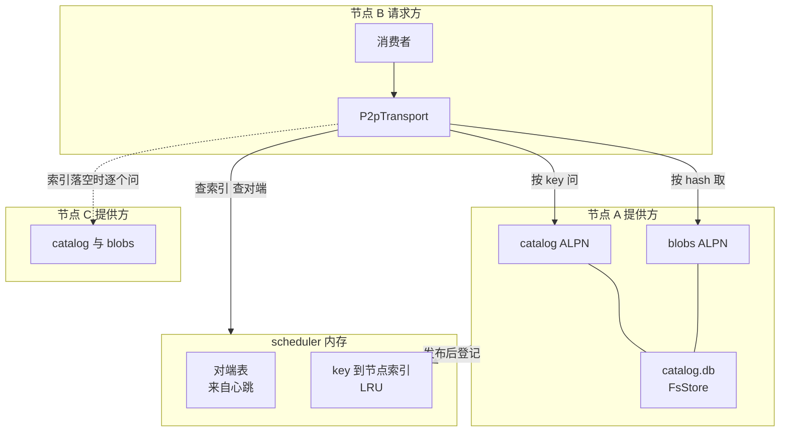
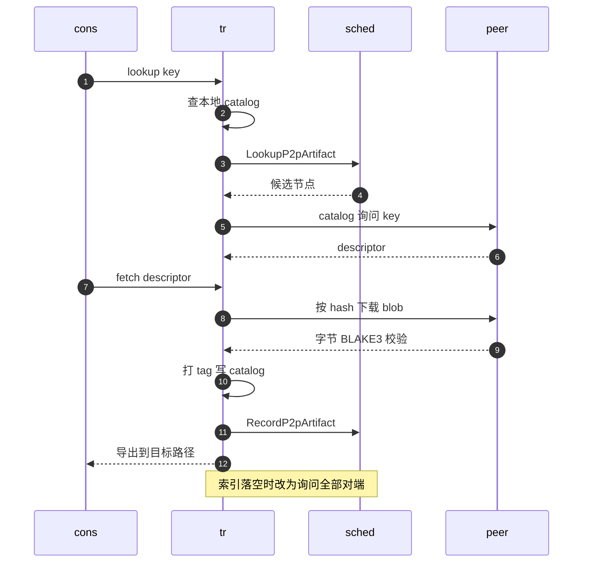

# 58 · P2P 制品传输

> 多节点集群里，同一份快照的 vm_state、同一个镜像层，往往已经在某台邻居节点的磁盘上；再去对象存储或 registry 拉一遍，既慢又费出口带宽。
> AgentENV 的 P2P 子系统让节点之间直接交换这些制品：一个与具体实现无关的传输抽象，一个基于 iroh 的后端，scheduler 上的一张「谁有什么」索引，以及三类各自定义 key 与校验方式的消费者。
> 本篇讲这条加速路径怎样工作、失败时怎样退回源头，以及它默认信任集群内每个对端这一前提。
>
> **读者**：工程师、运维。　**预备**：[第 57 篇 · 心跳](57-heartbeat-and-cpu-intersection.md)、[第 38 篇 · VirtualFile 链与远端 I/O](38-virtualfile-chain-and-remote-io.md)、[第 48 篇 · 对象存储仓库](48-oss-repository.md)。
> **代码**：`src/p2p/transport.rs`、`src/p2p/types.rs`、`src/p2p/mod.rs`、`src/p2p/iroh/transport.rs`、`src/p2p/iroh/catalog.rs`、`src/p2p/discovery/`、`src/overlaybd/p2p/`、`src/snapshot/p2p.rs`、`src/snapshot/manager.rs`、`src/snapshot/repository/backends/oss/resolver.rs`、`src/image/cache/service.rs`、`services/scheduler/internal/store.go`

---

## 0. 本篇要回答的问题

1. P2P 的抽象由哪几个概念组成？关掉 P2P 时调用方为什么不需要写分支？
2. iroh 后端在一个节点上起了什么？数据与元数据怎样在同一个端点上分开？
3. 一次 lookup 依次问了谁？fetch 怎样校验字节、怎样防止下载到一半被 GC 回收、成功后做了什么？
4. 哪三类制品走 P2P？各自的 key 怎样构造、怎样校验、失败退回到哪里？
5. overlaybd 的 HTTP 门面为什么在中途出错时不退回 origin？
6. P2P 的信任边界在哪里？哪些情况下它会把一个不可信的对端当成可信？

---

## 1. 问题：制品已经在邻居那里

节点要从远端取的东西有三类：OSS 仓库里的快照固定制品（vm_state、Firecracker manifest，[第 48 篇](48-oss-repository.md)），
overlaybd 层的按需块读（[第 38 篇](38-virtualfile-chain-and-remote-io.md)），以及把 OCI 层转换成 overlaybd 层的产物（[第 45 篇](45-image-pull-and-conversion.md)）。
在一个几十台节点的集群里，热门模板的这些制品很快就会在多台节点上各有一份。

P2P 要做的是在「去源头取」之前先问一句「集群里谁已经有了」。这句问话的代价必须足够小，失败必须不影响正确性：
源头永远是权威，P2P 只是一层可以整个清空的缓存。本篇反复出现的设计原则都从这一句推出：
**P2P 的任何失败都等价于缓存未命中**。

需要先说明一点：`config/default.toml` 在 `[p2p]` 段上方注明 P2P 是实验性功能、未在生产环境测试过，`[p2p] enabled` 缺省为 false。
本篇讲的是它在 v0.2.3 中的设计与实现。

---

## 2. 抽象：key、descriptor、provider

`src/p2p/types.rs` 与 `src/p2p/transport.rs` 定义了与实现无关的四个概念：

- **key**（`P2pArtifactKey`）是一个字符串，由消费者自己编码完整的上下文，传输层不解释它。
- **descriptor**（`P2pArtifactDescriptor`）是一次查找的结果：key、provider 列表、`backend_locator`（iroh 后端里是 blob 的 BLAKE3 hash）与一段 JSON `metadata`。metadata 的格式由消费者定义，传输层原样携带。
- **provider** 是 `Local`（本节点就有）或 `Peer { node_id, endpoint }`，endpoint 是 `(backend, address)` 二元组，address 对传输层之外不透明。
- **publish** 的来源可以是文件或内存字节，文件可以选 `Copy`（拷进 P2P 存储）或 `Reference`（尽量只引用原文件）。

`P2pTransport` trait 的方法有 `lookup_with_hints()`、`fetch_with_options()`、`fetch_bytes_with_options()`、`fetch_byte_range()`、`publish()`、`unpublish()`、`local_endpoint()` 与 `shutdown()`。
fetch 默认 `advertise = true`，即取到之后把自己登记为新的提供方。`fetch_byte_range()` 的契约写在注释里：要么恰好产出 `len` 字节，要么以错误结束流；
调用方可能已经发出了响应头，短读不得「成功」结束。

`DisabledP2pTransport` 是关闭时的实现：lookup 返回 `None`，publish 与 unpublish 返回成功的空操作，fetch 返回 `TransportDisabled`。
`src/p2p/mod.rs` 的 `transport_from_config()` 在 `[p2p] enabled = false` 时返回它。调用方因此可以无条件地「先查 P2P」：查不到就走原路，不需要到处判断开关。

---

## 3. iroh 后端

### 3.1 一个节点上起了什么

`IrohBlobsP2pTransport::new_with_gc_interval()`（`src/p2p/iroh/transport.rs`）在 `<p2p.store_dir>/iroh/` 下建立三样东西：

- **FsStore**：iroh-blobs 的内容寻址存储，元数据在 `blobs.db`。所有经 P2P 发布或下载的字节都先进这里。
- **catalog**：`PublishedArtifactCatalog`（`src/p2p/iroh/catalog.rs`），本节点发布过的 key → descriptor，内存一份、RocksDB `catalog.db` 一份（WAL 持久）。重启后从 RocksDB 读回。
- **endpoint 与 Router**：`Endpoint::builder(presets::Minimal)` 配一个内存地址簿 `MemoryLookup`，即不使用 iroh 的公共发现与中继服务，
  对端地址全部由 AgentENV 自己分发；`listen_addr` 缺省 `0.0.0.0:0`，端口由系统分配。
  一个 Router 在同一端点上接受两个 ALPN：`iroh_blobs::ALPN` 按 hash 提供字节，`/agentenv/artifact-catalog/v1` 按 key 回答 descriptor。

catalog 协议很简单：请求是一个 JSON `{key}`（上限 1 MiB），响应是 `{descriptor}`（上限 8 MiB）。
`CatalogProtocol::descriptor_for_response()` 在回答时把 provider 列表换成「本节点当前的 node_id 与 endpoint」，而不是存储里的旧值，
所以重启后端点变化不会让旧 descriptor 指向一个已经不存在的地址。

本节点的 endpoint 经心跳的 `p2p_endpoint` 字段上报给 scheduler（[第 57 篇 §3.1](57-heartbeat-and-cpu-intersection.md#31-节点侧observabilityreporter)）。
`SchedulerPeerDiscovery`（`src/p2p/discovery/scheduler.rs`）每隔 `peer_discovery_refresh_interval_secs`（缺省 5 s，至少 1 s，首轮加随机抖动）调用 `ListP2pPeers` 刷新对端表；
scheduler 只返回推导状态为 READY、上报了 endpoint、backend 匹配且不是自己的节点。没有配置 `[cluster] scheduler_endpoint` 时用 `NoopP2pPeerDiscovery`，单节点只能命中本地。

下图是三台节点与 scheduler 之间的关系。scheduler 只保存地址与「谁有什么」，不代理 catalog 请求，也不经手字节。

### 3.2 publish

`publish()` 把文件（`add_path_with_opts`，`Copy` 或 `TryReference`）或字节（`add_bytes`）导入 FsStore，得到 blob hash；
`advertise_local_blob()` 用确定性的命名 tag `agentenv:p2p:v1:{sha256(key)}` 钉住这个 blob，再把 provider 为 `Local`、locator 为 hash 的 descriptor 写进 catalog；
最后尽力调用 scheduler 的 `RecordP2pArtifact` 登记，失败只记 warn。命名 tag 就是「保留」语义：只要 tag 在，GC 就不会回收这个 blob。

### 3.3 lookup：三级

`lookup_with_hints()` 按顺序问三个地方，命中即返回：

1. **本地 catalog**。
2. **scheduler 索引**：`peers_for_key()` 调 `LookupP2pArtifact`（5 s 超时），得到登记过这个 key 的节点（scheduler 端再按 READY 与 endpoint 过滤），
   对它们并发（`MAX_CONCURRENT_CATALOG_LOOKUPS = 4`）走 catalog ALPN 询问，每个对端受 `lookup_timeout`（缺省 5 s）限制。
   `first_some_buffered_in_order()` 按候选顺序取**第一个**有结果的，后面的不再等，代码注释称这是「为简单起见的短路」。
3. **全部对端**：索引落空或 scheduler 不可达时，取发现到的对端表（调用方给的 hint 排在前面、按节点 ID 与 endpoint 去重），用同样的方式逐个询问。

第三级是一次广播。推论：一个集群里根本不存在的 key，查找代价正比于对端数乘以单个询问的时延，最坏情况下每 4 个对端等一个 `lookup_timeout`；
消费者自己的超时（如 §5 门面的 300 ms）才是实际的上限。scheduler 的索引只保存 key → 节点，不保存 locator 与 metadata，descriptor 始终要向提供方本人要。

### 3.4 fetch、校验与 GC

`fetch_with_options()` 先用 `resolve_fetch_source()` 判断：descriptor 含 `Local` 就直接从本地 FsStore 导出到目标路径；
否则把各 provider 的地址注入 `MemoryLookup`，调用 `download_blob()`。下面的时序图把一次跨节点的查找与下载串起来。
参与者：`cons` 是消费者，`tr` 是本节点的传输层，`sched` 是 scheduler，`peer` 是持有制品的对端。

几个要点：

- **校验**。iroh-blobs 按 BLAKE3 树哈希验证下载的每一段，字节与 descriptor 里的 hash 不符就失败。注意被验证的是「与对端自己报出的 hash 一致」，不是「与仓库记录一致」，§6 会回到这一点。
- **防 GC**。`download_blob()` 下载之前先 `pin_blob()` 拿一个 TempTag，调用方持有它直到导出或读完；范围读则把 tag 交给返回的流，流结束或被丢弃时释放。
  注释写明「下载完成本身不保留 blob」，没有这个 tag，下载完与导出之间的 GC 就可能把它收走。
- **自广告**。`advertise = true` 时，`try_advertise_fetched_blob()` 打命名 tag、写 catalog、向 scheduler 登记，于是取过一次的节点成为新的提供方，制品在集群里副本越来越多。
  自广告的 descriptor 只含 `Local`，代码里的 TODO 说明它没有合并先前的 provider。
- **范围读**（`fetch_byte_range()`）只下载请求的那几段（`GetRequest::blob_ranges`），不做自广告：一个只有部分字节的 blob 不能声称自己能提供整个制品。
- **门控 GC**。`gated_gc_config()` 让 FsStore 每 5 min 醒一次，但 `add_protected` 回调只在 `pending_gc` 为真时放行 mark/sweep，否则直接中止；
  `pending_gc` 在启动时为真一次，之后只有 `unpublish()` 删掉命名 tag 时才置真。这省掉了在没有删除发生时反复扫描一个大存储。
  推论：范围读与 `advertise = false` 的下载留下的未钉住字节，要等下一次 unpublish 或重启触发 GC 才会被回收，在此之前一直占用 `store_dir` 的空间。
- **unpublish** 删 catalog 条目、删命名 tag、置 `pending_gc`、尽力调 `ForgetP2pArtifact`；字节由之后的 GC 回收。

### 3.5 scheduler 侧的索引

`InMemoryArtifactStore`（`services/scheduler/internal/store.go`）以 (cluster, backend, key) 为键保存一个节点集合，并维护节点 → key 的反向索引，
总条目数由 LRU 限制（`artifact_store_capacity` 缺省 1,000,000），`artifact_lookup_node_limit` 缺省 0 表示返回全部节点。
`RecordP2PArtifact` 要求节点在发现列表中；`UnregisterNode` 时 `ForgetNode()` 清掉这个节点的全部条目（[第 57 篇 §4.1](57-heartbeat-and-cpu-intersection.md#41-unregisternode)）。

这张索引只在 primary scheduler 的内存里，不进 Redis。scheduler 重启、节点注销都会清空相应条目，而节点重启后虽然从 RocksDB 读回了 catalog，
代码里没有把已有 catalog 重新登记到 scheduler 的路径（`record_key()` 只在 publish 与自广告时调用）。
推论：重启过的节点上的制品此后只能经第三级广播被找到，直到它们被再次发布或下载。

---

## 4. 三个消费者与 key 空间

| key | 生产者 | 消费者 | 取到后的校验 | 失败时 |
|---|---|---|---|---|
| `snapshot/v1/artifacts/{id}/vm_state.bin` | 快照提交后 `publish_p2p_artifacts()`，文件 Copy | OSS resolver 取 vm_state | 只有 BLAKE3 与对端 hash 一致 | OSS `get_to_file` |
| `snapshot/v1/artifacts/{id}/firecracker-manifest.json` | 同上，内存字节 | OSS resolver 读 manifest | JSON 能解析 | OSS `get_bytes` |
| `overlaybd-layer/v1/sha256:<digest>` | 快照提交后发布本地层，文件 Copy | 门面 `/p2p-http`，ublk-daemon 读 registry 层 | metadata 的协议、规范 key 与 digest 匹配 | 转发到 origin |
| `overlaybd-layer/v1/uuid/<uuid>` | 同上，限 committed 记录里有 uuid 的层 | 门面 `/p2p-uuid`，本地缺失的层 | metadata 的 uuid 匹配 | 没有 origin，404 或 502 |
| `oci-layer/v1/<sha256(转换上下文)>` | image cache 转换完成，文件 Reference | `lookup_remote_converted_layer()` | 重算 sha256 与大小，读 sealed 层 uuid | 本地下载并转换 |

**快照固定制品**。`SnapshotManager::publish_p2p_artifacts()`（`src/snapshot/manager.rs`）在仓库提交成功之后执行：提交失败不发布，P2P 发布失败不回滚提交，
各制品以 8 路并发发布、单个失败只记 warn。它与仓库后端无关，只看 `SnapshotManager` 手里有没有传输（`[snapshot] p2p_enabled` 缺省 true，且需 `[p2p] enabled`）。
消费者只有 OSS resolver（`src/snapshot/repository/backends/oss/resolver.rs`）：取 vm_state 时在 `ensure_cached()` 的填充回调里先试 `p2p::fetch_artifact()`，
读 manifest 时先试 `fetch_artifact_bytes()`，失败都以 debug 日志退回 OSS。POSIX 仓库不消费 P2P，`default.toml` 的注释也说 POSIX 固定制品以仓库为准。
推论：POSIX 部署下开启 P2P，每次快照提交都会把 vm_state 与各层以 Copy 方式再存一份进 FsStore，却没有消费者读固定制品；
而快照删除时没有任何代码调用 unpublish，这些副本由命名 tag 钉住，永不回收。

**overlaybd 层**。发布侧在 `SnapshotP2pArtifact::local_overlaybd_layers()`（`src/snapshot/p2p.rs`）：对 rootfs、内存与附加盘的 image config 里每个本地 lower，
只有当它的 digest 出现在 committed 记录里时才按 digest 发布。原因是发布时压缩会把原始层重新封装成 ZFile，记录里写的是压缩后的 digest，按原始 digest 发布的 key 不会有人来查；
压缩后的上传文件由 manager 另行按记录里的描述符发布。按 uuid 发布则限于记录里带 uuid 的层。消费侧见 §5。

**转换层复用**。key 是 `LayerConversionKey`（源层 digest、转换器 ID、虚拟大小、是否 mkfs、父层 commit digest、预期层 uuid）序列化后的 sha256，
表达的是「同样的输入、同样的转换器会产出同样的层」。`lookup_remote_converted_layer()`（`src/image/cache/service.rs`）找到 descriptor 后，以 `advertise = false` 下载到临时目录，
重算 sha256 与大小并与 metadata 比较，再读出 sealed 层的 uuid 与预期值比较，全部通过才持久化进 image cache，然后由 image cache 以 `Reference` 方式重新发布并记下 key 的归属；
之后 image cache GC 删除这个层时会 unpublish 它。三类消费者里只有这一类在 P2P 发布与本地 GC 之间建立了闭环。

---

## 5. overlaybd 的 HTTP 门面

### 5.1 为什么是一个 HTTP 服务

Rust 版 overlaybd 跑在 ublk-daemon 进程里，它读 registry 层时发出的是 HTTP Range 请求（[第 38 篇 §3.4](38-virtualfile-chain-and-remote-io.md#34-registryfs_v2)）。
让它直接链接 P2P 传输，就要把 iroh 端点、catalog 与 scheduler 客户端都搬进 daemon。AgentENV 选择在 `server` 进程里起一个只监听 `127.0.0.1` 随机端口的 HTTP 门面
（`src/overlaybd/p2p/facade.rs` 的 `P2pHttpFacadeServer::start()`），把地址写进 overlaybd 全局配置作为「加速地址」：daemon 的请求变成 `GET <门面>/p2p-http/<origin URL>`，
门面决定从对端还是从 origin 取。门面启动失败时 `OverlaybdP2pRuntime::start_from_app_config()` 只记 warn，overlaybd 照常运行、不走 P2P。
门面可达时仓库 blob 以 `Direct` 模式打开、不再经过节点块缓存，由门面背后的 P2P 存储充当缓存，这一取舍在[第 39 篇 §2.1](39-block-cache-and-background-download.md#21-位置) 已说明。

### 5.2 一次范围读

`handle_http_facade_result()` 的步骤：

1. 拒绝任何 `If-*` 条件请求头（412）；从路径还原 origin URL，只接受 http / https；只接受单段 Range。
2. `CanonicalBlobIdentity::from_origin_url()` 从 URL 路径里抽出 `sha256:<64 位十六进制>`，得到 key `overlaybd-layer/v1/sha256:…`；
   抽不出时退化为 scheme + host + path 的哈希，去掉查询串，使同一对象的不同预签名 URL 落到同一个 key。
   key 只取决于 digest、与 registry 的主机名无关，因此不同 registry 上的同一层在 P2P 这一层是共享的。
3. `lookup_descriptor()`：先查 descriptor 缓存（命中 TTL 5 min，未命中 TTL 5 s，上限 16K 条）；没有则调 `transport.lookup()`，整体限时 `p2p_lookup_timeout_ms`（缺省 300 ms）。
   查找出错按未命中缓存 5 s；**超时不缓存**，下一次读再试；metadata 校验不过的 descriptor 不进缓存。
4. 命中则 `fetch_p2p_range()`：校验 metadata，按层大小截断请求长度，在 `p2p_fetch_range_timeout_ms`（缺省 2 s）内拿到字节流，作为 206 响应体返回。
   在拿到流之前任何一步失败，都记 warn 并转去 origin。
5. origin 路径：只转发 `Authorization` 与 `User-Agent`，要求对方返回 206、`Content-Range` 起点一致且不越界、`Content-Length` 与之相符；origin 返回 200 视为错误（502），因为它忽略了 Range。

### 5.3 中途出错为什么不回退

2 s 的超时只覆盖「拿到流」为止。流一旦接到响应体上，状态码与 `Content-Length` 已经发出；此时若 P2P 中途出错，门面不能再改从 origin 续传，
否则一个响应里前半段来自对端、后半段来自 origin，接收方无法察觉拼接，也无法区分哪段出了问题。代码选择让错误经 HTTP 帧暴露：
流以错误结束，连接被截断，`fetch_byte_range()` 的「恰好 `len` 字节」契约保证不会出现「短读却成功」。daemon 侧把它当作一次读失败，按 registry 客户端的重试处理（第 38 篇）。
测试 `p2p_mid_stream_error_does_not_fallback_to_origin` 固定了这一行为。

`/p2p-uuid/<uuid>` 是只有 P2P 一条路的版本：用于本地文件缺失、只知道层 uuid 的情形（第 38 篇 §3.1），未命中返回 404，取数失败返回 502，没有 origin 可退。

门面上还有第三个端点 `POST /p2p-control/publish-layer`：只接受回环地址的请求，路径必须在允许的发布根目录下，大小与 sha256 由门面重算核对后以 `Reference` 方式发布。
它的地址经 `UblkDeviceManager::init_global_from_config_with_p2p_publish_url()` 一路传进 ublk-daemon 的 `ImageService`，
但 `storage/overlaybd/src/image/image_service.rs` 只在 `Debug` 输出里读这个字段，v0.2.3 中没有任何代码调用该端点。
也就是说，daemon 后台下载完成的整层不会被发布到 P2P，overlaybd 层的 P2P 来源只有快照提交这一条。

---

## 6. 失败原则与信任边界

**失败原则**。发布失败只记 warn，不影响快照提交与镜像转换；lookup 与 fetch 失败只记 debug，回到 OSS、registry 或本地转换；
门面起不来就关掉 overlaybd 的 P2P；P2P 存储可以整个删掉，只损失加速。唯一的例外是传输本身：`[p2p] enabled = true` 而 iroh 端点绑定失败时，
`transport_from_config()` 的错误会让 `server` 启动失败。

**信任边界**。P2P 的校验链有一个共同的锚点：descriptor 来自对端本人。

- catalog ALPN 没有任何鉴权，任何能连上端点的一方都可以按 key 查询；blobs ALPN 以 `BlobsProtocol::new(&store, None)` 创建，没有访问控制，知道 hash 就能取字节。
  端点缺省监听 `0.0.0.0` 的系统分配端口。推论：P2P 端口必须由网络隔离保证只在集群内可达。
- 快照固定制品的 key 只含快照 ID，record 里没有记录 vm_state 与 manifest 的 digest，metadata 为 null；iroh 只验证「字节与对端报的 hash 一致」。
  一个能回答 catalog 请求的对端可以为这个 key 提供任意内容。
- overlaybd 层的 metadata 校验比较的是对端 metadata 里的 digest 与请求 URL 里的 digest，二者都不来自对字节本身的 sha256 计算；门面在 P2P 路径上不重算 sha256。
  P2P 路径也不经过 registry 的认证：一个节点能否读到某层，只取决于集群里是否有对端持有它。
- 转换层复用会重算 sha256，但比较对象同样来自对端的 metadata；预期 uuid 由源层 digest 确定性地推出（`uuid_from_layer_digest()`），可以被预测。
- 对照之下，本地 `/p2p-control/publish-layer` 端点的注释明说「回环只是进程边界、不是信任边界」，因而重算了 digest。

这些放在一起，含义是：**集群内的每个 P2P 对端都被视为可信**。scheduler 的心跳与 P2P RPC 本身也没有鉴权（[第 54 篇](54-control-plane-overview.md)），
任何能向 scheduler 报出一个发现列表里节点 ID 的进程，都能把自己的 endpoint 登记为该节点的 P2P 地址。推论：在多租户或节点不完全受信的环境里，
开启 P2P 等于把快照 vm_state 与镜像层的完整性交给集群里最弱的一台节点。

---

## 7. 与 e2b infra 的对照

e2b infra 不在节点之间直接传输制品：模板分片从对象存储取，节点之间共享的是一个可选的 NFS 分片缓存，由一个按 atime 清理的独立作业维护。
AgentENV 让节点彼此充当缓存、由 scheduler 维护「谁有什么」的索引，省掉了共享文件系统，代价是多了一个 UDP 端口、一个没有鉴权的对端协议，以及一组需要分别处理回收的本地存储。

---

## 8. 小结

- P2P 是可以整个清空的加速层，源头永远是权威；任何 P2P 失败都等价于缓存未命中，`DisabledP2pTransport` 让调用方无条件调用。
- key 由消费者编码完整上下文，descriptor 携带 provider、iroh blob hash 与消费者自定义的 metadata。
- iroh 后端不用公共发现与中继，一个端点上两个 ALPN 分别提供字节与 descriptor；catalog 持久在 RocksDB，scheduler 只存 key → 节点。
- lookup 依次问本地、scheduler 索引、全部对端，取第一个命中；一个不存在的 key 会触发一次全集群广播。
- fetch 先钉 TempTag 再下载，按 BLAKE3 校验，成功后自广告；范围读不广告；GC 只在 unpublish 或启动后运行。
- 三类消费者：快照固定制品（只有 OSS resolver 消费）、overlaybd 层（经 127.0.0.1 上的 HTTP 门面）、转换层复用（唯一与本地 GC 闭环的一类）。
- 门面的超时只覆盖拿到流之前；流开始之后出错不回退 origin，避免同一响应混用两个来源。
- `publish-layer` 端点在 v0.2.3 没有调用者；快照删除不 unpublish；scheduler 索引不持久、节点重启后不重新登记。
- catalog 与 blobs 协议无鉴权，固定制品没有记录 digest，层 digest 的比较对象来自对端；集群内对端被视为可信，P2P 端口需要网络隔离。

---

## 延伸阅读 / 下一篇

- [第 38 篇 · VirtualFile 链与远端 I/O](38-virtualfile-chain-and-remote-io.md)：加速地址、`Direct` 模式与 uuid 门面在读链上的位置。
- [第 39 篇 · 块缓存与后台下载](39-block-cache-and-background-download.md)：门面可达时为什么不经节点块缓存。
- [第 48 篇 · 对象存储仓库](48-oss-repository.md)：OSS resolver 与 vm_state 的本地缓存。
- [第 45 篇 · 镜像拉取与转换](45-image-pull-and-conversion.md)：`LayerConversionKey` 与 image cache GC。
- [第 56 篇 · scheduler](56-scheduler.md)：primary 与 query-only 副本，P2P 索引为什么不在 HA 覆盖范围内。
- [e2b 手册第 34 篇 · 模板缓存与本地存储](../e2b-infra/34-template-cache-and-local-storage.md)：NFS 共享分片缓存。
- 下一篇：[第 59 篇 · 宿主准备、依赖供给与权限模型](59-host-setup-and-privileges.md)。
