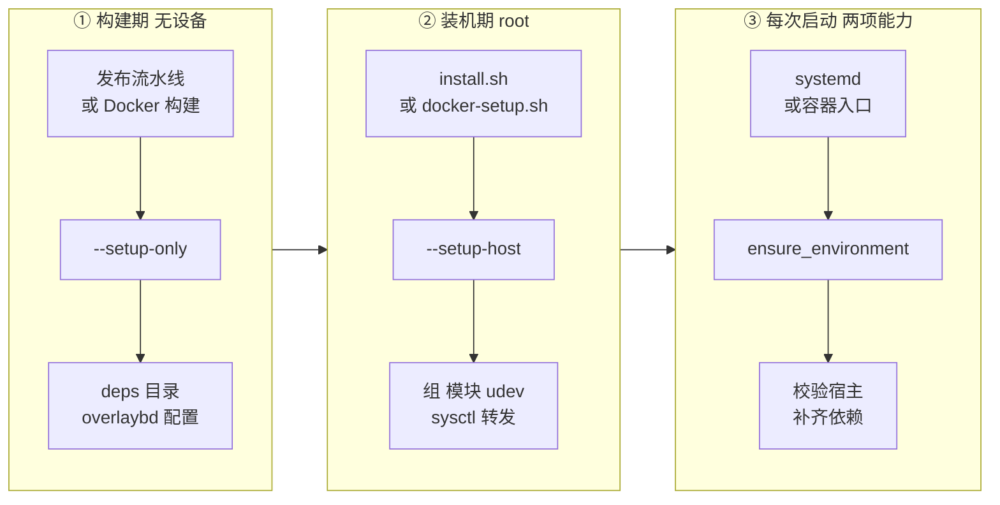
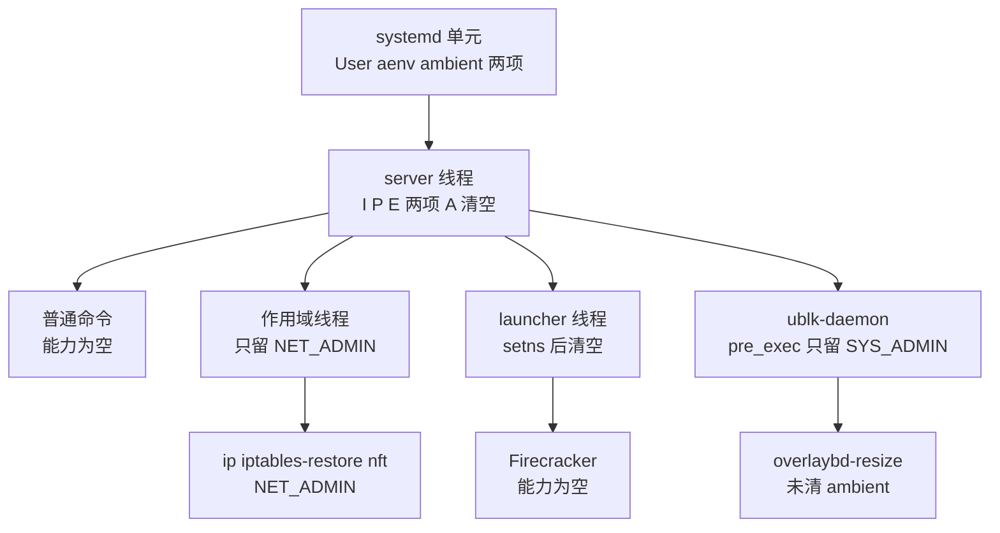

# 59 · 宿主准备、依赖供给与权限模型

> 一台机器要能跑 AgentENV 节点，需要三类准备：装好可下载的依赖、改好只有 root 能改的宿主设置、让常驻进程只带它真正需要的两项 Linux 能力。
> 本篇讲 `server` 二进制怎样把这三件事拆成 `--setup-only`、`--setup-host` 与普通启动三种模式，依赖从哪里来、落在哪里、怎样判断「已安装」，
> 以及 `CAP_NET_ADMIN` 与 `CAP_SYS_ADMIN` 怎样在进程、线程与子进程之间流动。
>
> **读者**：运维、维护者。　**预备**：[第 10 篇 · 节点进程](10-node-process-and-object-model.md)、[第 11 篇 · 配置体系](11-configuration.md)。
> **代码**：`src/setup/{mod,deps,packages,overlaybd,kvm,ublk,network_capacity}.rs`、`src/privileges.rs`、`crates/linux-cap/src/lib.rs`、
> `storage/ublk-daemon/src/client.rs`、`config/deps_manifest.toml`、`scripts/docker-setup.sh`

---

## 0. 本篇要回答的问题

1. 为什么宿主准备要拆成三种模式？每种模式由谁、在什么权限下运行，改动哪些东西？
2. Firecracker、guest 内核、overlaybd 工具、regctl 与 tools 盘的版本由什么决定？节点怎样判断一个依赖「已经装好」，下载时做了哪些校验？
3. `--setup-host` 在宿主上留下了哪些文件？`scripts/docker-setup.sh` 与它有什么不同？
4. 常驻的 `server` 持有哪两项能力、以什么形式持有？它 spawn 的普通命令、网络命令、Firecracker 与 ublk-daemon 各自拿到什么？
5. 这套权限模型在什么前提下成立，有哪些已知的缺口？

---

## 1. 问题：一次性的特权与常驻的最小权限

一个节点运行时要做的事情里，有几类必须动用特权：建网络命名空间（netns）与 bind mount 要 `CAP_SYS_ADMIN`，
建 tap、配地址、写 iptables 要 `CAP_NET_ADMIN`，ublk 控制设备的创建与删除要 `CAP_SYS_ADMIN`。
另一类事只在装机时做一次，却需要完整的 root：加载内核模块、写 udev 规则、写 `/etc/sysctl.d`、把账户加进 `kvm` 组。
还有一类事完全不需要特权：下载几个二进制、转换一个 OCI 镜像、生成几份 JSON 配置。

最省事的做法是让 `server` 以 root 常驻，三类事情都在启动时顺手做掉。代价是每个 bug 都以 root 的身份发生，
它 spawn 的每个子进程——包括每台沙箱的 Firecracker——也都是 root。
另一个极端是把每类特权拆成独立的 setuid 辅助程序，常驻进程完全无特权；代价是多出一组需要单独审计、单独分发的二进制。

AgentENV v0.2.3 取的是中间路线：同一个 `server` 二进制按命令行参数进入三种模式，把「需要 root 的一次性改动」与「不需要特权的依赖供给」都从常驻路径里拿出去；
常驻进程以普通用户运行，只持有两项能力，并且在 spawn 子进程时按需把它们收窄到零或一项。这种收窄只在 `server` 不是 root 时生效（§6）。

---

## 2. 三种模式的分工

`src/bin/server.rs` 的 `ServerCli` 定义了两个互斥的开关：`--setup-only` 与 `--setup-host`（后者带 `--runtime-user`、`--runtime-group`，缺省都是 `aenv`）。
两者都在加载配置之后、能力检查之前提前返回，所以它们不受常驻进程的能力契约约束。

| 维度 | `--setup-only` | `--setup-host` | 普通启动 |
|---|---|---|---|
| 入口 | `setup::ensure_provisioning()` | `setup::ensure_host()` | `setup::ensure_environment()` |
| 运行身份 | 任意；缺系统包时经 `sudo` 安装 | 必须 root，否则直接报错 | 运行用户 + 两项能力 |
| 系统包 | `packages::ensure()`：缺什么装什么 | 不管 | `packages::check_runtime()`：只检查 |
| 依赖下载 | 下载缺失项 | 不管 | 同样下载缺失项 |
| overlaybd 全局配置 | 生成，不含 P2P 地址 | 安装系统级 `/etc/overlaybd/overlaybd.json` | 每次启动重新生成，含 P2P 读门面地址 |
| tools 盘 | 预先解析当前版本 | 不管 | 不解析，首次启动沙箱时才解析 |
| KVM / ublk | 不管 | 加组、加载模块、写 udev 规则与 modules-load | 只检查可访问 |
| sysctl 与转发 | 不管 | 写 `/etc/sysctl.d/99-aenv.conf`、打开 IPv4 转发 | 只检查；转发未开即拒绝启动 |
| 典型调用者 | 发布流水线、Dockerfile、`install.sh` | `install.sh` | systemd、容器入口 |

两点需要说明。第一，`--setup-only` 并不严格「无特权」：`packages.rs` 的 `sudo_cmd()` 在非 root 时用 `sudo` 调 `apt-get` / `dnf` / `yum`，
只是在包都齐全时不会触发。它对设备没有任何要求，这才是它能在构建机与 Docker 构建阶段运行的原因；源码注释说的也是「without requiring VM device access」。
第二，普通启动的 `ensure_environment()` 对宿主只校验、对 `$AENV_HOME` 是**补齐**的（[第 10 篇 §2.4](10-node-process-and-object-model.md#24-ensure_environment校验加补齐)）：
缺 Firecracker 或内核就下载，overlaybd 全局配置每次都重写。于是即使跳过 `--setup-only`，节点首次启动也能自己补齐依赖，只是启动时长取决于下载。

下图按「谁在什么时候运行」把三种模式排在一条部署时间线上。



三个阶段可以在不同的机器上发生：发布流水线在 GitHub runner 上跑 `--setup-only`，把结果打进 server bundle（[第 64 篇](64-build-codegen-release.md)）；
装机时在目标宿主上跑 `--setup-host`；之后每次启动只做校验与补齐。

---

## 3. 依赖供给

### 3.1 manifest：编进二进制的版本表

依赖的版本与下载地址来自 `config/deps_manifest.toml`。它不是运行时读取的文件：`src/setup/deps.rs` 与 `src/setup/packages.rs` 的 `bundled_manifest()` 都用 `include_str!` 把它编进二进制。
所以「换一个版本」有两种方式：重新编译，或在运行配置里覆盖。

| 依赖 | manifest 节 | 运行配置的覆盖 | 安装位置 |
|---|---|---|---|
| Firecracker | `[firecracker.kvm]` / `[firecracker.pvm]` | `[firecracker] version`、`url`、`binary_path` | `deps/firecracker/<ver>/firecracker` |
| guest 内核 | `[kernel.kvm]` / `[kernel.pvm]` | `[kernel] version`、`url`、`image_path` | `deps/kernel/<ver>/vmlinux.bin` |
| regctl | `[regclient]` | 无 | `deps/regctl/<ver>/regctl` |
| overlaybd 工具 | `[overlaybd]` | `[overlaybd]` 整节 | `deps/overlaybd/bin/` |
| tools 盘 | `[tools]` | `[tools] version`、`url`、`drive_path` | `deps/tools/<semver>/` |
| 运行时系统包 | `[packages.runtime*]` | 无 | 发行版包管理器 |

KVM 模式下 Firecracker 是 AENV 补丁版 Firecracker，版本 `1.15.1-patch-v1`，内核是 `vmlinux-6.1.175`；PVM 模式换成另一条 Firecracker 代码线与 `6.12.33-pvm` 内核（[第 61 篇](61-pvm.md)）。
选择由 `ManifestVirtualizationDownloads::for_mode()` 按 `virtualization_mode` 完成，`deps::ensure()` 还在最前面拒绝「PVM 且不是 x86_64」的组合。

### 3.2 版本化路径与「存在即已安装」

`src/cfg.rs` 的 `resolved_firecracker_binary_path()` 与 `resolved_kernel_image_path()` 把版本号放进路径。
`ensure_firecracker()` 与 `ensure_kernel()` 判断是否需要下载只看一件事：这个路径上是不是一个非空的普通文件（`file_exists_nonempty()`）。
于是升级 manifest 里的版本号就会自然触发下载新文件，旧版本留在旁边，不会被覆盖。代价是旧版本也不会被清理，`deps/` 只增不减。
配置了显式路径（`binary_path`、`image_path`）时不下载，只由 `validate_explicit_file()` 检查它是非空、可读的普通文件，可执行文件还要有执行位。

其余三类依赖各有自己的「已安装」判据：

- **regctl**：路径也带版本号，但 `ensure_regctl()` 额外执行一次 `regctl version`，要求输出里恰好出现 manifest 的版本标记，否则删掉重下。
- **overlaybd 工具**：安装在不带版本号的 `deps/overlaybd/bin/`，旁边写一份 `tools-release.json` 记录 tag 与资产名。
  `ensure_release_tools()` 要求记录与当前配置一致、四个工具（`overlaybd-create`、`-apply`、`-commit`、`-resize`）都在、默认配置也已暂存，三者缺一就整包重装。
  一把进程内的 `tokio::sync::Mutex` 让并发的安装请求排队。
- **tools 盘转换器**：`ensure_tools_converter_v1()` 为 tools 镜像的 `oci-rootfs-v1` 格式钉死一个转换器版本 `v1.0.18-aenv.1`。
  当前 overlaybd 工具恰好是这个版本时直接复用，否则另装一份到 `deps/tools-converter-v1/`。注释给出的理由是「v1 必须在运行时升级后保持同样的块布局」：
  推论：同一个 tools 版本在不同节点、不同 AgentENV 版本上转换出的层 digest 要一致，快照里钉住的 tools 版本才能在别处找回同样的设备（[第 26 篇 §7.3](26-sandbox-block-devices.md#73-版本钉在快照上)）。

下面是一个装好依赖的 `deps/` 目录。

```text
$AENV_HOME/deps/
├── firecracker/1.15.1-patch-v1/
│   ├── firecracker
│   └── cpu-template-helper          # 同一个 tgz 里解出，供 CPU 模板交集使用
├── kernel/vmlinux-6.1.175/vmlinux.bin
├── regctl/v0.11.5/regctl
├── overlaybd/
│   ├── bin/overlaybd-{create,apply,commit,resize}
│   ├── etc/overlaybd/overlaybd.json # 发布包自带的默认配置，供 --setup-host 安装
│   └── tools-release.json
├── tools-converter-v1/              # 仅当当前 overlaybd 工具不是 v1.0.18-aenv.1 时存在
└── tools/0.1.1/
    ├── image.json                   # overlaybd 形态；或旧式 tools.ext4
    └── sha256-<digest>.commit
```

### 3.3 下载：只有传输层的保证

所有下载都经 `deps.rs` 的 `download_file()`：目标已存在且非空就跳过；否则 `reqwest::get()`，非 2xx 报错，
把整个响应体读进内存，写到同目录的 `.tmp` 文件再 `rename` 到目标位置。`rename` 保证了不会留下半个文件被当成「已安装」，这是它唯一的完整性保证。

下载过程中**没有校验和，也没有签名验证**。manifest 里只有 URL 模板，没有 digest 字段；`OverlaybdInstalledRelease` 有一个 `digest` 字段，
但 `desired_overlaybd_installed_release()` 总是把它设为 `None`。可信度完全来自 HTTPS 与 GitHub 发布页本身。
对照之下，`scripts/install.sh` 下载 release bundle 时会从 GitHub API 取每个资产的 `sha256:` digest 并逐个比对（[第 60 篇](60-deployment.md)）——
走安装脚本、使用 bundle 里预下载的 `deps/` 的节点得到了校验；在运行时自己补齐依赖的节点没有。
整包读入内存对几十 MiB 的 Firecracker 包与内核问题不大，但它意味着下载大小没有上限。

Firecracker 包解开后，`extract_firecracker()` 把二进制与 `cpu-template-helper` 放进版本目录，随后删除 tgz；overlaybd 工具包同样在解开后删除。
注释给出的原因是不让 `--setup-only` 构建出的容器镜像层带着压缩包。

### 3.4 tools 盘与 overlaybd 全局配置

tools 盘的三种来源与节点上的解析顺序已在[第 26 篇 §7.2](26-sandbox-block-devices.md#72-节点上的解析)讲过，这里只补充它与三种模式的关系。
`--setup-only` 的 `ensure_provisioning()` 最后一步调 `resolve_tools_image()` 解析当前配置的 tools 版本，于是发布包与 Docker 镜像里已经带着转换好的 tools 层；
普通启动的 `ensure_environment()` 不做这一步，只由 `ensure_tools()` 处理显式配置的本地 `tools.drive_path`，镜像形态的解析留到第一台沙箱启动时。
旧式 ext4 路径（镜像没有 `oci-rootfs-v1` 标签时）用 regctl 把镜像拷进本地 OCI 目录，再用 `umoci unpack --rootless` 解开、取出 `tools.ext4`，
这就是系统包清单里有 `umoci` 的原因。

overlaybd 全局配置由 `write_generated_overlaybd_global_configs()` 一次生成四份，各用一个独立的块缓存目录：

| 文件（`$AENV_HOME/overlaybd/` 下） | 使用者 | 缓存子目录 | 后台下载 |
|---|---|---|---|
| `overlaybd-global.json` | rootfs 等运行时设备 | `remote-blocks` | `[ublk.overlaybd] download_enable` |
| `mem-overlaybd-global.json` | 内存设备 | `memory-blocks` | `[memory_snapshot.background_download]` |
| `convert-overlaybd-global.json` | 离线转换工具 | `convert-blocks` | 关 |
| `resize-overlaybd-global.json` | `overlaybd-resize` | `resize-blocks` | 关 |

后两份隔离缓存目录的理由写在注释里：C++ 版工具把缓存目录下的每个文件都当作扁平的缓存条目，淘汰时截断并删除，
与 Rust 版 overlaybd 每个条目一个子目录的布局放在一起会毁掉运行时缓存。这是两个实现共存于一台节点时必须付出的隔离成本。

另外还有一份系统级的 `/etc/overlaybd/overlaybd.json`。`deploy/docker/Dockerfile.agentenv` 的注释说明，`overlaybd-apply` 即使拿到了显式的生成配置，
也会校验这个内置缺省路径是否存在；所以 Dockerfile 写一个 `{}` 占位，裸机由 `--setup-host` 从 `deps/overlaybd/etc/` 安装。

---

## 4. 宿主准备：`--setup-host` 与 `docker-setup.sh`

### 4.1 `--setup-host` 做了什么

`ensure_host()` 先确认有效 uid 为 0，再由 `validate_runtime_account()` 检查运行账户：名字匹配 `[a-z_][a-z0-9_-]*`（与 `install.sh` 的校验一致，单元测试 `runtime_account_names_match_installer_validation` 钉住），
账户与组都存在，且 uid、gid 都不是 0。随后依次：

1. 用 `usermod -aG` 把运行用户加进运行组与 `kvm` 组（`kvm::add_user_to_group()`）。已在组里时不动；新加入时打 warn，提醒手工启动前要重新登录才能生效。
2. `ublk::provision()`：模块未加载时先尝试 `apt-get install linux-modules-extra-$(uname -r)`（只在有 `apt-get` 时），再加载 `ublk_drv`，
   写 `/etc/modules-load.d/aenv-ublk.conf` 让它开机自动加载；把 `ublk-control`、`ublkc*`、`ublkb*` 三类设备的 udev 规则写进 `/etc/udev/rules.d/99-agentenv-ublk.rules`
   （属组为运行组、权限 `0660`），然后 `udevadm control --reload-rules` 并 trigger 已存在的设备。没有 `/etc/udev/rules.d` 时跳过规则、只打 warn。
3. `overlaybd::install_system_default_config()`：安装 `/etc/overlaybd/overlaybd.json`。已存在时保留内容，但目录与文件的属组都改为运行组、权限改为 `0750` / `0640`。
4. 写 `/etc/sysctl.d/99-aenv.conf`（含 `net.ipv4.ip_forward = 1` 与六个容量参数），直接写 `/proc/sys/net/ipv4/ip_forward`，并立即把低于推荐值的参数调上去。
   参数本身与普通启动时的检查见[第 29 篇 §5.4](29-network-slots.md#54-宿主容量)。

注意它**没有**做的事：不加载 KVM 模块，也不改 `/dev/kvm` 的权限——`kvm` 组对 `/dev/kvm` 的读写权限来自发行版自己的 udev 规则；
不设置 `ublk_drv` 的 `ublks_max` 模块参数，这一步由 `install.sh` 与 `docker-setup.sh` 写 `/etc/modprobe.d/aenv-ublk.conf` 完成；
不创建、也不改 `$AENV_HOME` 的属主，这也交给 `install.sh`。

普通启动时与之对应的检查分散在 `ensure_environment()` 里：`kvm::check()` 在 `validate_mode()` 之后要求 `/dev/kvm` 存在且能以读写方式打开；
`ublk::check()` 要求 `/sys/module/ublk_drv` 存在且 `/dev/ublk-control` 能以读写方式打开。两者失败的提示都指回 `--setup-host` 或加组后重新登录。

### 4.2 容器宿主：`docker-setup.sh`

在 Docker 或 Kubernetes 里运行时，`server` 跑在容器中，没人去宿主上执行 `--setup-host`。`network_capacity.rs` 的 `running_in_container()` 通过 `/.dockerenv`
与 `/proc/1/cgroup` 里的 `docker`、`kubepods`、`containerd`、`podman` 标记判断自己在容器里，此时跳过 sysctl 的检查与调整，除非设置了 `AENV_FORCE_SYSCTL_TUNING`。
宿主上的那一半交给 `scripts/docker-setup.sh`，由人以 root 在宿主上执行一次。它与 `--setup-host` 的覆盖面并不相同：

| 项 | `--setup-host` | `docker-setup.sh` |
|---|---|---|
| `ublk_drv` 加载与 modules-load | 有 | 有，并在缺模块且无 apt 时报错退出 |
| `ublks_max=4096` | 无 | 写 modprobe 配置，加载时带上 |
| udev 规则 | 有 | 无；容器以 privileged 运行、直接用宿主 `/dev` |
| 账户与组 | 有 | 无；容器内是 root |
| `/etc/sysctl.d/99-aenv.conf` | 含 `ip_forward = 1` | 只含六个容量参数 |
| IPv4 转发 | 打开 | 不管 |

两者写的是**同一个文件名**。在一台既跑过 `--setup-host`、又跑过 `docker-setup.sh` 的宿主上，后者会用一份不含 `ip_forward` 的内容覆盖前者，
重启后 IPv4 转发是否打开取决于别的配置。推论：容器部署时转发通常由 Docker 守护进程在宿主上打开，容器内的 `ensure_environment()` 读到的是容器所在命名空间的值，
所以这个遗漏在纯容器宿主上不一定暴露；但它让两条路径不能安全地混用。

---

## 5. 权限模型

### 5.1 回顾：能力在 exec 时怎样变化

Linux 把 root 的特权拆成几十项能力，每个线程有 permitted（P）、effective（E）、inheritable（I）、bounding 与 ambient（A）五个集合。
本篇只需要 exec 一个**没有文件能力、也不是 setuid** 的普通程序时的规则：新程序的 P 与 E 都等于原线程的 A，I 原样保留；
而 A 里只能放同时在 P 与 I 里的能力。换句话说，ambient 集是「把能力传给普通子程序」的唯一通道：清空它，子程序就一无所有；
往里放一项，子程序就恰好拿到这一项。另一条规则是例外：有效 uid 为 0 的进程 exec 时，内核把 bounding 集重新授予 P 与 E。

### 5.2 契约：两项能力，以「可委派」的形式持有

常驻 `server` 的能力契约在 `src/privileges.rs` 的 `require_runtime_capabilities()`：
非 root 时要求 `CAP_NET_ADMIN` 与 `CAP_SYS_ADMIN` 都是「可委派」的，`crates/linux-cap/src/lib.rs` 的 `CapabilitySets::is_delegable()` 定义为同时在 I、P、E 三个集合里；
root 时只要求两者在 E 里。检查读的是 `/proc/self/status` 的 `CapInh`、`CapPrm`、`CapEff` 三行，不读 bounding 集。

这个形状对应 `install.sh` 生成的 systemd 单元：`User=aenv`，`AmbientCapabilities` 与 `CapabilityBoundingSet` 都只有这两项，`NoNewPrivileges=true`。
systemd 把两项能力放进 I 与 A，`server` 被 exec 时按 §5.1 的规则得到 P = E = A，于是三个集合里都有它们。
紧接着 `privileges::clear_ambient_capabilities()` 用 `prctl(PR_CAP_AMBIENT, PR_CAP_AMBIENT_CLEAR_ALL)` 清空 A——
`server` 自己的线程仍持有两项能力，但它此后 exec 的任何普通程序都拿不到。没有 systemd 时，`install.sh` 打印的 `setpriv` 命令行
（`--inh-caps`、`--ambient-caps`、`--bounding-set=-all,+net_admin,+sys_admin`、`--nnp`）构造的是同一个形状。

两项能力对应的用途：`CAP_SYS_ADMIN` 用于 `unshare(CLONE_NEWNET)`、netns 文件的 bind mount 与 `setns`，这些由 `server` 的线程直接以系统调用完成；
它还被委派给 ublk-daemon，用于 ublk 设备的控制命令。`CAP_NET_ADMIN` 用于 veth、tap、地址、路由与 iptables，一部分经 netlink 在线程里完成，一部分经外部命令完成。

### 5.3 四类子进程

`server` 在清空 ambient 之后 spawn 的子进程分成四类，各自拿到的能力不同。下图与下表都以 `server` **非 root** 运行为前提；以 root 运行时的结果见 §6。



| 子进程 | 机制 | 得到的能力（非 root 时） |
|---|---|---|
| 普通命令（regctl、umoci、overlaybd 转换工具、mkfs 等） | 直接 `Command::spawn()` | 无：A 已清空 |
| 网络命令（`ip tuntap`、`ip route`、`iptables-restore`、`iptables-save`、`nft`） | `run_with_scoped_capabilities(&[CAP_NET_ADMIN], …)` | 恰好 `CAP_NET_ADMIN` |
| Firecracker | `spawn_tokio_command_scoped(cmd, &[], setns)` | 无 |
| ublk-daemon | `configure_daemon_capabilities()` 的 `pre_exec` | 恰好 `CAP_SYS_ADMIN` |

`run_with_scoped_capabilities()` 用 `thread::scope` 起一个名为 `aenv-capability-command` 的短命线程，在线程里调
`linux_cap::configure_current_process_capabilities()`：先清空 A，再用 `capset` 把本线程的 E、P、I 都设为请求的集合，最后逐项 `PR_CAP_AMBIENT_RAISE`。
线程里的操作 exec 出来的命令于是带着恰好这些能力；能力与 netns 都是线程属性，所以调用线程本身、以及 tokio 的工作线程都不受影响。
新线程继承调用线程的 netns，这正是[第 29 篇 §4.2](29-network-slots.md#42-步骤)里 `ip tuntap` 能在沙箱命名空间里建出 `tap0` 的原因。
函数注释强调的另一点是它不需要 `pre_exec`：多线程进程在 `fork` 与 `exec` 之间只能做 async-signal-safe 的事，
而没有 `pre_exec` 时标准库可以走 `posix_spawn` 快路径。

Firecracker 走的 `spawn_tokio_command_scoped()` 是同一思路的异步版本：launcher 线程先执行调用方给的闭包（`setns` 进沙箱 netns，这一步需要 `CAP_SYS_ADMIN`，所以必须在收窄之前），
再把能力收窄为空集并 spawn，子进程通过 `oneshot` 交回调用方；调用方已经放弃时由 `terminate_unclaimed_child()` 杀掉并回收。
这条路径的细节与它所依赖的「server 非 root」前提在[第 25 篇 §4.2](25-backend-and-firecracker-process.md#42-进入-netns-并清空能力)。

ublk-daemon 是唯一用 `pre_exec` 的地方（`storage/ublk-daemon/src/client.rs`）。spawn 前它先确认 `CAP_SYS_ADMIN` 在 `server` 的 E 里，
然后在 fork 出的子进程里调 `configure_current_process_capabilities(&[CAP_SYS_ADMIN])`。注释给出的理由与 root 有关：
root 的 I 集可能为空，而在子进程里、`CAP_SYS_ADMIN` 仍有效时可以把它补进 I，于是 root 与非 root 都能得到「只有 `CAP_SYS_ADMIN`」的 daemon。
`linux-cap` 的文档注释特意写明这个函数只做校验与系统调用，可以在 `pre_exec` 里使用。

### 5.4 `linux-cap` crate

`crates/linux-cap/src/lib.rs` 是对两个系统调用的薄封装，约 220 行，不依赖 libcap：

- `capset` 用版本 3 的头（`_LINUX_CAPABILITY_VERSION_3`）与两元素的数据数组，能力号上限 64；
- `prctl(PR_CAP_AMBIENT, …)` 的 `RAISE` 与 `CLEAR_ALL`；
- 读取侧解析 `/proc/self/status` 的十六进制字段，而不是调 `capget`。

`configure_current_process_capabilities()` 的注释写明它**有意不动 bounding 集**。bounding 集只能缩不能扩，一旦在某个线程里缩掉，
这个线程以后就再也不能把能力交给任何后代；不动它，收窄就是纯粹作用于当前线程的、可以每次重来的操作。
推论：这也是为什么收窄必须放在一个用完即弃的线程里——`capset` 把 P 缩小之后，这个线程自己也回不去了。

---

## 6. 边界与代价

**`CAP_SYS_ADMIN` 本身很宽。** 它覆盖 mount、命名空间、大量设备 ioctl 等操作，常被称为「新的 root」。
常驻进程持有它是 netns 与 ublk 的需要；收窄只发生在子进程上，`server` 自己的所有线程始终在 E 里带着它。
因此这套模型防的是「子进程意外继承特权」，不是「`server` 自身被攻破」。

**ublk-daemon 的子进程。** daemon 以 A = {`CAP_SYS_ADMIN`} 启动，`storage/ublk-daemon/src/` 里未见它清空 ambient；
它在冷启动扩容 rootfs 时用 `run_resize_tool()` 直接 spawn `overlaybd-resize`。推论：按 §5.1 的规则，这个 C++ 工具带着 `CAP_SYS_ADMIN` 运行，
与 `server` 对普通命令「一律不给」的原则不一致。

**收窄只在非 root 时成立。** 以 root 运行时，exec 会从 bounding 集重新授予能力：线程上的 `capset` 与 ambient 设置照样执行，却被 exec 的 root 规则覆盖，
Firecracker、网络命令与普通命令都会带着 bounding 集里的全部能力。
`src/privileges.rs` 的测试因此在 root 下只断言 I 与 A 为空。容器部署（Compose 与 DaemonSet 都是 privileged、容器内为 root）正处在这种情况（[第 60 篇](60-deployment.md)）。
`--setup-host` 拒绝 uid 0 的运行账户，但它约束不到不经安装脚本的启动方式；裸机上「Firecracker 不带能力」实际由 systemd 的 `User=aenv` 与只含两项的 `CapabilityBoundingSet` 保证。

**同一个 uid。** 收窄的是能力，不是身份。Firecracker 与 `server` 是同一个 uid，DAC 上能互相访问对方能访问的文件；
udev 规则又让运行组可以读写所有 `ublkb*`。这一缺口与 jailer 的对照在[第 25 篇 §5](25-backend-and-firecracker-process.md#5-不用-jailer哪些隔离有哪些没有)。

**残留进程要靠外部清理。** `server` 被 SIGKILL 或崩溃时，析构代码不会执行，Firecracker 子进程成为孤儿继续运行，
`firecracker-work/` 与 `managed-snapshots/` 下的工作文件也无人回收（[第 22 篇 §7](22-persistence-across-restarts.md#7-崩溃一致性边界)）。
`install.sh` 的单元为了让 `server` 在退出前串行暂停沙箱而设了 `KillMode=process`，systemd 停止时只杀主进程；`TimeoutStopSec=30` 到期后同样只杀 `server`。
所以宿主上需要一个外部步骤收拾残留：例如在重启服务前按单元的 cgroup 杀掉剩余进程（`systemctl kill --kill-whom=all`），再清理工作目录。`scripts/` 与 `deploy/` 里没有这样的步骤（单元没有 `ExecStartPre` / `ExecStopPost`，也没有 `pkill` 之类的清理）。

**供应链。** 运行时补齐的依赖没有校验和；manifest 编进二进制，换版本要么重编译、要么在每个节点的配置里覆盖；
`deps/` 只增不减，没有对旧版本的回收。Docker 镜像的运行时包列表与 manifest 的 `[packages.*]` 需要手工同步，manifest 的注释自己承认了这一点。

**两条宿主准备路径。** `--setup-host` 与 `docker-setup.sh` 各管一部分，写同名的 sysctl 文件、内容不同；`ublks_max` 只在后者与 `install.sh` 里出现。
宿主准备的「真相」因此分散在一个 Rust 函数与两段 shell 里。

---

## 7. 小结

- `server` 一个二进制有三种模式：`--setup-only` 供给依赖、不需要设备；`--setup-host` 以 root 做一次性宿主改动；普通启动校验宿主、补齐依赖。
- `--setup-only` 不需要设备权限，但缺系统包时会经 `sudo` 安装；普通启动会下载缺失依赖并每次重写四份 overlaybd 全局配置。
- 依赖版本来自编进二进制的 `deps_manifest.toml`，可被运行配置覆盖；Firecracker 与内核按版本分目录，「非空文件存在」即视为已安装。
- 运行时下载只靠 HTTPS 与 `rename`，没有校验和；`install.sh` 对 release bundle 做了 sha256 比对，两条路径的保证不同。
- tools 盘的 `oci-rootfs-v1` 格式钉死转换器 `v1.0.18-aenv.1`，使同一 tools 版本在运行时升级后得到同样的层。
- `--setup-host` 负责组、ublk 模块与 udev 规则、系统级 overlaybd 配置、sysctl 与 IPv4 转发；`ublks_max` 与 `$AENV_HOME` 属主由安装脚本负责。
- 常驻进程以「可委派」形式持有 `CAP_NET_ADMIN` 与 `CAP_SYS_ADMIN`，启动即清空 ambient；子进程的能力由短命线程上的 `capset` + ambient 精确给出：普通命令零项、网络命令一项、Firecracker 零项、ublk-daemon 一项。
- 这套模型防的是子进程继承特权；收窄只在 `server` 非 root 时生效，容器内以 root 运行时 Firecracker 拿到完整能力集；`server` 自身始终持有 `CAP_SYS_ADMIN`，Firecracker 与 `server` 同 uid。
- `KillMode=process` 让 SIGKILL 或停止超时后的 Firecracker 成为孤儿，残留进程与工作目录要由宿主上的外部步骤清理。

---

## 延伸阅读 / 下一篇

- 下一篇：[第 60 篇 · 单节点安装、Compose 与 Kubernetes](60-deployment.md)：`install.sh` 的 systemd 单元、Docker 镜像与两种多节点清单怎样使用本篇的三种模式。
- [第 10 篇 · 节点进程](10-node-process-and-object-model.md)：普通启动序列里 `ensure_environment()` 与能力检查的位置。
- [第 25 篇 · 后端抽象与 Firecracker 进程](25-backend-and-firecracker-process.md)：Firecracker 的拉起、同 uid 的隔离缺口。
- [第 29 篇 · 网络（一）](29-network-slots.md)：用到 `CAP_NET_ADMIN` 作用域的网络命令与宿主容量参数。
- [第 61 篇 · PVM](61-pvm.md)：按虚拟化模式切换的依赖。
- capabilities(7) 手册页：exec 时各能力集的变换规则与 ambient 集的约束。
