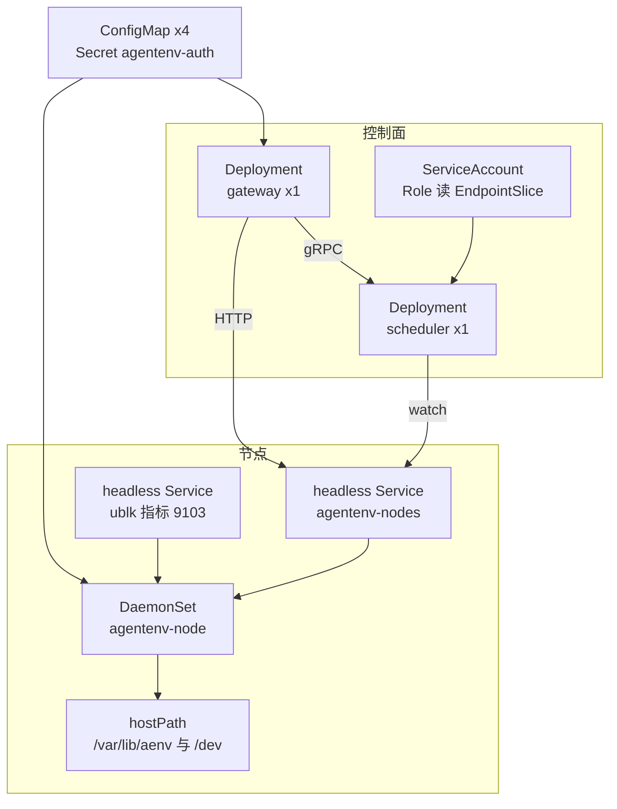

# 60 · 单节点安装、Compose 与 Kubernetes

> AgentENV v0.2.3 仓库给出三种部署形态：裸机单节点的一键安装脚本、一台机器上模拟两节点的 Docker Compose、以及 Kubernetes 的 kustomize 清单。
> 三者用的是同一个 `server` 二进制与同一份默认配置，差别在于由谁来做宿主准备、密钥从哪里来、状态落在哪里、进程怎样被停止。
> 本篇逐个拆开这些清单，说明每个看上去随意的设置背后的原因，以及它们各自没有覆盖的部分。
>
> **读者**：运维、维护者。　**预备**：[第 59 篇 · 宿主准备与权限模型](59-host-setup-and-privileges.md)、[第 08 篇 · 系统架构](08-system-architecture.md)。
> **代码**：`scripts/install.sh`、`scripts/install-cli.sh`、`deploy/docker/{Dockerfile.agentenv,Dockerfile.gateway,Dockerfile.scheduler,config/default.json}`、
> `deploy/docker-compose.yml`、`deploy/k8s/{base,overlays}/**`、`deploy/k8s/run.sh`

---

## 0. 本篇要回答的问题

1. 三种部署形态分别解决什么问题？宿主准备、API key、token seed、快照仓库、暂停沙箱在三者里各落在哪里？
2. `install.sh` 生成的 systemd 单元里，`KillMode=process`、`AmbientCapabilities`、`LimitMEMLOCK` 等设置各为了什么？`TimeoutStopSec=30` 与关闭时的串行暂停有什么冲突？
3. Docker 镜像为什么要跑两次 `--setup-only`？运行时包列表为什么要和 manifest 手工同步？
4. Compose 的两个节点共享了哪些东西？为什么说它是「多节点模拟」而不是生产拓扑？
5. Kubernetes 的节点 DaemonSet 为什么是 privileged、为什么 grace period 是 3600 s、preStop 在等什么？清单里缺了哪些多节点生产部署需要的部件？

---

## 1. 问题：同一个二进制，三种宿主

一个 AgentENV 节点对宿主的要求很重：`/dev/kvm`、ublk 内核模块、宿主 iptables 与网络命名空间、两项 Linux 能力、几个 GiB 的依赖与缓存。
控制面（gateway 与 scheduler）则是两个无特权的 Go 程序。部署形态要回答的是：这些要求由谁满足，满足到什么程度。

| 维度 | 裸机单节点（`install.sh`） | Compose 两节点 | Kubernetes |
|---|---|---|---|
| 宿主准备 | 脚本内跑 `--setup-only` 与 `--setup-host` | 人工在宿主上跑 `docker-setup.sh` | 同 Compose，每台 worker 一次 |
| 运行身份 | `aenv` 用户 + 两项 ambient 能力 | 容器内 root，privileged | 容器内 root，privileged |
| 依赖 | release bundle 预下载 | 构建镜像时预烘焙 | 镜像里预烘焙，但被 hostPath 遮住（§5.2） |
| 控制面 | 无 | 一个 scheduler、一个 gateway | 一个 scheduler、一个 gateway |
| 节点发现 | 不需要 | static 列表 | EndpointSlice |
| API key | 节点首次启动时自动生成 | 节点生成，经共享卷给 gateway | `run.sh` 生成，存在 Secret |
| token seed | 节点自管文件 | 同一个共享卷，两节点一致 | 只有 local-dev overlay 提供 |
| 快照仓库 | 本地 `posix_fs` | 两节点共享一个 named volume | 每节点本地（缺省配置未改） |
| 暂停沙箱 | `$AENV_HOME`，跨重启保留 | 容器可写层，重建容器即丢失 | hostPath，跨 Pod 重建保留 |
| 停止宽限 | `TimeoutStopSec=30` | Docker 缺省 | `terminationGracePeriodSeconds: 3600` |

下面三节按表的列逐个展开。

---

## 2. 裸机单节点：`install.sh`

### 2.1 两个 bundle 与安装步骤

`scripts/install.sh` 从 GitHub 最新 release 下载两个资产：CLI 包 `aenv-linux-<arch>.tar.gz`（内含 `aenv`、`aenv-buildctl` 与 `manifest.json`），
以及 server 包 `aenv-server-linux-<arch>.tar.gz`（PVM 模式下带 `-pvm` 后缀）。server 包里有 `server`、`ublk/uvm-ublk-daemon`、
发布流水线跑 `--setup-only` 得到的 `deps/` 目录、`default.toml` 与 overlaybd 的默认配置（[第 64 篇](64-build-codegen-release.md)）。

`download_release_asset()` 先从 GitHub API 的 release 元数据里按名字找到**唯一**一个资产，取它的 `browser_download_url` 与 `digest`；
digest 不是 `sha256:` 开头就拒绝，下载后用 `sha256sum` 比对。这是整条依赖供给链上唯一一处逐文件的完整性校验——
节点运行时自己补齐依赖时没有校验和（[第 59 篇 §3.3](59-host-setup-and-privileges.md#33-下载只有传输层的保证)）。
`scripts/install-cli.sh` 只装 CLI，支持 linux / darwin 与 x86_64 / aarch64，用同样的方式校验 digest。

server 部分的步骤依次是：

1. 校验 `AENV_VIRTUALIZATION_MODE`（`kvm` 或 `pvm`，PVM 只允许 x86_64）、架构与操作系统；缺 `curl`、`jq`、`sha256sum` 等命令时用包管理器补装。
2. 创建系统组与系统用户 `aenv`（`--system`、家目录为数据目录、shell 为 `nologin`），并拒绝 uid 或 gid 为 0 的情况；数据目录不能是 `/` 或符号链接。
3. 服务正在运行时先 `systemctl stop`，再安装 `server` 到 `/usr/local/bin`、daemon 到 `/var/lib/aenv/ublk/uvm-ublk-daemon`。
4. 删掉 `deps/` 下的 `firecracker`、`kernel`、`tools`、`overlaybd`、`regctl` 五个子目录，整体换成 bundle 里的版本。
5. 配置文件 `/var/lib/aenv/config/config.toml` 只在不存在时从 bundle 的 `default.toml` 安装，属主 `root:aenv`、权限 `0640`；升级不覆盖用户改过的配置。
6. 写 `/etc/modprobe.d/aenv-ublk.conf`（`ublks_max=4096`），注释写明要在 `server` 加载模块之前写。
7. 以 root 依次执行 `server --setup-only` 与 `server --setup-host --runtime-user aenv --runtime-group aenv`（`SKIP_SETUP=1` 可跳过）。
8. 把整个数据目录 `chown -R` 给 `aenv`，配置目录与文件改回 `root:aenv`。
9. 有 systemd 时写 `/etc/default/aenv` 与 `/etc/systemd/system/aenv.service`，`daemon-reload` 并 `enable`，**不启动**；没有 systemd 时打印一条等价的 `setpriv` 命令。

两点值得注意。第 4 步每次升级都删掉 `deps/tools`，而暂停记录与快照钉住的可能是旧的 tools 版本（[第 26 篇 §7.3](26-sandbox-block-devices.md#73-版本钉在快照上)）。
推论：升级后恢复这类沙箱时，节点要按旧版本号重新从镜像仓库解析 tools 盘，离线环境下会失败。
第 7 步以 root 运行 `--setup-only`，下载出的文件属于 root，所以需要第 8 步的 `chown -R`；数据目录里若已经有很大的快照仓库或镜像缓存，这一步的耗时随文件数增长。

### 2.2 环境文件与 API key

`/etc/default/aenv` 首次安装时写入五个变量：`API_ADDR="127.0.0.1:8000"`、`AENV_CONFIG_PATH`、`AENV_HOME_PATH`、`AENV_RUNTIME_PATH="/run/aenv"`、`AENV_VIRTUALIZATION_MODE`。
再次安装时脚本逐行重写其中四个路径与模式变量，保留其它行——包括用户改过的 `API_ADDR`。
缺省只监听回环地址，意味着单节点安装后 API 只能从本机访问；要对外提供服务需要人工改这一行，安装结束时的提示也是这样写的。

脚本不生成 API key。`ApiKey::resolve()` 在 `server` 首次启动时按「`AENV_API_KEY` → `/run/secrets/api-key` → `$AENV_HOME/secrets/api-key`」的次序查找，
都没有就生成一个写进最后那个文件（[第 13 篇 §2.1](13-authentication.md#21-来源与格式)）。安装脚本最后打印的正是这个路径。

### 2.3 systemd 单元逐项

| 设置 | 作用与原因 |
|---|---|
| `User=aenv`、`Group=aenv`、`SupplementaryGroups=kvm` | 非 root 运行；`kvm` 组让它与 Firecracker 能打开 `/dev/kvm`，运行组由 udev 规则获得 `ublkb*` 的读写权 |
| `AmbientCapabilities=` 与 `CapabilityBoundingSet=` 只含两项能力 | 构造 [第 59 篇 §5.2](59-host-setup-and-privileges.md#52-契约两项能力以可委派的形式持有) 的能力契约；bounding 集收窄后，任何后代都不可能重新获得其它能力 |
| `NoNewPrivileges=true` | setuid 程序与文件能力失效；`server` 的子进程无法经 `sudo` 提权 |
| `RuntimeDirectory=aenv`、`RuntimeDirectoryMode=0750` | systemd 以运行用户身份创建 `/run/aenv`，即 `AENV_RUNTIME_PATH`，放 socket 与 netns 文件 |
| `UMask=0027` | 新建的状态文件对其它用户不可读 |
| `LimitNOFILE=1048576` | 每台沙箱要占若干个 fd（socket、设备、日志）；`ensure_environment()` 自己只会把软上限抬到 65536 |
| `LimitMEMLOCK=infinity` | 推论：为 io_uring 与 ublk 的缓冲注册留出余量，旧内核把它们计入 `RLIMIT_MEMLOCK`；daemon 作为子进程继承这个上限 |
| `Restart=on-failure`、`RestartSec=5` | 崩溃后自动拉起；暂停记录在下次启动时恢复（[第 22 篇](22-persistence-across-restarts.md)） |
| `KillMode=process` | 停止时只向主进程发信号，见下文 |
| `TimeoutStopSec=30` | 主进程 30 s 内不退出就被 SIGKILL |

`KillMode=process` 的理由写在单元的注释里：缺省的 control-group 模式会立即向 cgroup 里所有进程发 SIGTERM，
Firecracker 子进程随之退出，运行中沙箱的内存状态就丢了；只给主进程发信号，`server` 才有机会走完关闭序列，把每台运行中的沙箱暂停落盘（[第 10 篇 §3](10-node-process-and-object-model.md#3-关闭序列)）。
这与 `spawn_with_netns()` 里 `process_group(0)` 的意图相同（[第 25 篇 §4.1](25-backend-and-firecracker-process.md#41-命令行与进程属性)）。

问题出在它和 `TimeoutStopSec=30` 的组合上。关闭时的暂停是**逐个串行**的，总时长正比于运行中沙箱的数量与各自的脏页量。
推论：沙箱稍多时 30 s 不够，systemd 在超时后 SIGKILL 主进程；由于 `KillMode=process`，SIGKILL 也只发给主进程，
尚未暂停的 Firecracker 进程留在宿主上成为孤儿，而它们背后的 ublk-daemon 检测到父进程退出后自行关闭，孤儿的块设备随之消失
（[第 22 篇 §7](22-persistence-across-restarts.md#7-崩溃一致性边界)）。崩溃后 `Restart=on-failure` 拉起的新进程同样不会回收它们。
单元里没有 `ExecStopPost=` 之类的清理步骤；在现有结构上，可以把超时调大到与节点容量相称，再加一步在 `server` 退出后杀掉 cgroup 里残留进程的清理。

---

## 3. Docker 镜像

`deploy/docker/Dockerfile.agentenv` 分六个阶段：

1. `chef`：`rust:1-bookworm` 上装 clang、protobuf 编译器（envd 客户端的构建脚本要用），再 `cargo install cargo-chef`。
2. `planner`：`cargo chef prepare` 从完整源码算出只含依赖的 `recipe.json`。
3. `build-deps`：`cargo chef cook --release` 只编译依赖。注释说明 target 目录有意放在镜像层里而不是 BuildKit 的 cache mount，
   因为 cache mount 不随外部缓存导出，放在层里才能让全新的 CI runner 复用依赖层。
4. `builder`：拷入源码，编出 `server` 与 `uvm-ublk-daemon`。源码改动只使这一层失效。
5. `runtime-base`：`ubuntu:24.04` 上 `apt-get install` 运行时包，并写一个 `{}` 的 `/etc/overlaybd/overlaybd.json` 占位。
6. `deps-stage` 与最终镜像：前者跑一次 `--setup-only` 把依赖预烘焙进 `/workspace/env`；最终镜像拷入这棵树与两个二进制，**再跑一次** `--setup-only`。

第二次 `--setup-only` 的注释称它是「authoritative」：预烘焙的结果完全符合预期时，每个依赖都命中「已存在则跳过」，这一步几乎不做事；
任何缺失或过期都在这里补上。这样依赖层与二进制层可以分开缓存——二进制变了而依赖没变时，依赖层不重建，也不会因此得到一个过期的依赖树。

运行时包列表是**硬编码**在 `runtime-base` 里的：`ca-certificates`、`curl`、`e2fsprogs`、`iproute2`、`iptables`、`jq`、`sudo`、`umoci`、`zstd`，
外加构建参数 `EXTRA_RUNTIME_PACKAGES`。`config/deps_manifest.toml` 的注释说明 Dockerfile 已不再在构建期解析 manifest，两边要手工同步。
v0.2.3 里两份列表内容一致；漂移的后果是镜像里缺命令，`ensure_environment()` 的 `packages::check_runtime()` 在容器启动时报错。

最终镜像以 root 运行，`ENTRYPOINT ["/server"]`，`AENV_HOME_PATH=/workspace/env`，`AENV_UBLK_DAEMON_BINARY_PATH` 指向 `/usr/local/bin/uvm-ublk-daemon`。
构建参数 `AENV_VIRTUALIZATION_MODE` 决定预烘焙哪一套 Firecracker 与内核。gateway 与 scheduler 的镜像是 `golang:1.25` 静态编译后放进 distroless，
scheduler 额外带一个 `grpc_health_probe` 供健康检查使用。

---

## 4. Compose：一台机器上的两节点

### 4.1 拓扑与启动次序

`deploy/docker-compose.yml` 定义四个服务：`agentenv-a`、`agentenv-b` 两个节点，`scheduler`（gRPC `:9090`，round-robin），`gateway`（容器 `:8080` 映射到宿主 `8000`）。
控制面配置 `deploy/docker/config/default.json` 用 static 发现，节点列表写死为 `node-a → http://agentenv-a:8000` 与 `node-b → http://agentenv-b:8000`，
与两个节点的 `AENV_NODE_ID` 一一对应；ID 对不上时心跳会被拒（[第 56 篇](56-scheduler.md)）。

启动次序由 `depends_on` 的 `condition: service_healthy` 串起来：两个节点的 `/health` 通过之后才起 scheduler，scheduler 的 gRPC 健康检查通过之后才起 gateway。
节点健康检查的 `timeout` 给到 120 s、`retries` 20 次，为首次启动时的依赖补齐与预热留出时间。
gateway 必须排在节点之后还有一个原因：它的 API key 来自节点生成的文件（§4.2），节点没起来之前这个文件不存在，gateway 的 `loadAPIKeyFrom()` 会直接报错退出。

节点容器的设置：

- `privileged: true`、把宿主 `/dev` 整个 bind 进来、`devices` 里再列 `/dev/kvm`。ublk 的 `/dev/ublkbN` 是运行时动态出现的，容器里没有 udev，只有直接看到宿主的 devtmpfs 才能找到它们。
- `init: true`：Compose 用一个极小的 init 作 PID 1，把信号转给 `server`、回收僵尸进程。
- 把宿主的 `/run/systemd/resolve/resolv.conf` 只读挂进来。`src/sandbox/network/slot.rs` 的 `resolve_guest_dns_server()` 优先读这个文件，
  并跳过回环地址；推论：容器自己的 `/etc/resolv.conf` 常指向 Docker 的内嵌 DNS（回环地址），被跳过后 guest 会落到 `8.8.8.8` 的兜底，挂进宿主上游的 resolv.conf 是为了避免这一点。
- 节点不向宿主发布端口，只有 gateway 的 8000 对外。

### 4.2 共享了什么

两个节点共享两个 named volume：`agentenv-snapshot-store` 挂在 `/workspace/env/snapshot-store`，即 `posix_fs` 的缺省仓库位置；
`agentenv-auth` 挂在两个节点的 `/workspace/env/secrets`，同时以只读方式挂在 gateway 的 `/run/secrets`。

共享 secrets 卷顺带解决了两件多节点必须解决的事。`AENV_API_KEY` 在 Compose 里只写了键没写值，shell 里没有设置时容器里就没有这个变量，
节点于是在自管文件 `secrets/api-key` 里生成 key；两个节点并发生成时，`managed_secret::create()` 的原子创建让后到者读取先到者写下的值，
gateway 则把同一个文件当作外部密钥 `/run/secrets/api-key` 读取。token seed 也在同一个目录里，两个节点因此天然使用同一个 seed（[第 13 篇 §3.3](13-authentication.md#33-生命周期)）。

没有共享的是暂停沙箱。`persisted-sandboxes/` 在 `/workspace/env` 下但不在任何卷里，位于容器的可写层：`docker compose restart` 保留它，
`make deploy-down`（`docker compose down`）删除容器后它就没了，而共享卷里的快照仓库还在。镜像缓存、快照本地缓存（`AENV_SNAPSHOT_LOCAL_CACHE_PATH` 指向 `/var/cache/...`）同样随容器重建而清空。

### 4.3 为什么只是模拟

这份 Compose 适合在一台机器上验证 gateway、scheduler、心跳与跨节点路由，但它的几个前提在生产拓扑里都不成立：

- 两个「节点」在同一个宿主内核上：共享 `/dev/kvm`、同一个 ublk 驱动实例、同一组 sysctl，节点故障不是独立的；
- 共享快照仓库是一个本机 named volume，两个节点的并发写由同一个本地文件系统仲裁，这不能代表网络文件系统或对象存储上的一致性（[第 47 篇](47-posix-repository.md)）；
- 共享 secrets 卷让 key 与 seed 自动一致，真实的多机部署需要另外分发这两份密钥；
- 两个容器都是 privileged 的 root，按[第 59 篇 §6](59-host-setup-and-privileges.md#6-边界与代价)，此时 Firecracker 子进程带着完整的能力集。

停止宽限也值得一提。Compose 文件没有设置 `stop_grace_period`；推论：按 Docker 的缺省值，`docker stop` 在 10 s 后发 SIGKILL，
这比 systemd 单元的 30 s 更短，节点上运行中的沙箱稍多时同样来不及在关闭序列里全部暂停。

---

## 5. Kubernetes

### 5.1 清单的组成

`deploy/k8s/base/kustomization.yaml` 把所有资源放进命名空间 `agentenv-system`。下图是它们之间的引用关系。

四个 ConfigMap 由 `configMapGenerator` 生成：节点的 `agentenv.toml`、`scheduler.json`、`gateway.json`，以及只有一个键的 `sandbox-proxy-config`（`SANDBOX_PROXY_DOMAINS`，节点与 gateway 共用）。
`generatorOptions.disableNameSuffixHash: true` 关掉了名字后缀哈希，所以改配置不会自动触发滚动，`run.sh apply` 在 apply 之后显式 `rollout restart` gateway 与节点 DaemonSet。

`agentenv.toml` 不在仓库的 `base/config/` 里：`run.sh` 把整个 `deploy/k8s` 拷进临时目录，再把仓库根的 `config/default.toml` 原样拷成 `agentenv.toml`。
这意味着集群节点用的就是默认配置，只靠环境变量覆盖身份与集群相关的项（[第 11 篇 §4.2](11-configuration.md#42-环境变量)）。

scheduler 用 kubernetes 发现模式：watch headless Service `agentenv-nodes` 的 EndpointSlice，节点 ID 取 endpoint 的 `TargetRef.Name`，即 Pod 名，
与 DaemonSet 用 `fieldRef: metadata.name` 注入的 `AENV_NODE_ID` 相同。`nodeFromEndpoint()` 只接受 `Serving` 为真的 endpoint，`Terminating` 为真的标为 lingering——
仍然可以被查到、不再接受新放置（[第 56 篇](56-scheduler.md)）。headless Service 设置了 `publishNotReadyAddresses: true`，让未就绪的 Pod 也出现在 EndpointSlice 里，
由 scheduler 按 `Serving` 自己筛选。

### 5.2 节点 DaemonSet

每台 worker 上一个节点 Pod。逐项看：

- **privileged 与 hostPath `/dev`**：理由与 Compose 相同。DaemonSet 不用 `hostNetwork`，推论：节点的 iptables 规则与沙箱 netns 都建在 Pod 自己的网络命名空间里，`slot.rs` 用 `/proc/thread-self/ns/net` 取「宿主」命名空间正好适配这种情况（[第 29 篇 §4.1](29-network-slots.md#41-为什么要开线程)）。
- **hostPath `/var/lib/aenv` 挂到 `/workspace`**：暂停记录、快照仓库、镜像缓存都落在宿主盘上，Pod 重建后仍在，滚动升级后的新 Pod 能从同一目录恢复暂停的沙箱。
  代价是这个挂载**遮住了镜像里预烘焙的 `/workspace/env`**：base overlay 下节点首次启动时 `ensure_environment()` 要重新下载依赖到 `/var/lib/aenv/env/deps`，
  tools 盘在第一台沙箱启动时解析。`startupProbe` 允许 48 × 5 s，为这次下载留出时间。local-dev overlay 再把仓库的 `env/` 挂到 `/workspace/env`，用开发机上已有的依赖。
- **身份与密钥**：`AENV_API_KEY` 来自 Secret `agentenv-auth`；`AENV_SANDBOX_ACCESS_TOKEN_HASH_SEED` 来自一个标为 `optional` 的 Secret `agentenv-runtime-secrets`，**只有 local-dev overlay 生成它**，且值是固定的测试字符串。
  base 部署下各节点在自己的 hostPath 里生成各自的 seed，`load_or_create()` 只打一条 warn（[第 13 篇 §3.3](13-authentication.md#33-生命周期)）。
- **内存与 OOM**：`requests.memory: 8Gi` 的注释解释了它的用途不是调度而是 `oom_score_adj`：Kubernetes 按请求量推导容器的 `oom_score_adj`，
  不写请求时它是 1000，与 `server` 显式写给 Firecracker 的 1000 相同，OOM 时就分不出先杀谁。`postStart` 把容器 cgroup 的 `memory.oom.group` 写成 0，
  否则 cgroup v2 下任何一个 Firecracker 被 OOM 杀掉都会连带整个容器（包括 `server`）一起被杀。清单没有设 `limits`；推论：guest 内存记在这个 Pod 的 cgroup 里，任何固定的内存上限都会把节点容量与 Pod 绑死。
- **探针**：`startupProbe`、`readinessProbe`、`livenessProbe` 都打 `GET /health`。

### 5.3 preStop 与 3600 s

`terminationGracePeriodSeconds: 3600` 与 preStop 钩子配合：preStop 每 3 s 用 `X-API-Key` 调一次本地 `GET /sandboxes`，用 `jq 'length'` 数结果，等到 0 才返回；
之后 kubelet 才向容器发 SIGTERM，进入[第 10 篇 §3](10-node-process-and-object-model.md#3-关闭序列)的关闭序列。

v1 的 `GET /sandboxes` 只列 `Running`（`src/api/impls/sandbox.rs` 的 `sandboxes_get()`），所以 preStop 等的是「没有运行中的沙箱」，暂停的沙箱不算。
Pod 进入终止状态后它在 EndpointSlice 里变成 Terminating，scheduler 把它当作 lingering，不再往这里放新沙箱，已有沙箱的请求照常路由过来。
于是这段时间里运行中的沙箱只会因用户删除、暂停或 TTL 到期的自动驱逐（[第 23 篇](23-auto-eviction-and-ttl.md)）而减少，节点在「排空」，而不是在关闭时把它们一次性串行暂停。
这把关闭时的暂停压力换成了一段可能很长的等待；3600 s 是这段等待的上限。

这个设计有两个边界。其一，没有 TTL 的沙箱（`timeout` 设为不过期）不会自行离开，preStop 会一直等到宽限期耗尽。
推论：按 Kubernetes 的语义，preStop 超出宽限期后 kubelet 只再给一个很短的额外宽限就强制杀掉容器，`server` 来不及暂停剩下的沙箱，它们的运行状态丢失。
其二，查询失败（例如 `server` 已经不响应）时脚本只是每 3 s 重试，同样会耗满宽限期。

### 5.4 `run.sh` 与密钥引导

`deploy/k8s/run.sh render|apply|delete` 是使用这套清单的入口，`make k8s-render`、`make k8s-apply`、`make k8s-apply-dev` 等都调用它。它做三件 kustomize 做不了的事：

1. 拷入 `config/default.toml` 作为 `agentenv.toml`，按 `K8S_NAMESPACE` 改写命名空间；
2. API key：调用者设置了 `AENV_API_KEY` 就用它（不允许为空）；否则读集群里已有的 Secret `agentenv-auth`，没有就生成一个 `e2b_` 前缀的随机 key 并 `kubectl create secret`，
   与并发的 apply 竞争时以重新读出的值为准；然后把值写进 `secretGenerator` 的字面量。`render` 模式写的是 `REDACTED`。
3. local-dev overlay：把 `repo-env` 卷的空 `hostPath` 填成仓库的 `env/` 目录。

base 的 `secretGenerator` 里 `AENV_API_KEY=` 是空字面量。绕过 `run.sh` 直接 `kubectl apply -k` 时，节点拿到一个空的 `AENV_API_KEY`：
变量存在，`ApiKey::resolve()` 不会再去找文件，而空串过不了 `ApiKey::new()` 的长度校验，节点启动失败。所以 `run.sh` 不是便利脚本，而是这套清单的一部分。

### 5.5 清单里没有的部件

- **共享快照仓库**：`agentenv.toml` 就是默认配置，`posix_fs` 的仓库在各节点的 hostPath 里。文档 `docs/src/deployment/kubernetes.md` 把「所有节点共享 POSIX 或 OSS 存储」列为前提，但清单本身不配置它；
  不改配置直接部署时，一个节点上提交的快照与模板在别的节点上不可见（[第 08 篇 §5](08-system-architecture.md#5-存储拓扑什么是真相)）。
- **scheduler 的高可用**：scheduler 与 gateway 都是单副本；scheduler 配置里没有 `redis_addr`，绑定只在内存里，也没有 query-only 副本的清单。
- **共享 token seed**：只有 local-dev 提供，而且是不能用于生产的固定值。
- **宿主准备**：worker 上的 ublk 模块、`ublks_max`、sysctl 要事先用 `docker-setup.sh` 准备，清单不检查。

---

## 6. 小结

- 三种形态共用一个 `server` 与一份默认配置，差别在宿主准备由谁做、密钥从哪里来、状态落在哪里、停止宽限多长。
- `install.sh` 对 release 资产逐个校验 sha256，以 root 跑 `--setup-only` 与 `--setup-host`，生成非 root 的 systemd 单元；API 缺省只监听回环，API key 由节点首次启动时生成。
- `KillMode=process` 让关闭序列有机会暂停沙箱，但 `TimeoutStopSec=30` 不随沙箱数量伸缩，超时后未暂停的 Firecracker 成为孤儿，单元里没有清理步骤。
- Docker 镜像跑两次 `--setup-only`：一次预烘焙、一次兜底，使依赖层与二进制层分开缓存；运行时包列表与 manifest 手工同步。
- Compose 的两节点共享快照仓库与 secrets 卷，后者让 API key 与 token seed 自动一致；暂停沙箱在容器可写层，重建容器即丢失；它是多节点模拟，不是生产拓扑。
- DaemonSet 以 privileged、hostPath 运行，节点 ID 等于 Pod 名；hostPath 遮住镜像里预烘焙的依赖，首次启动要重新下载。
- preStop 等运行中沙箱自然排空、宽限 3600 s；没有 TTL 的沙箱会让它耗满宽限期。
- Kubernetes 清单不含共享快照仓库、Redis 与 query-only scheduler、生产用 token seed，必须通过 `run.sh` 应用。

---

## 延伸阅读 / 下一篇

- 下一篇：[第 61 篇 · PVM](61-pvm.md)：没有嵌套虚拟化时，`AENV_VIRTUALIZATION_MODE=pvm` 的安装与镜像变体。
- [第 59 篇 · 宿主准备与权限模型](59-host-setup-and-privileges.md)：本篇各形态调用的三种模式与能力契约。
- [第 22 篇 · 跨重启持久化](22-persistence-across-restarts.md)：暂停记录与崩溃一致性边界。
- [第 55 篇 · gateway](55-gateway.md)、[第 56 篇 · scheduler](56-scheduler.md)：控制面两个组件的行为。
- [第 64 篇 · 构建、代码生成与发布](64-build-codegen-release.md)：server bundle 与镜像的生成。
- [e2b 手册第 09 篇](../e2b-infra/09-nomad-consul-terraform.md)：e2b infra 用 Nomad、Consul 与 Terraform 的部署方式。
