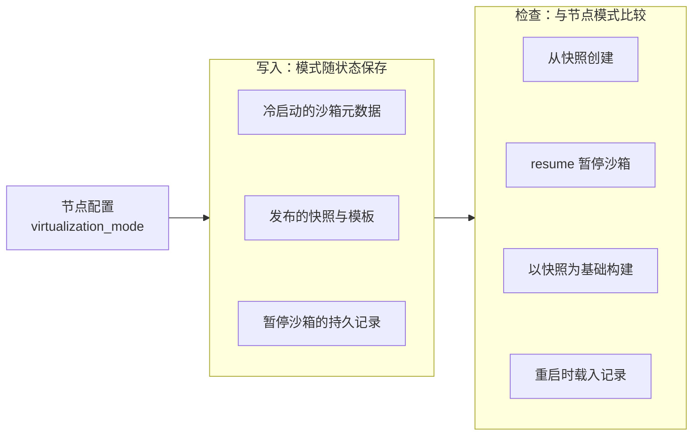

# 61 · PVM：没有嵌套虚拟化时

> 云上的虚拟机多半不向客户暴露硬件虚拟化扩展，没有 `/dev/kvm` 就跑不了 Firecracker。PVM 用一个宿主内核模块提供与 KVM 兼容的接口，让这类机器也能跑 microVM。
> 本篇讲 AgentENV v0.2.3 怎样在 KVM 与 PVM 两种虚拟化模式之间切换：一个节点级配置键，换掉三样外部制品，再加上一道贯穿快照与暂停记录的兼容域检查。
>
> **读者**：运维、工程师。　**预备**：[第 11 篇 · 配置体系](11-configuration.md)、[第 22 篇 · 跨重启持久化](22-persistence-across-restarts.md)。
> **代码**：`src/virtualization.rs`、`src/setup/kvm.rs`、`src/setup/deps.rs`、`src/cfg.rs`、`config/deps_manifest.toml`、
> `src/orchestrator/service.rs`、`src/orchestrator/persistence/file_backed.rs`、`src/sandbox/firecracker/config.rs`、`src/template/builder.rs`、`docs/src/deployment/pvm.md`

---

## 0. 本篇要回答的问题

1. PVM 解决什么问题？AgentENV 需要知道它的多少细节？
2. 从 KVM 切到 PVM，哪些东西变了，哪些代码路径没变？
3. 启动时对虚拟化模式做了哪些校验，为什么 KVM 模式要拒绝已加载 `kvm_pvm` 的宿主？
4. PVM 下为什么强制关闭脏页跟踪？关闭之后内存快照还能不能做，脏页从哪里来？
5. 为什么说虚拟化模式是一个「快照兼容域」？它在哪里被写入、在哪里被检查，不符时发生什么？
6. 混合 KVM 与 PVM 节点的集群会遇到什么问题？

---

## 1. 问题：宿主本身就是一台虚拟机

Firecracker 通过 `/dev/kvm` 使用 KVM，KVM 又依赖 CPU 的硬件虚拟化扩展（Intel VT-x、AMD-V）。
在物理机上这不是问题；可是很多部署落在公有云的普通虚拟机实例上，那时宿主本身就是一台 guest。
要在其中再起 microVM，需要云厂商开启嵌套虚拟化，把 VT-x 暴露给实例。不少实例类型不提供这一点，`/dev/kvm` 根本不存在。

剩下的选择大致三种：换成裸金属或支持嵌套虚拟化的实例，代价是可选机型变少、成本变高；
用纯软件模拟（例如 QEMU TCG），代价是失去硬件虚拟化带来的执行效率，与 Firecracker 的设计目标相悖；
第三种是 PVM。

PVM 出自 SOSP 2023 的论文 *PVM: Efficient Shadow Paging for Deploying Secure Containers in Cloud-native Environment*。
它的思路是半虚拟化：guest 内核以特殊配置编译，知道自己运行在 PVM 之上，与宿主协作完成特权操作与页表管理（论文用影子页表），
因而不需要硬件虚拟化扩展。宿主侧以内核模块 `kvm_pvm` 实现，并对用户态提供与 KVM 相同的 `/dev/kvm` ioctl 接口。
本书不展开 PVM 的内部机制，只需要记住三件事：

- **宿主**要运行打了 PVM 补丁的内核（`CONFIG_KVM_PVM=m`），并加载 `kvm_pvm` 模块；
- **guest 内核**要以 `CONFIG_PVM_GUEST` 编译，且与宿主侧的 PVM ABI 匹配；
- **VMM** 仍然通过 `/dev/kvm` 工作，但需要一个适配了 PVM 的 Firecracker 构建。

这三件事都不在 AgentENV 仓库里。PVM 尚未进入 Linux 主线，部署文档 `docs/src/deployment/pvm.md` 把它标为实验特性；
宿主内核由运维自行安装并重启进入，AgentENV 既不安装内核，也不加载模块。
AgentENV 要做的只是：知道自己处在哪种模式，选对制品，并且不让两种模式产生的状态互相混用。

---

## 2. 一个配置键，三样制品

### 2.1 `VirtualizationMode`

模式由 `src/virtualization.rs` 的 `VirtualizationMode` 表示，只有 `Kvm`（缺省）与 `Pvm` 两个值，序列化为小写字符串，
解析时忽略大小写与首尾空白。类型上的文档注释把它定义为「节点级虚拟化后端，也是快照兼容域」，本篇后半部分就围绕这两个身份展开。

配置入口是 `AppConfig` 的顶层键 `virtualization_mode`（`src/cfg.rs`），可被环境变量 `AENV_VIRTUALIZATION_MODE` 覆盖。
一个节点进程在整个生命期内只处于一种模式；配置是进程级单例（[第 11 篇 §3](11-configuration.md#3-全局单例)），改模式意味着重启节点。

### 2.2 依赖按模式选择

`config/deps_manifest.toml` 把 Firecracker 与内核两项拆成了按模式区分的子表，其余依赖两种模式共用：

| 维度 | KVM 模式 | PVM 模式 |
|---|---|---|
| 宿主内核与模块 | 发行版内核，标准 `kvm_intel` / `kvm_amd`；`kvm_pvm` 不得加载 | PVM 宿主内核 6.12.33，加载 `kvm_pvm`；运维自行安装 |
| Firecracker | `[firecracker.kvm]`：AENV 补丁版 Firecracker，资产名 `1.15.1-patch-v1` | `[firecracker.pvm]`：另一个 fork kvcache-ai/firecracker-next 的 `v1.17.0-next.1` |
| guest 内核 | `[kernel.kvm]`：`vmlinux-6.1.175` | `[kernel.pvm]`：`6.12.33-pvm`，以 `CONFIG_PVM_GUEST` 构建 |
| 支持的架构 | x86_64、aarch64 | 仅 x86_64 |
| 脏页跟踪 | `memory_snapshot.track_dirty_pages` 缺省开启 | 强制关闭 |
| 发布产物 | `aenv-server-linux-<arch>.tar.gz`、镜像 `aenv-server:<tag>` | `aenv-server-linux-x86_64-pvm.tar.gz`、镜像 `aenv-server:<tag>-pvm` |
| tools 盘、overlaybd 工具、regctl | 共用 | 共用 |

`AppConfig::manifest_firecracker()` 与 `manifest_kernel()` 经 `ManifestVirtualizationDownloads::for_mode()` 取出当前模式那一项，
`resolved_firecracker_binary_path()` 与 `resolved_kernel_image_path()` 再把版本号拼进路径：
`$deps/firecracker/<版本>/firecracker` 与 `$deps/kernel/<版本>/vmlinux.bin`。
下载由 `src/setup/deps.rs` 的 `ensure_firecracker()` 与 `ensure_kernel()` 完成，URL 模板同样按模式取。

版本化路径带来一个小性质：两种模式的制品落在不同目录，同一台宿主在两种模式之间切换时不会互相覆盖。
显式配置的 `firecracker.binary_path`、`kernel.image_path` 与 `version` / `url` 覆盖项优先于 manifest，这时选错制品是运维的责任，代码不再按模式核对。

要注意 PVM 用的 Firecracker 与 AENV 补丁版 Firecracker 是**两条不同的代码线**：后者是上游 v1.15.1 加 7 个提交（[第 67 篇](67-firecracker-patch-layer.md)），
前者基于更新的上游版本另行维护，不在本书的代码基线里。AgentENV 的 Firecracker 客户端模型由 1.15.1 的 `firecracker.yaml` 生成，两种模式共用。

---

## 3. 启动时的校验

### 3.1 `validate_mode()` 的三条规则

正常启动时，`setup::ensure_environment()` 在检查系统包之后、检查 ublk 之前调用 `setup/kvm.rs` 的 `check()`。
它先调用 `validate_mode(mode, arch, pvm_loaded)`，其中 `pvm_loaded` 取自 `/sys/module/kvm_pvm` 是否存在：

1. PVM 模式而架构不是 x86_64：拒绝。
2. KVM 模式而 `kvm_pvm` 已加载：拒绝，错误信息提示「改配 `pvm` 或卸载 `kvm_pvm`」。
3. PVM 模式而 `kvm_pvm` 未加载：拒绝。

三条都通过之后，`check()` 才检查 `/dev/kvm` 是否存在、能否以读写方式打开。两种模式用的是同一个设备节点，
所以光看 `/dev/kvm` 无法分辨背后是哪个 hypervisor，模块存在与否是唯一的判据。

第 2 条规则看起来多余：KVM 模式的节点只要 `/dev/kvm` 能用不就行了吗？
推论：加载了 `kvm_pvm` 的宿主上，`/dev/kvm` 背后可能就是 PVM；此时 KVM 模式会拿普通 guest 内核与 AENV 补丁版 Firecracker 去起 VM，
普通内核没有 `CONFIG_PVM_GUEST`，在 PVM 上无法正常启动。与其在第一次创建沙箱时得到一个难以定位的启动失败，
不如在节点启动时就按模块是否加载做互斥判断。这条规则的代价是：一台同时具备硬件虚拟化与 PVM 模块的宿主，必须先卸载 `kvm_pvm` 才能跑 KVM 模式。

### 3.2 校验发生在哪里，不发生在哪里

架构检查出现了三次：`scripts/install.sh` 在下载 bundle 之前、`setup/deps.rs` 的 `ensure()` 在下载依赖之前、`validate_mode()` 在正常启动时。
模块检查只有一次，就是正常启动时的 `check()`。

`--setup-only`（`setup::ensure_provisioning()`）只下载依赖，不调用 `kvm::check()`；`--setup-host`（`setup::ensure_host()`）
把运行用户加进 `kvm` 组、配置 ublk 与 sysctl，也不检查模块。这样分工是有意的：
`ensure_host()` 的注释说明，`--setup-only` 也用于在无特权的构建机上组装发布制品。
`.github/workflows/release.yml` 在普通的 ubuntu-22.04 runner 上把 `default.toml` 的模式改成 `pvm`、跑一遍 `server --setup-only`，
就能把 PVM 版 Firecracker 与内核预下载进 `-pvm` bundle；Dockerfile 用 `ARG AENV_VIRTUALIZATION_MODE` 同样在构建期预烘焙 PVM 依赖。
如果 `--setup-only` 也要求 `kvm_pvm` 已加载，这两条发布路径都做不到。

代价是：一台没有 PVM 宿主内核的机器可以顺利完成安装，直到 `systemctl start aenv` 时才因 `PVM mode requires the kvm_pvm host module to be loaded` 失败。
宿主准备与三种模式的分工见 [第 59 篇](59-host-setup-and-privileges.md)。

---

## 4. 脏页跟踪：为什么关，关了之后怎样

### 4.1 两道关卡

`AppConfig` 的归一化函数在路径展开之后有一段专门的分支：模式为 `Pvm` 时把 `memory_snapshot.track_dirty_pages` 直接改成 `false`。
注释写明了顺序的用意：先改写、后校验，「已有的 PVM 配置不需要新增覆盖项」—— 一份为 KVM 写的配置（缺省为 `true`）切到 PVM 时可以原样使用。
`validate_memory_snapshot_options()` 再兜底一次：若 PVM 下这个值仍为 `true` 就报错，理由是「这个组合没有测试过」。
正常加载路径上归一化总在校验之前，这道兜底只在绕过归一化直接构造配置时起作用（单元测试 `validate_memory_snapshot_options_enforces_dirty_page_requirements` 就是这样构造的）。

这是 AgentENV 运行时代码里唯一一处由模式改变的行为，而且它是通过改写配置值实现的，不是在运行路径上分支。

### 4.2 关闭的是什么

这里容易产生一个误解：以为关掉脏页跟踪就不能做内存快照了。实际上内存快照的打包路径与这个开关无关。
`src/sandbox/firecracker/sandbox.rs` 的 `snapshot_memory_to_overlaybd()` 总是先 `create_state_only_snapshot()`，再调用
AENV 补丁版 Firecracker 新增的 `GET /vm/dirty-memory-ranges` 取区间，然后用 `process_vm_readv` 把这些区间写成内存层（[第 42 篇](42-memory-snapshot-over-ublk.md)）。
`track_dirty_pages` 只影响 Firecracker 在 machine-config 与 snapshot load 时是否开启 KVM 的脏页日志（`instance.rs` 的 `set_machine_config()` 与 `load_snapshot_file()`）。

在 AENV 补丁版 Firecracker 里，这个端点的实现 `Vm::get_dirty_memory_ranges_preserve()`（`src/vmm/src/vstate/vm.rs`）调用 `get_dirty_bitmap()`。
后者沿用上游 Firecracker v1.15.1 的逻辑：memslot 带位图时读 KVM 脏页日志；没有位图，也就是没开脏页跟踪时，改用 `mincore(2)` 按「页是否驻留」来**过近似**脏页集合。
`config/default.toml` 的注释「use Firecracker KVM dirty-page tracking instead of mincore」说的就是这两个来源。

过近似对正确性是安全的：多记一页只让内存层变大，漏记才会丢数据。代价落在体积上。冷启动的 VM 内存是匿名映射，驻留页大致就是 guest 碰过的页；
推论：从快照恢复的 VM 内存是只读块设备的私有文件映射，`mincore` 报告的是页缓存驻留，guest 只读过、甚至别的沙箱读进页缓存的页也会被算进来，
关掉脏页跟踪后，恢复过的沙箱再次暂停时写出的内存层可能明显大于真正被改写的部分。

### 4.3 PVM 下的语义：只能推论

上面关于 `mincore` 的描述只对 KVM 模式用的那条代码线成立，即 AENV 补丁版 Firecracker（tag `aenv-deps`）。PVM 模式下暂停同样无条件调用 `/vm/dirty-memory-ranges`，
但响应它的是 firecracker-next；这条代码线不在本书基线里，它是否实现该端点、没有脏页日志时是否也退回 `mincore`，都无法从代码确认。下面几点因此都是推论：

- 推论：PVM 模式要能暂停，firecracker-next 必须也实现这个端点，并在没有脏页日志时返回一个过近似的区间集合（例如同样走 `mincore`）。
- 推论：同理，可选的 `mem_file_path`、用 seek 取内存文件大小、drive 的 `direct` 选项这几个被 AgentENV 用到的补丁行为，在 firecracker-next 里也要有等价实现，否则暂停或从内存层恢复会失败。
- 「没有测试过」的说法只针对脏页跟踪与 PVM 的组合。推论：PVM 上 KVM 脏页日志的语义（影子页表下由谁、在何时置位）与硬件 KVM 不同，这是保守关闭的原因。

---

## 5. 快照兼容域

### 5.1 为什么模式要跟着状态走

一份内存快照不只是内存内容，还有 vCPU 寄存器、设备状态与 guest 内核在内存里的全部数据结构。
推论：PVM guest 内核以不同配置编译、与宿主有专门的半虚拟化协议，它的快照拿到 KVM 节点上用普通 Firecracker 恢复没有意义，反过来也一样。
所以 AgentENV 把模式当作快照的一个属性：在 A 模式下产生的状态只能在 A 模式下恢复。

这个兼容域是粗粒度的。快照元数据里还记着 `runtime_versions`（内核版本、Firecracker 版本、envd 版本、tools 盘版本，见 `src/snapshot/types/version.rs`），
但恢复时只有 tools 盘版本被实际使用，内核与 Firecracker 版本不参与兼容判断。模式是唯一被强制执行的 VMM 维度。

### 5.2 写入与检查

下图是模式在系统里的流向：节点配置决定写入状态的模式，检查点再拿状态里的模式与节点配置比较。

写入点都取自节点配置或源状态：冷启动时 `create_sandbox_inner()` 把 `ConfigManager::global_config().virtualization_mode` 写进 `SandboxMetadata`；
从快照创建时继承快照的模式；发布快照时 `sandboxes_sandbox_id_snapshots_post()` 把沙箱元数据里的模式带进 `SnapshotPublishMetadata`，
最终落在 `CommittedSnapshot.virtualization_mode`；暂停记录直接序列化整个 `SandboxMetadata`。
`CommittedSnapshot` 与 `SandboxMetadata` 的这个字段都带 `#[serde(default)]`，引入模式之前写下的旧快照与旧记录被当作 KVM。

检查点与不符时的结果：

| 检查点 | 位置 | 不符时 |
|---|---|---|
| 从快照创建沙箱 | `service.rs` 的 `create_sandbox_inner()` | `VirtualizationModeMismatch`，记一次创建失败 |
| 由快照构造 Firecracker 配置 | `sandbox/firecracker/config.rs` 的 `FirecrackerSnapshotConfig::from_runnable_snapshot()` | 报错；与上一行重复，属纵深防御 |
| resume 暂停的沙箱 | `service.rs` 的 `resume_sandbox_inner()` | `VirtualizationModeMismatch`，在置 Resuming 之前返回 |
| 以已有快照为基础构建模板 | `template/builder.rs` 的 `prepare_snapshot_base_context()` | `invalid_input` |
| 重启时载入暂停记录 | `persistence/file_backed.rs` 的 `load_all()` | 保留记录与产物，以无暂停状态的 Paused 载入 |
| BuildKit builder 模板的复用 | `image_build/worker.rs` 的 `initialize_builder_template()` | 模式参与 alias 的哈希，两种模式各建各的，不会互相复用 |

最后一行是另一种处理方式：不是检查后拒绝，而是把模式放进缓存键，让不兼容的制品根本不会被找到。

### 5.3 不符时的后果

`load_all()` 对模式不符的记录调用 `into_metadata_without_runtime_state()`，置空 `paused_state`：沙箱能被列出、能被删除，resume 时得到 `VirtualizationModeMismatch`。
两种模式的记录因此可以在同一个持久化目录里共存，节点切回原模式后能继续恢复（详见 [第 22 篇 §6](22-persistence-across-restarts.md#6-启动load_all-与它的耦合)）。
回顾第 22 篇的推论：这些记录没有暂停状态，不会被镜像 GC 钉住，在切换过模式的节点上，它们所需的镜像层可能被回收，切回原模式后也无法 resume。
部署文档要求不要让 KVM 与 PVM 节点共用持久化目录，这条推论是另一个理由。

`VirtualizationModeMismatch` 在 API 层没有专门的映射。`src/api/impls/sandbox.rs` 的 `From<OrchestratorError> for models::Error` 只单列了
`ShuttingDown`、`SandboxNotFound`、`InvalidSandboxState`、`SandboxOperationFailed`、`SandboxOperationConflict`，其余落到 `internal_error()`，返回 HTTP 500。
一个本质上是「请求了与本节点不兼容的资源」的客户端错误，于是以服务端错误的面目出现，调用方无法据此判断该换节点重试。

---

## 6. 运行时没有分支

除了第 4 节的配置改写，`src/sandbox`、`src/orchestrator`、存储与网络的运行代码里没有任何按模式区分的路径：
同样的 `spawn_with_netns()`、同样的 API 调用序列、同样的 boot args、同样的 ublk 块设备与 overlaybd 层栈。
模式只出现在三类地方：选制品（第 2 节）、启动校验（第 3 节）、兼容域标记与检查（第 5 节）。

这样的边界划分让第五到第七部分的内容对 PVM 原样成立，也让 PVM 支持在代码上很便宜：没有第二套启动或暂停实现需要同步维护。
代价被推到了代码之外，并且不容易被看见：

- **行为等价靠二进制保证。** AgentENV 依赖的补丁行为在 firecracker-next 中是否等价，本仓库里没有测试覆盖。`tests/`、`crates/` 与 `scripts/tests/` 里都没有 PVM 相关的用例，
  CI 只在发布流水线里为 PVM 打包，不运行它。
- **boot args 不随模式变化。** 推论：缺省内核命令行中对 guest 内核的要求（第 67 篇讨论的 DAMON reclaim、free page reporting、`pci=off` 等）对 6.12.33-pvm 内核同样成立，否则 PVM guest 的行为会与 KVM guest 不同。
- **CPU 模板是可选的。** `extract_firecracker()` 在 tarball 里找不到 `cpu-template-helper` 时静默跳过，`resolved_cpu_template_helper()` 返回 `None`，
  节点就不上报 CPU 配置。推论：若 firecracker-next 的发布包不带这个工具，PVM 节点不参与集群 CPU 模板求交（[第 56 篇](56-scheduler.md)）。

---

## 7. 多节点：模式不在调度器的视野里

单节点上，模式不符只会在用户拿错快照时出现。多节点时问题更具体：scheduler 与 gateway 的 Go 代码（`services/`）里没有任何关于虚拟化模式的字段，
心跳不上报模式，放置决策也不考虑模式。

推论：在一个共享快照仓库、混合了 KVM 与 PVM 节点的集群里，用某种模式产生的模板创建沙箱时，scheduler 可能把请求放到另一种模式的节点上，
那个节点在 `create_sandbox_inner()` 拒绝，客户端得到 HTTP 500。部署文档对此的建议是在同一个运行池里统一模式，
Kubernetes 下用节点标签与亲和性把 PVM Pod 限制在加载了 `kvm_pvm` 的节点上；仓库自带的 `deploy/k8s/base/agentenv-daemonset.yaml` 把 `AENV_VIRTUALIZATION_MODE` 写死为 `kvm`，
PVM 部署需要自行覆盖。部署形态见 [第 60 篇](60-deployment.md)。

换句话说，模式在节点内是被强制执行的兼容域，在集群层只是一条运维约定。

---

## 8. 与 e2b infra 的对照

e2b infra 只支持硬件 KVM：它的 GCP 部署通过镜像许可打开嵌套虚拟化，让 orchestrator 所在的云主机获得 `/dev/kvm`。
AgentENV 多出一种模式，换来的是能部署在不提供嵌套虚拟化的实例上；代价是要追踪第二条 Firecracker 代码线与一套非主线的宿主内核，
并且要在快照与暂停记录上维护模式这一兼容域。

---

## 9. 小结

- PVM 由宿主模块 `kvm_pvm` 提供与 KVM 兼容的 `/dev/kvm`，guest 内核需以 `CONFIG_PVM_GUEST` 编译；宿主内核与模块由运维安装，AgentENV 不负责。
- 模式是节点级配置 `virtualization_mode`（环境变量 `AENV_VIRTUALIZATION_MODE`），它换掉 Firecracker 与 guest 内核两项依赖；PVM 用 firecracker-next `v1.17.0-next.1` 与 `6.12.33-pvm` 内核，仅支持 x86_64。
- 制品按版本号落在不同目录，两种模式在同一宿主上互不覆盖；显式路径覆盖项不再按模式核对。
- `validate_mode()` 只在正常启动时运行：PVM 要求 x86_64 且 `kvm_pvm` 已加载，KVM 要求 `kvm_pvm` 未加载。`--setup-only` 不查模块，因此能在无特权构建机上打包 PVM bundle。
- PVM 下脏页跟踪被归一化强制关闭，但内存快照照常走 `GET /vm/dirty-memory-ranges`；「关闭跟踪即改用 `mincore` 过近似、代价是内存层变大」只对 KVM 线的 AENV 补丁版 Firecracker 成立，firecracker-next 的行为无法确认。
- firecracker-next 是否实现 AgentENV 依赖的四个补丁行为，本书基线无法确认，仓库里也没有 PVM 测试。
- 模式随沙箱元数据、快照与暂停记录一起保存，在创建、resume、基于快照构建与重启载入四处检查；不符时 API 返回 500，重启时记录被保留但不可恢复。
- 运行时代码没有 KVM / PVM 分支，差异全在二进制、内核与配置。scheduler 不知道模式，混合模式集群要靠部署约定隔离。

## 延伸阅读 / 下一篇

- 下一篇：[第 62 篇 · aenv CLI](62-aenv-cli.md)。
- 宿主准备与依赖供给：[第 59 篇](59-host-setup-and-privileges.md)；部署形态：[第 60 篇](60-deployment.md)。
- 内存快照怎样使用脏页区间：[第 42 篇](42-memory-snapshot-over-ublk.md)；AENV 补丁版 Firecracker 的补丁与 guest 内核：[第 67 篇](67-firecracker-patch-layer.md)。
- KVM 脏页日志与 Firecracker 的两张位图：[Firecracker 手册第 14 篇 · 脏页跟踪](../firecracker/14-dirty-page-tracking.md)；KVM API 回顾：[Firecracker 手册第 03 篇](../firecracker/03-kvm-api-primer.md)。
- e2b infra 的宿主与嵌套虚拟化：[e2b 手册第 63 篇](../e2b-infra/63-gcp-terraform.md)。
- PVM 论文：*PVM: Efficient Shadow Paging for Deploying Secure Containers in Cloud-native Environment*, SOSP 2023，<https://dl.acm.org/doi/10.1145/3600006.3613158>。
