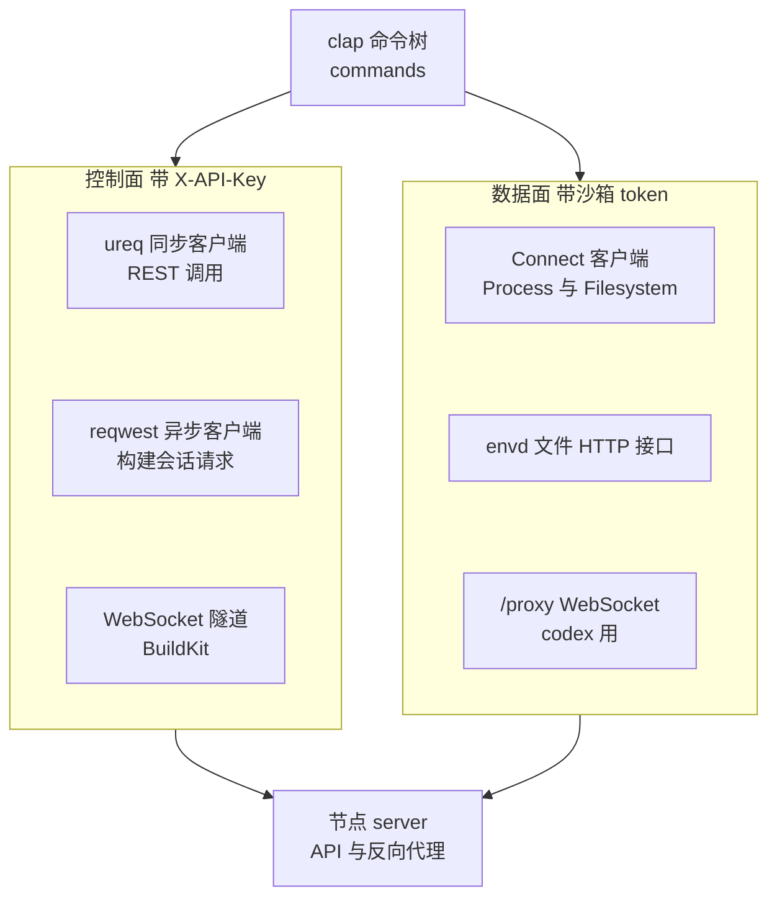
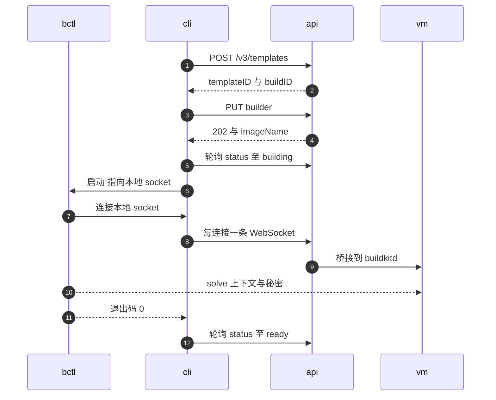

# 62 · aenv CLI

> `aenv` 是 AgentENV 自带的命令行客户端：管理沙箱、模板、快照与卷，在沙箱里执行命令、传文件、开交互终端，把本地 Dockerfile 送进 builder microVM 构建。
> 它的大部分命令只是 HTTP 调用的薄封装，值得细读的是三处：经反向代理和 envd 说话的 Connect 客户端、一个要在断线与暂停之间保持可用的交互终端，以及把本地 `buildctl` 接到远端 `buildkitd` 的隧道。
>
> **读者**：工程师、SDK 使用者。　**预备**：[第 13 篇 · 认证与凭据](13-authentication.md)、[第 15 篇 · 模板构建 API](15-template-build-api.md)、[第 17 篇 · 反向代理](17-reverse-proxy.md)。
> **代码**：`crates/aenv/src/main.rs`、`crates/aenv/src/auth.rs`、`crates/aenv/src/client/*.rs`、`crates/aenv/src/grpc/mod.rs`、
> `crates/aenv/src/commands/{connect,start,exec,build,completion}.rs`、`crates/aenv/src/commands/codex/*.rs`

---

## 0. 本篇要回答的问题

1. CLI 用了哪几种 HTTP 客户端，各自走哪条路径、带什么凭据？
2. 为什么 envd 的调用用 Connect 协议而不是 gRPC？传输层为什么要关连接池、开 TCP keepalive？
3. `aenv connect` 怎样在输入流被代理切断、输出流中断、沙箱被暂停这几种情况下维持一个可用的终端？
4. `aenv build` 怎样把本地 `buildctl` 接到 builder microVM 里的 `buildkitd`？失败时谁来清理？
5. `aenv codex` 把哪些部件拼在一起，它说明了平台的哪些能力？
6. CLI 与服务端之间有哪些不一致与遗留？

---

## 1. 问题：一个客户端，两个平面

AgentENV 的接口分两个平面（[第 13 篇 §1](13-authentication.md#1-问题三种访问三条信任边界)）：控制面是带 `X-API-Key` 的管理请求，
数据面是经节点反向代理送进 guest 的流量，凭据是沙箱级 token。一个命令行工具两边都要用：`aenv start` 先在控制面创建沙箱，
再在数据面上让 envd 拉起一个带 PTY 的 shell；`aenv build` 在控制面创建构建会话，再把 BuildKit 的会话流量经一条 WebSocket 隧道送进 builder VM。

两个平面对客户端的要求不同。控制面请求短、无状态、失败可以直接报错；数据面上既有毫秒级的交互输入，也有可能持续数小时的流，
而中间隔着一个有空闲超时、不支持 HTTP/2 上游的代理。CLI 的分层就是按这两种要求切开的。

---

## 2. 分层

**控制面。** `client/mod.rs` 的 `Client` 持有两个 HTTP 客户端：同步的 `ureq::Agent`（连接 5 s、整体 120 s 超时）与异步的 `reqwest::Client`（同样的超时）。
`get()`、`post()`、`delete()` 三个方法给每个请求加 `X-API-Key`，`client/{sandboxes,templates,snapshots,volumes}.rs` 都建立在它们之上。
`handle_status()` 把错误响应体里的 `message` 字段抽出来，401 时附上「运行 `aenv auth` 更新 API key」的提示。
异步客户端只被 `client/buildkit.rs` 的 `build_request()` 用于 `aenv build` 的会话请求，因为那段流程本来就跑在 tokio 里。

**运行时。** 需要异步的命令各自调用 `commands::tokio_rt()` 建一个 current-thread 的 tokio runtime，用 `block_on` 跑完就退出。
单线程 runtime 足够：CLI 的并发是 I/O 并发，没有 CPU 密集的工作。同步的 `ureq` 调用若出现在异步上下文里（如 `connect` 的看门狗续期），用 `spawn_blocking` 放到阻塞线程池，免得卡住唯一的工作线程。

**TLS provider。** `main.rs` 在解析命令之前调用 `install_crypto_provider()`。注释说明了原因：`reqwest` 与 `ureq` 各自启用了 rustls 的不同 crypto provider（aws-lc-rs 与 ring），
rustls 无法自动选出缺省值，依赖缺省值的连接（`aenv build` 的 `wss://` 隧道）会 panic 而不是报错。显式安装一个就消除了这种二义性。

**凭据。** `aenv auth` 交互式读入服务地址（缺省 `http://localhost:8000`）与 API key（`rpassword` 隐藏输入），
`auth.rs` 的 `save()` 写成 TOML 放在 `ProjectDirs` 的配置目录下（Linux 上是 `~/.config/aenv/credentials`）。
所有命令经 `Client::from_env()` 读这个文件 —— 名字叫 `from_env`，实际上不读任何环境变量，没有用环境变量覆盖凭据的途径。
`save()` 先 `fs::write()` 再把权限改成 0600：文件在两步之间按进程 umask 创建，存在一个其它用户可读的窗口（[第 13 篇](13-authentication.md)），更稳妥的做法是以 0600 创建后再写。

---

## 3. 数据面：envd 的 Connect 客户端

### 3.1 为什么是 Connect

guest 里的 envd 来自 e2b-dev/infra，用 ConnectRPC 框架实现，同一个 handler 接受 gRPC、gRPC-Web 与 Connect 三种线协议。
`grpc/mod.rs` 的模块注释给出了选择：原生 gRPC 要求代理到 envd 之间走 HTTP/2，而 AgentENV 的反向代理不提供这一点；
Connect 协议对 HTTP/1.1 友好 —— unary 调用是一个普通的 POST，body 是 protobuf；server streaming 是一个请求加一串分块传输的 envelope，能原样穿过代理。

`Transport` 实现了这三种调用形态：

- **unary**：`POST /<service>/<method>`，`Content-Type: application/proto`，响应体直接解码；
- **server streaming**：请求体是一个 envelope，响应体是 envelope 流；
- **client streaming**：请求体是一个由 `reqwest::Body::wrap_stream()` 驱动的 envelope 流，响应只有一条消息。

envelope 是 5 字节头加负载：1 字节标志、4 字节大端长度。标志 `0x00` 表示数据，`0x02` 表示流结束，结束帧的负载是 JSON，可能带错误码。
`try_decode_envelope()` 在缓冲区里攒够一整帧再解码，`envelope_stream()` 用 `futures::stream::unfold` 把字节流转成消息流。
双向流（bidi streaming）需要全双工的 HTTP/2，在 HTTP/1.1 上无法实现；client streaming 是半双工的，服务端读完整个分块请求体之后才回应，HTTP/1.1 能承载。终端输入因此走单独的 client streaming 调用 `StreamInput`，输出走 server streaming。

### 3.2 路由与凭据

请求不带 `/proxy` 前缀，而是带三个头：`x-agentenv-sandbox-id`、`x-agentenv-target-port: 49983`（envd 端口）与 `Connect-Protocol-Version: 1`。
服务端没有匹配到的路径只要带着路由头，就由 fallback 交给代理（[第 17 篇 §2](17-reverse-proxy.md#2-三个入口)），路径 `/process.Process/Start` 原样转发给 envd。
secure 沙箱再加 `X-Access-Token`，值是控制面返回的 `envdAccessToken`；以特定用户身份运行时用 HTTP Basic 认证的用户名字段传递，与 envd 的约定一致。

数据面请求**不带** `X-API-Key`。测试 `unary_user_is_sent_as_basic_auth` 断言了这一点：平台级密钥不应该随请求进入 guest，即便代理会在转发前清洗这个头（[第 13 篇 §4.4](13-authentication.md#44-转发前的头清洗)），客户端也不把它交出去。

### 3.3 传输参数

`Transport::http_client()` 的每个参数都对应一个具体的失效模式：

| 参数 | 值 | 目的 |
|---|---|---|
| `http1_only()` | — | 与代理的上游协议一致，避免协商出代理不支持的形态 |
| 重定向 | 禁止 | 数据面请求不应被重定向到别处 |
| `pool_max_idle_per_host(0)` | 不保留空闲连接 | 沙箱暂停、恢复或被重建后，旧连接可能指向已经不存在的上游；每次新建连接，不复用 |
| TCP keepalive | 3 s 起、间隔 1 s、2 次 | 让对端消失在几秒内被内核发现，而不是等默认的两小时 |
| `tcp_user_timeout` | 3 s（仅 Linux 等） | 已发送数据长时间未被确认时让连接失败，覆盖 keepalive 管不到的「有数据在途」情形 |
| 系统代理 | 地址是 localhost 或 127.x 时绕过 | 本地开发时不让 `HTTP_PROXY` 截走请求（`bypass_proxy_for_base_url()`） |

另外，每次 `server_stream()` 与 `client_stream()` 都新建一个 HTTP 客户端，长流之间不共享任何连接状态。
代价是每个调用都要付一次 TCP（以及 TLS）握手；对交互式工具，这比「复用了一条已经死掉的连接，然后等超时」便宜。

`exec`、`upload`、`download` 都建立在这一层上：`exec` 先 `GET /sandboxes/{id}` 取 token，再以非 PTY、无 stdin 的 `Process/Start` 运行命令，`drain_output()` 把输出写到本地并返回退出码；
文件传输走 envd 的 HTTP `/files` 接口（`client/files.rs` 的 `EnvdFilesClient`），用同样的路由头，空闲 60 s 无进展才判超时。

---

## 4. `aenv connect`：交互终端的鲁棒性

### 4.1 要防的几种失败

一个经代理连到 microVM 的交互终端会遇到普通 SSH 少见的情况：

- **代理切断空闲的输入流。** 代理对请求体有 30 s 的空闲超时（`src/api/proxy.rs` 的 `PROXY_REQUEST_BODY_IDLE_TIMEOUT`，[第 17 篇 §5.2](17-reverse-proxy.md#52-两阶段超时)），用户盯着屏幕半分钟不打字，`StreamInput` 就会被断开。
- **输出流中断。** 节点重启、沙箱恢复、网络抖动都会让 server stream 结束，而 guest 里的 shell 进程还活着。
- **沙箱被暂停或删除。** TTL 到期后自动驱逐缺省是暂停（[第 23 篇](23-auto-eviction-and-ttl.md)），终端此时应当告诉用户发生了什么，而不是挂住。
- **TTL 本身。** 经代理的流量不续期 TTL（[第 23 篇 §7](23-auto-eviction-and-ttl.md#7-与代理自动恢复的联动)），一个正在被使用的终端也会因为 TTL 到期被暂停。

### 4.2 结构

`commands/connect.rs` 的 `attach()` 先 `POST /sandboxes/{id}/connect`（对暂停的沙箱会触发恢复，并返回 `envdAccessToken`），
再用 `Process/Start` 以 PTY 模式启动一段 shell 探测脚本 `INTERACTIVE_SHELL_DISPATCHER`：依次尝试 `/bin/bash`、`/bin/sh`，都不能运行时退到 tools 盘里的 `/agentenv/bin/busybox sh`。
探测脚本本身由 busybox 执行，所以即使镜像里没有任何 shell 也能拿到终端。拿到 `Start` 事件里的 pid 之后，本地终端进入 raw 模式，
四个任务在一个 `tokio::select!` 里并发运行，任何一个结束会话就结束：

| 任务 | 职责 | 关键常量 |
|---|---|---|
| `maintain_stream_input()` | 把本地 stdin 经 `StreamInput` 送进 PTY；流断开后重开 | 每 10 s 发一个 keepalive 事件；断开后 100 ms 重连 |
| `maintain_output_stream()` | 消费输出流写到本地 stdout；断开后用 `Process/Connect` 按 pid 重新接上 | 500 ms 无事件视为空闲；重连前等 500 ms，单次重连限 800 ms |
| `resize_loop()` | 轮询本地窗口大小，变化时调用 `Process/Update` | 250 ms |
| `watchdog_loop()` | 健康探测、输入卡顿检测、暂停探测与续期 | 1 s 一拍；10 s 不健康判定失联 |

stdin 由一个专门的 OS 线程同步读取（`spawn_stdin_pump()`），经无界通道交给异步任务；终端读取是阻塞的，放进单线程 runtime 会卡住其它任务。

### 4.3 几个机制

**输入流 keepalive。** 10 s 一次的 keepalive 事件与代理的 30 s 空闲超时对齐（常量旁的注释写明了这一点），留出两次丢失的余量。
即便如此，`maintain_stream_input()` 仍按「流随时会断」来写：流结束就重开，并以 `Start` 事件告诉 envd 这条新流属于哪个 pid。

**输出流以代数重连。** `SessionState` 里有几个单调递增的计数：`generation`（输出流每断一次加一）、`output_generation`（每次有可见输出加一）与 `activity_generation`（每次有输入或输出加一）。
输入任务看到 `generation` 变化就主动重开自己的流，两个方向因此不会一个停在旧连接上。重连成功后有 750 ms 的宽限期，期间到来的重连请求被吞掉，避免在恢复过程中反复重连。

**输入卡顿检测。** 用户敲了可打印字符（`should_expect_output()`），却在 500 ms 内没有看到任何回显，看门狗就把这当作输出流「活着但不通」的信号，请求一次重连。
这是对 TCP 层探测的补充：连接在内核看来完好，数据却到不了。恢复期间的输入改用 unary 的 `Process/SendInput` 单发，并丢弃排队中的后续输入 ——
注释没有解释这个选择，推论：恢复期间重复或乱序的按键比丢掉几个按键更难让用户察觉和纠正。

**健康与暂停探测。** 看门狗每秒用 `Process/List` 探测 envd（200 ms 超时）；连续 10 s 不健康，会话以 `Lost` 结束。
不健康之后又恢复健康，说明 envd 曾经不可达（例如沙箱被恢复过），也触发一次输出重连。
每 5 s 它还在控制面查一次沙箱状态：`paused` 时以 `Paused` 结束并提示 `aenv resume`；404 时以 `Deleted` 结束。

**按活动续期。** 每 60 s 检查一次 `activity_generation` 是否变化，变化了才调用 `POST /sandboxes/{id}/refreshes` 把 TTL 续到 300 s（`DEFAULT_TIMEOUT_SECS`）。
「有人在用」由客户端判定，并由客户端负责续期；一个连着但没人动的终端会在 TTL 到期后被正常驱逐。

**退出码。** 远端 shell 正常退出时返回它的退出码；暂停、删除与失联三种情况都返回 130。调用方据此能区分「shell 自己结束」与「会话被外部打断」，但分不清是三者中的哪一种。

这一组常量都是毫秒到秒级的经验值，没有配置项；它们与服务端代理的超时形成隐式契约，代理一侧改动时客户端需要同步调整。

---

## 5. `aenv build`：本地 buildctl 与远端 buildkitd

服务端的会话、限流与清理在 [第 15 篇 §4](15-template-build-api.md#4-dockerfile-与-buildkit-路径) 已经讲过，这里只讲客户端。
下图中 `cli` 是 `aenv build` 进程，`bctl` 是它拉起的本地 `buildctl`，`api` 是节点 API，`vm` 是 builder microVM 里的 `buildkitd`：

`commands/build.rs` 的 `run()` 先确认平台是 Unix（隧道入口是私有 unix socket，Windows 上直接拒绝），定位 `buildctl`：
缺省是与 `aenv` 同目录的 `aenv-buildctl`，由 `scripts/install-cli.sh` 随 CLI 一起安装，也可以用 `--buildctl` 指定。

`run_async()` 依次创建模板（`POST /v3/templates`）、启动 builder（`PUT …/builder`，请求体是 `timeout`、`startCmd`、`readyCmd`），拿到 `imageName`，
等状态变成 building，然后在 `build()` 里同时跑两件事：

- `client/buildkit.rs` 的 `bind_local()` 在一个 0700 的临时目录里监听 `buildkit.sock`，`buildkit_tunnel()` 每接受一个连接就向 `ws(s)://…/builder` 开一条 WebSocket（带 `X-API-Key`，握手限 15 s），`bridge()` 双向搬运二进制帧；
- 本地 `buildctl --addr unix://… build --frontend dockerfile.v0 --local context=… --local dockerfile=… --output type=image,name=<imageName>,oci-mediatypes=true`，附带 `--build-arg`、`--secret`、`--no-cache`。

`imageName` 必须原样传给 `--output`：服务端靠这个名字在 BuildKit 的 history 里认出本次构建的产物。
构建上下文与秘密由 BuildKit 自己的会话协议经隧道送达 `buildkitd`，不经过 API 的请求体；放在 0700 目录里的 socket 保证同机其他用户不能借这条已鉴权的隧道连进 builder。

两件事任一结束，`select!` 就结束：`buildctl` 成功退出后进入「等 ready」阶段；隧道先结束则视为错误。
隧道里任何一条连接出错都会让整个 `buildkit_tunnel()` 返回错误（`connections.join_next()` 的 `result??`），从而中止构建。
`bridge()` 把 BrokenPipe、ConnectionReset 等视为正常断开，注释说明 buildctl 可能在最后的状态流量尚未发完时就关闭 socket，成败以它的退出码与模板状态为准。

整个操作受 `timeout + 600` s 的截止时间约束（多出的 10 分钟留给准备与发布），并同时监听 Ctrl-C 与 SIGTERM。
失败、中断或超时时，若会话已建立，CLI 在 5 s 内发 `DELETE …/builder` 请求服务端取消并回收 builder；清理请求本身失败时只打印提示，让用户用 `aenv template watch` 查看构建状态。
服务端另有 journal 驱动的周期清理（[第 15 篇 §4.5](15-template-build-api.md#45-取消与清理)），客户端的 DELETE 是加速，不是唯一的保证。

客户端允许 32 条并发隧道连接，服务端上限是 8，超出时返回 429 而不排队（[第 15 篇 §4.4](15-template-build-api.md#44-隧道get-builder)）。由于单条连接失败会中止整个构建，这个不一致在 buildctl 开出较多连接时会直接表现为构建失败。

---

## 6. `aenv codex`：一个完整的用例

`aenv codex` 只支持 Linux，它把本地的 OpenAI Codex 客户端与一台 AgentENV 沙箱拼起来：模型调用与凭据留在本地，命令执行与文件操作发生在沙箱里。
它不是平台的核心功能，但用到了几乎所有对外能力，适合作为「私有 ingress + secure envd + WebSocket 代理」的完整示例。

- **执行器模板。** `codex setup` 用普通的 `aenv build` 路径（`build.rs` 的 `codex_template()`，2 核、1024 MiB、`startCmd` 置空、`readyCmd` 为 `true`）构建内置的 `assets/Dockerfile`：`node:22` 基础镜像，安装固定版本 `@openai/codex@0.155.1`，以 uid 1001 的普通用户运行。
- **创建沙箱。** `codex start` 把项目打包成 tar.gz（`project.rs` 的 `pack()` 跳过常见的构建目录、校验符号链接不越界），然后 `POST /sandboxes`，请求体是 `secure: true`、`autoPause: true`、`network.allowPublicTraffic: false` 与 `metadata.purpose`。
  私有 ingress 意味着访问沙箱端口需要 `trafficAccessToken`。
- **guest 内服务。** 经 envd 在沙箱里起两个进程：`codex exec-server` 监听 4501，`codex app-server` 监听 4502 并要求一个 capability token（写在 `/codex-home/ui-token`，权限 0600）。
- **本地拓扑。** `socket.rs` 的 `Proxy` 经 `/proxy` 的 WebSocket 连接沙箱端口，带 `e2b-sandbox-id`、`e2b-sandbox-port` 与 `e2b-traffic-access-token`，不带 API key 与调用方的其它头。
  本地 `codex app-server` 的执行端指向一个只监听 127.0.0.1、路径随机、拒绝带 `Origin` 头请求的中继，中继再连到沙箱的 4501；
  本地 UI 连到一个 unix socket 网关，网关按 JSON-RPC 方法名分流：`command/exec`、`fs/*`、`process/*` 与文件搜索送往沙箱的 4502，其余送往本地 app-server，并改写请求 id 避免两边冲突。
- **租约与收尾。** 会话期间一个线程每 30 s `POST /sandboxes/{id}/timeout` 把 TTL 续到 300 s。退出时先保存项目改动并暂停沙箱；`codex finish` 导出文件后删除沙箱。
  删除前先把会话清单的状态写成 `deletion-pending` 并落盘，注释指出 DELETE 可能成功而响应丢失，这样重跑 `finish` 只需补做删除，导出的文件不会因为一次网络错误而丢失状态。

整个用例里平台不知道 Codex 的存在：它只看到一台 secure、私有 ingress 的沙箱，一组 envd 调用，以及两条经代理的 WebSocket。

---

## 7. 补全与其它细节

**动态补全。** `aenv completion` 是隐藏命令，基于 `clap_complete` 的 `unstable-dynamic` 特性：补全候选在按 Tab 时向 API 实时查询（活跃或暂停的沙箱、模板与快照）。
`completion.rs` 为它单独建一个超时很短的客户端（连接 500 ms、请求 1 s），一次补全的总预算 2 s，每类候选最多 100 个，快照最多翻 1000 条。
凭据缺失或服务不可达时返回空候选而不是报错 —— 补全的首要约束是不能卡住 shell。

**仍用弃用端点。** `client/sandboxes.rs` 的 `create_sandbox()` 调用 `POST /sandboxes`，`codex start` 也一样，这个端点在 `src/api/openapi.yml` 里标为 deprecated。
CLI 在请求体里显式写 `secure: true` 弥补 v1 缺省非 secure 的差异（[第 14 篇 §3.3](14-sandbox-api.md#33-v2一层字段适配)），并且不暴露关闭 secure 的开关；列表则已经用 `GET /v2/sandboxes`。
`aenv start <target>` 把参数原样作为 `templateID` 传给服务端，由服务端解析别名；`--cold` 改走 `/sandboxes-cold`，`--disk-size-mb` 必须是 1024 的整数倍，`--volume` 在本地先校验挂载路径的重叠与保留目录。

**续期方式不统一。** `connect` 用 `refreshes`，`codex` 用 `timeout`，`resume` 用 `connect` 端点，三者语义有细微差别（[第 14 篇 §4](14-sandbox-api.md#4-四个改-ttl-的入口)），CLI 内部没有统一的续期抽象。

---

## 8. 与 e2b infra 的对照

e2b 手册第 48 篇的考察是：e2b 的 JS 与 Python SDK 向 envd 送 PTY 输入用的是 unary 的 `SendInput`，生成的 `StreamInput` 存根没有被业务代码使用，该篇并据此推论客户端流在只讲 HTTP/1.1 的 envd 上用不上。
`aenv` 的做法与这个推论不同：它在 `http1_only()` 的连接上实际使用了 `StreamInput`，依据是客户端流是半双工的、请求体可以分块送完（§3.1），真正需要 HTTP/2 的只有全双工的双向流；两本书的口径差别就在这一点上。
它换来输入的顺序保证与更少的请求数，代价是要用 10 s 的 keepalive 维持这条流、在它被切断时重建，并在恢复期间退回 unary 的 `SendInput`。
两边都用 Connect 协议，这是 E2B SDK 能直接访问 AgentENV 沙箱里 envd 的前提之一（[第 18 篇](18-e2b-compatibility.md)）。

---

## 9. 小结

- 控制面用同步 `ureq`（统一加 `X-API-Key`），构建会话与 BuildKit 隧道用 `reqwest` / tungstenite；需要异步的命令各建一个 current-thread runtime。
- 两个 TLS 库各带一个 rustls provider，必须在启动时显式安装一个，否则 `wss://` 隧道 panic。
- 凭据只来自 `~/.config/aenv/credentials`；写入后才改成 0600，存在一个按 umask 可读的窗口。
- envd 调用用 Connect 协议是因为代理对上游只说 HTTP/1.1；路由靠头而不是 `/proxy` 前缀，数据面请求不带 API key。
- 传输层禁用连接池、开 3 s 级 TCP keepalive 与 `tcp_user_timeout`，宁可每次握手，也不复用可能已失效的连接。
- `aenv connect` 用四个并发任务维持终端：10 s 输入 keepalive 对齐代理的 30 s 空闲超时，输出断开按 pid 重连，输入无回显触发重连，5 s 一次暂停探测，按活动每 60 s 续期。
- `aenv build` 在 0700 目录的 unix socket 上为每个 buildctl 连接开一条 WebSocket；上下文与秘密不经 API 请求体。客户端 32 与服务端 8 的并发上限不一致，单条连接失败会中止整个构建。
- `aenv codex` 用 secure、私有 ingress 的沙箱加两条经代理的 WebSocket，把模型凭据留在本地、执行放进沙箱，并用先落盘再删除的顺序保证收尾可重试。
- CLI 仍调用已弃用的 `POST /sandboxes`；暂停、删除与失联共用退出码 130。

## 延伸阅读 / 下一篇

- 下一篇：[第 63 篇 · 测试与基准](63-testing-and-benchmarks.md)。
- 服务端一侧：构建会话与隧道见 [第 15 篇](15-template-build-api.md)，代理的超时与 fallback 见 [第 17 篇](17-reverse-proxy.md)，envd 的来源与就绪见 [第 28 篇](28-mmds-and-envd.md)，BuildKit 在 microVM 里的运行见 [第 53 篇](53-buildkit-in-microvm.md)。
- e2b infra 的 envd 协议与 SDK 侧的 Connect 客户端：[e2b 手册第 48 篇](../e2b-infra/48-envd-overview.md)、[e2b 手册第 52 篇](../e2b-infra/52-envd-legacy-and-sdk-compat.md)。
- Connect 协议规范：<https://connectrpc.com/docs/protocol/>。
