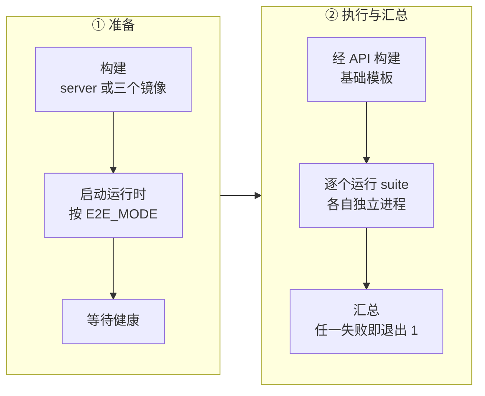
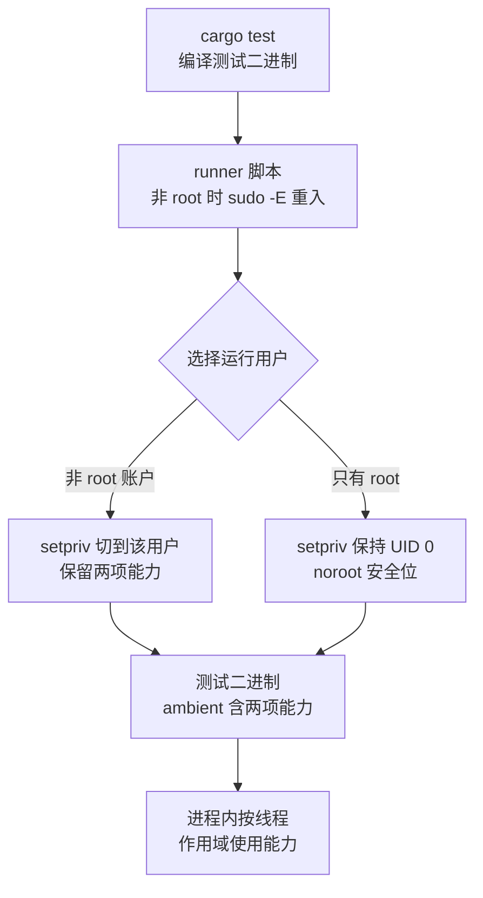

# 63 · 测试与基准

> AgentENV 的大部分行为离不开宿主内核：KVM、ublk、网络命名空间、iptables，还要从镜像仓库拉镜像、从对象存储读层。
> 这样的系统不能只靠 `cargo test` 验证。本篇按「需要多少宿主资源」把测试分层，讲清每层在哪里、怎么跑、CI 跑了哪些，
> 再讲能力委托的测试 runner、代码里为可测试性留的接缝、五个基准测什么，以及这套体系测不到什么。
>
> **读者**：维护者、想提交改动的工程师。　**预备**：[第 08 篇 · 系统架构](08-system-architecture.md)、[第 19 篇 · 状态机与并发控制](19-state-machine-and-concurrency.md)。
> **代码**：`Makefile`、`scripts/run-with-capabilities.sh`、`tests/**`、`crates/{e2e-tests,benchmarks,test-support}/**`、`scripts/tests/**`、`.github/workflows/*`、`.github/actions/*`、`adev/src/{coverage,mutants}.rs`

---

## 0. 本篇要回答的问题

1. AgentENV 的测试按什么分层？每一层依赖哪些宿主资源，入口命令是什么？
2. 需要 `CAP_NET_ADMIN` / `CAP_SYS_ADMIN` 的测试怎样在不以 root 运行整个测试进程的前提下拿到能力？
3. 代码里为可测试性留了哪些接缝？`#[cfg(test)]` 切换常量换来了什么，又让哪些路径测不到？
4. CI 跑了哪几层、在什么机器上跑？哪些测试从不在 CI 里运行？
5. 五个基准各测什么，结果怎样读？E2B 基准脚本测的是谁？

---

## 1. 问题：一个依赖宿主内核的系统怎样测试

一次冷启动要经过镜像解析（访问 registry）、overlaybd 层转换（调用 overlaybd 工具）、ublk 设备创建（`/dev/ublk-control`）、
网络槽位配置（创建 netns、veth、iptables 规则，需要 `CAP_NET_ADMIN` 与 `CAP_SYS_ADMIN`）、Firecracker 启动（`/dev/kvm`）、
envd 就绪探测。暂停与快照还要用到 AENV 补丁版 Firecracker 的 `GET /vm/dirty-memory-ranges`；发布到对象存储要有一个 S3 端点。

这些依赖决定了测试不可能只有一层。纯逻辑（LSMT 索引、状态机 CAS、路由解析）可以在任何机器上测；
一旦碰到内核对象，测试就要求宿主有特定模块、设备节点与能力；一旦碰到真实镜像，测试就要求网络。
AgentENV 的做法是按「需要的宿主资源」显式分层，用 `#[ignore]`、独立的测试二进制与独立的 make 目标把它们隔开，
再用一个统一的 runner 给需要能力的层委托能力。

分层的代价是入口多。`CONTRIBUTING.md` 列出 `make test`、`make test-unit`、`make test-integration`、`make -C services test` 四个入口，
PR 模板要求作者勾选实际跑过的检查并说明跳过的原因。哪一层由谁、在哪里跑，是下面几节的主题。

---

## 2. 测试的层次

| 层 | 位置 | 需要的宿主资源 | 入口 |
|---|---|---|---|
| 单元测试 | 各 crate 的 `#[cfg(test)]` 模块 | 无 | `make test-unit` 前两步 |
| 能力测试 | 单元测试中标 `#[ignore]` 的用例 | `CAP_NET_ADMIN`、`CAP_SYS_ADMIN`、ublk | `make test-unit` 后几步 |
| 集成测试 | `tests/integration.rs`、`tests/orchestrator_integration.rs` | KVM、ublk、netns、网络 | `make test-agent-integration` |
| OSS 与存储 | `crates/e2e-tests`、`storage/*/tests` | Docker（MinIO 容器）、ublk | `make test-agent-integration`、`make test-ublk` |
| HTTP 端到端 | `scripts/tests/e2e/` 的 17 个 suite | 一套完整部署 | `make test-e2e`、`test-e2e-compose`、`test-e2e-k8s` |
| 外围 | envd、BuildKit、Go 服务、安装脚本 | 视对象而定 | `make test-envd`、`make test-buildkit`、`make -C services test` |
| 基准 | `crates/benchmarks`、`storage/overlaybd/benches` | 同集成测试 | `make bench*` |

### 2.1 单元测试与能力测试

`make test-unit` 先跑 `cargo test -p agentenv -p envd -p linux-cap --lib` 与 `cargo test -p aenv --bin aenv`，这两步不需要任何特权。
`src/` 下带 `#[test]` 或 `#[tokio::test]` 标注的函数约 950 个，`storage/overlaybd` 约 400 个，其中 `src/orchestrator/tests.rs` 一个文件就有 104 个。

需要能力的用例写成普通单元测试，再标上 `#[ignore = "requires CAP_NET_ADMIN ..."]` 一类的理由。
`src/privileges.rs` 的 `scoped_command_receives_only_requested_capability()` 与 `scoped_spawn_enters_netns_and_drops_capabilities()`
验证线程作用域能力只交给指定子进程；`src/sandbox/network/slot.rs` 的 `test_network_lifecycle()` 真的创建并拆除一个网络槽位；
`src/sandbox/network/manager.rs` 的 `panic_exit_with_pooled_slot_is_cleaned_by_exit_hook()` 故意让子进程 panic，检查池化槽位被清理。
这些用例开头先用 `linux_cap::has_effective_capabilities()` 断言能力存在，缺能力时报错而不是静默通过。

`make test-unit` 的第三、四步用能力 runner 运行 `cargo test -p agentenv --lib -- --ignored` 与 `cargo test -p uvm-ublk -p uvm-ublk-daemon --lib`，
最后三步是脚本自检：`verify-capability-runner.sh`、`verify-install-service.sh`、`verify-install-buildctl.sh`（见 §3 与 §2.5）。

选择 `#[ignore]` 而不是运行时探测跳过，意味着能力测试必须显式地 `--ignored` 才会跑，一旦跑了，缺能力就是失败。
代价是 `--ignored` 会把一个 crate 里所有被忽略的用例一起选中，理由不同的忽略（需要能力、需要 Docker、压力测试）没有分组手段。

### 2.2 集成测试

`tests/` 下有两个测试二进制。`tests/integration.rs` 汇集 `fc`、`process`、`snapshot`、`snapshot_attached_drive`、`posix_startup_pack`、`ublk`、`envd_supervisor` 七个模块；
`tests/orchestrator_integration.rs` 只含 `orchestrator` 一个模块，文件注释说明原因：orchestrator 关闭时会永久停止进程级的全局运行时管理器，
所以这组测试不能与其它启动沙箱的测试共用一个进程。全局单例（`ConfigManager`、`UblkDeviceManager`）使「测试隔离」只能在进程这一级做。

公共准备在 `tests/common/mod.rs` 的 `setup()`：初始化日志，设置 `AENV_SANDBOX_ACCESS_TOKEN_HASH_SEED`，用 `ConfigManager::init_global()` 读配置，
`UblkDeviceManager::init_global_from_config()` 拉起 ublk-daemon，再用 `ImageResolver` 解析一个真实镜像 `ghcr.io/linuxserver/baseimage-ubuntu:noble`。
因此集成测试需要访问 ghcr.io。

用例覆盖的是端到端的不变量，而不是单个函数：
`fc.rs` 的 `microvm_lifecycle_and_snapshot_preserve_disk_state()` 写入磁盘标记、暂停、恢复后读回；
`oci_tools_share_a_readonly_device_across_concurrent_launches()` 检查并发启动共享同一个只读 tools 盘设备；
`memory_snapshot_format_matches_config_and_resumes()` 检查内存层格式与配置一致；
`microvm_network_policy_controls_egress()` 检查出站策略。
`snapshot.rs` 的 `randomized_snapshot_lifecycle_operations_preserve_artifact_ownership()` 用固定种子的 `DeterministicRng` 生成 75 步随机操作序列
（写标记、暂停、恢复、捕获、从快照启动、删除），失败时把种子与完整操作日志打进错误信息，
结束时还断言「同一沙箱被捕获过两次」「从捕获的快照启动过子沙箱」这类覆盖条件，防止随机序列退化成只测了平凡路径。

`posix_startup_pack.rs` 的唯一用例标着 `#[ignore = "requires enabled startup-pack config plus KVM/ublk"]`，
而 `make test-agent-integration` 没有给这两个二进制传 `--ignored`，所以它在任何 make 目标下都不会运行。

### 2.3 对象存储与存储引擎

对象存储路径用 MinIO 兼容服务测。`crates/test-support/src/minio.rs` 的 `MinioFixture::start()` 起一个固定 tag 的容器（镜像 `pgsty/silo`），
提供 endpoint、bucket 与 `object_exists()` 等辅助。两组测试用它：

- `crates/e2e-tests/tests/snapshot_oss_e2e_test.rs`：六个 `#[ignore = "requires docker"]` 用例，覆盖发布后保留稠密增量供 P2P 使用、
  解析远端 managed layers、发布时压缩 raw 层、别名解析清理陈旧绑定、缺层报错、按别名删除。由 `make test-agent-integration` 的最后一步带 `--ignored` 运行。
- `storage/overlaybd/tests/oss_backend_minio.rs`：七个用例覆盖上传读回、错误凭据、HEAD 大小、覆盖写、多分片流式上传、缺失与空对象的区分。
  由 `make test-ublk` 的第二步运行。

`make test-ublk` 的第一步在能力 runner 下跑 `uvm-ublk`、`overlaybd`、`uvm-ublk-daemon` 三个 crate 的全部非忽略测试，
包括 `storage/ublk/tests/overlaybd.rs` 与 `storage/ublk-daemon/tests/ublk_daemon_test.rs`（后者用一个 `MockServer` 扮演 daemon 的对端）。
overlaybd 里另有两个忽略用例：`backend/cache/tests.rs` 的 `test_concurrent_read_during_capacity_eviction()`（「并发压力测试，手动运行」）
与 `lsmt/file/tests.rs` 的 `test_hybrid_io_uring_discard_rewrite_and_reopen()`（需要启用 io_uring 的宿主）。没有 make 目标会运行它们。

### 2.4 HTTP 端到端套件

`scripts/tests/e2e/run_e2e.sh` 把整套系统当黑盒，只通过 HTTP API 驱动。它的流程分五段：

`E2E_MODE` 有三个取值。single-node 用 `scripts/tests/e2e/lib/server.sh` 的 `start_server()` 在本机起 server，非 root 时经能力 runner；
compose 用 `deploy/docker-compose.yml` 加上 `docker-compose.e2e.yml` 覆盖（打开 gateway 的调试模式、把两个节点的端口暴露到 8001 / 8002）；
k8s 用 `deploy/k8s/run.sh` 部署并 `kubectl port-forward`。三种模式的部署本身见[第 60 篇](60-deployment.md)。

每个 suite 是一个独立的 bash 进程，`lib/assertions.sh` 提供 `assert_eq`、`assert_status`、`assert_json_field` 等断言，
`suite_summary()` 在有失败断言时返回非零。17 个 suite 依次是：健康检查、沙箱生命周期、TTL、元数据、模板生命周期、代理、分页、认证、
E2B 兼容（见[第 18 篇 §6](18-e2b-compatibility.md#6-验证方式)）、集群部署、节点指标、共享快照仓库、快照、code interpreter、卷、随机化卷、BuildKit。
`SUITE_FILTER` 可以只跑一部分。

suite 用 `e2e_mode_is_clustered` 与 `e2e_mode_is compose` 按模式裁剪：`10_cluster_deployment` 与 `12_template_shared_repository` 只在集群模式下有意义，
`16_volume_randomized` 只在 compose 下运行（种子默认 21106、50 步，可由 `AENV_VOLUME_RANDOM_SEED` 与 `AENV_VOLUME_RANDOM_STEPS` 覆盖）。
不适用的 suite 记一条 `_pass "skipped ..."` 然后正常退出，汇总里与真正通过的 suite 无法区分。

### 2.5 外围对象

- **envd 客户端**：`scripts/tests/test_envd.sh` 在 Docker 里以 `-isnotfc` 模式起一个 envd 容器（缺省镜像 `ghcr.io/lsx-s-software/envd-debug:latest`），
  等端口 49983 就绪后跑 `cargo test -p envd`，即 `thirdparty/envd/tests/` 下针对 host 侧 Rust 客户端的用例。
- **BuildKit**：`scripts/buildkit/test.py` 是一个 `unittest` 套件，经与用户相同的认证 API 与 CLI 驱动 BuildKit 构建，由 `make test-buildkit` 运行。
- **Go 服务**：`services/` 下的 `_test.go` 共约 6900 行。`services/scheduler/internal/redis_store_test.go` 在找不到 `redis-server` 时 `t.Skip`。
- **安装脚本**：`verify-install-service.sh` 从 `scripts/install.sh` 里用 awk 截出 systemd unit 模板，替换变量后逐条检查 `User=aenv`、
  `AmbientCapabilities=CAP_NET_ADMIN CAP_SYS_ADMIN`、`NoNewPrivileges=true` 等指令，再交给 `systemd-analyze verify`。
  它测的是安装脚本里的文本，不是安装后的结果。

---

## 3. 能力委托：`run-with-capabilities.sh`

需要能力的测试有两种直接的跑法：整个 `cargo test` 以 root 运行，或者给测试二进制设置文件能力。
前者让测试在比生产更宽的权限下运行，测不出「非 root + 委托能力」才会暴露的问题（例如文件属主、`/proc/thread-self/status` 里的能力集）；
后者每次重新编译都要重新设置，也会污染构建产物。

AgentENV 利用 Cargo 的 runner 机制：根 `Makefile` 的 `CAPABILITY_RUNNER` 把 `CARGO_TARGET_<HOST>_RUNNER` 设为 `scripts/run-with-capabilities.sh`，
其中 `<HOST>` 由 `cargo -vV` 的 host 三元组转大写得到。Cargo 运行每个测试二进制时都会先 exec 这个脚本，把二进制路径作为参数传入。

脚本的步骤：

1. 非 root 调用时先设 `AENV_RUN_USER` 为当前用户，再 `exec sudo -E` 重入自身。脚本注释写明它是开发与 CI 用的包装，不是通用的权限边界。
2. 以 root 身份选择运行用户：显式的 `AENV_RUN_USER`、`SUDO_USER`、仓库目录属主、`aenv` 账户，依次回退；都没有时才用 root 并打印警告。
3. 校验 `AENV_HOME_PATH` 与 `AENV_RUNTIME_PATH` 解析后位于仓库、`/home`、`/tmp`、`/var` 等允许前缀之下，拒绝指向 `/etc` 这类路径，并以运行用户属主创建它们。
4. 把 locked memory 上限提到 `AENV_MEMLOCK_LIMIT`（缺省 `unlimited`），注释说明常见的 8 MiB 上限会让 ublk 与 io_uring 的缓冲注册失败。
5. `setpriv --reuid --regid --init-groups`，并把 inheritable、ambient、bounding 三个集合都设为只含 `net_admin` 与 `sys_admin`，再加 `--nnp`。
   回退到 root 时不切 UID，改用 `--securebits=+noroot,+noroot_locked`，使 UID 0 不再自动获得全部能力。

测试进程拿到的是「普通用户 + 两项 ambient 能力」，与 systemd unit 里 `User=aenv` 加 `AmbientCapabilities` 的生产形态一致；
进程内再由 `src/privileges.rs` 按线程作用域使用能力（[第 59 篇 §5](59-host-setup-and-privileges.md#5-权限模型)）。
`Makefile` 的 `CAPABILITY_TEST_ENV` 同时把 `AENV_HOME_PATH`、`AENV_RUNTIME_PATH` 指到 `/tmp/aenv-test-<id>`（CI 上 id 取 `GITHUB_RUN_ID` 与重试次数，本地取 UID），
避免测试状态与开发机上运行的 server 混在一起；`AENV_DEPS_PATH` 则复用已下载的依赖。

runner 自身有测试。`scripts/tests/verify-capability-runner.sh` 以 `AENV_RUN_USER=root` 运行它，读 `/proc/self/status`，
断言 CapInh、CapPrm、CapEff、CapBnd、CapAmb 都等于 `0000000000201000`（bit 12 `CAP_NET_ADMIN` 与 bit 21 `CAP_SYS_ADMIN`）、`NoNewPrivs` 为 1，
再验证子进程清空 ambient 后有效集归零、`AENV_MEMLOCK_LIMIT` 生效、未知用户与不安全路径被拒绝。

代价有两点。runner 作用于整个测试二进制，同一二进制里不需要能力的用例也带着能力运行，「这段代码在无能力时表现如何」只能靠单独的测试证明；
`sudo -E` 保留全部环境变量（推论：在共享机器上，调用者能经环境变量影响以 root 执行的那一小段脚本，这正是脚本注释声明它不是权限边界的原因）。

---

## 4. 为可测试性留的接缝

### 4.1 trait 替身

需要真实资源的部件都藏在 trait 后面，测试替换实现：

| 接缝 | 替身 | 编译范围 | 用于 |
|---|---|---|---|
| `SandboxBackend` / `SandboxBackendFactory` | `src/sandbox/mock.rs` 的 `MockSandboxBackend`、`MockBehavior` | `#[cfg(test)]` | orchestrator 状态机测试 |
| 沙箱持久化器 | `src/orchestrator/persistence/mock.rs` 的 `RecordingPersister` | `#[cfg(test)]` | 重启恢复测试 |
| 快照仓库与运行时解析 | `src/snapshot/mock.rs` 的 `MockSnapshotRepository` 等 | `pub`，`#[doc(hidden)]` | 跨 crate 使用 |
| P2P 传输 | `src/p2p/mock.rs` 的 `MockTransport` | `#[cfg(test)]` | P2P 拉取测试 |
| 模板执行沙箱 | `src/template/runner.rs` 等处的 `RecordingSandbox` | 测试模块内 | 步骤执行顺序 |

orchestrator 怎样用 `MockBehavior` 与 store 闸门构造确定的交错，[第 19 篇 §8](19-state-machine-and-concurrency.md#8-怎样验证这台状态机) 已经详讲，这里不重复。
`src/snapshot/mock.rs` 不在 `#[cfg(test)]` 后面，而是以 `pub mod mock` 加 `#[doc(hidden)]` 编进生产库，代价是替身代码进入 server 二进制的编译单元。

### 4.2 `#[cfg(test)]` 切换常量

另一类接缝是按编译配置切换常量或分支：

- `src/api/proxy.rs` 的四个超时 `PROXY_CONNECT_TIMEOUT`、`PROXY_RESPONSE_HEADER_TIMEOUT`、`PROXY_REQUEST_BODY_IDLE_TIMEOUT`、`PROXY_AUTO_RESUME_TIMEOUT`，
  生产分别是 5 s、30 s、30 s、60 s，测试里都是 100 ms，使超时路径的测试能在毫秒级完成（代理行为见[第 17 篇](17-reverse-proxy.md)）。
- `src/p2p/iroh/catalog.rs` 的 `DB_DURABILITY` 生产是 `Wal`，测试是 `Memory`。
- `src/snapshot/repository/backends/common/acr/client.rs` 的 `insecure_http_allowed()` 在生产恒为 false，测试里才读 `allow_insecure_http` 选项，用于对着本地 HTTP 假服务器测重定向。
- `src/cfg.rs` 的 `ConfigManager::global()` 在测试里未初始化时自动 `init_global()`，生产则要求先初始化；测试另有固定的 `TEST_ACCESS_TOKEN_HASH_SEED`。

这种做法的收益是测试快且不依赖外部环境；代价是测试二进制与生产二进制在这些点上走的不是同一份代码。
`#[cfg(not(test))]` 一侧的分支（例如生产的 WAL 持久化、ACR 拒绝明文重定向）只能由集成测试或端到端套件覆盖，单元测试的通过不说明它们正确。

### 4.3 确定的随机性

随机化测试都用固定种子：§2.2 的快照随机生命周期、§2.4 的随机化卷 suite、`storage/overlaybd/benches/zfile_read_benchmark.rs` 的数据与偏移。
固定种子让失败可复现，代价是每次 CI 走同一条序列；探索新序列要人为改种子。

---

## 5. CI 矩阵

`.github/workflows/` 下有 13 个 workflow，其中与测试相关的如下：

| workflow | 触发 | 内容 | 宿主要求 |
|---|---|---|---|
| `ci.yml` | PR 与 push，路径过滤 `**.rs`、`Cargo.*` 等 | `make fmt`、`make clippy`、`make test-unit` | ublk（`setup-ublk-access.sh`） |
| `integration-tests.yml` | PR 与 push，排除纯文档改动 | `make test-agent-integration`；E2E 矩阵 single-node 与 docker-compose | KVM、ublk、Docker |
| `ublk-tests.yml` | PR 与 push，`storage/**` 等 | `make test-ublk` | ublk、Docker |
| `envd-tests.yml` | PR 与 push，`thirdparty/envd/**` 等 | `make test-envd` | Docker |
| `services-ci.yml` | PR 与 push，`services/**`、`deploy/**` | Go build、test、fmt-check、vet | Redis |
| `coverage.yml` | push 到 main，或手动 | `make coverage`，不阻塞 | KVM、ublk |
| `mutation-tests.yml` | 手动 | `cargo adev mutants`，三个包 | 无特权 |
| `benchmark.yml`、`e2b-benchmark.yml` | 手动 | 见 §6 | KVM |

这些作业都声明 `runs-on: ubuntu-latest` 一类的 GitHub 托管标签。composite action `sandbox-ci-setup` 负责把托管机变成可跑沙箱的宿主：
把 `/dev/kvm` 改为 kvm 组可读写并把当前用户加入 kvm 组（所以后续命令用 `sg kvm -c "make ..."`）；
`cargo run --bin server -- --setup-only` 下载依赖，`--setup-host --runtime-user "$USER"` 配置宿主；
最后用能力 runner 检查 `ublk_drv` 已加载、有效能力集为 `0x201000`、能打开 `/dev/kvm` 与 `/dev/ublk-control`。
依赖目录按 `config/deps_manifest.toml`、`src/setup/deps.rs` 等文件的哈希做缓存键，同一套依赖不重复下载。
action 里还有 `runner.environment == 'self-hosted'` 的分支，改用本地目录缓存。

E2E 矩阵在 single-node 下直接跑 `make test-e2e`；在 docker-compose 下先用 buildx 构建 runtime、gateway、scheduler 三个镜像，再以 `SKIP_BUILD=1` 跑 `make test-e2e-compose`。
两者都先装好 `@e2b/cli`、Python `e2b` 与 `e2b-code-interpreter`、`buildctl`，并用 `scripts/buildkit/test-config.toml` 作为 server 配置。

覆盖率由 `adev/src/coverage.rs` 驱动 `cargo llvm-cov --workspace`，排除 `agentenv_http_server`、`firecracker_client`、`envd`、`http_client` 四个 crate，
文件名正则再滤掉 `thirdparty/` 与 `generated/`；缺省不带 `--include-ignored`，所以能力测试与 OSS 测试不计入。
步骤标 `continue-on-error`，成功时把 `badge.json`、`badge.svg`、`coverage.json` 发布到一个元数据分支。
变异测试由 `adev/src/mutants.rs` 调用 `cargo mutants --package <pkg> -- --lib`，CI 矩阵是 `agentenv`、`overlaybd`、`uvm-ublk`，
每个变体的测试进程经 `systemd-run --user --scope -p MemoryMax=...` 限内存（缺省 8192 MiB），同样 `continue-on-error`，只上传 `mutants.out` 供人看。

从这张表能读出三类**不在 CI 里**的测试：

- `make test-e2e-k8s`：仓库里没有任何 workflow 设置 `E2E_MODE=k8s`，Kubernetes 清单只有本地验证。
- 所有 make 目标都不带 `--ignored` 的忽略用例：`posix_startup_pack_publish_resolve_and_resume()`、overlaybd 的两个忽略用例。
- `make test-buildkit` 作为独立目标不在 CI；BuildKit 路径由 E2E 的 `17_buildkit.sh` 覆盖。

另外，发布流水线 `release.yml` 不依赖任何测试 workflow，tag 推上去即开始构建（[第 64 篇](64-build-codegen-release.md)）。

---

## 6. 基准

`crates/benchmarks` 是一个 `publish = false` 的 crate，四个基准都用 criterion 0.8、`harness = false`。
`make bench` 先以 release 构建并安装 ublk-daemon，再在能力 runner 下 `cargo bench -p agentenv-benchmarks`；
每个基准也有单独的目标（`bench-snapshot`、`bench-ublk`、`bench-orchestrator-store`、`bench-oci-conversion`）。

| 基准 | 被测对象 | 用例 |
|---|---|---|
| `snapshot` | `FirecrackerSandbox` 的暂停与恢复 | 128 MiB 内存下 `pause()`；先写 1 GiB 磁盘或在 `/dev/shm` 写 1 GiB 内存后 `pause()`；热恢复、冷恢复、并发恢复 |
| `ublk_overlaybd` | ublk 设备上的 overlaybd 读写 | 顺序读 1 MiB × qd8、128 KiB × qd32；随机读 4 KiB × qd1、qd64；随机写 4 KiB × qd1、qd64 |
| `orchestrator_store` | `InMemoryMetadataStore` | 过期列表与状态过滤的朴素扫描对照、CAS 成功与冲突、更新、1000 条记录上的 `metrics_snapshot()` |
| `oci_conversion_pipeline` | OCI 镜像转 overlaybd 的流水线 | 合成数据的流水线与非流水线参照；设置 `AGENTENV_BENCH_OCI_IMAGE` 时追加真实镜像 |

几个读结果时要知道的细节：

- `snapshot` 用 `iter_custom` 只计 `pause()` 本身的耗时，沙箱的启动与停止在计时区之外。每个用例先做一次冒烟启动，失败就打印 `Skipping ...` 并直接返回，
  criterion 不会报错，结果目录里只是少了这个用例。
- `ublk_overlaybd` 用 `SamplingMode::Flat`，并在结束后把 criterion 的汇总页改写成柱状图。
- `orchestrator_store` 不需要能力，`Makefile` 的对应目标也没有挂 runner；它对比的「朴素扫描」是基准里手写的参照实现，用来说明当前 store 的索引是否值得。
- `oci_conversion_pipeline` 的注释说明真实镜像路径刻意复刻 `src/image/oci_image.rs` 里后台 `regctl image copy` 的生产者，需要人工保持同步；
  这是一份手抄的生产逻辑，生产代码改了而基准没改时，它测的就不再是生产流水线。

`storage/overlaybd/benches/zfile_read_benchmark.rs` 是第五个基准，属于 overlaybd crate，不在 `make bench` 里。
它的模块注释写明设计约束：数据与偏移来自固定种子，构造工作都在计时区之外，打开文件后重置计数器，只断言非时间的不变量，从不断言耗时阈值。

`benchmark.yml` 手动触发，跑 `make bench PROFILE=release` 并把 `target/criterion` 作为 artifact 上传。仓库里没有保存基线，也没有回归门槛，
结果只能由人下载后与 criterion 自己保存的上一次结果比较。本书不引用任何测量值。

`scripts/e2b/run-e2b-benchmark.sh` 测的不是 AgentENV。它克隆 `INFRA_REPO_URL`（缺省是 GitHub 上一个个人账户下的 e2b infra fork，未指定 ref），
运行 `make local-bootstrap-up-to-base-template` 搭起本地 e2b 环境，再执行 `benchmark-template-restore.sh -n 50 -t base`，最后清理。
它提供的是同一台托管机上 e2b infra 模板恢复的参照数据；由于 fork 与分支都不固定，两次运行之间对照对象本身可能已经变了。

---

## 7. 这套体系测不到什么

- **跳过即通过。** E2E 中不适用的 suite、[第 18 篇](18-e2b-compatibility.md#6-验证方式)讲过的缺 SDK 工具时的兼容测试，都记为 pass；汇总不区分「通过」与「跳过」。
- **从不运行的用例。** 忽略的启动包集成测试、overlaybd 的并发驱逐压力测试与 io_uring discard 用例没有任何入口运行。
- **Kubernetes 形态。** k8s E2E 不在 CI，DaemonSet 的 preStop、EndpointSlice 发现只有手工验证。
- **外部镜像不固定。** `test_envd.sh` 缺省用一个第三方账户下的 `envd-debug:latest`；E2E 的 TypeScript 段装 `e2b@latest`；E2B 基准克隆未固定的 fork。测试结果随外部发布而变。
- **测试与生产分叉。** `#[cfg(test)]` 一侧的常量与分支使单元测试不覆盖生产分支；`#[cfg(not(test))]` 的路径只有更高层的测试能触及。
- **性能无门槛。** 基准只手动运行，没有基线与阈值；覆盖率与变异测试都不阻塞合并。
- **PVM 与 aarch64。** CI 的所有测试作业都在 x86_64 KVM 托管机上运行；PVM 模式（[第 61 篇](61-pvm.md)）与 aarch64 只在发布流水线里被构建，不被测试。

---

## 8. 与 e2b infra 的对照

e2b infra 把需要 root 的测试写成普通 Go 测试，运行时 `t.Skip`，在开发机上会静默少跑一批；AgentENV 用 `#[ignore]` 让这类测试必须显式选中，选中后缺能力即失败。
e2b infra 的集成测试要一台准备好 uffd、NBD 与大页的机器，AgentENV 则用 composite action 把 GitHub 托管机就地改造成沙箱宿主。
两边都没有性能回归门槛；AgentENV 另有覆盖率与变异测试，但都不阻塞。

---

## 9. 小结

- 测试按「需要多少宿主资源」分为单元、能力、集成、OSS / 存储、HTTP 端到端、外围与基准七层，入口各不相同。
- 需要能力的单元测试标 `#[ignore]`，由 `--ignored` 显式选中；缺能力时失败而不是跳过。
- `run-with-capabilities.sh` 经 Cargo runner 机制包住每个测试二进制：sudo 重入、选非 root 用户、`setpriv` 只留 `CAP_NET_ADMIN` 与 `CAP_SYS_ADMIN`，与生产的 systemd 形态一致。
- 全局单例使隔离只能在进程级做：orchestrator 集成测试单独一个二进制，测试状态目录按 run id 或 UID 隔开。
- trait 替身覆盖后端、持久化器、快照仓库与 P2P 传输；`#[cfg(test)]` 常量让超时测试毫秒级完成，代价是生产分支不被单元测试覆盖。
- 随机化测试都用固定种子并断言覆盖条件，失败可复现。
- CI 在 GitHub 托管机上开 KVM、装 ublk、跑 `--setup-host`，覆盖单元、集成与 single-node / compose 两种 E2E；k8s E2E、若干忽略用例与基准不在 CI。
- 覆盖率与变异测试都是 `continue-on-error`，只提供信息。
- 五个 criterion 基准测暂停恢复、ublk 读写、元数据 store、OCI 转换与 ZFile 读；没有基线与阈值，`snapshot` 基准在冒烟失败时静默跳过用例。
- E2B 基准脚本测的是一个未固定版本的 e2b infra fork，用作参照。

---

## 延伸阅读 / 下一篇

- [第 19 篇 · 状态机与并发控制](19-state-machine-and-concurrency.md)：orchestrator 替身测试的四种模式。
- [第 59 篇 · 宿主准备、依赖供给与权限模型](59-host-setup-and-privileges.md)：`--setup-host` 与线程作用域能力。
- [第 60 篇 · 单节点安装、Compose 与 Kubernetes](60-deployment.md)：E2E 三种模式所部署的形态。
- [e2b 手册第 62 篇 · 测试体系](../e2b-infra/62-testing.md)：同类系统的另一种分层与跳过策略。
- [Firecracker 手册第 47 篇 · 测试](../firecracker/47-testing.md)：Firecracker 自身的测试框架。
- 下一篇：[第 64 篇 · 构建、代码生成与发布](64-build-codegen-release.md)。
