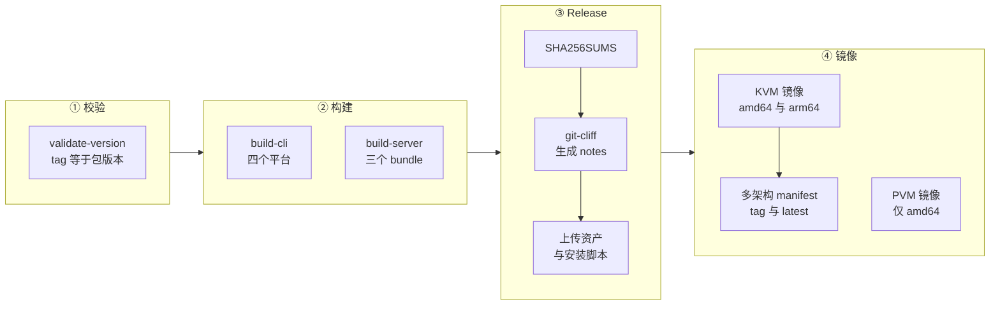

# 64 · 构建、代码生成与发布

> 一个 AgentENV 仓库产出六类东西：Rust 的 server 与 ublk-daemon、四个平台的 `aenv` CLI、Go 的 gateway 与 scheduler、节点 Docker 镜像、guest 的 tools 盘镜像，以及文档站。
> 它们用到 cargo、Go、Node.js 上的 openapi-generator、protoc、Docker buildx、mdBook 六套工具链。
> 本篇讲这些产物从哪里来：根 `Makefile` 与 `adev` 怎样组织构建，哪些代码是生成的、怎样再生成，一个 tag 怎样变成 GitHub Release 与镜像，以及构建在哪些地方不可复现。
>
> **读者**：维护者、要自己出包或改发布流程的运维。　**预备**：[第 12 篇 · 规范驱动的服务骨架](12-spec-driven-server.md)、[第 63 篇 · 测试与基准](63-testing-and-benchmarks.md)。
> **代码**：`Makefile`、`Cargo.toml`、`rust-toolchain.toml`、`build.rs`、`adev/src/*`、`.github/workflows/{release,docs,publish-tools-image}.yml`、`cliff.toml`、`scripts/release/package-cli.sh`、`tools-image/`、`docs/book.toml`

---

## 0. 本篇要回答的问题

1. 根 `Makefile`、Cargo workspace 与 `adev` 各管什么？工具链版本由谁决定？
2. 仓库里有哪些生成代码？哪些入库、哪些在构建时生成？各用什么命令再生成？
3. 推一个 `v*` tag 之后，发布流水线做了哪几步，产出哪些资产？
4. tools 盘镜像为什么单独发布？它的来源与不可变性怎样保证？
5. 文档站怎样按版本发布？
6. 构建与发布在哪些环节不可复现，或者与仓库自己的部署清单脱节？

---

## 1. 问题：一个仓库，多种产物

AgentENV 的单节点形态只需要 server 与 ublk-daemon 两个二进制，但它运行时还要 Firecracker、guest 内核、tools 盘、overlaybd 工具与 regctl。
这些运行时依赖不由本仓库编译，而是按 `config/deps_manifest.toml` 下载（[第 59 篇 §3](59-host-setup-and-privileges.md#3-依赖供给)）。
发布要解决的问题因此有两层：把本仓库的代码编译成能在常见 Linux 宿主上运行的二进制；
再把下载好的依赖与二进制打成一个离线可装的包，让 `scripts/install.sh` 不必在每台机器上重复下载。

多节点形态还需要 Go 写的 gateway 与 scheduler，以及容器镜像；CLI 要覆盖 Linux 与 macOS 两种系统、两种架构；
guest 侧的 envd 来自 e2b infra，需要另一条构建线。每条线的工具链与触发方式都不同，下面逐一展开。

---

## 2. 构建入口

### 2.1 根 `Makefile`

根 `Makefile` 以 `bash -eu -o pipefail` 执行每条命令，并开 `.DELETE_ON_ERROR`。`PROFILE` 缺省 `debug`，设为 `release` 时给 cargo 加 `--release`。
它的目标按用途分成几组：

| 组 | 目标 | 说明 |
|---|---|---|
| 构建 | `build`、`release`、`build-server`、`build-aenv`、`build-ublk`、`install-ublk`、`install-aenv` | `install-ublk` 把 daemon 拷到 `$AENV_HOME_PATH/ublk/uvm-ublk-daemon` |
| 检查 | `fmt`、`clippy`、`coverage`、`mutants` | `clippy` 带 `--workspace --all-targets --all-features -- -D warnings` |
| 测试与基准 | `test-*`、`bench*` | 见[第 63 篇](63-testing-and-benchmarks.md) |
| 代码生成 | `agentenv-server`、`firecracker-client`、`envd-http-client`、`custom-extension-client`、`ci-deps` | 都转给 `cargo adev codegen` |
| 部署 | `deploy-*`、`k8s-*` | Compose 与 kustomize，见[第 60 篇](60-deployment.md) |
| Go 与文档 | `services-%`、`gateway-%`、`scheduler-%`、`docs`、`docs-serve` | 前三个把目标名转发给 `services/` 下的 Makefile |

Go 侧有自己的 `services/Makefile`（`build`、`test`、`fmt-check`、`vet`、`proto`），根 Makefile 只做转发，两套构建在 make 这一层没有共享状态。

### 2.2 Cargo workspace 与工具链

根 `Cargo.toml` 的 workspace 有 19 个成员，包括两个生成 crate（`src/api/generated`、`src/custom_extension_api/generated`）
与两个 `thirdparty/` 客户端。`[workspace.package] version = "0.2.3"`，但只有 `agentenv` 与 `aenv` 等少数包用 `version.workspace = true`，
其余成员大多写死 `0.1.0`，`thirdparty/firecracker-client` 写 `1.15.1`。`storage/uffd-core` 不在成员列表里。

几处与构建行为有关的设置：

- `vendored-openssl` feature（`agentenv` 与 `aenv` 各有一份）让 `openssl-sys` 从源码静态编译 OpenSSL，发布构建用它摆脱宿主 OpenSSL 版本。
- `[profile.dev.package.*]` 对 `sha2`、`digest`、`block-buffer`、`crypto-common`、`rocksdb`、`librocksdb-sys` 强制 `opt-level = 3`，`profile.test` 对 RocksDB 同样处理。
  推论：debug 构建下层摘要计算与 RocksDB 太慢，会拖慢开发循环与测试；这些包被单独优化，其余代码仍保留调试友好的 debug 构建。
- `rust-toolchain.toml` 只写 `channel = "stable"`、`profile = "minimal"` 与 clippy、rustfmt 两个组件，**不锁具体版本**。
  rustup 在每台机器上取当时最新的 stable；发布流水线用 `dtolnay/rust-toolchain@stable`，节点镜像的构建阶段用 `rust:1-bookworm`。
  三处都是「当时的 stable」，同一个 commit 在不同日期构建可能用不同的编译器。依赖版本则由入库的 `Cargo.lock` 与发布构建的 `--locked` 固定。
- `.cargo/config.toml` 只定义一个别名：`adev = "run --package adev --"`，所以 `cargo adev …` 会先编译再运行 `adev` crate。

### 2.3 `adev`：开发与 CI 工具

`adev`（`adev/src/main.rs`）是一个 clap 程序，只有三个子命令：`codegen`、`mutants`、`coverage`。
后两个在[第 63 篇 §5](63-testing-and-benchmarks.md#5-ci-矩阵) 讲过；它们共同的模式是「缺什么装什么」：
`ensure_tool.rs` 的 `ensure_cargo_tool()` 在找不到 `cargo-mutants` 或 `cargo-llvm-cov` 时 `cargo install --locked`，`ensure_rustup_component()` 补装 `llvm-tools`。

`codegen --ensure-deps-only`（即 `make ci-deps`）只做一件事：`ensure_protoc()` 按 `deps_manifest.toml` 的 `[protoc]`（版本 `33.4`）检查 PATH 上的 `protoc --version`，
不符时从 GitHub release 下载 zip 解到 `$HOME/.local`，在 CI 里再把 `bin/` 追加进 `GITHUB_PATH`。
`adev/src/config.rs` 的 `Config` 只反序列化 `[protoc]` 一节，manifest 的其它节是 server 的 `--setup-only` 在读。
下载走 `adev/src/util.rs` 的 `download_file()`：没有校验和，并且目标文件已存在且非空时直接跳过下载，残缺的临时 zip 会被当作完整文件解压。

### 2.4 `build.rs`：构建时生成与提交号

根 crate 的 `build.rs` 做两件事。第一，用 `tonic_prost_build` 编译三份 proto：
`services/api/proto/scheduler.proto` 只生成**客户端**（节点调用 scheduler，[第 54 篇](54-control-plane-overview.md)），
`src/image/content.proto` 与 `src/image/build_history.proto` 生成服务端与客户端。输出在 Cargo 的 `OUT_DIR`，不入库。
`thirdparty/envd/build.rs` 同样在构建时编译 envd 的 `filesystem.proto` 与 `process.proto`，只生成客户端，并传 `--experimental_allow_proto3_optional`，
注释说明这是为了兼容一些 Linux 宿主上的旧版 protoc（这两份 proto 用了 proto3 `optional`，根 crate 的三份没有）。

第二，注入构建提交号：`resolve_git_commit()` 运行 `git rev-parse --short HEAD`，失败时用 `unknown`，以 `cargo:rustc-env=AENV_GIT_COMMIT=…` 编进二进制；
`emit_git_rerun_inputs()` 把 `HEAD`、当前分支的 ref 文件与 `packed-refs` 登记为 rerun 输入，切分支或提交后会重新运行 build script。
`src/identity.rs` 的 `build_commit()` 用 `option_env!` 读这个值，与 `CARGO_PKG_VERSION` 一起放进 `NodeIdentity`，经节点 API 与心跳上报。

这里有一个与镜像构建的交互：`.dockerignore` 排除了 `.git`。
推论：在 `deploy/docker/Dockerfile.agentenv` 里构建的 server 拿不到 git 元数据，`AENV_GIT_COMMIT` 会是 `unknown`；
发布流水线直接在 checkout 上构建的 bundle 二进制则带有真实的短 SHA。

---

## 3. 生成代码

仓库里的生成代码分两类：入库的 OpenAPI 产物，与构建时生成、不入库的 protobuf 产物。

| 产物 | 来源 | 生成器 | 入库 | 再生成 |
|---|---|---|---|---|
| `src/api/generated`（`agentenv_http_server`） | `src/api/openapi.yml` | openapi-generator `rust-axum` | 是 | `make agentenv-server` |
| `thirdparty/firecracker-client` | 同目录 `firecracker.yaml` | openapi-generator `rust` | 是 | `make firecracker-client` |
| `thirdparty/envd/http-client` | 同目录 `envd.yaml` | openapi-generator `rust` | 是 | `make envd-http-client` |
| `src/custom_extension_api/generated` | `src/custom_extension_api/openapi.yml` | openapi-generator `rust` | 是 | `make custom-extension-client` |
| `services/api/proto/*.pb.go` | `scheduler.proto` | protoc + protoc-gen-go / go-grpc | 是 | `make -C services proto` |
| Rust 侧 scheduler / content / envd gRPC | 各 `.proto` | `tonic_prost_build` | 否 | 每次 `cargo build` |

OpenAPI 四项都由 `adev/src/codegen.rs` 的 `run_openapi_generator()` 经 `npx` 调用：npm 包装器版本由常量 `OPENAPI_GENERATOR_CLI_VERSION` 固定为 `2.32.0`，
真正的生成器 jar 版本由根目录 `openapitools.json` 固定为 `7.22.0`，都带 `hideGenerationTimestamp=true` 使输出可重复。
三个客户端的后处理是 `prepend_allow_attrs()` 在 `lib.rs` 开头加 `#![allow(clippy::all)]` 与 `#![allow(warnings)]`，再 `cargo fmt`；
custom extension 客户端另带 `--skip-validate-spec`。server 的正则后处理 `fix_duplicate_auth_trait()` 及其脆弱之处，[第 12 篇 §2](12-spec-driven-server.md#2-生成管线) 已经讲过。
`cargo adev codegen` 不带子命令时按 Firecracker、envd、server、custom extension 的顺序全部重生成。

两类做法各有代价。入库的 OpenAPI 产物让普通构建不需要 Node.js 与 Java，代价是 spec 与产物的一致性只靠评审——
CI 里没有「重新生成并比较」的检查。构建时生成的 proto 产物永远与 `.proto` 一致，代价是每台构建机都需要 protoc，而且版本各不相同：
CI 经 `make ci-deps` 用 `33.4`，发布流水线用 Ubuntu 22.04 的 apt 包 `protobuf-compiler`，入库的 `.pb.go` 头注释记录的是 `protoc v3.21.12`。
推论：这三份 proto 不用新语法特性时，不同 protoc 产出的 Rust 代码语义相同，所以这种漂移目前无害；一旦有人在根 crate 的 proto 里用 `optional`，旧 protoc 的发布构建会先失败。

另一个容易误读的地方：`thirdparty/firecracker-client/Cargo.toml` 的版本写 `1.15.1`，而它的 `firecracker.yaml` 描述的是 AENV 补丁版 Firecracker 的 API
（含 `GET /vm/dirty-memory-ranges` 等补丁端点，见[第 67 篇](67-firecracker-patch-layer.md)），版本号不说明 API 来自补丁版。

---

## 4. 发布流水线

`release.yml` 由推送 `v*` tag 触发，不依赖任何测试 workflow：tag 推上去就开始构建，测试是否通过要靠发布者事先确认。
整条流水线的作业依赖如下：

### 4.1 校验版本

`validate-version` 用 `cargo metadata --no-deps` 读出包版本，要求 `agentenv` 与 `aenv` 两个包的版本等于去掉 `v` 的 tag。
它只检查这两个包，其余 workspace 成员的版本号不参与，也不出现在任何产物名里。

### 4.2 CLI

`build-cli` 的矩阵是 linux x86_64、linux aarch64（各在 `ubuntu-22.04` 与 `ubuntu-22.04-arm` 原生构建，带 `vendored-openssl` 与 `OPENSSL_STATIC=1`）
和 darwin x86_64、darwin aarch64（都在 `macos-15` 上用 `--target` 构建，不开 vendored OpenSSL）。
构建后 `strip`，再由 `scripts/release/package-cli.sh` 打包：它按 `config/buildkit-version`（`v0.33.0`）调用 `scripts/buildkit/install-buildctl.sh`
下载对应平台的 `buildctl`，用 GitHub release API 给出的 sha256 摘要校验，改名为 `aenv-buildctl`，
连同 `aenv` 与一个记录 `aenvVersion`、`buildkitVersion`、`platform` 的 `manifest.json` 打成 `aenv-<os>-<arch>.tar.gz`。
CLI 与 BuildKit 客户端版本由此成对发布（`aenv build` 怎样使用它见[第 62 篇](62-aenv-cli.md)）。

### 4.3 server bundle

`build-server` 在 `ubuntu-22.04`（x86_64，modes 为 `kvm pvm`）与 `ubuntu-22.04-arm`（aarch64，只有 `kvm`）上各构建一次 server 与 ublk-daemon，
都是 `--release --locked --features vendored-openssl`。推论：选 22.04 而不是更新的 runner，是为了让动态链接的 glibc 版本不高于常见的部署宿主。

同一份二进制按 mode 打成不同的包，每个 mode 的步骤是：

1. 建 `dist/bundle-<mode>`，放入 strip 后的 `server`、`ublk/uvm-ublk-daemon` 与 `config/default.toml`。
2. 用 `sed` 把 `default.toml` 的 `virtualization_mode` 改成当前 mode，并 `grep -qx` 确认改成功。
3. 以临时目录为 `AENV_HOME_PATH`、设 `AENV_VIRTUALIZATION_MODE`，运行 `server --setup-only`，把该 mode 的 Firecracker、内核、tools 盘、overlaybd 工具与 regctl 下载进 `deps/`。
   作业开头特意创建了 `/etc/overlaybd/overlaybd.json`，注释说明 `overlaybd-apply` 在解析参数时就要求这个缺省路径存在。
4. 检查 `deps/` 与 overlaybd 全局配置已生成，拷进 bundle，并把 `overlaybd.json` 另放一份到 `etc/overlaybd/`。
5. 打包为 `aenv-server-linux-<arch>.tar.gz`，PVM 包名加 `-pvm` 后缀。

结果是三个 server bundle：x86_64 KVM、x86_64 PVM、aarch64 KVM。KVM 与 PVM 的差别只在配置文件的一行与 `deps/` 的内容，
这与[第 61 篇](61-pvm.md)「运行时代码没有 KVM / PVM 分支」的结论一致。

预下载的代价是：bundle 里的依赖是「发布那一刻 manifest 里的 URL 返回的内容」，下载本身没有校验和（[第 59 篇 §3.3](59-host-setup-and-privileges.md#33-下载只有传输层的保证)），
发布流水线也只对最终的 tar.gz 计算 SHA256SUMS。被打包的依赖是否就是上游发布的那一份，流水线不做核对。

### 4.4 GitHub Release

`release` 作业下载全部构建产物，生成 `SHA256SUMS`，然后用 `orhun/git-cliff-action`（按 commit SHA 固定，注释标 v4.8.0）以 `--latest --strip header` 生成本版的变更说明。
`cliff.toml` 要求 Conventional Commits 并过滤掉不符合规范的提交；`feat`、`fix`、`refactor`、`perf`、`docs` 分别归入 Features、Bug Fixes、Improvements、Performance、Documentation，
`ci`、`chore`、`style`、`test`、`build` 被跳过；有 PR 号与作者时附在条目后面。变更说明前面再加一行指向本版文档的链接。

上传的资产是 `install.sh`、`install-cli.sh`、`SHA256SUMS`、四个 CLI 包与三个 server bundle。
`scripts/install.sh` 校验下载时用的是 GitHub release API 为每个资产给出的 `digest` 字段，而不是 `SHA256SUMS` 文件；
两个安装脚本本身不在 `SHA256SUMS` 里。

### 4.5 节点镜像

镜像作业在 release 之后运行。KVM 镜像在 amd64 与 arm64 runner 上分别以 `AENV_VIRTUALIZATION_MODE=kvm` 构建 `deploy/docker/Dockerfile.agentenv`，
推送为 `ghcr.io/<owner>/aenv-server:<tag>-<arch>`，再用 `docker buildx imagetools create` 合成 `:<tag>` 与 `:latest` 两个多架构标签。
PVM 镜像只构建 amd64，标签为 `:<tag>-pvm` 与 `:latest-pvm`。

镜像不是由 bundle 二进制装配的，而是在 Dockerfile 里从源码**再编译一次**：基础镜像 `rust:1-bookworm`，经 cargo-chef 分出依赖层，
`cargo build --release` 不带 `--locked` 也不开 `vendored-openssl`，运行时层是 `ubuntu:24.04` 并跑两次 `--setup-only` 预烘焙依赖（Dockerfile 的细节见[第 60 篇](60-deployment.md)）。
同一个 tag 因此有两套独立构建的 server：bundle 里的与镜像里的，编译器版本、OpenSSL 链接方式、依赖解析规则都可能不同。

还有两处与仓库其它部分脱节：

- 发布流水线不构建 gateway 与 scheduler 的镜像。`deploy/docker-compose.yml` 与 `deploy/k8s/base/` 引用的都是本地标签 `agentenv-runtime:latest`、
  `agentenv-gateway:latest`、`agentenv-scheduler:latest`，需要先 `make k8s-build` 或 `make deploy-build`；已发布的 `aenv-server` 镜像不被这些清单使用。
- gateway 与 scheduler 的 Dockerfile 用 `golang:1.25-bookworm` 构建、`distroless/static-debian12` 运行，`go build` 没有注入版本或提交号的 `-ldflags`。

---

## 5. tools 盘镜像

guest 的 `/dev/vda` 是 tools 盘：PID 1 的 `/init`、pivot 之后的 `/agentenv/pivot-init`、envd 与 BusyBox（启动过程见[第 26 篇](26-sandbox-block-devices.md)与[第 28 篇](28-mmds-and-envd.md)）。
它与 server 的发布节奏不同：envd 来自 e2b infra，变动频率与 AgentENV 无关，而一个 tools 盘版本一旦被快照引用，就必须能被再次拉到同样的内容。
所以它是一个独立版本化的 OCI 镜像，由 `config/deps_manifest.toml` 的 `[tools]`（`version = "0.1.1"`，`url = "ghcr.io/kvcache-ai/agentenv-tools:{version}"`）引用，
节点在 `--setup-only` 时下载并转换成 overlaybd。

`tools-image/Dockerfile` 分三个阶段：

1. **envd-builder**：在 `golang:1.25.9-bookworm` 上浅克隆 `ENVD_UPSTREAM_REPO`（缺省 `https://github.com/e2b-dev/infra.git`）的 `ENVD_REF`（缺省 `2026.17`），
   在 `packages/envd` 下以 `CGO_ENABLED=0` 编译静态 envd，用 `-ldflags -X=main.commitSHA=…` 写入解析出的短 SHA；构建架构与目标架构相同时执行 `envd -version` 与 `envd -commit` 作冒烟检查。
2. **rootfs**：从 `busybox:1.37.0-musl` 取 BusyBox，组装 `/init`、`/agentenv/pivot-init`、`/agentenv/envd`、`/agentenv/bin/busybox`，写入 `/agentenv/tools-drive-version`，
   并逐个检查 `runsv`、`svlogd`、`nice`、`ionice` 四个 applet 存在，缺一个就构建失败。
3. **artifact**：`FROM scratch`，只含上一阶段的根文件系统，打上 `io.agentenv.tools-drive.format=oci-rootfs-v1` 标签（节点据此选择转换规则），`CMD` 故意指向不存在的路径，防止被误当容器运行。

不可变性靠两层检查。`tools-image/Makefile` 的 `check-tools-version` 要求 SemVer，`check-publish-image` 要求镜像名带仓库前缀、tag 等于版本，
并在 `docker buildx imagetools inspect` 能查到同名镜像时拒绝发布。`publish-tools-image.yml` 手动触发，`validate` 作业做同样的检查，
然后在 amd64 与 arm64 原生 runner 上分别推送 `<version>-<arch>`，最后合成 `<version>` 多架构标签。Makefile 注释说明真正的保证来自 registry 侧的不可变标签，inspect 只是预检。

这里的版本缺省值不一致：workflow 输入 `tools_version` 缺省 `0.1.0`，`tools-image/Makefile` 与 Dockerfile 缺省 `0.1.1`，manifest 引用 `0.1.1`。
manifest 按 tag 而不是 digest 引用镜像，所以「同一版本同一内容」的保证完全取决于 registry 是否真的拒绝覆盖。

---

## 6. 文档站

`docs/` 是一个 mdBook 站点。`docs/book.toml` 配置 `mdbook-mermaid` 预处理器、自定义的 `theme/version-selector.{css,js}` 与 `mermaid-init.js`；
后者从 jsDelivr 加载固定版本的 mermaid 并带 SRI 摘要。API 参考页 `docs/src/stoplight-elements.html` 从 unpkg 加载固定版本的 Stoplight Elements，
渲染 `docs/src/openapi.yml`——这个文件是构建前创建的软链，指向 `src/api/openapi.yml`，所以文档里的 API 参考与 server 的 spec 是同一份文件。

`docs.yml` 在 main 分支的文档相关改动、`v*` tag 与手动触发时运行。版本号的判定是：tag 触发用 tag 名；手动触发且 `ref` 输入形如 `v…` 时用该值；其余都是 `dev`。
发布作业把构建结果放进 `gh-pages` 分支的同名目录，更新 `versions.json`，并且只有当该版本按 `sort -V` 是已知最高版本时才覆盖 `latest/`，
这样补发旧版本文档不会把 `latest` 回滚。推送失败时最多重试五次。mdbook-mermaid 固定为 `0.17.0`，mdBook 本身用 `taiki-e/install-action@mdbook` 安装，未固定版本。

文档是参考，不是依据：本书各篇的交付说明记录了多处 `docs/src/internals/*` 与代码不一致（汇总在[第 68 篇](68-known-issues-and-debt.md)）。

---

## 7. 与 e2b infra 的对照

e2b infra 有一个 `pr-no-generated-changes` 工作流，在 PR 上重跑 `make generate` 并比较工作树；AgentENV 的 OpenAPI 产物同样入库，但没有对应的检查。
e2b infra 的镜像只打 `latest`，回滚等于重建旧 commit；AgentENV 的 server 镜像与 bundle 按 tag 版本化，代价是 bundle 与镜像是两次独立构建。
e2b infra 不对外发布离线安装包，AgentENV 把依赖预下载进 bundle，换来离线安装，也把「依赖未校验」的问题带进了发布产物。

---

## 8. 小结

- 根 `Makefile` 是唯一入口，Go 侧构建只是被转发；`adev` 只有 codegen、mutants、coverage 三个子命令，按需自动安装工具。
- `rust-toolchain.toml` 只写 `stable`，发布与镜像构建也都取当时的 stable；可复现性只由 `Cargo.lock` 与 `--locked` 部分保证。
- OpenAPI 生成的 server 与三个客户端入库，生成器版本由常量与 `openapitools.json` 固定；proto 产物在构建时生成，protoc 版本在 CI、发布与 Go 产物之间各不相同。
- `build.rs` 把短 SHA 编进二进制；镜像构建上下文排除了 `.git`，推论镜像里的提交号是 `unknown`。
- 发布由 tag 触发、不依赖测试；版本校验只看 `agentenv` 与 `aenv` 两个包。
- CLI 包内附与之配对的 `buildctl` 并做摘要校验；三个 server bundle 共用同一份二进制，只差配置一行与预下载的依赖。
- bundle 里的依赖在发布时下载、未经校验；Release 只为最终 tar.gz 生成 `SHA256SUMS`，安装脚本改用 GitHub API 的资产摘要校验。
- 节点镜像从源码重新编译，与 bundle 是两次独立构建；gateway、scheduler 镜像不随版本发布，仓库自己的部署清单也不引用已发布镜像。
- tools 盘是独立版本化的 OCI 镜像，从 e2b infra 的固定 ref 编译 envd；不可变性依赖 registry 的不可变标签，manifest 按 tag 引用。
- 文档站按版本发布到 `gh-pages`，`latest` 只随最高版本前进；API 参考直接渲染 server 的 spec 文件。

---

## 延伸阅读 / 下一篇

- [第 12 篇 · 规范驱动的服务骨架](12-spec-driven-server.md)：server 侧生成管线与正则后处理。
- [第 59 篇 · 宿主准备、依赖供给与权限模型](59-host-setup-and-privileges.md)：`--setup-only` 的下载与 manifest。
- [第 60 篇 · 单节点安装、Compose 与 Kubernetes](60-deployment.md)：`install.sh`、Dockerfile 与部署清单。
- [第 67 篇 · AENV 补丁版 Firecracker 与 guest 内核](67-firecracker-patch-layer.md)：`firecracker.yaml` 描述的补丁端点。
- [e2b 手册第 65 篇 · 构建与发布](../e2b-infra/65-build-and-release.md)：另一套产物形态与一致性检查。
- [Firecracker 手册第 48 篇 · 发布与兼容策略](../firecracker/48-release-and-compat-policy.md)：上游 Firecracker 的发布方式。
- 下一篇：[第 65 篇 · 与 e2b infra 的对照（一）](65-vs-e2b-infra-architecture.md)。
