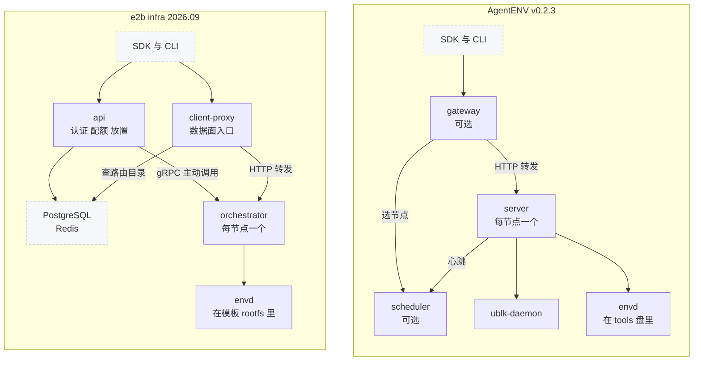
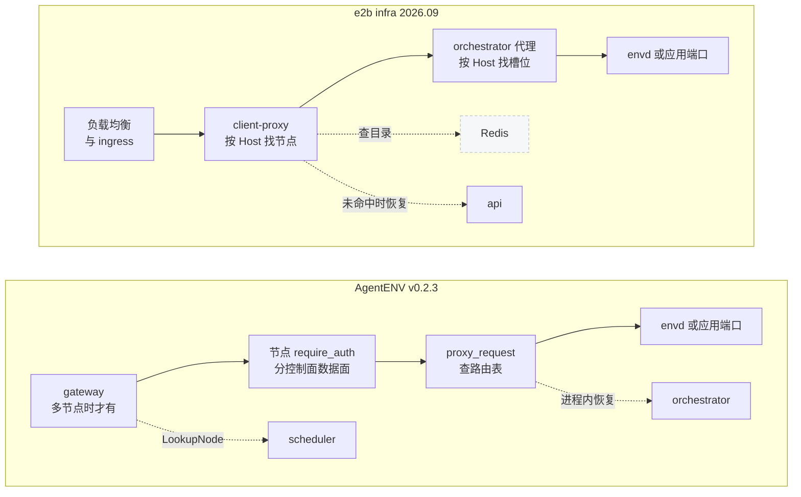

# 65 · 与 e2b infra 的对照（一）：架构、控制面与 API

> AgentENV 与 e2b infra 面对同一份 SDK 契约，却从不同的部署假设出发：一个是多租户的公有云服务，一个是「一个部署就是一个信任域」、单节点即可自足的平台。
> 本篇沿进程结构、控制面、API 层、认证、反向代理、网络与 envd 七个维度，逐一说明两边各自要解决什么问题、做了什么取舍；存储、内存恢复与模板留给第 66 篇。
>
> **读者**：熟悉 E2B 或读过 e2b 手册、想知道两套实现差在哪里的工程师；评估迁移的 SDK 使用者。　**预备**：[第 08 篇 · 系统架构](08-system-architecture.md)、[第 18 篇 · E2B 兼容性](18-e2b-compatibility.md)。
> **代码**：AgentENV 侧以本书第 08–30、54–57、62 篇为依据（`src/bin/server.rs`、`src/api/`、`src/sandbox/`、`services/gateway/`、`services/scheduler/`、`tools-image/`）；e2b infra 侧以 e2b 手册第 10、15、16、19、35、48、53、55 篇为依据

---

## 0. 本篇要回答的问题

1. 两套系统各有哪些进程？语言与进程边界的不同分别是为了解决什么问题？
2. 沙箱的状态在哪里是真相？放置与节点发现由谁主动发起？这些选择让哪类故障更容易、哪类更难处理？
3. 两边的 API 层都由 OpenAPI 生成，差别在哪里？第 18 篇的端点分类之外，还有哪些契约层面的不同？
4. team 与多种凭据，和一把部署级 key，各自换来了什么、放弃了什么？
5. 数据面请求在两边各经过几跳？按 Host 定址与按头定址的选择从何而来？
6. 两边用的是同一个 envd，那么分发方式、版本与客户端用法上有什么不同？

---

## 1. 对照的方法

两套系统的大部分差异都能追溯到三条部署假设。先把它们摆出来，后面每一维都会回到这张表。

| 假设 | e2b infra 2026.09 | AgentENV v0.2.3 |
|---|---|---|
| 谁在用 | 互不信任的多个团队，按档位计费与限额 | 一个组织内的调用方，一个部署对应一个信任域 |
| 最小部署 | 一组 Nomad 集群：api 池、build 池、client 池，加 PostgreSQL、Redis、ClickHouse | 一台机器上的一个 `server` 进程 |
| 状态的真相在哪里 | 中心化的 api 及其存储；节点只执行指令 | 各节点自己；控制面只做选节点与查绑定 |
| 部署底座 | Nomad + Consul + Terraform | systemd、Compose 或 Kubernetes，控制面可有可无 |

本篇的依据分两侧。AgentENV 的论断都来自本书已写的正文，这里只给结论和链接，不重新推导；e2b infra 的论断来自 e2b 手册，正文以「（见 e2b 手册第 N 篇）」标注。
两侧的口径都是固定基线：AgentENV v0.2.3 与 e2b infra 2026.09。唯一的例外是 envd，第 8 节单独说明。

每一维的写法相同：先讲两边各自要解决的问题，再讲取舍。不比较哪一边「更好」，因为两边要满足的约束不同。

---

## 2. 进程结构与语言

**e2b infra 要解决的问题**是把五类负载隔离开：多租户的 REST 逻辑、需要 root 与内核特性的宿主运行时、长时间的模板构建、只做转发的流量层、沙箱内的代理。
它因此部署 api、orchestrator、template-manager、client-proxy、envd 等进程，全部用 Go 写成；orchestrator 与 template-manager 是同一个二进制，靠 `ORCHESTRATOR_SERVICES` 区分角色，分别跑在 client 与 build 两个节点池上（见 e2b 手册第 10 篇）。
一台 client 节点上，块设备（NBD 服务端）、内存后端（uffd）、网络槽位与沙箱代理都在 orchestrator 一个进程里；Firecracker 经 `unshare`、bash 脚本与 `ip netns exec` 拉起（见 e2b 手册第 28 篇）。

**AgentENV 要解决的问题**是让一台节点自足，同时把故障域与能力要求分开。节点上只有三类进程：Rust 写的 `server`、独立的 ublk-daemon、每沙箱一个不带 Linux 能力的 `firecracker`（[第 08 篇 §2](08-system-architecture.md#2-单节点三类进程)）。
多节点时，前面再加两个 Go 服务：gateway 与 scheduler（[第 08 篇 §4](08-system-architecture.md#4-多节点gateway-与-scheduler)）。
模板构建不另设进程或节点池，`TemplateBuilder` 在 `server` 里启动 builder VM 完成（[第 52 篇](52-template-builder.md)）。

下图把两套结构并排画出，只画进程与主要的有状态依赖，箭头表示调用方向。

**取舍。** e2b infra 的拆分沿着负载类型切：构建与运行分池，构建的磁盘与页缓存抖动不影响线上沙箱，代价是两类机器的容量不能互借（见 e2b 手册第 10 篇）。
AgentENV 沿着能力与故障域切：块设备的 io_uring 与 ublk 设备集中在 ublk-daemon，`server` 只经 RPC 描述设备；Firecracker 进程在 netns 里启动且清空能力（[第 25 篇 §5](25-backend-and-firecracker-process.md#5-不用-jailer哪些隔离有哪些没有)）。
代价是 ublk-daemon 成为节点内单点，它退出后不会被重新拉起（[第 08 篇 §7](08-system-architecture.md#7-单点与代价)）；构建与运行共享一台节点的资源。

语言的选择跟着这条边界走。数据面里延迟最敏感、与内核交互最密的部分（块设备、Firecracker 交互、反向代理）在 Rust 节点里；
gateway 与 scheduler 是无特权、几乎无状态的转发与记账服务，用 Go 写。两种语言共用一份 `scheduler.proto`：Go 侧生成代码入库，Rust 侧在 `build.rs` 里每次构建生成且只生成客户端，两侧可能静默不一致（[第 54 篇 §5](54-control-plane-overview.md#5-一份-proto两种生成方式)）。
e2b infra 全部是 Go，proto 与生成代码集中在一个 monorepo 里，没有这层跨语言同步的问题。

---

## 3. 控制面：状态的真相与谁主动

### 3.1 状态放在哪里

**e2b infra 要解决的问题**是让 api 可以多实例水平扩展，同时让沙箱能在节点之间迁移。
它把运行中沙箱的记录放在 api 的运行态存储里（生产用 Redis，见 e2b 手册第 20 篇），模板、构建、快照与租户配额放在 PostgreSQL（见 e2b 手册第 11 篇）。
暂停的沙箱是「不在运行态存储里、但 PostgreSQL 有 snapshots 行」，产物上传到对象存储，因此可以在另一台节点恢复，恢复时优先回到原节点（见 e2b 手册第 18、37 篇）。

**AgentENV 要解决的问题**是单节点时不依赖任何外部服务。沙箱的逻辑状态、VM 句柄与路由表都在节点 orchestrator 的三张内存表里（[第 10 篇 §4](10-node-process-and-object-model.md#4-对象模型)）；
暂停产物写在节点本地的 `persisted-sandboxes/`，记录存在本地 RocksDB，不进快照仓库，因此一台暂停的沙箱只能在原节点恢复（[第 08 篇 §5](08-system-architecture.md#5-存储拓扑什么是真相)）。
跨节点可用的状态只有显式提交到快照仓库的快照（[第 46 篇](46-snapshot-object-model.md)）。

| 状态 | e2b infra 2026.09 | AgentENV v0.2.3 |
|---|---|---|
| 运行中的沙箱 | api 的运行态存储（Redis）+ orchestrator 进程内 map | 节点 orchestrator 的内存表 |
| 暂停的沙箱 | PostgreSQL 记录 + 对象存储产物，可换节点恢复 | 节点本地目录与 RocksDB，只能原节点恢复 |
| 沙箱 → 节点 | api 写入的 Redis 路由目录 | scheduler 的绑定表，由节点心跳对账 |
| 模板与快照 | PostgreSQL + 对象存储 | 快照仓库（POSIX 或对象存储） |
| 租户与配额 | PostgreSQL | 无 |

**取舍。** e2b infra 的中心化存储换来 api 的无状态多实例与暂停沙箱的可迁移，代价是 Redis 进入请求关键路径、两份表示之间要处理同步延迟（见 e2b 手册第 13、20 篇）。
AgentENV 把真相留在节点，换来单节点开箱即用，也让任何控制面组件丢失后都能由心跳重建；代价是暂停沙箱随节点失联而不可用，集群级列表要由 gateway 向所有节点扇出合并，任一节点失败就整体失败（[第 55 篇](55-gateway.md)）。

### 3.2 节点发现与放置

**e2b infra** 的 api 是主动方：每 20 s 一轮向 Nomad 列出节点，对每个 orchestrator 维持一条 gRPC 连接，轮询 `ServiceInfo` 得到容量与状态；
放置在 api 进程内完成，采用 best-of-K 采样加按 vCPU 过量分配率打分，只接受 Ready 节点，失败换节点重试（见 e2b 手册第 15、19 篇）。
控制面中断时已有沙箱继续运行，但节点状态只能靠下一轮轮询发现，所以关停时要等 15 s 让 Draining 状态传播（见 e2b 手册第 10 篇）。

**AgentENV** 反过来：scheduler 只实现 gRPC 服务端，从不调用节点；节点按 `interval_secs`（缺省 5 s）推送心跳，携带容量快照与完整的沙箱名单（[第 54 篇 §2](54-control-plane-overview.md#2-三个角色与调用方向)、[第 57 篇 §3](57-heartbeat-and-cpu-intersection.md#3-心跳循环)）。
节点表来自静态配置或 Kubernetes EndpointSlice；放置是阈值过滤加 round-robin 或 random，不排除 UNHEALTHY 节点，gateway 也不重试（[第 56 篇 §2](56-scheduler.md#2-放置)）。
绑定的真相源是心跳名单，`RecordAssignment` 只填补新建到下一次心跳之间的空档，`binding_ttl` 缺省 30 s（[第 56 篇 §3](56-scheduler.md#3-绑定)）。

**取舍。** 拉模型让 e2b infra 的 api 可以随时探测节点、即时下发指令，放置质量也更高；代价是 api 要维护到所有节点的连接，并依赖 Nomad 这样的外部发现源。
推模型让 scheduler 不必知道节点的地址与 API，单节点时整条链路都不存在（`[observability.scheduler_report] enabled` 缺省 false）；
代价是 scheduler 不能主动探测节点，下行信息只能搭心跳响应的便车（目前只有 CPU 配置交集），新沙箱与失联节点各有一个以心跳周期计的不一致窗口。
scheduler 的 HA 也因此较弱：query-only 副本只能回答 `LookupNode`，覆盖的停机长度不超过 `binding_ttl`（[第 56 篇 §6](56-scheduler.md#6-haprimary-与-query-only)）。

---

## 4. API 层：同一种做法，不同的落点

**两边要解决的问题相同**：服务端的路由、字段与状态码必须和独立发版的 SDK 对得上。两边都选择契约先行，由 OpenAPI 生成服务端骨架。

e2b infra 用 `oapi-codegen` 为 gin 生成 `ServerInterface`，并把 spec 嵌入二进制，运行时由请求校验中间件再做一次路由匹配与 schema 校验；认证不是独立中间件，而是校验器的回调，哪条路由收哪种凭据由 spec 的 `security` 决定（见 e2b 手册第 15 篇）。
AgentENV 用 `rust-axum` 生成器把约束编进 Rust 类型：模型结构体、`validator` 派生、按状态码穷举的响应枚举，运行时不再加载 spec；鉴权是一个包在路由外的中间件 `require_auth()`（[第 12 篇 §2](12-spec-driven-server.md#2-生成管线)、[第 12 篇 §4](12-spec-driven-server.md#4-router-组装与中间件顺序)）。
取舍是：e2b infra 每个请求多一次路由查找与 schema 校验，换来 spec 里的全部约束在运行时都被执行；AgentENV 省掉这一步，代价是生成器没翻译成类型的约束不会被检查。

端点层面的对照已在[第 18 篇 §4](18-e2b-compatibility.md#4-端点对照以-e2b-infra-202609-为参照)分成四类：两边都有、E2B 形状但 2026.09 没有、AgentENV 扩展、2026.09 有而 AgentENV 没有。这里不重做，只补三点契约层面的差别。

第一，乙类端点不能拿 e2b infra 2026.09 的实现来对照。`POST /v2/sandboxes`、`POST /v2/sandboxes/{id}/connect`、`PUT /sandboxes/{id}/network`、`GET /snapshots/{snapshotID}`、`GET /v2/templates` 都不在 2026.09 的 spec 里，
e2b 手册也就没有描述它们的行为。它们在 AgentENV 里的语义以[第 14 篇](14-sandbox-api.md)与[第 16 篇](16-snapshot-and-volume-api.md)为准。

第二，安全方案的名字不同。2026.09 的 spec 声明 `ApiKeyAuth`、`AccessTokenAuth`、`Supabase1TokenAuth`、`Supabase2TeamAuth`、`AdminTokenAuth`；
AgentENV 的 spec 声明 `ApiKeyAuth`、`AuthProviderBearerAuth`、`AuthProviderTeamAuth`、`AdminApiKeyAuth`，并且后三者在实现中全部退化为检查 `X-API-Key`（[第 13 篇 §5](13-authentication.md#5-生成层的副检查与名不副实的安全方案)）。
推论：AgentENV 的 spec 所继承的是另一版 E2B 公开 API 的命名，而不是 2026.09 的；读两份 spec 的人不能按方案名把它们对齐。

第三，同名字段的形状也可能不同。`autoResume` 在 2026.09 是 `{policy: any | off}`，在 AgentENV 是必填 `enabled` 的 `{enabled: bool}`；`autoPause` 的缺省值两边相反（[第 18 篇 §5](18-e2b-compatibility.md#5-偏差矩阵)）。
这说明 AgentENV 兼容的对象是一组 SDK 行为，而不是某一版 spec 的逐字拷贝。

---

## 5. 认证与多租户

**e2b infra 要解决的问题**是在一个服务里承载互不信任的团队，并把计费与配额挂在团队上。租户单位是 team，用户只是成员；
控制面有五种凭据（API key、access token、两个 Supabase 方案、admin token），各端点接受哪几种由 spec 决定，发凭据的端点只接受浏览器登录态，凭据不能自我繁殖；
API key 落库的是无盐 SHA-256，认证结果连同配额进入请求上下文，认证缓存让撤销一把热 key 后仍有约 1 分钟的可用窗口（见 e2b 手册第 16 篇）。

**AgentENV 要解决的问题**是让一个部署不依赖任何身份系统就能被 E2B SDK 使用。它只有一把部署级 API key：按环境变量 `AENV_API_KEY`、`/run/secrets/api-key`、`$AENV_HOME/secrets/api-key` 的顺序解析，都没有时生成带 `e2b_` 前缀的随机 key（[第 13 篇 §2](13-authentication.md#2-部署级-api-key)）。
`Claims` 是空结构体，持有 key 的调用方可以操作部署内的全部沙箱与模板；多节点时 gateway 与每个节点各校验一次同一把 key（[第 08 篇 §6](08-system-architecture.md#6-三种流量)）。

两边在数据面凭据上是一致的。envd 的 `X-Access-Token` 与应用端口的 `e2b-traffic-access-token` 都由一个 seed 经 HMAC-SHA256 从沙箱 ID 派生，不落库（[第 13 篇 §3](13-authentication.md#3-沙箱级-token无状态派生)；见 e2b 手册第 16 篇）。
差别在 seed 的来源：e2b infra 的 seed 为空时进程直接退出，AgentENV 可以自动生成并托管在本地文件里，多节点时要手工让各节点一致。

**取舍。** e2b infra 的 team 模型换来按调用方隔离、限额与吊销，代价是 PostgreSQL 进入每个控制面请求的认证路径（有缓存兜底），并要维护五种凭据之间的约定。
AgentENV 的单 key 换来零依赖与单节点开箱即用，gateway 也不需要身份系统；代价是一个部署只是一个信任域，没有 scope、只读 key 或按调用方的吊销，需要隔离的使用者只能各自部署实例。
这一维与 §3 的选择是同一件事的两面：没有中心化的数据库，也就没有地方存放租户。

---

## 6. 反向代理与数据面入口

**e2b infra 要解决的问题**是让公网上的任意请求找到一台可能在任意节点、可能刚被换节点恢复的沙箱。
它把寻址编码进域名 `<端口>-<沙箱 ID>.<域名>`：外部负载均衡与 ingress 把通配子域交给 client-proxy，client-proxy 查 api 写入的 Redis 路由目录（带 500 ms 本地缓存）得到节点 IP，转发到该节点的 5007；
orchestrator 的沙箱代理再解析一次同样的域名，在本机 map 里找到槽位地址，非 envd 端口时校验 traffic token（见 e2b 手册第 10、53、55 篇）。
按 `E2b-Sandbox-Id` / `E2b-Sandbox-Port` 头定址只在 `ENVIRONMENT=local` 时启用（见 e2b 手册第 53 篇）。

**AgentENV 要解决的问题**是在没有泛域名 DNS 与通配证书的环境里，让 SDK 只靠一个 IP 加端口就能访问沙箱。
它把按头定址作为主路径：节点上的 `proxy_via_fallback()` 接住所有未匹配 spec 路由、但带路由头的请求，`x-agentenv-sandbox-id` 与 E2B 别名 `e2b-sandbox-id` 都被接受，于是 `E2B_SANDBOX_URL` 可以等于 `E2B_API_URL`；
Host 形态只在配置了 `[sandbox_proxy].domains` 时启用（[第 18 篇 §2](18-e2b-compatibility.md#2-一个-sdk-请求怎样落到-agentenv)、[第 17 篇 §2](17-reverse-proxy.md#2-三个入口)）。
多节点时 gateway 同时是控制面与数据面的入口，按 host、路径、路由头的固定顺序判定路由来源，把数据面请求改写成 `/proxy` 前缀交给节点（[第 55 篇](55-gateway.md)）。

下图对比两边一个数据面请求经过的部件。

三处差别值得逐一说明。

**跳数与连接池。** e2b infra 两跳共用一个代理库，节点侧连接池以 Firecracker 进程的 `LifecycleID` 为键，在保留复用的同时避开槽位地址复用带来的串线（见 e2b 手册第 36 篇）。
AgentENV 在节点内只有一跳，直接禁用连接池，代价是每个请求一次本地 TCP 握手（[第 17 篇 §5.3](17-reverse-proxy.md#53-禁用连接池)）。两边防的是同一个问题：同一个地址不一定是同一台 VM。

**数据面鉴权的位置。** 两边的边缘层都不验数据面凭据。e2b infra 在 orchestrator 代理里校验 traffic token、envd 自己校验 access token；
AgentENV 在节点的 `require_auth()` 里同时校验两者，gateway 对数据面直接放行，理由是只有拥有沙箱的节点知道它的入口策略（[第 13 篇 §4](13-authentication.md#4-require_auth-的决策)）。
AgentENV 还在转发前剥离 `X-API-Key`，因为控制面与数据面共用一个端口，平台级 key 可能随请求到达。

**访问时自动恢复。** e2b infra 由 client-proxy 在目录未命中时经 gRPC 请求 api 恢复，受特性开关、沙箱策略与访问令牌多道闸门控制，并发去重在 api 的 reservation 层（见 e2b 手册第 55 篇）。
AgentENV 在节点进程内直接调用 orchestrator，只看按沙箱的 `auto_resume`，限时 60 s、只试一次，恢复期间并发到达的请求得到 410（[第 17 篇 §4](17-reverse-proxy.md#4-自动恢复)）。

**取舍。** 按 Host 定址让浏览器与任何 HTTP 客户端都能直达沙箱服务，代价是泛域名 DNS 与证书、以及一个能被所有边缘实例共享的路由目录。
按头定址把部署门槛降到一个端口，代价是不认识这两个头的客户端只能走 Host 形态；控制面与数据面共用端口时，任何新增的 spec 路径都可能遮住 guest 里的同名路径（[第 18 篇 §2](18-e2b-compatibility.md#2-一个-sdk-请求怎样落到-agentenv)）。

---

## 7. 网络：每沙箱一个 netns

**两边要解决的问题相同**：每台 microVM 要有隔离的网络，快照要能在任意槽位上恢复，出站要能按网段与域名控制。两边的答案也高度相似。
guest 地址固定为 `169.254.0.21`、tap 为 `169.254.0.22`，host 地址取自 `10.11.0.0/16`，veth 用 `/31`，命名空间内 SNAT / DNAT 加宿主 MASQUERADE（[第 29 篇 §2](29-network-slots.md#2-拓扑与地址计划)；见 e2b 手册第 35 篇）。
固定的 guest 地址让快照不必重放网络配置，这是两边共同的约束。

差异集中在三处。

| 维度 | e2b infra 2026.09 | AgentENV v0.2.3 |
|---|---|---|
| 槽位分配 | Consul KV 的 CAS，或以 `/var/run/netns` 目录为分配表 | 进程内原子位图，启动时扫描残留 `veth-*` 预占 |
| 规则下发 | 命名空间内 nftables，宿主 iptables | 全部 iptables，经 `iptables-restore --noflush` 批量提交 |
| 出站 TCP 判定 | 所有出站 TCP 重定向给宿主上的一个代理进程，网段与域名都在用户态判定 | 只在有域名规则时为 80 / 443 起命名空间内代理，其余 TCP 在内核按网段判定 |
| guest 访问宿主 | 经 `192.0.2.1` 访问 hyperloop、NFS 代理等宿主服务 | 宿主 INPUT 只放行回包，guest 不能主动连宿主 |

e2b infra 的槽位分配可以交给外部存储，是因为它已经依赖 Consul；`/var/run/netns` 的实现以内核状态为真相，重启自愈（见 e2b 手册第 35 篇）。
AgentENV 不依赖外部存储，槽位状态只在一个进程的内存里，重启后靠扫描接口名恢复占用情况（[第 29 篇 §5](29-network-slots.md#5-networkmanager分配复用与清理)）。

出站代理的位置体现了两边对「谁来付代价」的不同选择。e2b infra 的宿主代理每条连接都重读沙箱当前配置，策略变更立即生效，代价是所有出站 TCP 都多一跳用户态。
AgentENV 在没有域名规则时零开销，代价是代理线程随沙箱数增长，每条连接持有接受时的策略快照（[第 30 篇 §4](30-egress-policy-and-proxy.md#4-透明代理)）。
两边的「域名放行优先于网段拒绝」一致；DNS 的处理不同，e2b infra 在有域名规则时把 `8.8.8.8` 加进允许网段，AgentENV 无条件放行 guest 的 DNS 服务器。

guest 能否访问宿主，是另一个由功能需求决定的差别。e2b infra 的 hyperloop（日志与 `/me`）与 NFS 卷都需要 guest 主动连宿主，于是要在 `192.0.2.1` 上开一组只对沙箱可见的端口（见 e2b 手册第 10、36 篇）。
AgentENV 没有这两项功能，卷是块设备（[第 16 篇](16-snapshot-and-volume-api.md)），于是可以把 guest 到宿主的方向整体关掉。

---

## 8. envd：同一个代理，两种分发

**两边共用一个 envd**。它是 e2b infra 的 guest 守护进程，在一个端口 49983 上同时提供 REST（`/init`、`/files` 等）与 Connect-RPC（进程与文件系统服务）（见 e2b 手册第 48 篇）。
AgentENV 不实现 envd，只做它的客户端：仓库里的 `thirdparty/envd` 是 host 侧的 Rust 客户端库，不是 envd 的分支（[第 18 篇 §3](18-e2b-compatibility.md#3-兼容手段清单)）。数据面协议的兼容正是来自 guest 里跑的就是 E2B 的 envd。

**分发方式不同。** e2b infra 在模板构建时把宿主上的 envd 二进制作为一层 OCI 层写进 rootfs 的 `/usr/bin/envd`，由 systemd 单元拉起，并用 `OOMScoreAdjust=-1000` 等参数保护（见 e2b 手册第 48 篇）。
AgentENV 把 envd 放在 tools 盘上：`tools-image/Dockerfile` 从 e2b-dev/infra 的 `packages/envd` 编译，经 `/init` → `pivot-init` → `busybox runsv` 拉起并监管（[第 28 篇 §3.1](28-mmds-and-envd.md#31-来源与拉起)）。
e2b infra 的做法让 envd 版本随模板固定，同一模板的所有沙箱行为一致，代价是升级 envd 要重建模板；AgentENV 的做法让用户镜像不含任何 E2B 组件、升级与模板解耦，代价是版本跟着 tools 盘走，`[envd] version` 只是声明，运行时不核对。

**版本基线不同。** `tools-image/Dockerfile` 的 `ENVD_REF` 缺省是 `2026.17`，而 e2b 手册的基线是 2026.09。推论：e2b 手册对 envd 内部行为的描述（鉴权豁免、`/init` 的处理、超时常量）针对的是 2026.09 的 envd，套用到 AgentENV 的 tools 盘时需要逐项核实。

**初始化的时序不同。** e2b infra 在 `PATCH /vm Resumed` 之后才写 MMDS，以短超时无限重试 `/init` 本身同时完成就绪判定与初始化，`/init` 还带 hyperloop 地址；
AgentENV 在恢复之前写 MMDS，`address` 字段为空，先以 3 ms 间隔轮询 `/health`，再通知 ublk-daemon、发一次 `/init`，之后才发布代理路由（[第 28 篇 §4](28-mmds-and-envd.md#4-就绪与-init)）。

**客户端流的口径。** 这里两本书的表述需要对齐。e2b 手册第 48 篇指出 envd 只讲 HTTP/1.1，并以推论的形式认为 Connect 的客户端流方法 `StreamInput` 在当前部署形态下用不上；
其佐证是 JS 与 Python SDK 向 envd 送输入用的都是 unary 的 `SendInput`。这条佐证对 SDK 成立，AgentENV 下 E2B SDK 的行为不变。
但 AgentENV 自己的 `aenv` 客户端在 `http1_only()` 的传输上实际使用了 `StreamInput`（[第 62 篇 §3.1](62-aenv-cli.md#31-为什么是-connect)）。
差别在于两类流的性质：双向流需要全双工，HTTP/1.1 承载不了；客户端流是半双工的，请求体是一串分块传输的 envelope，服务端读完之后才回应，HTTP/1.1 的分块请求体可以承载。
推论：这要求沿途每一跳都流式转发请求体而不先缓存整个 body；AgentENV 节点代理在上传期间按数据帧重置空闲计时（[第 17 篇](17-reverse-proxy.md)），满足这一前提。所以更准确的说法是：在 HTTP/1.1 上不可用的是双向流，客户端流可用，只是 E2B SDK 没有用它。

---

## 9. 汇总

| 维度 | e2b infra 2026.09 | AgentENV v0.2.3 | 取舍的根源 |
|---|---|---|---|
| 语言与进程 | 全 Go；api、orchestrator / template-manager（同一二进制）、client-proxy | Rust 节点三类进程；Go gateway 与 scheduler | 按负载类型切 vs 按能力与故障域切 |
| 构建位置 | 独立的 build 节点池 | 节点内 builder VM | 隔离抖动 vs 单节点自足 |
| 控制面依赖 | Nomad、Consul、PostgreSQL、Redis | 无；多节点时 scheduler，可选 Redis | 中心化真相 vs 节点即真相 |
| 主动方 | api 轮询并调用节点 | 节点推心跳，scheduler 被动 | 即时控制 vs 无连接状态 |
| 暂停沙箱 | 对象存储产物，可换节点恢复 | 节点本地，只能原节点恢复 | 可迁移 vs 不依赖共享存储 |
| API 生成 | `oapi-codegen` + 运行时 spec 校验 | `rust-axum` 类型化，运行时不加载 spec | 运行时强制 vs 编译期约束 |
| 认证 | team + 五种凭据 + 配额 | 一把部署级 key，`Claims` 为空 | 多租户 vs 单信任域 |
| 数据面定址 | 按 Host，按头仅限本地开发 | 按头为主，Host 需配置域名 | 浏览器直达 vs 无需泛域名 |
| 数据面跳数 | client-proxy + orchestrator 代理 | 节点代理一跳，多节点时加 gateway | 共享路由目录 vs 节点本地路由表 |
| 出站代理 | 宿主上一个进程，接管全部 TCP | 每 netns 一个，仅在有域名规则时 | 即时策略 vs 零规则零开销 |
| envd | 随模板 rootfs，systemd 拉起 | 随 tools 盘，runsv 拉起，`ENVD_REF` 2026.17 | 版本随模板 vs 与用户镜像解耦 |

---

## 10. 小结

- 两边的差异大多源自三条假设：多租户还是单信任域、最小部署是一个集群还是一个进程、状态的真相在中心还是在节点。
- e2b infra 按负载类型拆进程并分节点池；AgentENV 按能力与故障域拆成 `server`、ublk-daemon 与无能力的 Firecracker，多节点时才加 Go 控制面。
- e2b infra 的 api 主动轮询与调用节点，运行态在 Redis、暂停沙箱可换节点恢复；AgentENV 的节点推心跳，绑定由心跳对账，暂停沙箱只能原节点恢复。
- 两边都由 OpenAPI 生成服务端，e2b infra 运行时再校验一遍 spec，AgentENV 把约束编进类型；端点分类以第 18 篇为准，安全方案名与 `autoResume` 形状也与 2026.09 不同。
- team 与五种凭据换来隔离、限额与吊销；一把部署级 key 换来零依赖。两边的数据面 token 都是 HMAC 派生、不落库。
- e2b infra 按 Host 定址、两跳代理、共享 Redis 目录；AgentENV 以头定址为主、节点内一跳，gateway 同时承接控制面与数据面。
- 网络拓扑几乎相同；差别在槽位分配的存放处、出站代理的位置，以及 guest 能否主动访问宿主。
- 两边用同一个 envd，分发方式与版本基线不同：e2b infra 随模板，AgentENV 随 tools 盘且 `ENVD_REF` 为 2026.17。
- HTTP/1.1 上不可用的是双向流；客户端流 `StreamInput` 可用，`aenv` 用了它，E2B SDK 没有用。

---

## 延伸阅读 / 下一篇

- [第 08 篇 · 系统架构](08-system-architecture.md)：AgentENV 侧的进程、存储拓扑与流量。
- [第 18 篇 · E2B 兼容性](18-e2b-compatibility.md)：端点四类划分与偏差矩阵。
- [第 54 篇 · 控制面总览](54-control-plane-overview.md)、[第 56 篇 · scheduler](56-scheduler.md)：推模型控制面的细节。
- [e2b 手册第 10 篇 · 系统架构](../e2b-infra/10-system-architecture.md)、[e2b 手册第 15 篇 · API 服务结构](../e2b-infra/15-api-service-structure.md)、[e2b 手册第 16 篇 · 认证与多租户](../e2b-infra/16-auth-and-multitenancy.md)
- [e2b 手册第 19 篇 · 节点管理与放置](../e2b-infra/19-node-management-and-placement.md)、[e2b 手册第 35 篇 · 沙箱网络](../e2b-infra/35-sandbox-networking.md)、[e2b 手册第 48 篇 · envd 总览](../e2b-infra/48-envd-overview.md)
- [e2b 手册第 53 篇 · client-proxy](../e2b-infra/53-client-proxy-edge.md)、[e2b 手册第 55 篇 · 沙箱目录与路由](../e2b-infra/55-sandbox-catalog-and-routing.md)
- 下一篇：[第 66 篇 · 与 e2b infra 的对照（二）：存储、内存恢复与模板](66-vs-e2b-infra-storage-and-memory.md)。
