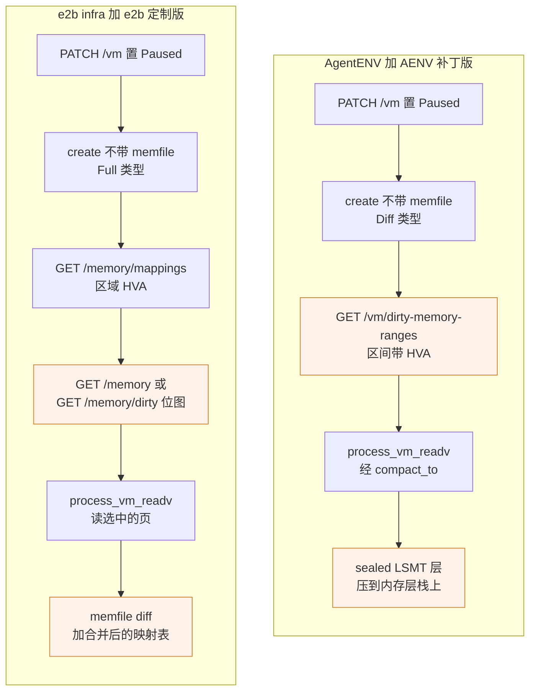
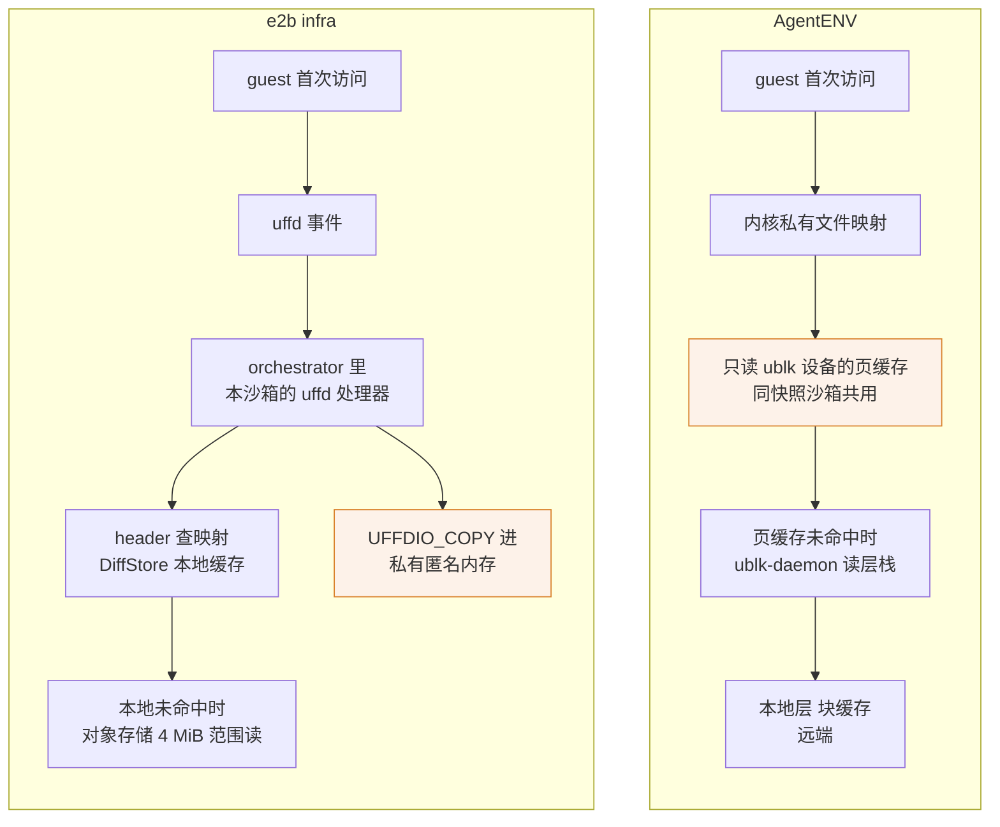

# 66 · 与 e2b infra 的对照（二）：存储、内存恢复与模板

> AgentENV 与 e2b infra 面对同一组存储问题：暂停的代价要正比于改动量，恢复不能先读完整个内存，模板要能被成百上千台沙箱复用。
> 两边各自维护一个 Firecracker 分叉，独立地走到了相似的方向 —— 快照不写内存文件、由宿主进程直接读 guest 内存 —— 但在内存怎样恢复、磁盘怎样分层、模板怎样构建、产物存在哪里这几件事上做了不同的取舍。
> 本篇逐项对照，不评优劣；AgentENV 侧的事实引用本书前文，e2b infra 侧以 e2b 手册与 Firecracker 手册为依据。
>
> **读者**：熟悉其中一个系统、想理解另一个的工程师；评估两种路线的架构师。　**预备**：[第 03 篇 · Firecracker](03-firecracker-for-agentenv.md)、[第 42 篇 · 内存快照](42-memory-snapshot-over-ublk.md)、[第 44 篇 · uffd 方案](44-uffd-alternative.md)
> 　**代码**：本篇不新引代码，AgentENV 侧的位置见各节链接的篇目；AENV 补丁版 Firecracker 的 `src/vmm/src/persist.rs`、`src/vmm/src/vstate/vm.rs`

---

## 0. 本篇要回答的问题

1. 两个 Firecracker 分叉在「快照不写内存文件」这件事上有哪些共同点？差别落在哪几处：地址怎样交出、脏页怎样判定、快照类型与位图怎样处理？
2. e2b infra 的 uffd 恢复与 AgentENV 的只读块设备 File 后端，缺页分别由谁回答？共享、预取、大页与故障面上各付出了什么？
3. 内存与磁盘的增量产物分别长什么样：扁平 diff 加映射表，还是 LSMT 层栈？
4. NBD 加用户态 COW 与 ublk 加 overlaybd 层栈，差别在内核接口、服务进程，还是写层的形状？
5. 模板构建：逐阶段暂停的层缓存，与一台 VM 跑完全部步骤或交给 BuildKit，各省掉了什么、失去了什么？
6. 快照与模板存在哪里，怎样到达另一台节点？

---

## 1. 同一组问题

两个系统的存储设计都从同一条要求出发：一台沙箱会被反复暂停与恢复，每次暂停的写入量必须正比于这次运行改动了多少，而不是正比于沙箱的内存与磁盘大小（[第 02 篇](02-why-agentenv.md)；e2b 一侧见 e2b 手册第 37 篇 §1）。
由此推出三件事，两边都必须做：

- **增量产物**：内存与磁盘都只写改动部分，并能与上一代叠出完整状态。
- **按需恢复**：恢复时不预先读完整个内存与磁盘，第一次触碰时再取。
- **共享基底**：同一模板的大量沙箱共用只读的基础数据，节点上不为每台沙箱复制一份。

上游 Firecracker 的快照接口把「写状态」与「写内存文件」绑在一次调用里，产物是与 guest 内存等大的扁平文件（[第 03 篇 §2](03-firecracker-for-agentenv.md#2-快照状态文件加内存)）。
两个系统都认为这一步不合用，各自给 Firecracker 打了补丁。e2b 定制版基于上游 v1.12.1，28 个提交里四个是功能提交（见 Firecracker 手册第 49 篇）；
AENV 补丁版 Firecracker 基于上游 v1.15.1，七个提交，其中四个行为被 AgentENV 用到（[第 03 篇 §4](03-firecracker-for-agentenv.md#4-aenv-补丁版-firecracker-的四个被用到的行为)、[第 67 篇](67-firecracker-patch-layer.md)）。

---

## 2. 两个分叉：相似的方向，不同的接口

### 2.1 共同点

两个分叉做了同一个关键决定：把 `PUT /snapshot/create` 的 `mem_file_path` 改成可选。不给路径时，Firecracker 只写状态文件，guest 内存由宿主上的另一个进程用 `process_vm_readv` 从 Firecracker 的地址空间直接读走。
AgentENV 的暂停管线是 `create_state_only_snapshot()` → `get_dirty_memory_ranges()` → `convert_dirty_memory_to_overlaybd()`（[第 42 篇 §2.1](42-memory-snapshot-over-ublk.md#21-管线)）；
e2b 的顺序是暂停 → 不带 memfile 的 create → 查映射 → 查位图 → 直读（见 Firecracker 手册第 54 篇 §5）。
两条流程的顺序约束相同：必须等 create 返回再读内存（保存设备状态时还会写 guest 内存里的队列），读内存时 Firecracker 进程必须还活着。
两边都放弃了上游「状态与内存出自同一次原子操作」的保证，正确性转由调用方遵守这个顺序。

### 2.2 差别一：地址与判据怎样交出

图 1 把两条暂停路径并排画出，橙色节点是两边做法不同的地方。

e2b 定制版把「地址」与「判据」拆成独立端点：`GET /memory/mappings` 给每个区域的宿主虚拟地址与扁平偏移，`GET /memory` 与 `GET /memory/dirty` 各给位图，集合运算与地址换算由 orchestrator 做（见 Firecracker 手册第 49–52 篇）。
AENV 补丁版只给一个端点：`GET /vm/dirty-memory-ranges` 在 Firecracker 内部把脏页位图合并成区间，每个区间直接带 HVA、镜像偏移与长度（[第 42 篇 §2.2](42-memory-snapshot-over-ublk.md#22-dirtymemoryranges-的语义)）。
前者把更多决定留给调用方，例如冷启动与恢复用不同的位图；后者把换算放在 Firecracker 里，调用方拿到的区间可以直接变成 LSMT 段映射（`moffset` 存 HVA 的扇区数）。
两边的坐标系相同：都是「所有内存区域首尾相接」的扁平偏移，MMIO 空洞不占位，与上游内存文件布局一致。

### 2.3 差别二：脏页判据

这是两个分叉最深的分歧，它与恢复路径的形状互为因果。

- **e2b 定制版**：从快照恢复的沙箱，判据是 `/proc/self/pagemap` 里「present 且 uffd 写保护位已被清」。uffd 处理器填读缺页时带写保护，guest 第一次写这一页时内核以异步写保护（宿主内核 6.7 起）清位放行，事后读 pagemap 即得写过的页。冷启动的沙箱没有 uffd，改用 `GET /memory` 的「常驻且非全零」（见 Firecracker 手册第 51–53 篇）。
- **AENV 补丁版**：判据是 KVM dirty log 与 Firecracker 用户态位图的并集，冷启动与恢复用同一个端点。它只要求 `track_dirty_pages` 打开，不依赖 uffd（[第 03 篇 §2.3](03-firecracker-for-agentenv.md#23-脏页从哪里来)）。

两种判据都指向「写过的页」，但前提不同。e2b 的判据绑定在 uffd 后端上：不走 uffd、宿主开着 swap、内核低于 6.7 或运行在 aarch64 上时，它静默退化为「常驻即脏」（见 Firecracker 手册第 52 篇）。
AgentENV 的判据绑定在 KVM 脏页日志上：`track_dirty_pages` 关闭时（PVM 模式强制如此）退回 `mincore`，同样是多记不漏记，而且共享内存设备的页缓存会放大过估（[第 42 篇 §5](42-memory-snapshot-over-ublk.md#5-关闭脏页跟踪时)）。
因果关系值得注意：e2b 选 uffd 恢复，所以能用写保护位判脏；AgentENV 选 File 后端恢复，没有 uffd 可用，于是转向 KVM 日志 —— 而 KVM 日志正是 AgentENV 废弃的 `uffd-core` 方案缺少的那一块（[第 44 篇 §4](44-uffd-alternative.md#4-逐项比较)）。

### 2.4 差别三：快照类型、队列标脏与「不清除」

两个分叉都让不带 memfile 的 create 跳过了上游唯一清脏位图的地方，但用法相反。
e2b 用 `Full` 类型且把 `track_dirty_pages` 设为假，KVM 日志从未启用，位图不清也无影响（见 Firecracker 手册第 54 篇 §4）。
AgentENV 用 `Diff` 类型且打开 `track_dirty_pages`，并主动依赖「不清除」：查询时把 KVM 位存回用户态位图，脏页区间累积自启动或 load 以来的全部写入（[第 03 篇 §4](03-firecracker-for-agentenv.md#4-aenv-补丁版-firecracker-的四个被用到的行为)）。

另一处细节是 virtio 队列页。上游在写完内存文件后把队列页重新标脏。e2b 定制版只跳过内存导出，重新标脏照做，但它标的是用户态位图，与 pagemap 判据无关（见 Firecracker 手册第 54 篇 §3）。
AENV 补丁版把重新标脏一并放进了「有 memfile」的分支里，不给路径时不做；队列页仍在区间里，是因为 `Queue::initialize()` 时已标脏且位图从不重置（[第 42 篇 §2.2](42-memory-snapshot-over-ublk.md#22-dirtymemoryranges-的语义)）。

「不清除」的后果在两边也不同。e2b 的暂停之后 Firecracker 进程即结束，Checkpoint 是暂停后用新产物再起一个进程（见 e2b 手册第 37 篇 §8），所以「一台 microVM 只导出一轮」不构成限制。
AgentENV 的 `snapshot()` 与 `fork()` 在捕获后原地恢复同一个 Firecracker 进程（[第 27 篇 §6](27-start-pause-resume-sequences.md#6-capture-与-pause同一段代码四种收尾)），再次捕获时新层仍压在启动时的层栈上，正需要累积的区间；代价是对同一台运行中的 VM 反复捕获，层越来越大。

---

## 3. 内存恢复：uffd 与只读块设备

### 3.1 缺页由谁回答

图 2 是两边恢复后的一次缺页。

e2b infra 的恢复走 Firecracker 的 Uffd 后端：guest 内存是匿名映射，Firecracker 把 uffd 交给 orchestrator，每台沙箱一个 Go 处理器，每个缺页一个 goroutine，按映射表取块后 `UFFDIO_COPY` 填进去（见 e2b 手册第 31 篇）。
「这一页从哪来」完全由用户态决定。

AgentENV 走 File 后端：内存层栈经 ublk-daemon 暴露成只读的 `/dev/ublkbN`，Firecracker 以 `MAP_PRIVATE` 把它当内存文件映射，缺页由内核按文件映射规则处理（[第 03 篇 §3.2](03-firecracker-for-agentenv.md#32-file-后端)）。
用户态只在页缓存未命中时出场，而且出场的是全节点共用的 ublk-daemon，不是每台沙箱的处理器（[第 42 篇 §4.2](42-memory-snapshot-over-ublk.md#42-一次缺页)）。
块设备能当内存文件，依赖 AENV 补丁版用 seek 取文件大小；上游用 `fstat`，块设备得 0。

### 3.2 共享与私有

这是两条路径最大的结构差异。uffd 把页拷进每台沙箱自己的匿名内存，同一模板的 N 台沙箱在内存里各持一份热页；它们共享的是磁盘上的 `DiffStore` 缓存文件（见 e2b 手册第 34 篇）。
File 后端下，同一内存 `image.json` 的沙箱共用一个设备与它的页缓存，未写过的页在宿主上只有一份物理页，每台沙箱只为自己写过的页付内存（[第 42 篇 §4.3](42-memory-snapshot-over-ublk.md#43-页缓存即去重)、[第 26 篇 §4](26-sandbox-block-devices.md#4-共享只读设备与两级引用计数)）。
反过来，File 后端的共享只在同一份层栈之间成立：各自暂停过一次的两台沙箱，层栈不同、设备不同，页缓存不再共享。

### 3.3 预取

两边都录制「恢复后最先被碰的页」，但预取的终点不同。e2b 在 uffd 填页路径上记录块索引与首次访问序号，恢复时 fetch 与 copy 两组 worker 把块直接填进 guest 内存，预取的页带写保护，不算脏页（见 e2b 手册第 32 篇）。
AgentENV 没有用户态缺页处理器可挂，录制放在 ublk 设备的读入口，预取的终点是节点块缓存或块设备页缓存（[第 43 篇 §4](43-startup-pack-and-prefetch.md#4-消费两条路径)）。
前者省掉了预取页的缺页往返，后者让一次预取惠及同节点恢复同一快照的所有沙箱。

### 3.4 大页与粒度

e2b infra 按 Firecracker 版本推导大页开关，一个开关同时决定 guest 页大小、memfile 块大小、预取块大小与脏页粒度，开大页时都是 2 MiB（见 e2b 手册第 32 篇）。
AgentENV 放弃了大页：上游 File 后端在 `src/vmm/src/persist.rs` 里明确拒绝 hugetlbfs 快照，错误信息建议改用 uffd，AgentENV 的配置里也没有大页选项（[第 44 篇 §4](44-uffd-alternative.md#4-逐项比较)）。
AgentENV 的 `dirty_ranges_to_segment_mappings()` 还要求 `page_size` 为 4096，内存层的粒度固定在 4 KiB。
于是两边的粒度取舍正好相反：e2b 用大页换缺页次数与映射表规模，代价是脏页判定粒度变粗、diff 放大；AgentENV 保留 4 KiB 的增量精度，代价是缺页次数与 TLB 压力（推论）。

### 3.5 故障面

e2b 的 uffd 处理器出错只影响一台沙箱；Firecracker 自己保留一份 uffd，处理器死掉表现为 guest 卡死而不是静默损坏（见 e2b 手册第 05 篇）。
AgentENV 的全部内存设备集中在 ublk-daemon，daemon 不支持 `UBLK_F_USER_RECOVERY`，退出即所有依赖它的设备失效（[第 41 篇 §6](41-ublk-daemon.md#6-故障模型)）。
两边对宿主内核都有门槛：e2b 的 uffd 异步写保护要 6.7，AgentENV 的 ublk 必需功能推论要 6.4、预热池的完整能力要 6.16（[第 04 篇 §5.2](04-io-uring-and-ublk.md#52-分级表)）。

---

## 4. 增量产物：扁平映射表与层栈

两边都只写改动，差别在怎样把多代叠成完整状态。

e2b infra 的每一代产物是 `snapfile`、`memfile` 与 `rootfs.ext4` 的数据文件加各自的 header（见 e2b 手册第 29 篇）。header 是一张覆盖整个盘或内存的映射表，每段指向某一代 build 的数据文件与偏移。
暂停时新 diff 与上一代 header 合并，祖先 build ID 直接写进新表，diff 链被压平：读一块只查一张表，读代价与代数无关，也没有层数上限；代价是老产物不能删、表随代数变长。

AgentENV 的每一代是一个 sealed LSMT 层，层栈保留逐层索引、打开时合并（[第 34 篇](34-lsmt-format-and-index.md)）。内存与 rootfs 用同一套层数预算：运行时后缀超预算时 compact 成一层（[第 37 篇 §5](37-seal-restack-compact.md#5-运行时层数预算)、[第 42 篇 §3](42-memory-snapshot-over-ublk.md#3-层栈的演进)）。
每层都是标准格式的独立文件，可以单独上传、经 P2P 分发、在块缓存里按层共享；代价是需要预算与偶发的整段重写。

全零数据两边都不占字节：e2b 用全零 UUID 表示空洞；LSMT 用零段与未映射区间。
差别在检测：e2b 的磁盘 diff 做全零块检测，恢复路径的内存 diff 不做（见 e2b 手册第 37 篇）；AgentENV 的内存层直接写 dirty 区间里的数据，不检测全零（推论：依据 `convert_dirty_memory_to_overlaybd()` 生成的映射 `zeroed` 恒为假）。

---

## 5. 块设备：NBD 与 ublk

### 5.1 内核接口与服务进程

e2b infra 用 NBD 让用户态代码扮演一块磁盘：经 netlink 建设备、socketpair 连接、默认 4 条连接，NBD server 是 orchestrator 进程里的一段 Go 代码，设备池也在同一个进程里（见 e2b 手册第 06、33 篇）。
AgentENV 用 ublk：请求描述经共享内存到达，命令与后端文件 I/O 在同一个 io_uring 里提交；全部设备归一个独立的 ublk-daemon 进程，ublk 控制命令只由它发出（[第 40 篇](40-ublk-library.md)、[第 41 篇](41-ublk-daemon.md)）。
这里的选择是 AgentENV 自己的：上游 overlaybd 的经典前端是 TCMU，但本书所取的上游默认分支也另带一个 ublk 前端（`src/ublk/`）；AgentENV 不用它，而是用 Rust 重写了数据面与 ublk server（[第 05 篇 §4.1](05-overlaybd-and-lazy-loading.md#41-谁做什么)）。

两种接口的取舍在[第 04 篇 §6](04-io-uring-and-ublk.md#6-为什么是-ublk)：NBD 的 server 理论上可以在远端，ublk 只能在本机；ublk 换来的是不必实现网络协议、可以合批提交，以及一个能被 O_DIRECT 打开、也能被当作内存文件映射的本机块设备 —— 后一点正是第 3 节内存路径的前提。
推论：两边在服务进程崩溃时都没有让设备继续工作的路径。

### 5.2 写层与导出

e2b 的写层是应用级 COW：`Overlay` 的规则是写进 cache、读先 cache 后基底，cache 的已缓存位图同时就是 4 KiB 粒度的脏块位图；暂停时把 cache 的所有权转出，NBD 断开后导出 diff，再与上一代 header 合并（见 e2b 手册第 06、37 篇）。
AgentENV 的写层是 overlaybd 的 upper，缺省布局 `hybridLogStructured`：覆盖已写过的块原地写、不加映射，upper 大小正比于写过的不同块数（[第 36 篇 §4.4](36-read-write-paths-and-rw-layouts.md#44-agentenv-用哪一种)）。
Hybrid RW 是 header flags 的 bit5，上游 overlaybd 默认分支也定义了这一位（`FLAG_HYBRID_RW`），两边在零段处理上不同，兼容性要逐项核实（[第 34 篇 §6](34-lsmt-format-and-index.md#6-与上游的兼容边界)）。
暂停与快照时 upper 原地封存成 sealed 层、换上新的空 upper，不拷贝数据（[第 37 篇 §3](37-seal-restack-compact.md#3-restack封存并换上新-upper)）。
e2b 的导出读出全部脏块再写成 diff 文件；AgentENV 的 restack 让被封存的 upper 直接成为制品里的一层，同时是继续运行的设备的新 lower，原地捕获因此不必停掉沙箱。

### 5.3 rootfs 的来源

e2b infra 在构建时把 OCI 层全部解包、经 overlayfs 叠合后 rsync 进一个 ext4 文件，envd 与 systemd 单元写进这个文件系统（见 e2b 手册第 43 篇）；运行期的基底是这个 ext4 在各代 diff 里的映射。
AgentENV 保留 OCI 的层结构：每个 tar 层转成一个 overlaybd 层，overlaybd-native 镜像连下载都推迟到运行时（[第 45 篇 §4](45-oci-to-overlaybd.md#4-标准-oci逐层转换)）；envd 放在单独的共享 tools 盘上，用户镜像不被修改（[第 26 篇 §1](26-sandbox-block-devices.md#1-问题一台沙箱要几块盘各自的生命期不同)）。
前者构建时需要 loop 设备与 overlay 挂载的特权、对宿主内核有 6.8 的要求，换来运行期只有一块盘；后者让转换结果按层跨镜像、跨节点复用，代价是依赖外部 C++ 工具、每台沙箱多一块设备。

---

## 6. 模板构建

两边对「模板」的定义相同：一台已开机、已跑起启动命令、停在就绪状态的 VM 的快照（见 e2b 手册第 41 篇；[第 52 篇](52-template-builder.md)）。差别在怎样到达那一刻。

e2b infra 自己解释构建步骤，把构建切成 base → user → steps → finalize → optimize 的阶段流水线。每个阶段算一个链式 hash，命中缓存就整段跳过；未命中的阶段起一台沙箱执行、暂停并上传，下一阶段从上一层的快照接续（见 e2b 手册第 42、45 篇）。
「一层」等于「一次 pause」，命中的层可以直接当快照恢复；代价是每层都付一次恢复与暂停，层不能跨链复用。

AgentENV 有两条前端。步骤路径在一台临时 microVM 里逐条执行全部步骤，跑起启动命令、等就绪命令通过，只捕获一次（[第 52 篇](52-template-builder.md)）：省掉了逐层暂停与上传，代价是没有步骤级缓存（[第 52 篇 §7](52-template-builder.md#7-没有逐步缓存取舍)）。
Dockerfile 路径把语义整个交给 builder microVM 里的 BuildKit，缓存是 BuildKit 自己的，以一块卷的形式在仓库里逐代传递，产物经 content API 取出、转成 overlaybd 层后再走一次步骤路径（[第 53 篇](53-buildkit-in-microvm.md)）。
缓存命中只省 BuildKit 内部的工作，省不掉最终模板 VM 的启动与捕获。

---

## 7. 快照存储与分发

e2b infra 的制品按 build ID 存在对象存储里（上游缺省 provider 是 GCS），模板、build 与快照的账目在 PostgreSQL，别名唯一性与状态转换由数据库事务保证（见 e2b 手册第 29、46 篇）。
节点侧有模板缓存与 `DiffStore`，按 25 小时 TTL 加命中续期保活、按磁盘水位驱逐、延迟 60 s 删除，另有可选的 NFS 分片缓存（见 e2b 手册第 34 篇）。
暂停的产物上传到对象存储，本地登记先于上传完成；上传窗口内的跨节点恢复会失败（见 e2b 手册第 37 篇）。

AgentENV 没有数据库：记录、别名与制品都在快照仓库里，后端是共享文件系统（POSIX）或 OpenDAL 的 S3 服务（[第 46 篇 §5](46-snapshot-object-model.md#5-三层存储)、[第 47 篇](47-posix-repository.md)、[第 48 篇](48-object-storage-repository.md)）。
POSIX 后端的提交点是一次 `rename`；对象存储后端的提交点是 record 对象的 PUT，catalog 的并发控制只能靠读-写-回读（[第 48 篇 §6](48-object-storage-repository.md#6-没有-cas-时的-catalog)）。
对象存储后端恢复时只下载 vm_state，层留在远端按需读（[第 49 篇 §4](49-resolve-and-artifact-cache.md#4-对象存储后端只下载小的层留在远端)）；节点之间可经 iroh 直接交换 vm_state 与层，由 scheduler 维护「谁有什么」的索引（[第 58 篇](58-p2p-artifact-transport.md)）。
暂停的沙箱则不进仓库：产物留在节点本地的 `$AENV_HOME/persisted-sandboxes/`，只能在原节点恢复（[第 22 篇](22-persistence-across-restarts.md)）。

两边的回收也都不完整：e2b 的构建缓存桶没有回收路径，旧代产物因 header 引用不能删；AgentENV 的 `managed-layers/` 从不回收（[第 47 篇](47-posix-repository.md)）。

---

## 8. 对照总表

| 维度 | e2b infra | AgentENV v0.2.3 |
|---|---|---|
| Firecracker 分叉 | e2b 定制版，基于 v1.12.1 | AENV 补丁版，基于 v1.15.1 |
| 暂停时的内存 | 不写 memfile；映射端点加位图端点；`process_vm_readv` | 不写 memfile；一个带 HVA 的区间端点；`process_vm_readv` |
| 脏页判据 | pagemap 写保护位；冷启动用常驻且非零 | KVM dirty log 加用户态位图；冷启动同一判据 |
| 快照类型与 `track_dirty_pages` | Full，关闭 | Diff，打开 |
| 恢复时的内存 | Uffd 后端，每沙箱一个处理器，拷进匿名内存 | File 后端，只读 ublk 设备，页缓存跨沙箱共享 |
| 大页 | 支持，2 MiB 贯穿各级粒度 | 不支持，4 KiB |
| 预取终点 | guest 内存 | 节点块缓存或块设备页缓存 |
| 块设备 | NBD，server 在 orchestrator 进程内 | ublk，server 是独立的 ublk-daemon |
| 写层 | 应用级 COW cache，暂停时导出 diff | overlaybd upper（Hybrid），原地封存后 restack |
| 增量产物 | 数据文件加压平的映射表，无层数上限 | sealed LSMT 层栈，层数预算加 compact |
| rootfs | 构建时压平成 ext4，envd 写入其中 | 保留 OCI 层结构，envd 在 tools 盘 |
| 模板构建 | 阶段流水线，每层一次 pause，层 hash 缓存 | 一台 VM 跑完、捕获一次；或 microVM 里的 BuildKit |
| 元数据 | PostgreSQL | 快照仓库内的 catalog |
| 制品存储 | 对象存储，按 build ID | POSIX 或 S3，按快照 ID 与层 digest |
| 节点间分发 | 对象存储加可选 NFS 分片缓存 | 仓库加 iroh P2P |
| 暂停产物 | 上传，可跨节点恢复 | 节点本地，只能原节点恢复 |

---

## 9. 小结

- 两个分叉独立做了同一个决定：`mem_file_path` 可选，内存由宿主进程用 `process_vm_readv` 直读；两边都因此把「先 create、后读内存、进程未退出」的顺序约束交给调用方。
- 接口形状不同：e2b 定制版分开交出地址与位图，组合留给 orchestrator；AENV 补丁版在 Firecracker 内部合成带 HVA 的区间，调用方直接把它变成 LSMT 段映射。
- 脏页判据的分歧由恢复路径决定：uffd 恢复让 e2b 可用写保护位，File 后端恢复让 AgentENV 只能用 KVM 脏页日志；两种判据在各自的失效条件下都退化为多记不漏记。
- e2b 用 Full 且关闭脏页跟踪，暂停后进程结束；AgentENV 用 Diff 且依赖「不清除」，原地捕获后继续运行同一进程，代价是反复捕获时层只增不减。
- 内存恢复上，uffd 把决定权与故障隔离留给每台沙箱的处理器、保有大页；File 后端把缺页交给内核与共享页缓存、实现跨沙箱去重，代价是放弃大页、依赖补丁与单个 daemon。
- 增量产物上，e2b 把 diff 链压平成一张映射表，没有层数上限；AgentENV 保留逐层索引，靠预算与 compact 控制栈高，换来每层可独立上传与共享。
- 块设备上，NBD 与 ublk 的差别在请求传递方式与服务进程归属；上游 overlaybd 也有 ublk 前端，AgentENV 用的是自己的 Rust 实现；Hybrid RW 的 bit5 上游同样定义。
- 模板构建上，e2b 用逐阶段暂停换步骤级缓存，AgentENV 用单次捕获或 BuildKit 换更少的暂停与上传；存储上，e2b 靠数据库与对象存储，AgentENV 把 catalog 放进仓库并加 P2P，但暂停产物留在节点本地。

## 延伸阅读 / 下一篇

- 下一篇：[第 67 篇 · AENV 补丁版 Firecracker 与 guest 内核](67-firecracker-patch-layer.md) —— 本篇第 2 节涉及的补丁的完整清单与实现。
- 上一篇：[第 65 篇 · 与 e2b infra 的对照（一）](65-vs-e2b-infra-architecture.md)：架构、控制面与 API。
- [第 42 篇 · 内存快照](42-memory-snapshot-over-ublk.md)、[第 44 篇 · uffd 方案与对比](44-uffd-alternative.md)：AgentENV 两种内存方案的细节。
- [Firecracker 手册第 49 篇 · 为什么分叉](../firecracker/49-why-e2b-forked.md)、[第 50 篇 · /memory/mappings](../firecracker/50-memory-mappings-api.md)、[第 51 篇 · /memory](../firecracker/51-memory-resident-empty-api.md)、[第 52 篇 · /memory/dirty](../firecracker/52-memory-dirty-api.md)、[第 53 篇 · uffd 写保护](../firecracker/53-uffd-write-protection.md)、[第 54 篇 · 可选 memfile](../firecracker/54-optional-memfile-snapshot.md)。
- [e2b 手册第 05 篇 · userfaultfd](../e2b-infra/05-userfaultfd.md)、[第 06 篇 · 块设备、NBD 与写时复制](../e2b-infra/06-block-devices-nbd-cow.md)、[第 29 篇 · 模板产物格式](../e2b-infra/29-template-artifact-format.md)、[第 30 篇 · block 包](../e2b-infra/30-block-layer.md)。
- [e2b 手册第 31 篇 · uffd 内存后端](../e2b-infra/31-uffd-memory-backend.md)、[第 32 篇 · 预取与大页](../e2b-infra/32-memory-prefetch-and-hugepages.md)、[第 33 篇 · NBD 与 rootfs](../e2b-infra/33-nbd-and-rootfs.md)、[第 34 篇 · 模板缓存](../e2b-infra/34-template-cache-and-local-storage.md)、[第 37 篇 · Pause](../e2b-infra/37-pause-and-snapshot.md)。
- [e2b 手册第 41 篇 · 构建总览](../e2b-infra/41-template-build-overview.md)、[第 42 篇 · 阶段流水线](../e2b-infra/42-build-phases.md)、[第 43 篇 · rootfs 制作](../e2b-infra/43-rootfs-construction.md)、[第 45 篇 · 层与构建缓存](../e2b-infra/45-layers-and-build-cache.md)、[第 46 篇 · template-manager](../e2b-infra/46-template-manager-service.md)。
