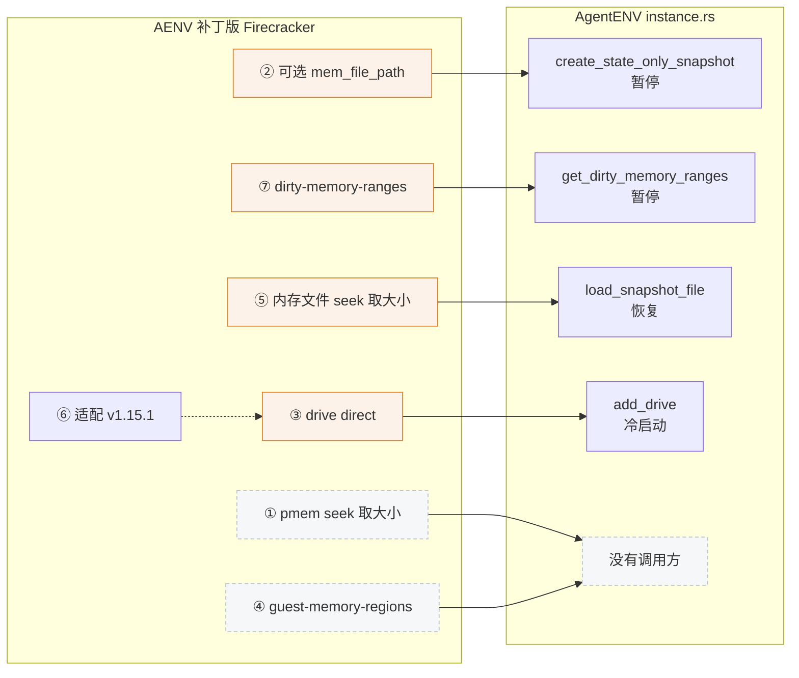
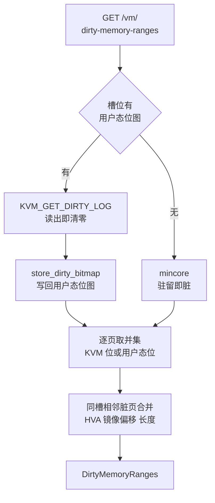

# 67 · AENV 补丁版 Firecracker 与 guest 内核

> AgentENV 的内存路径要求 Firecracker 做三件上游 Firecracker v1.15.1 做不到的事：不写内存文件的快照、交出脏页区间、把块设备当内存文件；磁盘路径另要一个 O_DIRECT 开关。
> 本篇逐个读 AENV 补丁版 Firecracker 的 7 个提交，讲每个补丁改了哪里、AgentENV 在哪里调用、哪些补丁没有被用到，再讲它从同一个 release 下载的 guest 内核隐含了哪些要求。
>
> **读者**：要维护或升级 AgentENV 所依赖的 Firecracker 与内核的工程师；想核实「补丁版到底改了什么」的读者。　**预备**：[第 03 篇 · 本书用到的 Firecracker](03-firecracker-for-agentenv.md)、[第 42 篇 · 内存快照](42-memory-snapshot-over-ublk.md)
> 　**代码**：AgentENV 的 `config/deps_manifest.toml`、`src/setup/deps.rs`、`src/sandbox/firecracker/instance.rs`、`src/sandbox/firecracker/config.rs`、`thirdparty/firecracker-client/firecracker.yaml`；firecracker 仓库 `v1.15.1..aenv-deps` 的 7 个提交，主要是 `src/vmm/src/persist.rs`、`src/vmm/src/vstate/memory.rs`、`src/vmm/src/vstate/vm.rs`、`src/vmm/src/rpc_interface.rs`、`src/vmm/src/devices/virtio/block/virtio/`

---

## 0. 本篇要回答的问题

1. AENV 补丁版 Firecracker 相对上游 Firecracker v1.15.1 有哪 7 个提交？哪 4 个行为被 AgentENV 调用，调用点在哪里？
2. 「快照内存不经过 mem.bin」由哪三个补丁共同实现？`dirty-memory-ranges` 怎样做到「读了 KVM 日志却不清除脏位」？
3. drive 的 `direct` 字段改了 virtio-blk 的哪些代码路径？它对快照状态文件的格式有什么影响？
4. 哪两个补丁没有被用到，为什么？补丁栈之后还有哪些分支，v0.2.3 用了没有？
5. guest 内核 `vmlinux-6.1.175` 从哪里来、用什么配置构建？AgentENV 的 boot args 对它提出了哪些要求？

---

## 1. 问题：上游接口假设内存是一个普通文件

上游 Firecracker v1.15.1 的快照接口有两个隐含假设（[第 03 篇 §1](03-firecracker-for-agentenv.md#1-问题agentenv-要-vmm-提供什么)）：
创建快照时，内存一定由 Firecracker 写成一个与 guest 内存等大的文件；恢复时，内存文件是一个能用 `fstat` 取到大小的普通文件。
AgentENV 的内存住在 overlaybd 层栈里，暂停时只想把脏页写成一个新层，恢复时经 ublk 把层栈暴露成只读块设备交给 File 后端。
两个假设都不成立。另一方面，Firecracker 自己的设备模拟以缓冲 I/O 打开磁盘后端，而 AgentENV 的磁盘后端也是 ublk 块设备，宿主页缓存会再存一份数据。

AENV 补丁版 Firecracker 的做法是在上游之上加一层尽量薄的补丁，只改接口边界上的几处，不动 VMM 的主体结构。
它的代价是 AgentENV 与一个非上游的二进制绑定：升级上游版本时，补丁要逐个重新适配；补丁行为也只有这个二进制有，换用上游 Firecracker 时 AgentENV 的暂停与恢复都会失败。

### 1.1 版本与获取

AgentENV 不在仓库里构建 Firecracker。`config/deps_manifest.toml` 的 `[firecracker.kvm]` 写着版本 `1.15.1-patch-v1`，
URL 模板指向 kvcache-ai/firecracker 的 release `aenv-deps`，文件名为 `firecracker-{version}-{arch}.tgz`；同一 release 下还有 `[kernel.kvm]` 的 `vmlinux-6.1.175-{arch}`（§7）。
这个 manifest 由 `src/setup/deps.rs` 的 `bundled_manifest()` 以 `include_str!` 编进二进制。

`ensure_firecracker()` 先看 `[firecracker] binary_path` 是否显式给出；没有时算出版本化路径，文件已存在且非空就跳过，
否则用 `resolve_url()` 替换 `{version}` 与 `{arch}`，`download_file()` 把整个响应读进内存、写 `.tmp` 再改名，
最后 `extract_firecracker()` 从 tgz 里取出 `firecracker` 与（可选的）`cpu-template-helper`。整个过程不校验摘要；`[firecracker] version` 与 `url` 可以覆盖 manifest。
PVM 模式改用 `[firecracker.pvm]` 指向的另一条代码线，不在本书基线里（[第 61 篇](61-pvm.md)）。

tag `aenv-deps` 指向提交 `90288c39`，它把所有 crate 的版本从 `1.15.1` 改成 `1.15.1-patch-v1`，swagger 的 `version` 也随之改变，与 manifest 的资产名吻合。
AgentENV 侧的 `thirdparty/firecracker-client/firecracker.yaml` 与补丁版的 `src/firecracker/swagger/firecracker.yaml` 除 `version:` 一行外完全相同，
但客户端 crate 与 yaml 的版本仍写 `1.15.1`，单看版本号看不出它描述的是补丁版 API（[第 64 篇 §3](64-build-codegen-release.md#3-生成代码)）。
生成的客户端只提供模型类型，真正的请求由 `instance.rs` 手写发出。

---

## 2. 七个提交

`git diff v1.15.1 aenv-deps` 共 30 个文件，+1219 / −145；其中 `src/` 下 26 个文件，+1018 / −138。
`src/` 以外的改动是各 crate 的 `Cargo.toml` 版本号、`Cargo.lock`、`CHANGELOG.md`，以及一份新增的仓库说明文件 `CLAUDE.md`（面向代码助手的说明，不影响行为）。
`resources/` 与 `tests/` 两个目录没有任何改动：seccomp 规则、guest 内核配置与 Python 集成测试都与上游相同。

| 提交 | 文件 | +/− | 内容 | AgentENV 调用点 |
|---|---|---|---|---|
| ① `c3ec7aef` | 1 | +3 / −2 | virtio-pmem 用 `seek` 取后端文件大小，代替 `fstat` | 未使用 |
| ② `caccb127` | 8 | +277 / −18 | `PUT /snapshot/create` 的 `mem_file_path` 改为可选 | `create_state_only_snapshot()` |
| ③ `d571a650` | 13 | +382 / −84 | drive 新增 `direct`，以 O_DIRECT 打开后端，不对齐时用反弹缓冲 | `add_drive()`，`patch_drive_path()` 沿用 |
| ④ `8c42a29d` | 5 | +302 / −134 | 新增 `GET /vm/guest-memory-regions` | 未使用 |
| ⑤ `41385d4e` | 1 | +9 / −5 | File 后端用 `seek` 取内存文件大小 | `load_snapshot_file()` |
| ⑥ `2a6598dc` | 5 | +53 / −30 | 把 ③ 适配到上游 v1.15.1，附带一处错误处理修正 | 随 ③ |
| ⑦ `90288c39` | 13 | +350 / −29 | 新增 `GET /vm/dirty-memory-ranges`；版本号改为 `1.15.1-patch-v1` | `get_dirty_memory_ranges()` |

调用点都在 `src/sandbox/firecracker/instance.rs`，再由 `sandbox.rs` 在冷启动、暂停与恢复三条序列里使用（[第 27 篇](27-start-pause-resume-sequences.md)）。
图 1 把补丁与调用点连起来，橙色是被 AgentENV 用到的补丁，虚线框是没有调用方的补丁。



---

## 3. 主线：快照内存不经过 mem.bin

补丁 ②、⑦、⑤ 合起来改变了内存的去向：暂停时 Firecracker 只写状态文件，AgentENV 拿到脏页区间后自己从 Firecracker 进程里读页、写成 overlaybd 层；
恢复时层栈经 ublk 变成块设备，作为 File 后端的内存文件。这条主线的整体图在[第 03 篇 §4](03-firecracker-for-agentenv.md#4-aenv-补丁版-firecracker-的四个被用到的行为)，
数据怎样成层在[第 42 篇](42-memory-snapshot-over-ublk.md)；这里只看 Firecracker 一侧的实现。

### 3.1 可选的 `mem_file_path`（补丁 ②）

`src/vmm/src/vmm_config/snapshot.rs` 的 `CreateSnapshotParams::mem_file_path` 从 `PathBuf` 改成 `Option<PathBuf>`，swagger 的 `SnapshotCreateParams` 从 `required` 里删掉了它。
`src/vmm/src/persist.rs` 的 `create_snapshot()` 照旧先 `save_state()` 再 `snapshot_state_to_file()` 写状态文件，之后原本无条件的两步被包进 `if let Some(..)`：

```rust
snapshot_state_to_file(&microvm_state, &params.snapshot_path)?;

if let Some(ref mem_file_path) = params.mem_file_path {
    vmm.vm
        .snapshot_memory_to_file(mem_file_path, params.snapshot_type)?;
    // … 已激活设备的队列内存重新标脏
    vmm.device_manager
        .mark_virtio_queue_memory_dirty(vmm.vm.guest_memory());
}
```

不给路径时，被跳过的有两件事。第一是 `snapshot_memory_to_file()`：不打开内存文件，不读脏页位图，Full 与 Diff 各自的清位逻辑都不执行，所以脏页记录原封不动。
第二是 `mark_virtio_queue_memory_dirty()`：上游在写完内存文件之后把 virtio 队列所在的页重新标脏，因为队列结构由 Firecracker 经裸指针更新、运行期不进位图；
补丁把这一步一并放进了「有内存文件」的分支，即 `mem_file_path` 缺省时跳过 virtio 队列重新标脏（[第 03 篇 §4](03-firecracker-for-agentenv.md#4-aenv-补丁版-firecracker-的四个被用到的行为)的说法与此一致）。AgentENV 的路径上这不会漏页：`Queue::initialize()` 在设备激活与从快照恢复时已把队列内存标脏，而 AgentENV 从不重置 Firecracker 的位图，
所以队列页在每次查询里都是脏的（[第 42 篇 §2.2](42-memory-snapshot-over-ublk.md#22-dirtymemoryranges-的语义)）。
推论：若有调用方在同一个进程里先做一次带内存文件的 Diff（它会清位图），再做不带内存文件的快照并查询区间，队列页能否出现取决于后来的写，这个组合 AgentENV 不会用到。

AgentENV 的 `create_state_only_snapshot()` 发出的请求只带 `snapshot_path` 与 `snapshot_type = Diff`。没有内存文件时 `snapshot_type` 不影响产物，只影响日志与指标的归类（[第 27 篇 §5.2](27-start-pause-resume-sequences.md#52-每一步为什么在那个位置)）。
补丁同时在 `src/vmm/tests/integration_tests.rs` 加了 `verify_create_state_only_snapshot()`：暂停一台 VM、不带内存路径建快照，再检查状态文件可以被解析。

### 3.2 `GET /vm/dirty-memory-ranges`（补丁 ⑦）

有了只写状态的快照，内存要由别人来读。读的人需要两样信息：哪些页要读（判据），以及这些页在 Firecracker 进程里的地址与在内存镜像里的位置（坐标）。
补丁 ⑦ 用一个端点同时给出这两样。请求路径在 `src/firecracker/src/api_server/parsed_request.rs` 里解析为 `VmmAction::GetDirtyMemoryRanges`，
`src/vmm/src/rpc_interface.rs` 只在启动之后受理它（`PrebootApiController` 把它列为不允许的操作），由 `RuntimeApiController::get_dirty_memory_ranges()` 在持有 `Vmm` 锁时调用
`src/vmm/src/vstate/vm.rs` 的 `Vm::get_dirty_memory_ranges_preserve()`。图 2 是这个函数的流程。



这个函数只有三步，每一步都复用上游已有的部件：

1. `get_dirty_bitmap()` 是上游函数，Diff 快照也用它。槽位带用户态位图（即 `track_dirty_pages` 为真）时读 KVM 日志，否则退回 `mincore_bitmap()` 的过估（[第 03 篇 §2.3](03-firecracker-for-agentenv.md#23-脏页从哪里来)）。
2. `store_dirty_bitmap()` 也是上游函数，原本用在 Diff 写失败时把读出的位存回去。补丁在**每次查询**都调用它：KVM 的位在第一步已被清掉，存回用户态位图后，这些页在逻辑上仍是脏的。没有位图的槽位上它什么也不做，`mincore` 本身也不清任何东西。
3. 新增的 `GuestMemoryMmap::dirty_memory_ranges()`（`src/vmm/src/vstate/memory.rs`）按槽遍历，`image_offset` 是之前所有槽长度的累加，未插入的热插槽跳过但偏移照样前进；
   `GuestMemorySlot::append_dirty_ranges()` 对每页取「KVM 位或用户态位」，与 `dump_dirty()` 的判据相同，并把同一槽内相邻的脏页合成一个区间，记下 HVA（槽的起始宿主地址加页偏移）、镜像偏移与长度。

返回体 `DirtyMemoryRanges` 另带 `page_size` 与 `memory_size`。`page_size` 取自 `get_page_size()`，即宿主页大小，而不是 `machine-config` 的大页设置；
AgentENV 的 `dirty_ranges_to_segment_mappings()` 要求它等于 4096，否则拒绝打包。`memory_size` 是镜像总长，等于所有槽长度之和。

swagger 把这个查询描述为「logically non-clearing」，并写明它面向「已暂停、已启动的 VM」。代码并不检查 Paused：运行中的 VM 也能调用，只是 vCPU 仍在写内存，结果只代表某一刻。
AgentENV 只在 `PATCH /vm` 置为 Paused 并完成状态快照之后调用它（`sandbox.rs` 的 `snapshot_memory_to_overlaybd()`）。
「不清除」在 AgentENV 里不只是失败重试的保险：原地 capture 之后再 capture，新层压在启动时的层栈上，必须包含自启动或 load 以来的全部写入，正需要只增不减的脏位（[第 42 篇 §2.2](42-memory-snapshot-over-ublk.md#22-dirtymemoryranges-的语义)）。
代价是同一台运行中的 VM 反复被捕获时，区间只会越来越大。

KVM 的 `KVM_GET_DIRTY_LOG` ioctl 本来就在 vmm 线程的 seccomp 允许表里（Diff 快照要用），`resources/seccomp/` 不需要改动；
读页的 `process_vm_readv` 由 AgentENV 的 server 进程发起，也不受 Firecracker 的 seccomp 约束。

### 3.3 内存文件用 seek 取大小（补丁 ⑤）

恢复时 `guest_memory_from_file()` 只读打开内存文件，交给 `memory::snapshot_file()`。后者在映射之前先比较文件大小与所有区域的总长，文件更小就拒绝 ——
否则访问越界的页会收到 SIGBUS。上游用 `file.metadata().len()` 取大小，块设备的 `st_size` 是 0，于是 `/dev/ublkbN` 在这一步就被拒绝。
补丁把它换成 `file.seek(SeekFrom::End(0))`，注释写明 ublk、dm-snapshot 这类块设备 `fstat` 得 0、`lseek` 得容量，而普通文件两者相同；
错误类型随之从 `MemoryError::FileMetadata` 换成 `MemoryError::SeekError`。`lseek` 已在 seccomp 允许表里。
其余部分没有改：映射仍是 `MAP_PRIVATE`，读走块设备页缓存，写时复制成私有匿名页（[第 03 篇 §3.2](03-firecracker-for-agentenv.md#32-file-后端)）。

File 后端的另一条上游限制被原样保留：`src/vmm/src/persist.rs` 在 machine-config 使用 hugetlbfs 大页时以 `GuestMemoryFromFileError::HugetlbfsSnapshot` 拒绝恢复，错误信息建议改用 uffd。
补丁没有动这一处，AgentENV 的配置里也没有大页选项，于是内存层的粒度固定在 4 KiB。这是选 File 后端换来跨沙箱页缓存共享的代价之一（[第 44 篇 §4](44-uffd-alternative.md#4-逐项比较)、[第 66 篇 §3.4](66-vs-e2b-infra-storage-and-memory.md#34-大页与粒度)）。

三处补丁合起来，Firecracker 里与内存快照有关的新代码不到两百行，大部分是区间计算与测试。
它们没有改变 Firecracker 对「一致性」的定义：上游的 create 在一次调用里同时写出状态与内存，补丁版把内存交给调用方以后，
「先 create 返回、再读内存、读时 Firecracker 进程还活着」这个顺序就成了调用方的责任，AgentENV 在 `snapshot_memory_to_overlaybd()` 里按这个顺序执行。

---

## 4. drive 的 `direct`（补丁 ③ 与 ⑥）

这是唯一与内存无关的被用补丁，作用于 virtio-blk。

**接口。** `src/vmm/src/vmm_config/drive.rs` 的 `BlockDeviceConfig` 加了 `direct: Option<bool>`，缺省视为假；swagger 说明它只适用于 virtio-block，vhost-user-block 应省略。
`src/vmm/src/devices/virtio/block/virtio/device.rs` 的 `DiskProperties::open_file()` 在 `direct` 为真时加上 `custom_flags(libc::O_DIRECT)`；
`VirtioBlock::update_disk_image()` 用设备记住的 `direct` 重新打开新路径，所以 `PATCH /drives/{id}` 换后端时沿用原值，AgentENV 的 `patch_drive_path()` 不必再传它（[第 31 篇](31-extra-drives-and-volumes.md)）。

**对齐。** O_DIRECT 要求文件偏移、长度与缓冲区地址都按设备的逻辑块对齐。`src/vmm/src/devices/virtio/block/virtio/io/mod.rs` 定义 `DIRECT_IO_ALIGN = 512`，
注释说明偏移与长度由 virtio-blk 协议保证是扇区的整数倍，只有缓冲区地址可能不满足。同步引擎（`sync_io.rs`）与异步引擎（`async_io.rs`）各有一个 `needs_bounce_buf()`：
`direct` 为真且 guest 地址不是 512 的倍数时，用 `AlignedBuf` 分配一块对齐的堆内存，写请求先把 guest 数据拷进去，读请求完成后再拷回 guest 内存并标脏。
推论：判断用的是 guest 物理地址而不是宿主地址，两者在同一内存区域内的低位相同（区域按页对齐映射），所以判断与真实的宿主缓冲地址等价。

**快照状态。** `src/vmm/src/devices/virtio/block/virtio/persist.rs` 的 `VirtioBlockState` 加了 `direct` 字段，恢复时据此重新以 O_DIRECT 打开后端。
字段带 `#[serde(default)]`，注释称是为了兼容旧快照。推论：状态文件由 bitcode 编码（`src/vmm/src/snapshot/mod.rs`），这种格式不自描述字段，`serde(default)` 只在自描述格式里能补缺失字段；
而补丁没有提升 `SNAPSHOT_VERSION`（仍是 9.0.0），所以上游 Firecracker v1.15.1 写出的状态文件与补丁版写出的状态文件互相读不了，报出的是反序列化错误，不是版本不符。
AgentENV 只用补丁版自己写的快照，这一点在它的路径上不构成问题；但它意味着补丁版的状态文件只能由同一份源码构建的二进制读取，不能拿上游 v1.15.1 的 Firecracker 或工具去解析。

**补丁 ⑥。** 提交说明是「rebase onto v1.15.1」，内容主要是让异步引擎适配上游 v1.15.1 的接口。其中有一处行为修正：
反弹缓冲拷回 guest 内存失败时，原先只记一条错误日志、请求照常报告成功；修正后 `mark_dirty_mem_and_unwrap()` 返回错误，`pop()` 以 `-EFAULT` 完成这个请求。

**调用点。** `configure_microvm()` 里三处 `add_drive()`：tools 盘（根设备、只读、`Sync` 引擎）传 `direct = false`；用户 rootfs 与每个附加盘、卷槽位传 `true` 并用 `Async` 引擎。
为什么可写盘开、共享的 tools 盘不开，代码没有注释，[第 26 篇 §6](26-sandbox-block-devices.md#6-o_direct哪些盘绕过宿主页缓存)给出了两条推论（避免双重缓存、让写完成等于数据已到 daemon）。
内存设备不经过 virtio-blk，与这个字段无关。

---

## 5. 未被使用的补丁

**补丁 ①：pmem 用 seek 取大小。** `src/vmm/src/devices/virtio/pmem/device.rs` 的 `mmap_backing_file()` 把 `metadata().len()` 换成 `seek(SeekFrom::End(0))`，
提交说明举的例子是 dm-snapshot 块设备。这与补丁 ⑤ 是同一个问题在另一个设备上的修法。AgentENV 不配置 virtio-pmem（`instance.rs` 没有 `/pmem` 请求），这个补丁在它的路径上不生效。

**补丁 ④：`GET /vm/guest-memory-regions`。** 它返回每个内存区域的 `GuestRegionUffdMapping`：区域起始 HVA、大小、在扁平镜像里的累计偏移、页大小，以及标为弃用、与 `page_size` 同值的 `page_size_kib`。
实现上它把 `persist.rs` 里 uffd 恢复路径构造握手表的代码抽成 `build_uffd_mappings()`，运行期端点与 uffd 握手共用这一份，所以两边的偏移语义一定一致。
有了它，外部进程就能用 `process_vm_readv` 读任意区域；但它只给坐标，不给判据 —— 调用方仍要自己决定读哪些页。
补丁 ⑦ 把坐标放进每个脏区间里，一次查询同时回答「读哪些」与「从哪读、写到哪」，于是 AgentENV 只调 ⑦。
生成的客户端里仍有 `GuestRegionUffdMapping` 模型，因为它来自同一份 yaml，但没有任何调用。

两个未用的补丁保留在补丁栈里，成本是每次 rebase 都要一起适配；收益是它们与被用的补丁相互独立，删去任何一个都不影响 AgentENV。

---

## 6. 补丁栈的后续

kvcache-ai/firecracker 在 `aenv-deps` 之后还有几条分支。AgentENV v0.2.3 一个都没有用：manifest 仍是 `1.15.1-patch-v1`，仓库里搜不到 `pre-fault`、`prefault` 或 `patch-v2`。

| 分支 / tag | 相对 `aenv-deps` | 内容 |
|---|---|---|
| `v1.15.1-patch`（= tag `v1.15.1-patch-v2`） | 加 2 个提交 | `PUT /vm/pre-fault-memory`；`guest-memory-regions` 增加 GPA 字段；版本改为 `1.15.1-patch-v2` |
| `v1.15.1-patch-nestedvirt` | 加 3 个提交 | 快照保存与恢复嵌套虚拟化的 vCPU 状态 |
| `v1.16.1-patch` | 不基于它 | 指向上游 v1.16.1 的发布提交，没有任何自定义提交 |

`PUT /vm/pre-fault-memory`（新增 `src/vmm/src/vstate/prefault.rs`）只能在 VM 暂停时调用，接受页对齐的 guest 物理地址区间，
在支持 `KVM_CAP_PRE_FAULT_MEMORY` 的 x86_64 宿主上把区间分给各 vCPU 线程调用 `KVM_PRE_FAULT_MEMORY`，提前建好二级页表；aarch64 不支持，seccomp 规则相应增加。
同一版本给 `guest-memory-regions` 的返回值加了 `guest_phys_addr`，注释写明用途是把区域内的 HVA 换算回 GPA。
推论：两者配合，调用方可以把按 HVA 或镜像偏移记录的首触页换算成 GPA 再交给 pre-fault，这是在 KVM 层做恢复预取的接口；v0.2.3 的预取仍在 ublk 与 overlaybd 层做（[第 43 篇](43-startup-pack-and-prefetch.md)）。

nestedvirt 分支让 guest 内运行 KVM 的 VM 也能做快照，AgentENV 没有引用它。`v1.16.1-patch` 是为下一次 rebase 预留的空分支。

版本记录上有两处值得注意。客户端 crate 写 `1.15.1`，与它描述的补丁版 API 不符（[第 64 篇 §3](64-build-codegen-release.md#3-生成代码)）；
快照元数据的 `SnapshotRuntimeVersions` 会用 `firecracker --version` 探测并记下 `firecracker_version`，但恢复时只核对 tools 盘版本，Firecracker 与内核的版本只记录不检查（[第 61 篇](61-pvm.md)）。
结合 §4 的状态文件格式推论，换 Firecracker 二进制之后旧快照能否恢复，要到 load 时才知道。

---

## 7. guest 内核

### 7.1 来源

`[kernel.kvm]` 的版本是 `vmlinux-6.1.175`，URL 是同一个 release `aenv-deps` 下的 `{version}-{arch}`。`ensure_kernel()` 直接下载到 `$deps/kernel/<版本>/vmlinux.bin`，同样不校验摘要。
AgentENV 仓库里没有内核配置，也没有内核构建脚本；补丁版 Firecracker 的 `resources/` 相对上游没有任何改动，`resources/guest_configs/` 只有上游 CI 用的配置。
上游 `resources/rebuild.sh` 的 `build_al_kernels` 以 Amazon Linux 内核源码加 `microvm-kernel-ci-$ARCH-6.1.config` 与 `ci.config`、`pcie.config`、`virtio-pmem.config`、`virtio-mem.config`、`vmclock.config` 几个片段构建 6.1 内核，产物命名为 `vmlinux-6.1.x`。
推论：`vmlinux-6.1.175` 是按上游这套脚本构建的，或者直接取自上游 CI 的产物；两个仓库都无法确认具体配置。

### 7.2 boot args 隐含的要求

内核要满足什么，最直接的证据是 AgentENV 交给它的命令行。`src/sandbox/firecracker/config.rs` 的 `DEFAULT_BOOT_ARGS` 与 `config/default.toml` 的 `boot_args` 拼装规则见[第 27 篇 §2.1](27-start-pause-resume-sequences.md#21-boot-args-的拼装)，下表列出它们对内核的要求，并与上游 `microvm-kernel-ci-x86_64-6.1.config` 对照：

| 参数 | 隐含的内核要求 | 上游 6.1 CI 配置 |
|---|---|---|
| `console=ttyS0` | 8250 串口控制台 | `CONFIG_SERIAL_8250_CONSOLE=y` |
| `pci=off` | 设备走 virtio-mmio；AgentENV 启动 Firecracker 时不带 `--enable-pci` | `CONFIG_VIRTIO_MMIO=y` |
| `ip=…` | 内核级 IP 自动配置 | `CONFIG_IP_PNP=y` |
| `damon_reclaim.*` | DAMON reclaim 模块 | `CONFIG_DAMON=y`，但 `CONFIG_DAMON_RECLAIM` 未设置 |
| `page_reporting.page_reporting_order=6` | free page reporting | `CONFIG_PAGE_REPORTING=y`、`CONFIG_VIRTIO_BALLOON=y` |

前四行之外，`init=/init` 要求 tools 盘的文件系统能被内核直接挂载为根（上游配置有 `CONFIG_EXT4_FS=y`）；balloon 的 free page reporting 与 DAMON reclaim 怎样配合把内存还给宿主，见[第 03 篇 §5](03-firecracker-for-agentenv.md#5-balloon-与-damon把内存还给宿主)。

第四行是一处矛盾。上游 6.1 CI 配置启用了 DAMON 本体、虚拟地址与物理地址两种监控，但明确写着 `# CONFIG_DAMON_RECLAIM is not set`。
若 `vmlinux-6.1.175` 真按上游配置构建，`damon_reclaim.*` 就是一组指向未编入模块的参数，推论：内核会忽略这类带点的未知参数而照常启动，guest 内的冷页回收不会发生，AgentENV 没有任何地方检查这一点。
推论：要么这个内核在上游配置之上额外打开了 `CONFIG_DAMON_RECLAIM`，要么 DAMON reclaim 在默认内核上静默失效；仅凭两个仓库无法区分。
上游 `ci.config` 打开了 `CONFIG_IKCONFIG_PROC`，若下载的内核也带着它，在 guest 里读 `/proc/config.gz` 或检查 `/sys/module/damon_reclaim/` 即可核实（推论）。

PVM 模式使用另一个内核 `6.12.33-pvm`，以 `CONFIG_PVM_GUEST` 构建，来源与校验见[第 61 篇 §2.2](61-pvm.md#22-依赖按模式选择)。

---

## 8. 与 e2b infra 的对照

e2b infra 依赖的 e2b 定制版 Firecracker 同样把 `mem_file_path` 改成了可选，但保留了不写内存时的队列重新标脏，AENV 补丁版把这一步一并跳过（[第 66 篇 §2.4](66-vs-e2b-infra-storage-and-memory.md#24-差别三快照类型队列标脏与不清除)）。
e2b 定制版的 `GET /memory/mappings` 与这里未被使用的补丁 ④ 几乎同形：都交出每个区域的 HVA、累计偏移与页大小，差别只是 e2b 另起了一个不带弃用字段 `page_size_kib` 的结构、外面再包一层 `mappings` 对象（见 Firecracker 手册第 50 篇）。
e2b 继续用「区域坐标 + 独立的位图端点」由 orchestrator 自己换算，AENV 补丁版则用补丁 ⑦ 把坐标与判据合进一个区间端点（[第 66 篇 §2.2](66-vs-e2b-infra-storage-and-memory.md#22-差别一地址与判据怎样交出)）。
两个分叉在「快照不写内存文件、由宿主进程直接读 guest 内存」上走到同一方向，差别落在判据与恢复后端上，整体对照见[第 66 篇 §2](66-vs-e2b-infra-storage-and-memory.md#2-两个分叉相似的方向不同的接口)。

---

## 9. 小结

- AENV 补丁版 Firecracker 是上游 v1.15.1 加 7 个提交，tag `aenv-deps`，资产名 `1.15.1-patch-v1`；AgentENV 从 release 下载二进制与内核，不构建、不校验摘要。
- 被用到的四个行为：可选 `mem_file_path`（②）、`GET /vm/dirty-memory-ranges`（⑦）、File 后端用 seek 取内存文件大小（⑤）、drive `direct`（③，⑥ 适配）。
- ② 缺省内存路径时只写状态文件，不动脏页记录，也跳过 virtio 队列重新标脏；AgentENV 不会因此漏页，因为队列页在初始化时已标脏且位图从不重置。
- ⑦ 复用上游的 `get_dirty_bitmap()` 与 `store_dirty_bitmap()`：读 KVM 日志后立即写回用户态位图，因而逻辑上不清除；区间带 HVA、镜像偏移与长度，判据与 `dump_dirty()` 相同；代码不检查 Paused。
- ⑤ 只换了取大小的方式，`MAP_PRIVATE` 映射与 File 后端拒绝 hugetlbfs 的限制都与上游相同，AgentENV 因此放弃大页。
- ③ 给 virtio-blk 加 O_DIRECT 与 512 字节反弹缓冲，`direct` 写进设备快照状态；推论：快照版本号未变而 bitcode 不自描述，补丁版与上游的状态文件互不兼容。
- ① pmem seek 与 ④ `guest-memory-regions` 没有调用方；④ 只给坐标不给判据，被 ⑦ 取代。
- patch-v2 的 `pre-fault-memory`、nestedvirt 分支与空的 `v1.16.1-patch` 都不在 v0.2.3 的路径上；客户端 crate 仍写 1.15.1，快照只记录不核对 Firecracker 版本。
- guest 内核 `vmlinux-6.1.175` 没有可追溯的配置；上游 6.1 CI 配置不含 `CONFIG_DAMON_RECLAIM`，与 AgentENV 缺省开启的 `damon_reclaim.*` 参数相矛盾，需在 guest 内核验证。

## 延伸阅读 / 下一篇

- 下一篇：[第 68 篇 · 已知问题与技术债](68-known-issues-and-debt.md) —— 本篇记下的补丁层与内核问题在那里汇总。
- [第 03 篇 · 本书用到的 Firecracker](03-firecracker-for-agentenv.md)：四个补丁行为与上游机制的对照。
- [第 27 篇 · 启动、暂停与恢复的 Firecracker 调用序列](27-start-pause-resume-sequences.md)、[第 42 篇 · 内存快照](42-memory-snapshot-over-ublk.md)、[第 26 篇 · 沙箱块设备](26-sandbox-block-devices.md)：补丁行为的调用方。
- [第 66 篇 · 与 e2b infra 的对照（二）](66-vs-e2b-infra-storage-and-memory.md)：两个 Firecracker 分叉的整体对照。
- [Firecracker 手册第 14 篇 · 脏页跟踪](../firecracker/14-dirty-page-tracking.md)、[第 37 篇 · 创建快照](../firecracker/37-snapshot-create.md)、[第 41 篇 · 快照工具与兼容性](../firecracker/41-snapshot-tools-and-compat.md)：上游机制。
- [Firecracker 手册第 50 篇 · /memory/mappings](../firecracker/50-memory-mappings-api.md)、[第 54 篇 · 可选 memfile](../firecracker/54-optional-memfile-snapshot.md)、[第 56 篇 · guest 内核要求](../firecracker/56-guest-kernel-requirements-and-e2b-configs.md)：e2b 定制版的对应补丁与内核配置。
