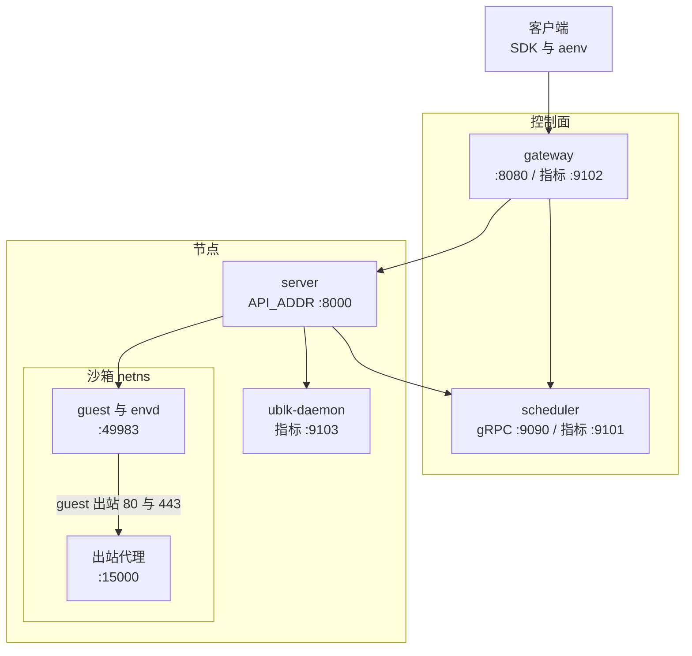

# 71 · 配置项、环境变量与端口总表

> 本附录把散在全书的配置面集中成几张表：节点配置文件 `config/default.toml` 的全部节与键（代码默认与默认文件两列并列，不一致处标出）、
> ublk-daemon 自己再读的那几个键、gateway 与 scheduler 的 JSON 配置与环境变量覆盖、所有被代码或部署脚本读取的环境变量，以及每个监听端口的来源。
> 每一行都链到详细讲解的篇目与小节。
>
> **读者**：部署、调参、排查「改了配置为什么没生效」的读者。　**预备**：[第 11 篇 · 配置体系](11-configuration.md)、[第 60 篇 · 部署形态](60-deployment.md)。
> **代码**：`src/cfg.rs`、`src/cfg/image.rs`、`src/cfg/network.rs`、`config/default.toml`、`storage/ublk-daemon/src/main.rs`、`storage/ublk-daemon/src/client.rs`、
> `services/shared/config/config.go`、`services/gateway/cmd/main.go`、`services/scheduler/cmd/main.go`、`src/bin/server.rs`、`deploy/`

---

## 0. 本篇要回答的问题

1. `config/default.toml` 有哪些节与键？每个键在代码里的默认值是什么，与默认文件里写的值是否一致？
2. 哪些键可以用环境变量覆盖？哪些环境变量根本不经过 confique，由谁在什么时候读？
3. ublk-daemon 从同一份 TOML 里读哪几个键，默认值与 `server` 有什么不同？
4. gateway 与 scheduler 的 JSON 配置有哪些键，代码默认、仓库附带的三份配置与环境变量覆盖各是什么？
5. 一个节点、一套集群各监听哪些端口？每个端口在代码或部署清单的哪一处定义？
6. 代码、默认文件、文档与部署清单之间有哪些不一致，后果是什么？

---

## 1. 怎样读这些表

**两列默认值。** 节点配置由 confique 分层加载，优先级是**环境变量 > 文件 > 代码默认**（[第 11 篇 §2](11-configuration.md#2-加载与归一化)）。
表里「代码默认」一列取自 `src/cfg.rs` 与 `src/cfg/*.rs` 字段上的 `#[config(default = …)]`；字段没有 default 而类型是 `Option` 的写「未设置」，并在作用栏说明未设置时代码怎样回退。
「default.toml」一列取自仓库的 `config/default.toml`：写了值的照抄，整行被注释掉的写「（注释）」，即文件不提供、取代码默认。
两列不同时，default.toml 一列的值加粗并标「≠」；它只在**有配置文件**时生效，没有配置文件时节点静默地按代码默认运行（[第 11 篇 §6.3](11-configuration.md#63-没有配置文件时)）。

**路径展开。** 带 `$AENV_HOME` 的值在加载后由 `AppConfig::normalize()` 展开为归一化后的 `home_path`；`$AENV_RUNTIME` 只在 `[ublk].daemon_socket_path` 上展开；
其它相对路径以配置文件所在目录为基准（[第 11 篇 §2.2](11-configuration.md#22-路径归一化)）。表里照写未展开的形式。

**环境变量。** 作用栏里出现 `env: NAME` 的键可被同名环境变量覆盖；全部这样的变量在 §5.1 汇总。没有标注的键只能写在文件里。

**篇目。** 「篇目」一栏写成「篇号 §小节」并链接；同一键在多篇出现时只列详讲的一两处。

---

## 2. 节点配置：`config/default.toml`

### 2.1 顶层键

| 键 | 代码默认 | default.toml | 作用 | 篇目 |
|---|---|---|---|---|
| `home_path` | `/var/lib/aenv` | `/var/lib/aenv` | 持久状态、缓存、日志与生成文件的根；相对路径以配置文件目录为基准。env: `AENV_HOME_PATH` | [10 §5](10-node-process-and-object-model.md#5-节点磁盘布局)、[11 §2.2](11-configuration.md#22-路径归一化) |
| `runtime_path` | `/run/aenv` | （注释） | socket 与 netns 等临时状态。env: `AENV_RUNTIME_PATH` | [10 §5](10-node-process-and-object-model.md#5-节点磁盘布局) |
| `deps_path` | `$AENV_HOME/deps` | （注释） | 下载的运行期依赖（Firecracker、内核、tools 盘、overlaybd 工具、regctl）。env: `AENV_DEPS_PATH`。ublk-daemon 对它的缺省不同，见 §3 | [59 §3.2](59-host-setup-and-privileges.md#32-版本化路径与存在即已安装) |
| `virtualization_mode` | `kvm` | `kvm` | 节点级虚拟化后端 `kvm` / `pvm`；`pvm` 时归一化强制关闭脏页跟踪。env: `AENV_VIRTUALIZATION_MODE` | [61 §2.1](61-pvm.md#21-virtualizationmode)、[11 §2.3](11-configuration.md#23-改写与清洗) |

### 2.2 依赖与 guest 启动：`[firecracker]` `[kernel]` `[tools]` `[overlaybd]`

| 键 | 代码默认 | default.toml | 作用 | 篇目 |
|---|---|---|---|---|
| `[firecracker].binary_path` | 未设置 | （注释） | 指定现成的 Firecracker 可执行文件，替代按 manifest 下载 | [59 §3.2](59-host-setup-and-privileges.md#32-版本化路径与存在即已安装) |
| `[firecracker].version` / `url` | 未设置 | 无此行 | 覆盖 `config/deps_manifest.toml` 编进二进制的版本与下载地址 | [59 §3.1](59-host-setup-and-privileges.md#31-manifest编进二进制的版本表) |
| `[firecracker].boot_args` | 未设置，退回常量 `DEFAULT_BOOT_ARGS` | **完整内核命令行（≠）** | 整条 guest 内核命令行，改它是替换不是追加；文件值比代码常量多 `mitigations=off`、`init=/init`、`page_reporting.page_reporting_order=6` | [11 §6.1](11-configuration.md#61-内核命令行的两份默认) |
| `[firecracker].allowed_extra_boot_args_prefixes` | 未设置 | （注释） | 冷启动请求 `extraBootArgs` 的前缀白名单；未设置即一概不允许 | [14 §3.4](14-sandbox-api.md#34-冷启动-sandboxes-cold) |
| `[firecracker].socket_timeout_secs` | `3` | `3` | 等 Firecracker API socket 出现的上限 | [25 §4.3](25-backend-and-firecracker-process.md#43-等-socket-出现) |
| `[firecracker].socket_poll_ms` | `1` | `1` | 等 socket 的轮询间隔 | [25 §4.3](25-backend-and-firecracker-process.md#43-等-socket-出现) |
| `[firecracker].work_dir` | 未设置，归一化为 `$AENV_HOME/firecracker-work` | （注释） | 每沙箱工作目录（socket、本地日志、可写层）。env: `AENV_FIRECRACKER_WORK_DIR` | [26 §5.4](26-sandbox-block-devices.md#54-可写层住在工作目录里) |
| `[firecracker].serial_dir` | 未设置，归一化为 `$AENV_HOME/logs/serial` | （注释） | 持久串口日志目录，按沙箱 ID 分组；只设它不会打开日志。env: `AENV_FIRECRACKER_SERIAL_DIR` | [11 §2.2](11-configuration.md#22-路径归一化) |
| `[firecracker].log_level` | 未设置 | （注释） | 非空时打开 stdout / stderr 捕获与 `firecracker.log`；未设置或空串全部关闭 | [25](25-backend-and-firecracker-process.md) |
| `[kernel].image_path` | 未设置 | （注释） | 指定现成的未压缩内核镜像 | [59 §3.2](59-host-setup-and-privileges.md#32-版本化路径与存在即已安装) |
| `[kernel].version` / `url` | 未设置 | 无此行 | 覆盖 manifest 里的内核版本与地址 | [59 §3.1](59-host-setup-and-privileges.md#31-manifest编进二进制的版本表) |
| `[tools].drive_path` | 未设置 | （注释） | 导入本地 ext4 tools 盘，须同时给 `version` | [26 §7](26-sandbox-block-devices.md#7-tools-盘的来源与版本) |
| `[tools].version` / `url` | 未设置 | `version`（注释）；`url` 无此行 | tools 盘版本与镜像地址模板，覆盖 manifest | [26 §7](26-sandbox-block-devices.md#7-tools-盘的来源与版本) |
| `[tools].control_plane_port` | `49983` | `49983` | 宿主连接 guest 内 envd 的端口；随快照记录（见 §6.1 的约束） | [28 §3.2](28-mmds-and-envd.md#32-地址) |
| `[overlaybd].version` / `url` / `package_url` | 整节未设置 | 无此节 | 覆盖 overlaybd 工具的版本与下载地址；节存在时 `version` 必填 | [59 §3.1](59-host-setup-and-privileges.md#31-manifest编进二进制的版本表) |

### 2.3 镜像：`[image.resolver]` `[image.cache.*]`

| 键 | 代码默认 | default.toml | 作用 | 篇目 |
|---|---|---|---|---|
| `[image.resolver].default_image` | `ubuntu:24.04` | `ubuntu:24.04` | 模板构建省略 `fromImage` 时的 rootfs 镜像 | [52 §2.1](52-template-builder.md#21-镜像-base冷启动) |
| `[image.resolver].search_registries` | `["docker.io", "ghcr.io"]` | 同左 | 短名依次尝试的 registry | [45 §2.1](45-oci-to-overlaybd.md#21-候选-registry) |
| `[image.resolver].convert_standard_oci` | `true` | `true` | 是否把标准 OCI tar 层转换成本地 overlaybd 提交；`false` 时只接受 overlaybd-native | [45 §4](45-oci-to-overlaybd.md#4-标准-oci逐层转换) |
| `[image.resolver].allowed_registries` | 未设置 | （注释） | registry 白名单；未设置全部允许，显式空列表全部拒绝，被拒返回 4xx | [45 §2.1](45-oci-to-overlaybd.md#21-候选-registry) |
| `[image.resolver].try_referrers_overlaybd_prefixes` | `[]` | `[]` | 哪些镜像引用前缀去查 OCI referrers 加速层（`starts_with` 匹配） | [45 §2.4](45-oci-to-overlaybd.md#24-referrers给标准镜像找加速层) |
| `[image.cache].root_dir` | `$AENV_HOME/image-cache` | （注释） | 转换提交、解析索引、配置与远端块缓存的根 | [45 §5.1](45-oci-to-overlaybd.md#51-目录) |
| `[image.cache].capacity_gb` | 未设置，不做容量驱逐 | **`100`（≠）** | 本地提交预算；只在 GC 打开时驱逐 | [45 §5.4](45-oci-to-overlaybd.md#54-容量驱逐按源配置的-lru) |
| `[image.cache.remote_blocks].max_size_gb` | `10` | **`100`（≠）** | registry 远端块缓存上限，写入生成的 overlaybd 配置 | [39 §2.4](39-block-cache-and-background-download.md#24-一个节点上的四个缓存目录)、[39 §4.1](39-block-cache-and-background-download.md#41-记账与两条水位) |
| `[image.cache.gc].enabled` | `true` | `true` | 后台对账并删除无引用的硬提交 | [45 §5.5](45-oci-to-overlaybd.md#55-宁可不删的-gc) |
| `[image.cache.gc].interval_secs` | `1800` | `1800` | GC 周期 | [45 §5.5](45-oci-to-overlaybd.md#55-宁可不删的-gc) |
| `[image.cache.gc].min_age_secs` | `600` | `600` | 容量驱逐前的最小空闲时长 | [45 §5.4](45-oci-to-overlaybd.md#54-容量驱逐按源配置的-lru) |
| `[image.cache.gc].high_watermark_ratio` | `0.95` | `0.95` | 达到 `capacity_gb` 的这一比例开始驱逐；须在 (0, 1] | [45 §5.4](45-oci-to-overlaybd.md#54-容量驱逐按源配置的-lru) |
| `[image.cache.gc].low_watermark_ratio` | `0.70` | `0.70` | 驱逐到这一比例为止；不得高于高水位 | [45 §5.4](45-oci-to-overlaybd.md#54-容量驱逐按源配置的-lru) |

### 2.4 集群与扩展：`[p2p]` `[custom_extension]` `[cluster]` `[sandbox_proxy]`

| 键 | 代码默认 | default.toml | 作用 | 篇目 |
|---|---|---|---|---|
| `[p2p].enabled` | `false` | `false` | P2P 制品传输总开关（文件注释标为实验性） | [58 §3.1](58-p2p-artifact-transport.md#31-一个节点上起了什么) |
| `[p2p].transport` | `iroh` | `iroh` | 传输实现 `iroh` / `disabled` | [58 §3](58-p2p-artifact-transport.md#3-iroh-后端) |
| `[p2p].store_dir` | `$AENV_HOME/p2p/store` | （注释） | 传输层的本地内容存储 | [58 §3.1](58-p2p-artifact-transport.md#31-一个节点上起了什么) |
| `[p2p].listen_addr` | `0.0.0.0:0` | `0.0.0.0:0` | iroh 端点地址；端口 0 由内核选 | [58 §3.1](58-p2p-artifact-transport.md#31-一个节点上起了什么) |
| `[p2p].lookup_timeout_ms` | `5000` | `5000` | 向 peer 目录查询的超时 | [58 §3.3](58-p2p-artifact-transport.md#33-lookup三级) |
| `[p2p].fetch_timeout_ms` | `30000` | `30000` | 从 peer 取制品的超时 | [58 §3.4](58-p2p-artifact-transport.md#34-fetch校验与-gc) |
| `[p2p].peer_discovery_refresh_interval_secs` | `5` | `5` | 向 scheduler 刷新 peer 列表的间隔，小于 1 按 1 | [58 §3.5](58-p2p-artifact-transport.md#35-scheduler-侧的索引) |
| `[custom_extension].url` | 未设置，即关闭 | （注释） | lifecycle hook 服务地址；关闭时非空 `customExtensionParams` 被拒。env: `AENV_CUSTOM_EXTENSION_URL` | [33 §2](33-custom-extension-hooks.md#2-契约四个-hook) |
| `[custom_extension].timeout_ms` | `5000` | （注释） | hook 调用超时；文件注释称不管 stop，第 33 篇核实 stop 同样受限 | [33 §6](33-custom-extension-hooks.md#6-代价与边界) |
| `[cluster].scheduler_endpoint` | 未设置 | （注释） | scheduler gRPC 地址，供心跳上报与 P2P peer 发现；去空白、空串视为未设置。env: `AENV_OBSERVABILITY_SCHEDULER_ENDPOINT` | [57 §3.1](57-heartbeat-and-cpu-intersection.md#31-节点侧observabilityreporter) |
| `[sandbox_proxy].domains` | `[]` | `[]` | Host 路由 `{port}-{sandboxID}.{domain}` 接受的域名后缀，第一个对外通告。env: `AENV_SANDBOX_PROXY_DOMAINS`（逗号分隔） | [17 §2](17-reverse-proxy.md#2-三个入口) |

### 2.5 网络与机器规格：`[network.*]` `[machine.*]`

| 键 | 代码默认 | default.toml | 作用 | 篇目 |
|---|---|---|---|---|
| `[network.egress].always_denied_cidrs` | 六段私有与保留网段 | 同左 | 在每沙箱 `allowOut` / `denyOut` 之前生效的节点级拒绝表 | [30 §3.1](30-egress-policy-and-proxy.md#31-链的结构) |
| `[network.internal].host_interaction_cidr` | `10.11.0.0/16` | `10.11.0.0/16` | 每槽位宿主交互地址池，至少 32768 个地址 | [29 §2.2](29-network-slots.md#22-地址计划) |
| `[network.internal].veth_cidr` | `10.12.0.0/16` | `10.12.0.0/16` | 每槽位 veth 对地址池，至少 65536 个地址；两池与固定的 `169.254.0.20/30` 不得重叠 | [29 §2.2](29-network-slots.md#22-地址计划) |
| `[machine].mem_size_mib` | `1024` | `1024` | 请求未给时的 guest 内存 | [14 §3.1](14-sandbox-api.md#31-sandboxes_post-的步骤) |
| `[machine].vcpu_count` | `2` | `2` | 请求未给时的 vCPU 数 | [14 §3.1](14-sandbox-api.md#31-sandboxes_post-的步骤) |
| `[machine.disk_rate_limit].enabled` | `false` | （注释） | 每沙箱 virtio-blk 限流开关；关闭时下面四项不校验 | [11 §2.4](11-configuration.md#24-校验) |
| `[machine.disk_rate_limit].bandwidth_bytes_per_sec` / `bandwidth_burst_bytes` | `0` / `0` | （注释） | 持续带宽与一次性突发；0 表示不限，有突发须有持续值 | [11 §2.4](11-configuration.md#24-校验) |
| `[machine.disk_rate_limit].iops` / `iops_burst` | `0` / `0` | （注释） | 持续 IOPS 与一次性突发，规则同上 | [11 §2.4](11-configuration.md#24-校验) |

### 2.6 沙箱与 orchestrator：`[envd]` `[sandbox]` `[volume]` `[orchestrator]`

| 键 | 代码默认 | default.toml | 作用 | 篇目 |
|---|---|---|---|---|
| `[envd].version` | `0.5.15` | `0.5.15` | tools 盘里 envd 应有的版本，运行时不核对 | [28 §3.1](28-mmds-and-envd.md#31-来源与拉起) |
| `[envd].init_timeout_secs` | `60` | `60` | 等 envd 就绪与 `/init` 的上限 | [28 §4.1](28-mmds-and-envd.md#41-wait_for_ready-的顺序) |
| `[envd].poll_ms` | `3` | `3` | envd 就绪轮询间隔 | [28 §4.1](28-mmds-and-envd.md#41-wait_for_ready-的顺序) |
| `[sandbox].access_token_hash_seed` | 未设置，用 `$AENV_HOME/secrets` 下的节点本地种子 | （注释） | 派生 envd 与流量 token 的 HMAC 种子；跨节点恢复要求各节点一致。env: `AENV_SANDBOX_ACCESS_TOKEN_HASH_SEED` | [13 §3.1](13-authentication.md#31-派生) |
| `[volume].max_size_mb` | `262144` | `262144` | 单个持久卷上限 | [31 §2.1](31-extra-drives-and-volumes.md#21-入口校验) |
| `[volume].max_volume_count` | `4` | `4` | 单沙箱可挂卷数，须在 1 到 `MAX_VOLUME_MOUNTS`（24）之间 | [31 §2.1](31-extra-drives-and-volumes.md#21-入口校验) |
| `[orchestrator].metrics_interval_secs` | `15` | `15` | guest 指标采样间隔，0 关闭 | [24 §3.2](24-metrics-and-events.md#32-采样任务) |
| `[orchestrator].metrics_retention_secs` | `3600` | `3600` | guest 指标内存保留时长 | [24 §3.5](24-metrics-and-events.md#35-存储与查询) |
| `[orchestrator].auto_evict_interval_ms` | `1000` | `1000` | 过期回收任务的节拍 | [23 §4.1](23-auto-eviction-and-ttl.md#41-节拍与退出) |
| `[orchestrator].default_sandbox_timeout_secs` | `15` | `15` | v1 创建与 resume 未带 TTL 时的缺省（v2 另有 300 s） | [14 §4](14-sandbox-api.md#4-四个改-ttl-的入口) |
| `[orchestrator].auto_resume_min_sandbox_timeout_secs` | `300` | `300` | 代理触发自动恢复时 TTL 的下限 | [23 §7](23-auto-eviction-and-ttl.md#7-与代理自动恢复的联动) |
| `[orchestrator].persisted_sandbox_store_path` | `$AENV_HOME/persisted-sandboxes` | （注释） | 暂停沙箱的持久记录与产物，重启后由 `load_all()` 恢复。env: `AENV_PERSISTED_SANDBOX_STORE_PATH` | [22 §3](22-persistence-across-restarts.md#3-记录与目录) |

### 2.7 快照仓库：`[snapshot.*]` `[backend.*]`

| 键 | 代码默认 | default.toml | 作用 | 篇目 |
|---|---|---|---|---|
| `[snapshot].local_cache_path` | `$AENV_HOME/snapshot-local-cache` | （注释） | 节点本地快照制品缓存。env: `AENV_SNAPSHOT_LOCAL_CACHE_PATH` | [49 §6](49-resolve-and-artifact-cache.md#6-localartifactcache) |
| `[snapshot].repository_backend` | `posix_fs` | `posix_fs` | 持久仓库后端 `posix_fs` / `oss` | [47 §2](47-posix-repository.md#2-目录布局)、[48 §2](48-object-storage-repository.md#2-对象布局) |
| `[snapshot].p2p_enabled` | `true` | `true` | 提交后把制品发布到 P2P、对象存储解析时先试 P2P；须 `[p2p].enabled` 同时为真 | [58 §4](58-p2p-artifact-transport.md#4-三个消费者与-key-空间) |
| `[snapshot.image_publish].enabled` | `false` | （注释） | 仅对象存储：把兼容的 rootfs 以 `agentenv-snapshot-{id}` 回推源 registry | [50](50-rootfs-as-oci-image.md) |
| `[snapshot.publish_compression].enabled` | `true` | `true` | 上传对象存储时压缩内存层与增量可写层；本地层恒为 raw | [35 §7.1](35-zfile-compression.md#71-本地-raw发布时压缩)、[48 §4.2](48-object-storage-repository.md#42-发布压缩digest-描述上传的字节) |
| `[snapshot.publish_compression].algorithm` | `lz4` | `lz4` | `lz4` / `zstd` | [35 §7.1](35-zfile-compression.md#71-本地-raw发布时压缩) |
| `[snapshot.publish_compression].workers` | `1` | `1` | 压缩 4 KiB 块的工作线程数，不改变输出布局 | [35 §7.1](35-zfile-compression.md#71-本地-raw发布时压缩) |
| `[snapshot.memory_startup_pack].enabled` | `false` | （注释） | 发布时录制启动首触页并生成 startup manifest | [43 §2.1](43-startup-pack-and-prefetch.md#21-何时录谁来等) |
| `[snapshot.memory_startup_pack].record_min_window_ms` / `record_quiet_ms` / `record_max_window_ms` | `200` / `300` / `2000` | （注释） | 录制窗口的最短、静默判停与硬上限 | [43 §2.4](43-startup-pack-and-prefetch.md#24-录制窗口) |
| `[snapshot.memory_startup_pack].record_budget_secs` | `10` | （注释） | 准备、录制与打包的总预算，超出放弃 pack 不放弃发布 | [43 §2.5](43-startup-pack-and-prefetch.md#25-节点侧的等待与收尾) |
| `[snapshot.memory_startup_pack].max_pack_bytes` | `1073741824` | （注释） | 单个 pack 页数据上限 | [43 §3.1](43-startup-pack-and-prefetch.md#31-字节布局) |
| `[snapshot.memory_startup_pack].consume_enabled` | `false` | （注释） | resume 时是否消费 manifest，与录制独立 | [43 §4.1](43-startup-pack-and-prefetch.md#41-开关与解析) |
| `[snapshot.memory_startup_pack].consume_timeout_secs` | `30` | （注释） | 一个 manifest 排队加读取的上限，超时退回按需读 | [43 §4.1](43-startup-pack-and-prefetch.md#41-开关与解析) |
| `[backend.posix_fs].snapshot_store` | `posix_fs` 而无此节时补成 `$AENV_HOME/snapshot-store` | （注释） | POSIX 仓库根；多节点须指向共享文件系统。代码声明了 env `AENV_SNAPSHOT_STORE`，推论：不生效，见 §7 | [47 §2](47-posix-repository.md#2-目录布局) |
| `[backend.oss].endpoint` / `bucket` / `region` / `prefix` | 整节未设置 | （注释） | 对象存储位置；节存在时 `endpoint` 与 `bucket` 必填 | [48 §2](48-object-storage-repository.md#2-对象布局) |
| `[backend.oss].addressing_style` | 未设置，按 endpoint 自动判断 | （注释） | `virtual` / `path` | [48 §2](48-object-storage-repository.md#2-对象布局) |
| `[backend.oss].credential_process` / `access_key_id` / `access_key_secret` / `security_token` | 未设置 | （注释） | 两种凭证来源；文件注释称前者优先，代码两者同配直接报错 | [48 §4.4](48-object-storage-repository.md#44-分片上传与凭证) |
| `[backend.oss].cache_max_size_gb` | 未设置，回退 10 GiB（`DEFAULT_MAX_SIZE_BYTES`） | （注释，示例 10） | 对象存储制品的节点本地缓存上限 | [49 §6](49-resolve-and-artifact-cache.md#6-localartifactcache) |

### 2.8 块设备：`[ublk]` `[ublk.overlaybd]`

| 键 | 代码默认 | default.toml | 作用 | 篇目 |
|---|---|---|---|---|
| `[ublk].daemon_binary_path` | 未设置，归一化为 `$AENV_HOME/ublk/uvm-ublk-daemon` | （注释） | ublk-daemon 可执行文件。env: `AENV_UBLK_DAEMON_BINARY_PATH` | [41 §2.1](41-ublk-daemon.md#21-拉起与就绪) |
| `[ublk].daemon_socket_path` | `$AENV_RUNTIME/ublk-daemon.sock` | （注释） | daemon 控制 socket，经 `--socket-path` 传给 daemon | [41 §3.1](41-ublk-daemon.md#31-帧与连接) |
| `[ublk].daemon_log_path` | 未设置，归一化为 `$AENV_HOME/logs/ublk-daemon.log` | （注释） | daemon 日志，经 `--log-file` 传入 | [41 §2.1](41-ublk-daemon.md#21-拉起与就绪) |
| `[ublk].daemon_metrics_listen_addr` | `0.0.0.0:9103` | `0.0.0.0:9103` | daemon 的 Prometheus 端点，空串关闭；经 `--metrics-listen-addr` 传入。env: `AENV_UBLK_DAEMON_METRICS_LISTEN_ADDR` | [24 §5.1](24-metrics-and-events.md#51-记录器与暴露位置) |
| `[ublk.overlaybd].global_config_path` | `$AENV_HOME/overlaybd/overlaybd-global.json` | （注释） | `server` 每次启动重写的 rootfs 用 overlaybd 全局配置；与其它三份生成配置不得重名 | [59 §3.4](59-host-setup-and-privileges.md#34-tools-盘与-overlaybd-全局配置)、[11 §2.4](11-configuration.md#24-校验) |
| `[ublk.overlaybd].read_only` | `false` | `false` | rootfs 设备不带可写层 | [26 §5.1](26-sandbox-block-devices.md#51-运行时物化) |
| `[ublk.overlaybd].runtime_upper_mode` | `hybridLogStructured` | `hybridLogStructured` | 新物化可写层的格式 `logStructured` / `hybridLogStructured` / `sparse`；已有可写层保持原格式 | [36 §4.4](36-read-write-paths-and-rw-layouts.md#44-agentenv-用哪一种) |
| `[ublk.overlaybd].allow_shrink` | `false` | `false` | 冷启动是否允许缩小 rootfs；扩大恒允许，resume 从不改大小 | [26 §5.3](26-sandbox-block-devices.md#53-大小只在冷启动时改变) |
| `[ublk.overlaybd].resize_timeout_secs` | `120` | `120` | 冷启动扩容工具超时，须为正；daemon 另读一次，见 §3 | [41 §5.2](41-ublk-daemon.md#52-为什么扩容要调-c-工具) |
| `[ublk.overlaybd].remote_io_workers` | `4` | `4` | Rust 版 overlaybd 远端 I/O 专用 runtime 的线程数，写入生成配置的 `remoteIoWorkers`；须为正 | [38 §4.3](38-virtualfile-chain-and-remote-io.md#43-runtimedispatchfile) |
| `[ublk.overlaybd].download_enable` | `false` | `false` | rootfs 远端层的层级后台下载 | [39 §5.1](39-block-cache-and-background-download.md#51-谁会被后台下载) |
| `[ublk.overlaybd].p2p_lookup_timeout_ms` | `300` | `300` | overlaybd 经 P2P 查描述符的超时，超时按可缓存的未命中处理 | [58 §5.2](58-p2p-artifact-transport.md#52-一次范围读) |
| `[ublk.overlaybd].p2p_fetch_range_timeout_ms` | `2000` | `2000` | 前台范围读走 P2P 的超时，超时回源 | [58 §5.3](58-p2p-artifact-transport.md#53-中途出错为什么不回退) |

### 2.9 预热池：`[pool.*]`

| 键 | 代码默认 | default.toml | 作用 | 篇目 |
|---|---|---|---|---|
| `[pool].low_watermark` | `2` | `2` | 三个池共用的起始补充目标；不得高于高水位 | [32 §2.1](32-warm-pools.md#21-补多少排多少) |
| `[pool].high_watermark` | `64` | `64` | 取用把池抽空时补充目标增长的上限 | [32 §2.1](32-warm-pools.md#21-补多少排多少) |
| `[pool.network].enabled` | `true` | 无此行 | 与 `maintenance_enabled` 相与后决定后台补充 | [32 §3](32-warm-pools.md#3-网络槽位池) |
| `[pool.network].maintenance_enabled` | `true` | `true` | 网络槽位池后台补充 | [32 §3](32-warm-pools.md#3-网络槽位池) |
| `[pool.network].startup_prewarm` | `true` | 无此行 | 启动时预热网络槽位 | [32 §3](32-warm-pools.md#3-网络槽位池) |
| `[pool.block].enabled` | `true` | `true` | 可复用的 overlaybd ublk 设备池；daemon 侧缺省不同，见 §3 | [32 §4](32-warm-pools.md#4-块设备池) |
| `[pool.block].maintenance_enabled` | `true` | 无此行 | 块设备池恒按请求补充，`block_pool_config()` 写死 `false`，此键不起作用 | [32 §4](32-warm-pools.md#4-块设备池) |
| `[pool.block].startup_prewarm` | `true` | （注释） | 文件注释描述的是 daemon 语义：省略则按内核 `UBLK_F_UPDATE_SIZE` 决定，见 §3 | [11 §5](11-configuration.md#5-同一个文件的第二个读者) |
| `[pool.firecracker].enabled` | `true` | `true` | 为 resume 预先拉起的 Firecracker 进程池 | [32 §5](32-warm-pools.md#5-firecracker-进程池) |
| `[pool.firecracker].maintenance_enabled` | `true` | 无此行 | 进程池后台补充 | [32 §5.1](32-warm-pools.md#51-填充) |
| `[pool.firecracker].startup_prewarm` | `true` | `true` | `server` 启动时填充进程池 | [32 §5.1](32-warm-pools.md#51-填充) |
| `[pool.firecracker].fill_concurrency` | `4` | `4` | 一批补充里并发创建的进程数，不得为 0 | [32 §5.1](32-warm-pools.md#51-填充) |

### 2.10 内存快照：`[memory_snapshot.*]`

| 键 | 代码默认 | default.toml | 作用 | 篇目 |
|---|---|---|---|---|
| `[memory_snapshot].overlaybd_global_config_path` | `$AENV_HOME/overlaybd/mem-overlaybd-global.json` | （注释） | 内存快照设备专用的生成配置，有独立的块缓存目录 | [42 §4.1](42-memory-snapshot-over-ublk.md#41-取设备) |
| `[memory_snapshot].track_dirty_pages` | `true` | `true` | 用 AENV 补丁版 Firecracker 的脏页区间代替 mincore；PVM 下强制关闭。env: `AGENTENV_MEMORY_SNAPSHOT_TRACK_DIRTY_PAGES` | [42 §5](42-memory-snapshot-over-ublk.md#5-关闭脏页跟踪时)、[61 §4.1](61-pvm.md#41-两道关卡) |
| `[memory_snapshot.background_download].enable` | `true` | `true` | 内存层远端缺块的后台下载，不早于 envd 就绪 | [39 §5](39-block-cache-and-background-download.md#5-后台下载调度器)、[39 §6.2](39-block-cache-and-background-download.md#62-envd-就绪信号) |
| `[memory_snapshot.background_download].delay` / `delay_extra` | `0` / `1` | `0` / `1` | 基础延迟与随机附加延迟的开区间上界（1 即无抖动） | [39 §5.2](39-block-cache-and-background-download.md#52-任务的三段生命) |
| `[memory_snapshot.background_download].try_cnt` | `5` | `5` | 每个后台任务的重试次数 | [39 §5.4](39-block-cache-and-background-download.md#54-超时重发与任务重试) |
| `[memory_snapshot.background_download].block_size` | `16777216` | `16777216` | 每次源请求的字节数，上限 64 MiB | [39 §5.3](39-block-cache-and-background-download.md#53-chunk-与块两种粒度共用一张位图) |
| `[memory_snapshot.background_download].concurrency` | `4` | `4` | 每层并发源读 1–16；与 `block_size` 之积不超过 256 MiB | [39 §5.2](39-block-cache-and-background-download.md#52-任务的三段生命) |
| `[memory_snapshot.background_download].max_inflight_blocks` | `16` | `16` | 后端全局 chunk 上限 1–128；与 `block_size` 之积不超过 2 GiB | [39 §5.2](39-block-cache-and-background-download.md#52-任务的三段生命) |

### 2.11 构建、观测与身份：`[template_build]` `[observability.*]` `[node_identity]`

| 键 | 代码默认 | default.toml | 作用 | 篇目 |
|---|---|---|---|---|
| `[template_build].max_concurrent_builds` | `4` | `4` | 每节点并发 BuildKit 会话上限（占用到发布与清理结束），超出返回 429；步骤构建路径不受它约束，与文件注释「每节点上限」不符 | [15 §4.2](15-template-build-api.md#42-受理put-builder)、[15 §3.3](15-template-build-api.md#33-这条路径没有会话) |
| `[template_build].builder_image` | `docker.io/moby/buildkit:v0.33.0` | 同左 | Dockerfile 构建用的 builder 镜像 | [53 §3](53-buildkit-in-microvm.md#3-builder-模板) |
| `[template_build].builder_cpu_count` | `16` | `16` | builder VM vCPU，1–255 | [53 §3](53-buildkit-in-microvm.md#3-builder-模板) |
| `[template_build].builder_memory_mb` | `32768` | `32768` | builder VM 内存，不少于 256 MiB | [53 §3](53-buildkit-in-microvm.md#3-builder-模板) |
| `[template_build].cache_size_mb` | `65536` | `65536` | `/var/lib/buildkit` 持久盘大小，不少于 1024 MiB，只影响新缓存 | [53 §5](53-buildkit-in-microvm.md#5-缓存种子) |
| `[observability].enabled` | `true` | `true` | 暴露节点身份、主机指标与 orchestrator 运行指标 | [24 §5](24-metrics-and-events.md#5-prometheus-指标) |
| `[observability.scheduler_report].enabled` | `false` | `false` | 向 scheduler 发心跳与生命周期事件，需要 `[cluster].scheduler_endpoint`。env: `AENV_OBSERVABILITY_SCHEDULER_REPORT_ENABLED` | [57 §3.1](57-heartbeat-and-cpu-intersection.md#31-节点侧observabilityreporter) |
| `[observability.scheduler_report].interval_secs` | `5` | `5` | 心跳间隔。env: `AENV_OBSERVABILITY_REPORT_INTERVAL_SECS` | [57 §3.1](57-heartbeat-and-cpu-intersection.md#31-节点侧observabilityreporter) |
| `[node_identity].node_id` | 未设置，退回 `HOSTNAME`、`/proc/sys/kernel/hostname`、`/etc/hostname` | **`node-a`（≠）** | 节点 API 与心跳里的节点 ID。env: `AENV_NODE_ID` | [57 §3.2](57-heartbeat-and-cpu-intersection.md#32-scheduler-侧heartbeat) |
| `[node_identity].cluster_id` | 未设置，nil UUID | 全零 UUID | 逻辑集群 UUID；解析失败也降级为 nil UUID（打 warn）。env: `AENV_CLUSTER_ID` | [12](12-spec-driven-server.md) |
| `[node_identity].service_instance_id` | 未设置，每次启动生成 UUIDv7 | **`service-instance-a`（≠）** | 进程实例 ID，`UnregisterNode` 用它防误注销。env: `AENV_SERVICE_INSTANCE_ID` | [57 §4.1](57-heartbeat-and-cpu-intersection.md#41-unregisternode) |

### 2.12 两列不一致汇总

| 键 | 代码默认 | default.toml | 后果 |
|---|---|---|---|
| `[firecracker].boot_args` | `DEFAULT_BOOT_ARGS` | 含 `init=/init` 等的完整命令行 | 无配置文件时 guest 内核命令行不同；推论：没有 `init=/init` 时能否起来取决于 tools 盘布局 |
| `[image.cache].capacity_gb` | 未设置 | `100` | 无配置文件时 image-cache 不做容量驱逐 |
| `[image.cache.remote_blocks].max_size_gb` | `10` | `100` | 远端块缓存上限差十倍；文档 `reference.md` 写 100 |
| `[node_identity].node_id` | 主机名 | `node-a` | 多节点共用默认文件又不设 `AENV_NODE_ID` 时同名注册 |
| `[node_identity].service_instance_id` | 每次启动的 UUIDv7 | `service-instance-a` | 所有节点、每次重启都是同一个值，Compose 与 DaemonSet 都不覆盖，`UnregisterNode` 的实例校验失效 |
| `[pool.block].startup_prewarm` | `true` | 注释写的是 daemon 语义 | 读 `src/cfg.rs` 与读注释得出相反结论；实际生效的通常是 daemon 语义 |

---

## 3. ublk-daemon 读的键

`server` 拉起 daemon 时把 `ConfigManager::config_path()` 作为 `--config` 传入（`src/sandbox/ublk/device.rs` 的 `UblkDaemonConfig::from_app_config()`），
daemon 在 `storage/ublk-daemon/src/main.rs` 里用 serde 结构 `DaemonTomlConfig` 再解析同一个文件，不经 confique，也不做 `server` 那样的归一化与校验（[第 11 篇 §5](11-configuration.md#5-同一个文件的第二个读者)）。
daemon 进程继承 `server` 的环境（`UblkDaemonClient` 的 `Command` 没有清空环境），但只主动读 `AENV_HOME_PATH` 与 `AENV_DEPS_PATH` 两个变量。

| 键 | daemon 缺省 | `server` 侧代码默认 | 用途 | 差异 |
|---|---|---|---|---|
| `home_path` | `/var/lib/aenv`（`DEFAULT_HOME_PATH`）；先看 `AENV_HOME_PATH` | `/var/lib/aenv` | 展开 `deps_path` 里的 `$AENV_HOME` | 一致 |
| `deps_path` | `./env`（`DEFAULT_DEPS_PATH`），相对配置文件目录；先看 `AENV_DEPS_PATH` | `$AENV_HOME/deps` | 找 `overlaybd/bin/overlaybd-resize` | **不同**；`default.toml` 注释掉此键，推论：不设 `AENV_DEPS_PATH` 时冷启动扩容找不到工具 |
| `[ublk.overlaybd].resize_timeout_secs` | `120`（`DEFAULT_RESIZE_TIMEOUT_SECS`），须为正 | `120` | 扩容工具超时 | 一致；两边各自校验 |
| `[pool].low_watermark` / `high_watermark` | `2` / `64` | `2` / `64` | 块设备池水位 | 一致 |
| `[pool.block].enabled` | 未写时取命令行 `--enable-pool`，而有配置文件时 `server` 不传该参数，即为 `false` | `true` | 是否启用块设备池 | **不同**；推论：配置文件里省略此键时 `server` 认为池开着，daemon 不开池 |
| `[pool.block].startup_prewarm` | 未写时按内核是否支持 `UBLK_F_UPDATE_SIZE` | `true` | 首次用镜像后是否预热 | **不同** |

daemon 其余参数全部来自命令行。`UblkDaemonClient::new()`（`storage/ublk-daemon/src/client.rs`）组装的参数如下；池参数只在**没有**配置文件路径时才传，有配置文件时由 daemon 自己读上表。

| 参数 | 来源 | daemon 内缺省 | 篇目 |
|---|---|---|---|
| `--socket-path` | `[ublk].daemon_socket_path` | 必填 | [41 §3.1](41-ublk-daemon.md#31-帧与连接) |
| `--global-config` | `[ublk.overlaybd].global_config_path` | 必填 | [59 §3.4](59-host-setup-and-privileges.md#34-tools-盘与-overlaybd-全局配置) |
| `--resize-global-config` | `resolved_overlaybd_resize_global_config_path()` | 必填 | [41 §5.2](41-ublk-daemon.md#52-为什么扩容要调-c-工具) |
| `--config` | `ConfigManager::config_path()` | 未给则不读 TOML、不配置扩容工具 | [11 §5](11-configuration.md#5-同一个文件的第二个读者) |
| `--log-file` / `--log-level` | `[ublk].daemon_log_path` / 不传 | stderr / `info` | [41 §2.1](41-ublk-daemon.md#21-拉起与就绪) |
| `--metrics-listen-addr` | `[ublk].daemon_metrics_listen_addr` | `0.0.0.0:9103` | [24 §5.1](24-metrics-and-events.md#51-记录器与暴露位置) |
| `--enable-pool`、`--pool-low-watermark`、`--pool-high-watermark`、`--pool-startup-prewarm` | `block_pool_config()`，仅无配置文件时 | 不开池 | [32 §4](32-warm-pools.md#4-块设备池) |
| `--p2p-publish-url` | `from_app_config()` 恒为 `None` | 不发布 | [58 §5.1](58-p2p-artifact-transport.md#51-为什么是一个-http-服务) |

---

## 4. gateway 与 scheduler 的 JSON 配置

### 4.1 加载顺序

两个 Go 服务共用 `services/shared/config/config.go` 的 `load()`，顺序与节点相同：**代码默认 → JSON 文件 → 环境变量**，后者覆盖前者，最后 `applyDefaults()` 回填几个空值、`validate()` 按服务检查。
与节点的三处差别：

- 文件路径只来自命令行 `-config`；不给就只用代码默认与环境变量。给了路径而文件不存在时启动失败（`read config file`），不像节点那样静默回退。
- 每个结构有自定义 `UnmarshalJSON`，JSON 里**出现**的键才覆盖默认值，缺省的键保持代码默认；时长字段必须写成 `"30s"` 这样的字符串，写数字直接报错。
- 环境变量只覆盖一部分键（下表「env」一列）；`report_ttl`、`forward_response_size`、`nodes`、`discovery`、`node_resource_limit` 只能写在文件里。

仓库附带三份控制面配置：`services/config/local.json`（本地开发）、`deploy/docker/config/default.json`（Compose，gateway 与 scheduler 共用一份）、
`deploy/k8s/base/config/{scheduler,gateway}.json`（Kubernetes，各一份）。下表「附带配置」一列写三者的取值，相同时合并。

### 4.2 顶层与 scheduler

| 键 | 代码默认 | 附带配置 | env | 篇目 |
|---|---|---|---|---|
| `log_level` | `info` | 三份都是 `info` | `LOG_LEVEL` | [54](54-control-plane-overview.md) |
| `log_format` | `auto`（可选 `auto` / `console` / `json`） | local 与 Compose `auto`；k8s `json` | `LOG_FORMAT` | [54](54-control-plane-overview.md) |
| `scheduler.grpc_listen_addr` | `:9090` | 三份都是 `:9090` | `SCHEDULER_GRPC_LISTEN_ADDR` | [56](56-scheduler.md) |
| `scheduler.metrics_listen_addr` | `:9101`，空串回填 `:9101` | local `:9101`；Compose 与 k8s 不写 | `SCHEDULER_METRICS_LISTEN_ADDR` | [56](56-scheduler.md) |
| `scheduler.strategy` | `round_robin`；`random` 可选，其它值静默按 `round_robin` | 三份都是 `round_robin` | `SCHEDULER_STRATEGY` | [56 §2.3](56-scheduler.md#23-策略) |
| `scheduler.report_ttl` | `30s` | local 与 Compose `30s`；k8s 不写 | 无 | [57 §3.2](57-heartbeat-and-cpu-intersection.md#32-scheduler-侧heartbeat) |
| `scheduler.binding_ttl` | `30s` | local 与 Compose `30s`；k8s 不写 | `SCHEDULER_BINDING_TTL` | [56 §3.3](56-scheduler.md#33-redis-实现) |
| `scheduler.redis_addr` | 空，即内存绑定 | local 空串；Compose 与 k8s 不写 | `SCHEDULER_REDIS_ADDR` | [56 §3.3](56-scheduler.md#33-redis-实现) |
| `scheduler.artifact_store_capacity` | `1000000`，须为正 | 三份都不写 | `SCHEDULER_ARTIFACT_STORE_CAPACITY` | [58 §3.5](58-p2p-artifact-transport.md#35-scheduler-侧的索引) |
| `scheduler.artifact_lookup_node_limit` | `0` | 三份都不写 | `SCHEDULER_ARTIFACT_LOOKUP_NODE_LIMIT` | [58 §3.5](58-p2p-artifact-transport.md#35-scheduler-侧的索引) |
| `scheduler.nodes` | `[{local-node, http://127.0.0.1:8000}]` | local 同代码；Compose `node-a` / `node-b` 指向 `agentenv-{a,b}:8000`；k8s 不写 | 无 | [56 §4.1](56-scheduler.md#41-static) |
| `scheduler.discovery.mode` | `static`，空串回填 | local 与 Compose 不写；k8s `kubernetes` | 无 | [56 §4](56-scheduler.md#4-节点发现) |
| `scheduler.discovery.kubernetes.namespace` / `service_name` / `port` / `scheme` | 空 / 空 / 0 / `http` | k8s `agentenv-system` / `agentenv-nodes` / `8000` / `http` | 无 | [56 §4.2](56-scheduler.md#42-kubernetes) |
| `scheduler.discovery.kubernetes.ignore_pod_selector` / `no_schedule_pod_selector` | 空 | 三份都不写 | 无 | [56 §4.2](56-scheduler.md#42-kubernetes) |
| `scheduler.node_resource_limit.*` | 整节缺省即不限；九个可选上限（运行与含暂停的沙箱数、启动中数、CPU / 内存的使用与分配百分比、含暂停的分配 CPU 与内存字节） | 三份都不写 | 无 | [56 §2.2](56-scheduler.md#22-资源上限) |

`-query-only` 模式只校验 `grpc_listen_addr`、`metrics_listen_addr`、两个 TTL 与必填的 `redis_addr`，跳过节点列表与发现的检查（[第 56 篇 §6](56-scheduler.md#6-haprimary-与-query-only)）。

### 4.3 gateway

| 键 | 代码默认 | 附带配置 | env | 篇目 |
|---|---|---|---|---|
| `gateway.http_listen_addr` | `:8080` | 三份都是 `:8080` | `GATEWAY_HTTP_LISTEN_ADDR` | [55](55-gateway.md) |
| `gateway.metrics_listen_addr` | `:9102`，空串回填 `:9102` | local `:9102`；Compose 与 k8s 不写 | `GATEWAY_METRICS_LISTEN_ADDR` | [55](55-gateway.md) |
| `gateway.scheduler_addr` | `127.0.0.1:9090` | local 同代码；Compose `scheduler:9090`；k8s `agentenv-scheduler:9090` | `GATEWAY_SCHEDULER_ADDR` | [55 §4](55-gateway.md#4-选节点) |
| `gateway.query_only_scheduler_addr` | 空，查询也走主 scheduler | local 空串；其余不写 | `GATEWAY_QUERY_ONLY_SCHEDULER_ADDR` | [54 §3.4](54-control-plane-overview.md#34-query-only-服务) |
| `gateway.request_timeout` | **`30s`** | 三份都是 **`90s`** | `GATEWAY_REQUEST_TIMEOUT` | [55 §5.2](55-gateway.md#52-超时) |
| `gateway.forward_response_size` | `4194304` | 三份都是 `4194304` | 无 | [55 §6.1](55-gateway.md#61-时机与-id-来源) |
| `gateway.sandbox_proxy_domains` | `[]` | 三份都是 `[]` | `GATEWAY_SANDBOX_PROXY_DOMAINS`（逗号分隔） | [55 §3.2](55-gateway.md#32-六种路由来源) |
| `gateway.debug_mode` | `false` | 三份都不写 | `GATEWAY_DEBUG_MODE` | [55](55-gateway.md) |

`request_timeout` 是这一组里唯一「代码默认与附带配置不同」的键。代码默认的 30 s 小于节点自动恢复最多等待的 60 s，不带配置文件启动的 gateway 访问暂停沙箱时可能先超时（[第 55 篇 §5.2](55-gateway.md#52-超时)）。

### 4.4 命令行与密钥

| 进程 | 参数或来源 | 缺省 | 作用 |
|---|---|---|---|
| gateway、scheduler | `-config <path>` | 空，只用代码默认与环境变量 | JSON 配置文件；两个镜像的 `CMD` 都是 `-config /config/default.json` |
| scheduler | `-query-only` | `false` | 只服务 `LookupNode`，要求 `redis_addr` |
| gateway | `AENV_API_KEY`，否则 `/run/secrets/api-key` | 都没有则拒绝启动 | 集群级 API key；gateway 不会像节点那样自动生成（`services/gateway/cmd/main.go` 的 `loadAPIKeyFrom()`） |

---

## 5. 环境变量

### 5.1 经 confique 覆盖的 21 个

只有字段上声明了 `env = "…"` 的键能被环境变量覆盖（`src/cfg.rs`）。读取发生在 `ConfigManager::load_config_file()` 的 `AppConfig::builder().env()` 一步，早于路径归一化，
所以变量给出的相对路径同样以配置文件目录为基准。

| 变量 | 覆盖的键 | 解析 | 篇目 |
|---|---|---|---|
| `AENV_HOME_PATH` | `home_path` | 非空路径 | [11 §2.2](11-configuration.md#22-路径归一化) |
| `AENV_RUNTIME_PATH` | `runtime_path` | 非空路径 | [10 §5](10-node-process-and-object-model.md#5-节点磁盘布局) |
| `AENV_DEPS_PATH` | `deps_path` | 非空路径；ublk-daemon 也直接读 | [59 §3.2](59-host-setup-and-privileges.md#32-版本化路径与存在即已安装) |
| `AENV_VIRTUALIZATION_MODE` | `virtualization_mode` | `kvm` / `pvm` | [61 §2.1](61-pvm.md#21-virtualizationmode) |
| `AENV_FIRECRACKER_WORK_DIR` | `[firecracker].work_dir` | 非空路径 | [26 §5.4](26-sandbox-block-devices.md#54-可写层住在工作目录里) |
| `AENV_FIRECRACKER_SERIAL_DIR` | `[firecracker].serial_dir` | 非空路径 | [11 §2.2](11-configuration.md#22-路径归一化) |
| `AENV_SNAPSHOT_STORE` | `[backend.posix_fs].snapshot_store` | 非空路径；推论：不生效，见 §7 | [47 §2](47-posix-repository.md#2-目录布局) |
| `AENV_SNAPSHOT_LOCAL_CACHE_PATH` | `[snapshot].local_cache_path` | 非空路径 | [49 §6](49-resolve-and-artifact-cache.md#6-localartifactcache) |
| `AENV_PERSISTED_SANDBOX_STORE_PATH` | `[orchestrator].persisted_sandbox_store_path` | 非空路径 | [22 §3](22-persistence-across-restarts.md#3-记录与目录) |
| `AENV_UBLK_DAEMON_BINARY_PATH` | `[ublk].daemon_binary_path` | 非空路径 | [41 §2.1](41-ublk-daemon.md#21-拉起与就绪) |
| `AENV_UBLK_DAEMON_METRICS_LISTEN_ADDR` | `[ublk].daemon_metrics_listen_addr` | 去空白的字符串 | [24 §5.1](24-metrics-and-events.md#51-记录器与暴露位置) |
| `AGENTENV_MEMORY_SNAPSHOT_TRACK_DIRTY_PAGES` | `[memory_snapshot].track_dirty_pages` | 布尔；唯一的 `AGENTENV_` 前缀 | [42 §5](42-memory-snapshot-over-ublk.md#5-关闭脏页跟踪时) |
| `AENV_OBSERVABILITY_SCHEDULER_REPORT_ENABLED` | `[observability.scheduler_report].enabled` | 布尔 | [57 §3.1](57-heartbeat-and-cpu-intersection.md#31-节点侧observabilityreporter) |
| `AENV_OBSERVABILITY_REPORT_INTERVAL_SECS` | `[observability.scheduler_report].interval_secs` | 整数 | [57 §3.1](57-heartbeat-and-cpu-intersection.md#31-节点侧observabilityreporter) |
| `AENV_OBSERVABILITY_SCHEDULER_ENDPOINT` | `[cluster].scheduler_endpoint` | 去空白；变量名与节名不对应 | [57 §3.1](57-heartbeat-and-cpu-intersection.md#31-节点侧observabilityreporter) |
| `AENV_NODE_ID` | `[node_identity].node_id` | 字符串 | [57 §3.2](57-heartbeat-and-cpu-intersection.md#32-scheduler-侧heartbeat) |
| `AENV_CLUSTER_ID` | `[node_identity].cluster_id` | 字符串，再解析为 UUID | [12](12-spec-driven-server.md) |
| `AENV_SERVICE_INSTANCE_ID` | `[node_identity].service_instance_id` | 字符串 | [57 §4.1](57-heartbeat-and-cpu-intersection.md#41-unregisternode) |
| `AENV_SANDBOX_PROXY_DOMAINS` | `[sandbox_proxy].domains` | 逗号分隔列表 | [17 §2](17-reverse-proxy.md#2-三个入口) |
| `AENV_SANDBOX_ACCESS_TOKEN_HASH_SEED` | `[sandbox].access_token_hash_seed` | 去空白的字符串 | [13 §3.1](13-authentication.md#31-派生) |
| `AENV_CUSTOM_EXTENSION_URL` | `[custom_extension].url` | 去空白的字符串 | [33 §2](33-custom-extension-hooks.md#2-契约四个-hook) |

### 5.2 `server` 直接读、不经 confique 的变量

| 变量 | 缺省 | 读取位置 | 作用 |
|---|---|---|---|
| `AENV_CONFIG_PATH` | 编译期 `CARGO_MANIFEST_DIR/config/default.toml` | `src/cfg.rs` 的 `ConfigManager::new()`；命令行 `--config` 优先 | 配置文件路径（[11 §2.1](11-configuration.md#21-流程)） |
| `API_ADDR` | `0.0.0.0:8000` | `src/bin/server.rs` 的 `main()` | 节点 HTTP 监听地址，不能写进 TOML（[11 §3.3](11-configuration.md#33-不在单例里的配置)） |
| `AENV_API_KEY` | 退到 `/run/secrets/api-key`、`$AENV_HOME/secrets/api-key`，再没有就生成 | `src/api_key.rs` 的 `ApiKey::resolve()` | 部署级 API key（[13 §2.1](13-authentication.md#21-来源与格式)） |
| `RUST_LOG` | `agentenv=info,envd=info,uvm_ublk=info` | `src/logging.rs`（`EnvFilter::try_from_default_env()`） | 日志过滤；ublk-daemon 继承同一变量 |
| `AENV_LOG_FORMAT` | `compact`（另有 `pretty`、`json`，未知值按 `compact`） | `src/logging.rs`；daemon 侧 `storage/ublk/src/lib.rs` | 日志格式 |
| `AENV_LOG_SPAN_EVENTS` | `off`（另有 `new`、`enter`、`exit`、`close`、`active` 等） | `src/logging.rs` | tracing span 事件 |
| `AENV_FORCE_SYSCTL_TUNING` | 未设置；容器内跳过 sysctl 调优 | `src/setup/network_capacity.rs` 的 `should_skip_sysctl_tuning()` | 取 `1` / `true` / `yes` / `on` 时在容器里也调优 |
| `HOSTNAME` | 再退到 `/proc/sys/kernel/hostname`、`/etc/hostname` | `src/identity.rs` 的 `read_hostname()` | `node_id` 未配置时的回退 |
| `DOCKER_CONFIG`、`HOME` | `$HOME/.docker` | `src/setup/deps.rs`、`src/snapshot/repository/backends/common/acr/client.rs` | 找 Docker 凭据（拉依赖、回推镜像） |
| `AENV_GIT_COMMIT` | 无 | `src/identity.rs` 的 `option_env!` | **编译期**注入构建提交号，运行期设置无效 |
| `AENV_NETWORK_PANIC_CHILD` | 无 | `src/sandbox/network/manager.rs` 测试 | 测试用子进程标记，生产不读 |

### 5.3 ublk-daemon

| 变量 | 读取位置 | 作用 |
|---|---|---|
| `AENV_HOME_PATH`、`AENV_DEPS_PATH` | `storage/ublk-daemon/src/main.rs` 的 `env_path()` | 定位扩容工具，优先于 TOML 里的 `home_path` / `deps_path`（§3） |
| `RUST_LOG`、`AENV_LOG_FORMAT` | `storage/ublk/src/lib.rs` 的 `setup_tracing()` | 日志过滤与格式；未设 `RUST_LOG` 时 `uvm_ublk` 的级别取 `--log-level` |
| `LD_LIBRARY_PATH` | `storage/ublk-daemon/src/runtime.rs` | 调 C++ overlaybd 工具时拼接库路径 |

### 5.4 部署与安装脚本

这些变量由脚本读取，再换成上面的节点变量或命令参数，代码本身不读。

| 变量 | 缺省 | 读取者 | 作用 |
|---|---|---|---|
| `AENV_HOME_PATH`、`AENV_VIRTUALIZATION_MODE` | `/var/lib/aenv`、`kvm` | `scripts/install.sh` | 安装时的数据目录与模式，写进 `/etc/default/aenv`（[60 §2.2](60-deployment.md#22-环境文件与-api-key)） |
| `AENV_SERVICE_USER`、`AENV_SERVICE_GROUP` | `aenv` | `scripts/install.sh` | systemd 服务的运行用户与组 |
| `AENV_RUN_USER`、`AENV_MEMLOCK_LIMIT` | 当前用户、`unlimited` | `scripts/run-with-capabilities.sh` | 以带能力的非 root 用户运行测试与开发进程（[63 §3](63-testing-and-benchmarks.md#3-能力委托run-with-capabilitiessh)） |
| `AENV_INSTALL_PREFIX`、`AENV_INSTALL_SUDO` | `/usr/local`、`sudo` | `Makefile` | `aenv` CLI 的安装位置 |
| `AENV_TEST_STATE_DIR`、`AENV_TEST_DEPS_PATH` | `/tmp/aenv-test-…`、`/var/lib/aenv/deps` | `Makefile` | 能力测试的 home、runtime 与依赖目录 |
| `AENV_API_KEY` | 无，读集群 Secret 或生成 | `deploy/k8s/run.sh` | 写进 `agentenv-auth` Secret（[60 §5.4](60-deployment.md#54-runsh-与密钥引导)） |
| `KUBECTL`、`K8S_OVERLAY`、`K8S_NAMESPACE`、`AENV_LOCAL_REPO_ENV_PATH` | `kubectl`、`default`、`agentenv-system`、仓库 `env/` | `deploy/k8s/run.sh` | 渲染与应用清单；最后一个只用于 local-dev overlay |
| `SANDBOX_PROXY_DOMAINS`、`CONFIG_PATH`、`HOST_RESOLV_CONF`、`RUST_LOG` | 空、`../config/default.toml`、`/run/systemd/resolve/resolv.conf`、同 §5.2 | `deploy/docker-compose.yml` 的插值 | 分别换成节点与 gateway 的域名变量、挂载的 TOML、guest DNS 来源 |

测试与基准还读一批只在 `scripts/tests/` 与 `crates/benchmarks/` 里出现的变量：e2e 套件的 `AENV_URL`、`AENV_PROXY_URL`、`AENV_TEMPLATE_ID`、`AENV_ENVD_PORT`（缺省 49983）、
`AENV_PORT`（单节点缺省 18080）、`AENV_GATEWAY_PORT` / `AENV_NODE_A_PORT` / `AENV_NODE_B_PORT`（8000 / 8001 / 8002）、`AENV_NODE_URLS` 等，
基准的 `AENV_BENCH_FULL`、`AENV_BENCH_UPPER_MODE`、`AGENTENV_BENCH_OCI_IMAGE` 等。它们不影响生产进程，详见[第 63 篇](63-testing-and-benchmarks.md)。

### 5.5 客户端侧

| 变量 | 读取者 | 说明 |
|---|---|---|
| `E2B_API_URL`、`E2B_API_KEY`、`E2B_SANDBOX_URL` | E2B SDK（不是 AgentENV 进程） | 把 SDK 指向节点或 gateway；`src/api/proxy.rs` 的注释说明 `E2B_SANDBOX_URL` 可设成与 `E2B_API_URL` 相同，靠请求头分派（[18](18-e2b-compatibility.md)） |
| 无 | `aenv` CLI | `Client::from_env()` 名不副实：只读 `aenv auth` 保存的凭据文件，不读任何环境变量；`aenv auth` 的缺省 URL 是 `http://localhost:8000`（[62](62-aenv-cli.md)） |
| `TERM`、`COLORTERM`、`LANG`、`LC_ALL`、`LC_CTYPE` | `aenv connect` 的 `pty_envs()` | 透传给 guest 里的终端，`TERM` 会被重映射 |
| `CODEX_BIN`、`CODEX_HOME` | `aenv codex` | 本地 codex 可执行文件与 home |

---

## 6. 端口

### 6.1 总表

下图画出一套集群里的监听端口与调用方向；Compose 与 Kubernetes 的对外映射在 §6.2。

| 端口 | 进程与绑定 | 定义位置 | 可配置 | 篇目 |
|---|---|---|---|---|
| 8000 | `server` 的 HTTP：E2B 形 API、原生 API、`/proxy`、Host 路由、BuildKit 隧道、`/health`、`/metrics` | `src/bin/server.rs` 的 `API_ADDR` 缺省 `0.0.0.0:8000`；`install.sh` 写成 `127.0.0.1:8000` | `API_ADDR` | [10 §2.6](10-node-process-and-object-model.md#26-服务对象orchestrator-与监听)、[17 §2](17-reverse-proxy.md#2-三个入口) |
| 49983 | guest 内 envd；宿主经 `http://<host_interaction_ip>:49983` 访问 | `src/cfg.rs` 的 `ToolsConfig::control_plane_port`；`crates/aenv/src/grpc/mod.rs` 的 `ENVD_PORT_STR` 写死 | 宿主侧 `[tools].control_plane_port`；guest 侧见下文 | [28 §3.2](28-mmds-and-envd.md#32-地址)、[13 §4.3](13-authentication.md#43-数据面) |
| 15000 | 每个带域名规则的沙箱 netns 内的透明出站代理，绑定 `0.0.0.0:15000`；nat 表把 guest 的 80 / 443 重定向到这里 | `src/sandbox/network/egress_proxy.rs` 的 `EGRESS_PROXY_PORT` | 否 | [30 §4.1](30-egress-policy-and-proxy.md#41-判定流程)、[29 §2.1](29-network-slots.md#21-拓扑) |
| 9103 | ublk-daemon 的 Prometheus 端点，Rust 版 overlaybd 的指标只在这里 | `[ublk].daemon_metrics_listen_addr` 与 daemon `--metrics-listen-addr` 的缺省都是 `0.0.0.0:9103` | 是，空串关闭 | [24 §5.1](24-metrics-and-events.md#51-记录器与暴露位置) |
| 8080 | gateway 的 HTTP 入口 | `config.go` 的 `defaultConfig()` `:8080` | `http_listen_addr` / `GATEWAY_HTTP_LISTEN_ADDR` | [55](55-gateway.md) |
| 9102 | gateway 的 Prometheus 端点 | `defaultConfig()` 与 `applyDefaults()` `:9102` | `metrics_listen_addr` / `GATEWAY_METRICS_LISTEN_ADDR` | [55](55-gateway.md) |
| 9090 | scheduler 的 gRPC（节点心跳、gateway 的放置与绑定、P2P 目录） | `defaultConfig()` `:9090`；gateway 侧 `scheduler_addr` 缺省 `127.0.0.1:9090` | `grpc_listen_addr` / `SCHEDULER_GRPC_LISTEN_ADDR` | [54 §2](54-control-plane-overview.md#2-三个角色与调用方向)、[56](56-scheduler.md) |
| 9101 | scheduler 的 Prometheus 端点 | `defaultConfig()` 与 `applyDefaults()` `:9101` | `metrics_listen_addr` / `SCHEDULER_METRICS_LISTEN_ADDR` | [56](56-scheduler.md) |
| 1234 | builder VM 内的 buildkitd，`tcp://0.0.0.0:1234`；节点经隧道转发 | `src/image/buildkit.rs` 的 `BUILDKIT_PORT`；`src/api/impls/image_build/worker.rs` 的启动脚本 | 否 | [53 §2](53-buildkit-in-microvm.md#2-组件与数据路径) |
| 随机 | iroh 端点 `0.0.0.0:0` | `[p2p].listen_addr` | 是 | [58 §3.1](58-p2p-artifact-transport.md#31-一个节点上起了什么) |
| 随机 | P2P 的 overlaybd HTTP 门面 `127.0.0.1:0`，只给本机 overlaybd 用 | `src/overlaybd/p2p/facade.rs` 的 `P2pHttpFacadeServer::start()` | 否 | [58 §5.1](58-p2p-artifact-transport.md#51-为什么是一个-http-服务) |

关于 49983 有一处隐式约束。`control_plane_port` 只决定**宿主连哪个端口**（并随快照记录，`effective_envd_port()` 对暂停沙箱用快照里的值）；
guest 里的 envd 由 `tools-image/pivot-init` 以不带端口参数的 `exec /agentenv/envd` 拉起，监听的是 envd 自己的缺省端口。推论：只改这个键而不重做 tools 盘，宿主会连向一个没有监听的端口；
`aenv` CLI 又把 49983 写死，所以这个键实际上不可改。

### 6.2 部署清单里的映射

| 形态 | 节点 | gateway | scheduler | 依据 |
|---|---|---|---|---|
| 裸机单节点 | `API_ADDR="127.0.0.1:8000"`，只监听回环；9103 按 `default.toml` 监听全部地址 | 无 | 无 | `scripts/install.sh`（[60 §2.2](60-deployment.md#22-环境文件与-api-key)） |
| Compose | 容器内 `API_ADDR=0.0.0.0:8000`，不向宿主发布端口 | 容器 `:8080` 映射到宿主 `8000`；9102 未发布 | `:9090`，`grpc_health_probe` 做健康检查；9101 未发布 | `deploy/docker-compose.yml`（[60 §4.1](60-deployment.md#41-拓扑与启动次序)） |
| Kubernetes | DaemonSet 声明 `http` 8000 与 `ublk-metrics` 9103；headless Service `agentenv-nodes` 暴露 8000，另一个 headless Service 暴露 9103 并带 `prometheus.io/port` 注解 | Deployment 声明 8080，Service 8080；9102 未声明 | Deployment 声明 9090，Service 9090；9101 未声明 | `deploy/k8s/base/*.yaml`（[60 §5.1](60-deployment.md#51-清单的组成)） |

两个 Go 服务的指标端口在三种形态里都没有被发布或写进 Service：进程照样监听，但只能直连 Pod 或容器地址去抓取。

---

## 7. 不一致与技术债

以下各条供[第 68 篇](68-known-issues-and-debt.md)汇总；第 11 篇 §6 已讲的几条只列结论。

1. **`AENV_SNAPSHOT_STORE` 可能是死变量。** `BackendConfig::posix_fs` 是 `Option<PosixFsBackendConfig>` 且没有 `#[config(nested)]`，confique 把它当作普通 serde 字段整体反序列化，
   内层字段上的 `env` 声明不参与加载；节缺省时补上的 `PosixFsBackendConfig::default()` 由 `impl_config_default!` 生成，走的是不带 `.env()` 的 `builder().load()`。
   推论：这个变量在任何情况下都不起作用，而 `docs/src/configuration/env-vars.md` 与第 47 篇都写它能覆盖仓库根。本书没有运行验证。
2. **代码默认与 `default.toml` 有六处不同**（§2.12），其中 `service_instance_id = "service-instance-a"` 让所有节点、每次重启共用同一个实例 ID。
3. **ublk-daemon 的三处默认与 `server` 不同**（§3）：`deps_path`、`[pool.block].enabled`、`[pool.block].startup_prewarm`。后两处只在配置文件省略相应键时显现；推论：省略 `[pool.block].enabled` 时两个进程对「池是否开着」看法不一。
   另外，`server` 在配置文件不存在时也会把编译期缺省路径作为 `--config` 传给 daemon，推论：此时 daemon 读文件失败而启动不起来，与 `server` 自己的静默回退相反。
4. **`max_concurrent_builds` 的注释与实现范围不同**：注释说是每节点构建上限，实现只约束 BuildKit 会话（[第 15 篇 §3.3](15-template-build-api.md#33-这条路径没有会话)）。
5. **`[pool.block].maintenance_enabled` 是不起作用的键**：`block_pool_config()` 恒写 `false`。
6. **`control_plane_port` 只改宿主一侧**（§6.1），guest 侧与 `aenv` CLI 都没有跟着变的通道。
7. **示例端口撞车**：`default.toml` 里 `[custom_extension].url` 的示例是 `http://127.0.0.1:9090`，与紧随其后 `[cluster].scheduler_endpoint` 示例、scheduler 缺省 gRPC 端口相同。
8. **注释之间的口径**：`default.toml` 称 startup pack 对 OSS 与 POSIX 都可用、manifest 是 v4；`src/cfg.rs` 的 `SnapshotStartupPackConfig` 文档注释写「OSS backend only」「v3 page manifest」（[第 43 篇 §3.3](43-startup-pack-and-prefetch.md#33-名字的混用)）。
   `[backend.oss]` 注释称 `credential_process` 优先，代码两者同配直接报错（[第 48 篇 §4.4](48-object-storage-repository.md#44-分片上传与凭证)）。
9. **文档漂移**：`docs/src/configuration/env-vars.md` 漏掉 `AGENTENV_MEMORY_SNAPSHOT_TRACK_DIRTY_PAGES`（只出现在 `reference.md` 的说明文字里）与编译期的 `AENV_GIT_COMMIT`；
   `reference.md` 把 `remote_blocks.max_size_gb` 与 `boot_args` 的缺省写成默认文件的值而不是代码的值。
10. **命名**：`AGENTENV_` 前缀只此一个；`[cluster].scheduler_endpoint` 的变量叫 `AENV_OBSERVABILITY_SCHEDULER_ENDPOINT`；`API_ADDR` 无前缀；Go 服务的变量没有统一前缀（`LOG_LEVEL`、`GATEWAY_*`、`SCHEDULER_*`）。
11. **控制面的两个小坑**：`scheduler.strategy` 写错时静默退回 round-robin；gateway 的 `request_timeout` 代码默认 30 s 与附带配置的 90 s 不同（§4.3）。

---

## 8. 小结

- 节点配置的优先级是环境变量 > 文件 > 代码默认；文件缺失不报错，所以「代码默认」一列才是没有配置文件时的真实行为，它与 `default.toml` 有六处不同。
- 能被环境变量覆盖的节点键共 21 个，集中在路径、身份、集群与密钥；另有 `AENV_CONFIG_PATH`、`API_ADDR`、`AENV_API_KEY`、日志变量等由代码直接读取，不在 `AppConfig` 里。其中 `AENV_SNAPSHOT_STORE` 推论为不生效。
- ublk-daemon 用自己的 serde 结构再读同一个文件里的六个键，`deps_path` 与块设备池两个开关的缺省与 `server` 不同。
- gateway 与 scheduler 的顺序是代码默认 → JSON → 环境变量，文件路径只来自 `-config`，文件不存在即失败；时长字段必须写成字符串。
- 一个节点监听 8000（API）与 9103（daemon 指标），每个启用域名规则的沙箱 netns 里有 15000（出站代理），guest 里有 49983（envd）；控制面是 gateway 8080 / 9102 与 scheduler 9090 / 9101。
- 49983 与 15000 实际上不可改：前者只改了宿主一侧，后者是常量；两个 Go 服务的指标端口在三种部署形态里都没有发布。

## 延伸阅读 / 下一篇

- 配置的加载、归一化与校验：[第 11 篇 · 配置体系](11-configuration.md)；ublk-daemon 的进程模型：[第 41 篇](41-ublk-daemon.md)。
- 控制面：[第 54 篇](54-control-plane-overview.md)、[第 55 篇 · gateway](55-gateway.md)、[第 56 篇 · scheduler](56-scheduler.md)；部署清单：[第 60 篇](60-deployment.md)。
- 接口总表：[第 72 篇](72-api-reference.md)；持久化制品与目录：[第 73 篇](73-artifacts-and-formats-reference.md)。
- 对照：[e2b 手册第 14 篇 · 配置、flag 与版本](../e2b-infra/14-config-flags-versions.md)。
- confique 的分层加载与 `nested` 语义：<https://docs.rs/confique/0.4.0/confique/>。
