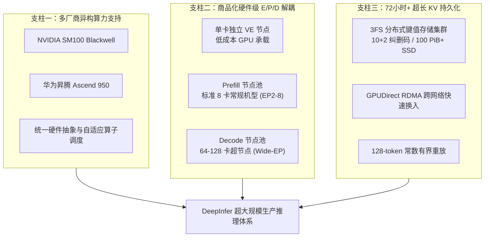
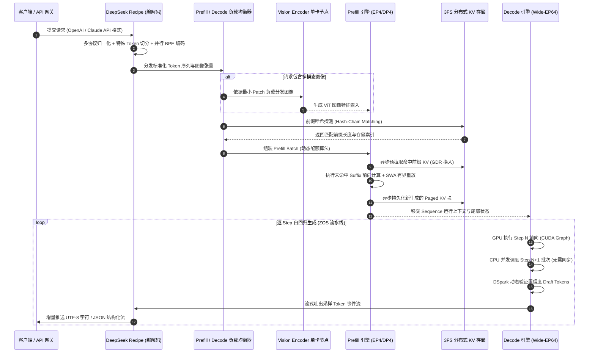
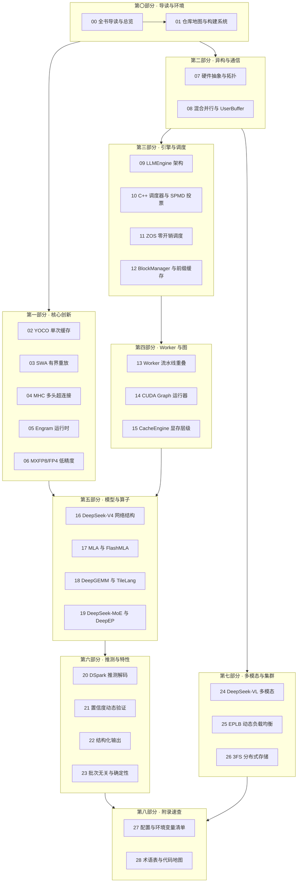

# 00 · 全书导读与 DeepInfer 总览

> DeepInfer 是支撑 DeepSeek 超大规模云端生产服务的高性能推理框架，单集群承载日均 155 万亿 Token 的极限吞吐。
> **前置知识**：大语言模型基础架构（Transformer、自回归解码）、GPU 体系结构与分布式通信基础。
> **源码指引**：`doc/inference_deployment_qa.md`、`deepinfer/engine/llm_engine.py`、`deepinfer/worker/worker.py`。

---

## 0. 本篇要回答的问题

- 面对千万级并发与长上下文负载，现代大模型推理系统为何不能沿用常规的单机多卡服务框架？
- 支撑 DeepSeek-V4.1-Flash 单集群日吞吐 155 万亿 Token、并在低谷电价下实现每卡时 38 美元净收益的底层工程闭环是什么？
- 一个在线请求进入 DeepInfer 集群后，如何经历 Vision Encoder、Prefill、Decode 与分布式 3FS 存储节点的端到端流转？
- 读者应如何结合自身技术栈与工程目标，高效阅读本技术手册？

---

## 1. 大规模云端推理的现实困境与经济账本

在人工智能进入工业化落地的时代，模型的数学表达能力定义了智能的上限，而将这种能力以尽可能低的成本与时延触达亿级用户，则是推理系统工程的根本矛盾。

大语言模型（LLM）的自回归生成特性天然将计算划分为两个特征迥异的阶段：
1. **预填充阶段（Prefill / Prompt）**：计算密集型（Compute-Bound）。模型并行处理用户输入的全部上下文，算力利用率（MFU）高，核心关注指标是首字延迟（TTFT, Time to First Token）；
2. **解码阶段（Decode / Completion）**：访存密集型（Memory-Bound）。模型自回归逐词生成，每生成一个 Token 都需要加载全量模型权重与历史 Key-Value 缓存，算力受限于 GPU 显存带宽，核心关注指标是词元生成间隔（TBT, Time Between Tokens）与每秒单卡吞吐（TPS）。

```text
+-----------------------------------------------------------------------------------+
|                            大模型云端推理的「不可能三角」                           |
|                                                                                   |
|                           超低首字延迟 (TTFT)                                      |
|                                  /\                                               |
|                                 /  \                                              |
|                                /    \                                             |
|                               /  ★   \                                            |
|                              / DeepInfer\                                         |
|                             /            \                                        |
|                            /              \                                       |
|  超低生成间隔 (TBT) <------------------------> 极低服务成本 ($/Million Tokens)     |
+-----------------------------------------------------------------------------------+
```

常规的开源推理框架（如原生 vLLM、SGLang、TensorRT-LLM）在单节点或中小规模集群上表现优异，但在超大规模生产环境中面临严重挑战：
- **算力与访存特性的物理错配**：将 Prefill 与 Decode 混合混跑于相同节点，会导致长文本 Prefill 的高算力突发严重阻塞 Decode 任务的时延 SLA，引发严重的调度抖动；
- **KV 缓存复用与重复计算浪费**：智能体（Agent）多轮对话与超长文档检索产生海量重复前缀。传统内存级 Prefix Caching 受限于单机显存，节点故障或扩缩容会导致缓存瞬间失效；
- **MoE 专家热点与木桶短板**：超大 MoE 架构（如数百个路由专家）在分布式专家并行（EP）下，某些热门专家极易引发显存访问与通信倾斜，慢节点拉低整组性能；
- **Host-Device 交互的发射气泡**：每一解码步 CPU 调度、内存分配、输入张量打包与 GPU 前向计算串行交替，CPU 开销侵蚀 GPU 高价值算力。

DeepSeek 团队开源的 **DeepInfer** 正是在这种严酷的工业化约束下淬炼而成的生产级推理底座。它不仅是单机代码库，更是深度契合现代 AI 数据中心互联（NVLink、400G RoCE/VLAN）与异构算力（NVIDIA SM100、华为昇腾 Ascend 950）的超大规模推理解决方案。

---

## 2. DeepInfer 核心架构与三大设计支柱

根据 DeepInfer 官方生产架构白皮书（`doc/inference_deployment_qa.md`），DeepInfer 的全栈优化紧密围绕三大战略目标展开：



### 支柱一：深度解耦与对齐的 E/P/D 拓扑
- **视觉编码器解耦（VE Disaggregation）**：多模态图像/视频特征抽取交由低成本单卡 GPU 独立承载，按图像 Patch 规模进行动态轮询调度，避免占用高昂的 LLM 主算力矩阵。
- **预填充资源池（Prefill Nodes, PE）**：基于普通 8 卡机型构建，配置较小的专家并行度（EP2~EP8），以尽可能小的并行通信开销换取最高的矩阵乘算力密度。
- **解码超节点资源池（Decode Nodes, CE）**：构建 64~128 卡的大规模 Scale-Up 超节点，采用 **Wide-EP**（EP64~EP128）架构。Wide-EP 将每个专家的数据量显著压缩，在超大 Batch 场景下将访存带宽压力摊薄至极致。

### 支柱二：独立于算力的分布式 3FS KV 存储体系
DeepInfer 彻底摒弃了「计算节点本地大内存分层缓存」的传统思路，将 Block KV Cache（主 KV 与 Indexer KV）下沉到独立的 **3FS 分布式文件存储集群**：
- **存算完全分离**：任何 Prefill 机器均可命中任意历史请求的前缀，彻底打破了「前缀亲和性路由」对全局负载均衡策略的束缚；
- **极高容错性**：GPU 计算节点由于显存超频与通信抖动，故障率比纯存储服务器高出一个数量级以上。计算节点崩溃不影响历史 KV 缓存资产；
- **10+2 纠删码（Erasure Coding）并发读**：读取数据时同时向 EC 组内 11 个存储节点广播请求，任意 10 个节点先返回即成功解码，彻底消除分布式存储的长尾延迟。

### 支柱三：跨软硬件层级的协同算法创新
- **YOCO（You Only Cache Once）单次缓存架构**：模型前向分为编码层与解码层，仅编码层维护完整全量注意力，解码层直接复用编码层跨层隐状态，使 KV 缓存理论体积与访存开销近乎腰斩；
- **SWA 有界重放（Bounded Replay）**：滑动窗口注意力丢弃历史注意力，在发生缓存缺失时仅需回放最后 128 个 Token 即可重建局部状态，将重放开销锚定为常量 $O(1)$；
- **ZOS（Zero-Overhead Scheduler）**：CPU 调度器与 GPU 计算流水线完全异步解耦，以 GPU 侧就地索引重映射替代一切同步屏障。

---

## 3. 端到端推理流水线：一个请求在 DeepInfer 的一生

为了理解 DeepInfer 内部各模块如何协同工作，我们跟踪一个携带长上下文与高分辨率图像的在线请求，观察其在系统中的完整流转生命周期：



### 阶段一：前置协议解析与安全编码（DeepSeek Recipe）
- 请求到达网关后，由纯 Rust 编写的高性能组件 `deepseek-recipe` 处理；
- 多协议统一：兼容 OpenAI Chat Completions、Anthropic Messages 等协议，解析为统一内部对话表示；
- **防注入与分段加速**：显式定位 `<｜User｜>`、`<｜image｜>` 等控制标号，普通文本区间采用多核并行 BPE 分段编码，消除特殊 Token 注入攻击风险并大幅缩短 Tokenization 时延。

### 阶段二：前缀匹配与动态配额 Prefill 调度
- 调度器探测 3FS 存储集群，进行元数据哈希链探测；
- 若检测到前缀命中，通过异步后台线程将 Paged KV 块从 3FS 读入 Host 共享内存，并在 GPU 前向计算开始前通过 GPUDirect RDMA（GDR）直通 HBM；
- Prefill 负载均衡器采用**分桶机制（Context Tiers）**与**二次多项式算力预测模型**，求解在显存与时间预算下的最大安全分块尺寸（Chunked Prefill）。

### 阶段三：有界重放与 P-to-D 上下文移交
- 执行 Prefill 前向计算时，模型运行 YOCO 截断与 SWA 128-token 重放；
- 计算完成后，新产生的 Paged KV 写入持久化存储队列，Sequence 状态无缝迁移至 Decode 引擎池（`prompted` 队列）。

### 阶段四：Wide-EP 自回归解码与 ZOS 零开销推进
- Decode 实例在 Wide-EP64 或 EP128 域内并行执行；
- **ZOS 异步推进**：当 GPU 执行第 $N$ 步的 CUDA Graph 与融合采样算子时，CPU 在没有任何 Device 同步等待的情况下，并发完成第 $N+1$ 步的请求挑选与内存映射；
- **DSpark 推测验证**：辅助预测头输出 5 个 Draft Token，经置信度模型动态筛选，自适应决定验证长度；
- 采样结果流式进入增量状态机解析器，遇断字或 DSML 工具调用边界就地解构，零阻塞推送给终端用户。

---

## 4. 全书知识图谱与技术脉络

为了帮助读者全面、立体地理解 DeepInfer 的设计精髓，本手册按照系统分层结构进行编排：



---

## 5. 小结

- DeepInfer 是专为大模型生产环境设计的高性能推理框架，以商品化硬件实现 155 万亿 Token/天的超大规模稳定服务；
- 框架的核心突破在于**全链路软硬件协同设计**：算法层采用 YOCO、SWA、MHC 与 Engram 缩减理论冗余；系统层采用 ZOS 异步流水线、Wide-EP 混合并行与 EPLB 动态热重排；存储层采用存算分离的 3FS 10+2 EC 集群；
- 本手册坚持**每个论断可追溯、先讲问题再讲方案、代价收益成对分析**的高标准学术工程体例，逐行揭开 DeepInfer 的技术内核。

---

## 延伸阅读 / 下一篇

- 下一篇：[`01-repo-map-and-build.md`](01-repo-map-and-build.md) · 仓库地图、构建系统与环境准备，深入剖析 DeepInfer 的源码组成结构与双平台编译流水线。
- 官方生产问答白皮书：`doc/inference_deployment_qa.md`。
