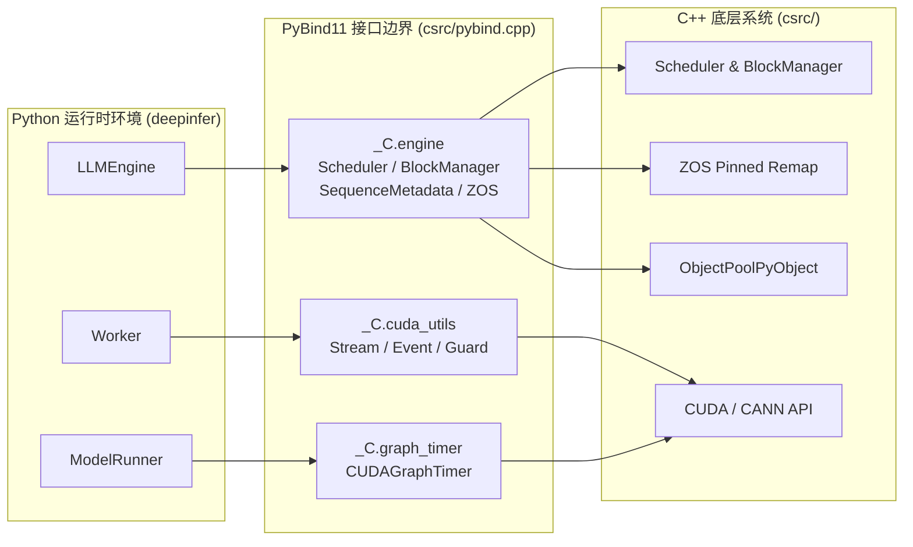

# 01 · 仓库地图、构建系统与环境准备

> 本篇梳理 DeepInfer 仓库的代码组织全景、模块依赖关系、底层 C++ / Python 混合构建流水线，以及面向 NVIDIA SM100 与华为昇腾 Ascend 950 双硬件平台的编译部署流程。
> **前置知识**：C++20 标准、PyBind11 扩展机制、Linux 动态链接与 CMake/Setuptools 基础。
> **源码指引**：`setup.py`、`build.sh`、`pyproject.toml`、`csrc/pybind.cpp`、`csrc/engine/pybind.cpp`。

---

## 0. 本篇要回答的问题

- DeepInfer 的源码树是如何在 Python 编排层、C++ 性能内核与第三方 Vendor 算子库之间划分边界的？
- 一个由 Python 发起的调用是如何穿透 PyBind11，落到底层 C++ 调度器与 CUDA/TileLang 算子上的？
- 针对 NVIDIA SM100（CUDA 13）与华为昇腾 Ascend 950（CANN 9.2）两大异构硬件平台，构建系统如何做到零冲突的多目标特化编译？
- 开发者如何在本地搭建开发环境并成功运行离线端到端验证程序？

---

## 1. 仓库目录全景与模块职责划分

DeepInfer 的代码架构体现了典型的高性能推理引擎设计范式：控制流与模型高级拓扑定义使用 Python（便于快速试验与对接生态），而对延迟极度敏感的调度循环、内存块池化管理、元数据打包与低级通信原语则下沉至 C++ 及专用底层硬件库。

```text
DeepInfer/
├── csrc/                           # C++ 性能关键路径与系统扩展
│   ├── engine/                     # 核心调度器、序列状态、块管理与 ZOS 实现
│   ├── graph_timer/                # CUDA / Ascend 图执行计时探针
│   ├── utils/                      # 无锁对象池、自旋锁与日志工具
│   ├── cuda_utils.cpp              # CUDA 流、事件与显存拷贝守护
│   └── pybind.cpp                  # Python 扩展入口与模块暴露
├── deepinfer/                      # Python 主业务逻辑包
│   ├── engine/                     # LLMEngine 运行时引擎与配置解析
│   ├── worker/                     # Worker 执行体、CUDA Graph 运行器与 CacheEngine
│   ├── model_executor/             # 模型定义、并行切分、EPLB 与算子层
│   │   ├── models/                 # DeepSeek-V4 与 DeepSeek-VL 模型实现
│   │   ├── layers/                 # 核心层实现与 TileLang 算子集 (tilelang_ops)
│   │   ├── eplb/                   # 专家并行动态负载均衡策略与权重搬运
│   │   └── parallel_utils/         # ProcessGroup、UserBuffer 与通信抽象
│   ├── structure_output/           # 结构化输出 (JSON/Regex) 匹配自动机
│   ├── ve/                         # Vision Encoder 多模态切分与处理管道
│   ├── distributed/                # 跨进程共享内存广播通信
│   └── hugging_face/               # HF 模型权重转换与分词适配
├── deep_cluster/                   # 硬件拓扑感知与底层设备抽象层
│   ├── hardware/                   # NVIDIA / Ascend / CPU 统一硬件原语
│   └── topology/                   # NUMA 拓扑感知与 CPU 核绑定
├── vendor/                         # 深度耦合的第三方/外部高性能算子库
│   ├── DeepEP / DeepEP-Ascend      # 专家并行跨卡 All-to-All 通信库
│   ├── DeepGEMM / DeepGEMM-Ascend  # FP8/FP4 高性能稠密 GEMM 库
│   ├── FlashMLA                    # 多头潜在注意力 (MLA) 高性能算子
│   └── DeepSelect                  # 细粒度专家路由 Top-K 算子
├── doc/                            # 生产部署问答与架构文档
├── examples/                       # 离线推理、基准测试与结构化生成范例
└── tests/                          # 单元测试与端到端精度测试套件
```

各核心子目录的代码体量与技术栈分布如下表所示：

| 模块路径 | 主要语言 | 核心职责 | 性能敏感度 |
|---|---|---|---|
| `csrc/engine/` | C++20 | 批调度算法、BlockManager 块分配、ZOS 异步索引重映射 | 极高（每次调度 < 50 微秒） |
| `csrc/cuda_utils.cpp` | C++/CUDA | 同步屏障检测、流间同步事件管理 | 极高 |
| `deepinfer/worker/` | Python | GPU 模型前向执行、CUDA Graph 批次重放、采样事件级联 | 高 |
| `deepinfer/model_executor/` | Python/Torch | 网络主干、YOCO 截断、MHC 混合、FlashMLA/DeepGEMM 胶水层 | 高 |
| `deepinfer/structure_output/` | Python/C++ | 基于 xgrammar 的语法约束自动机与 Bitmask 掩码生成 | 中 |
| `deep_cluster/` | Python/C | NUMA 亲和性探测、硬件架构标志位统一封装 | 低（初始化阶段执行） |
| `vendor/` | CUDA/C++/Ascend C | 各平台硬件极限算子实现与通信内核 | 极高（执行瓶颈） |

---

## 2. 混合构建系统与底层 C++ / PyBind 扩展

DeepInfer 的构建核心位于 `setup.py` 与 `build.sh`。构建系统编译出名为 `deepinfer._C` 的 CPython C 扩展模块，为 Python 运行时暴露三大核心命名空间：



### PyBind11 模块导出机制
在 `csrc/pybind.cpp` 中，入口函数 `PYBIND11_MODULE(_C, m)` 声明了三个子模块：
```cpp
// csrc/pybind.cpp
PYBIND11_MODULE(_C, m) {
    m.doc() = "deepinfer C++ extension";
    
    // 导出 engine 核心逻辑（调度器、序列、输出池）
    auto m_engine = m.def_submodule("engine", "engine utils");
    deepinfer::engine::init_engine(m_engine);

    // 导出平台特定工具
#if defined(USE_CUDA)
    auto m_cuda = m.def_submodule("cuda_utils", "cuda utils");
    init_cuda_utils(m_cuda);
#elif defined(USE_ASCEND)
    auto m_asc = m.def_submodule("asc_utils", "ascend utils");
    init_asc_utils(m_asc);
#endif

    // 导出 CUDA Graph 计时探针
    auto m_timer = m.def_submodule("graph_timer", "graph timer");
    deepinfer::graph_timer::init_graph_timer(m_timer);
}
```

在 `csrc/engine/pybind.cpp` 中，`SequenceMetadata`、`Scheduler`、`BlockManager` 等核心结构体被映射为 Python 类型。为了避免 Python 垃圾回收（GC）在频繁调度循环中引发停顿，DeepInfer 在 C++ 内部实现了无锁对象池 `ObjectPoolPyObject`（`csrc/utils/object_pool.hpp`），复用 `SequenceMetadata` 对象，减少内存分配开销。

---

## 3. 异构双平台支持：NVIDIA SM100 与华为昇腾 950

支持多厂商硬件是 DeepInfer 的核心设计目标之一。代码库通过环境变量 `DEEPINFER_ACCELERATOR` 显式路由编译流程：

```bash
# 构建 NVIDIA 版本（目标平台：SM100 Blackwell / Hopper）
export DEEPINFER_ACCELERATOR=nvidia
./build.sh

# 构建华为昇腾版本（目标平台：Ascend 950 / CANN 9.2）
export DEEPINFER_ACCELERATOR=ascend
./build.sh
```

### 平台差异化特征对照

```text
+-------------------+-----------------------------------+-----------------------------------+
| 维度               | NVIDIA SM100 架构                  | 华为昇腾 Ascend 950 架构           |
+-------------------+-----------------------------------+-----------------------------------+
| 编译器套件         | GCC >= 13.0 + CUDA 13 (nvcc)      | GCC >= 13.0 + CANN 9.2 (biSheng)  |
| 显存抽象           | CUDA Stream / Event / Pinned Host | NPU Stream / Event / HBM          |
| 专家通信 (EP)     | vendor/DeepEP (NVLink symm_mem)   | vendor/DeepEP-Ascend (HCCS)       |
| 矩阵乘算子 (GEMM)  | vendor/DeepGEMM (Cutlass / SM100) | vendor/DeepGEMM-Ascend (Ascend C) |
| 注意力加速         | FlashMLA (SASS 特化优化)          | TileLang Ascend MLA Kernel        |
| 批次无关推理       | 支持 (DEEPINFER_BATCH_INVARIANT)  | 试验性支持                         |
+-------------------+-----------------------------------+-----------------------------------+
```

在 `setup.py` 中，构建脚本动态探测目标硬件并注入对应的编译宏定义：
```python
# setup.py 核心构建逻辑
accelerator = os.getenv("DEEPINFER_ACCELERATOR", "nvidia").lower()
extra_compile_args = {"cxx": ["-O3", "-std=c++20", "-fPIC"]}

if accelerator == "nvidia":
    extra_compile_args["cxx"].append("-DUSE_CUDA")
    extra_compile_args["nvcc"] = ["-O3", "-std=c++20", "--expt-relaxed-constexpr"]
    # 针对 SM100 架构启用特定的 PTX 生成选项
elif accelerator == "ascend":
    extra_compile_args["cxx"].append("-DUSE_ASCEND")
    # 注入 CANN SDK 包含路径与动态库依赖
```

此外，`vendor/` 目录下的子模块通过 `scripts/build_vendor.sh` 在编译主工程前先行编译并安装为 Python Wheel 包，保证编译解耦。

---

## 4. 环境准备与离线推理运行实战

### 4.1 基础环境依赖
DeepInfer 运行要求严格的基础系统环境：
- 操作系统：Linux（推荐 Ubuntu 22.04 LTS 或 openEuler 24.03）；
- 编译器：GCC >= 13.0（全面启用 C++20 概念支持与范围操作）；
- Python 环境：Python 3.12（纯净 Virtualenv 或 Conda 环境）；
- 加速器驱动：CUDA 13.0+ 或 CANN 9.2+。

### 4.2 编译与安装执行流
```bash
# 1. 克隆代码仓库并初始化子模块
git clone https://github.com/deepseek-ai/DeepInfer.git
cd DeepInfer
git submodule update --init --recursive

# 2. 安装基础 Python 依赖
pip install -r requirements.txt
pip install -r requirements-nvidia.txt  # 或 requirements-ascend.txt

# 3. 触发一键编译构建
export DEEPINFER_ACCELERATOR=nvidia
./build.sh
```

### 4.3 离线推理验证（Offline Inference）
编译完成后，可通过官方提供的离线测试脚本进行端到端全链路验证：
```bash
# 运行离线生成范例
python examples/offline_inference.py
```

该脚本的核心逻辑位于 `deepinfer/entrypoints/llm.py` 中的 `LLM` 类：
```python
# examples/offline_inference.py 极简调用示例
from deepinfer import LLM, SamplingParams

# 初始化模型实例（内部拉起 LLMEngine 与分布式 Worker）
llm = LLM(
    model="deepseek-ai/DeepSeek-V4.1-Flash-1017",
    tensor_parallel_size=1,
    pipeline_parallel_size=1,
    trust_remote_code=True,
)

# 配置采样参数
sampling_params = SamplingParams(
    temperature=0.7,
    max_tokens=128,
)

# 提交请求并同步获取生成结果
prompts = ["DeepInfer 的核心设计目标是："]
outputs = llm.generate(prompts, sampling_params)

for output in outputs:
    print(f"Prompt: {output.prompt}")
    print(f"Generated text: {output.outputs[0].text}")
```

当看到控制台打印出流畅的生成文本且无显存泄漏或崩溃日志时，即证明 DeepInfer 的 C++ 运行时扩展、CUDA Graph 运行器以及底层 Vendor 算子库均已正确就绪。

---

## 5. 小结

- DeepInfer 采用 C++20 与 Python 混合架构，核心批调度器与块管理下沉至 C++ 以规避 GIL 锁竞争与 GC 开销；
- 扩展模块通过 PyBind11 导出 `deepinfer._C`，并在 C++ 端辅以无锁对象池，保证每次调度开销压低至微秒级；
- 构建体系通过统一脚本抽象支持 NVIDIA SM100 与华为昇腾 Ascend 950，底层通过 Vendor 算子库特化保证硬件极致性能。

---

## 延伸阅读 / 下一篇

- 下一篇：[`02-yoco-architecture-and-compaction.md`](02-yoco-architecture-and-compaction.md) · YOCO 架构与前缀截断机制，深入探究 DeepSeek-V4 模型前向中颠覆性的单次缓存与紧凑内存视图重排。
- 官方构建脚本：`build.sh`、`scripts/build_vendor.sh`。
