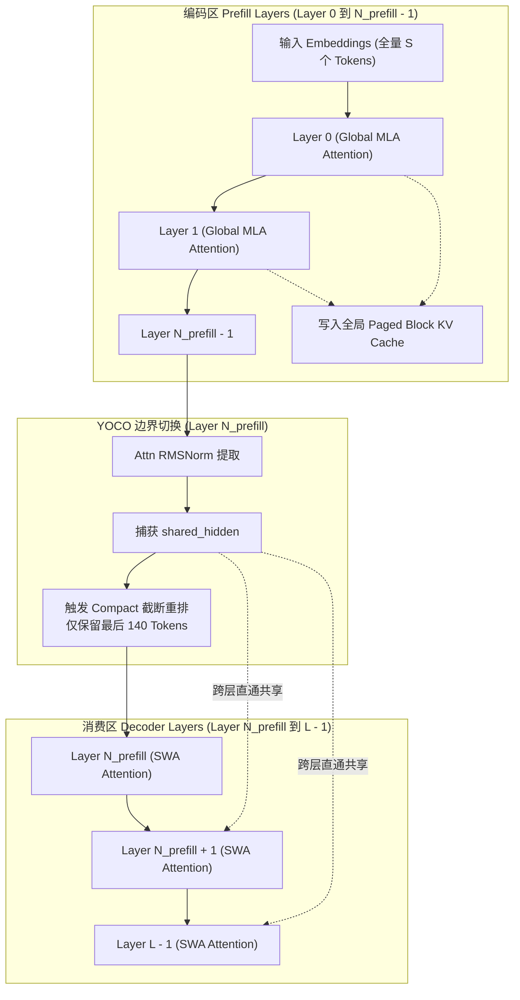

# 02 · YOCO 架构与前缀截断机制

> You Only Cache Once（YOCO）架构颠覆了传统 Transformer 逐层生成并维护全局全量 KV 缓存的范式，通过编码器-解码器跨层共享隐状态，将大模型前向推理的 KV 显存与访存压力降低近半。
> **前置知识**：标准多头注意力（MHA）、自回归前向计算、跨层注意力机制。
> **源码指引**：`deepinfer/model_executor/models/v4_modules/yoco.py`、`deepinfer/model_executor/input_metadata/yoco.py`、`deepinfer/model_executor/models/deepseek.py`。

---

## 0. 本篇要回答的问题

- 为什么在长上下文推理场景中，传统 Transformer 架构在每一层都保存全量 KV Cache 会成为吞吐与显存扩展的根本瓶颈？
- YOCO（You Only Cache Once / CED 架构）的理论数学基础是什么，编码层（Prefill Layers）与消费层（Consumer Layers）是如何分工的？
- 在 Prefill 阶段，DeepInfer 的 `compact` 紧凑截断模式是如何将千上万 Token 的中间隐状态压缩为仅保留最后 140 个 Token 的？
- 当上下文并行（Context Parallelism, CP）介入时，切分在不同 GPU 上的 Token 序列如何在紧凑视图下正确对齐？

---

## 1. 传统 Transformer 的全层 KV 缓存困境

在传统的自回归大模型（如标准 LLaMA、GPT 系列）中，假设模型深度为 $L$ 层，隐层维度为 $H$，序列长度为 $S$。当请求在自回归解码时，每一层都需要读取并追加自身专属的 Key 与 Value 张量：

$$\text{KV Cache Volume} \propto 2 \times L \times S \times H_{\text{kv}}$$

这意味着：
1. **显存膨胀线性加速**：随着模型层数 $L$ 与上下文长度 $S$ 的增加，KV Cache 迅速吞噬整个 GPU 显存，迫使系统大幅降低并发 Batch Size；
2. **算力受困于显存带宽（Memory-Bound）**：在 Decode 阶段，每个 Token 的生成都需要在每个 Layer 将所有历史 Token 的 KV 数据从 HBM 搬运至 SRAM。即使矩阵乘计算量极小，显存总线也早已满载，算力利用率（MFU）极低。

```text
+-----------------------------------------------------------------------------+
| 传统 Transformer: 每一层独立分配并读写全量历史 KV 缓存                         |
| Layer 0:   [Token 0 ... Token S] ---> 保存 Layer 0 专属 KV Cache             |
| Layer 1:   [Token 0 ... Token S] ---> 保存 Layer 1 专属 KV Cache             |
| ...                                                                         |
| Layer L-1: [Token 0 ... Token S] ---> 保存 Layer L-1 专属 KV Cache           |
+-----------------------------------------------------------------------------+
| YOCO 架构: 仅前半区编码层维护全局 KV，后半区消费层共享隐状态与局部 SWA        |
| Encoder (Layer 0 ~ N_prefill-1): 计算并沉淀全局 KV Cache (Global KV)         |
|                                       |                                     |
|                                       v 跨层共享隐状态 (Shared Hidden)      |
| Decoder (Layer N_prefill ~ L-1): 仅维护局部 SWA 窗口，免除全局 KV 读写        |
+-----------------------------------------------------------------------------+
```

---

## 2. YOCO 架构原理与跨层隐状态共享

DeepSeek-V4 采用的 YOCO 架构将模型 $L$ 个隐藏层严格划分为两阶段：
- **编码层（Prefill / Encoder Layers）**：前 $N_{\text{prefill}}$ 层（$0 \le l < N_{\text{prefill}}$）。该阶段负责对全部上下文进行全局自注意力建模，并生成全局紧凑 KV 缓存（结合 MLA 压缩）；
- **消费层（Consumer / Decoder Layers）**：后半区层（$N_{\text{prefill}} \le l < L$）。这一阶段的模型不再针对每个历史 Token 维护全局 KV，而是直接依赖第一层消费层的注意力归一化输出（`shared_hidden`）作为全局表征，本层自身仅计算极小滑动窗口（SWA, Sliding Window Attention）。



在 `deepinfer/model_executor/models/v4_modules/yoco.py` 中，框架通过严格的谓词判定模块行为：
```python
def yoco_enabled(cfg: AttrDict) -> bool:
    """判定是否启用 YOCO（n_prefill_layer 小于模型总层数即为启用）"""
    return cfg.get("n_prefill_layer", cfg.num_hidden_layers) < cfg.num_hidden_layers

def is_yoco_consumer_layer(cfg: AttrDict, layer_idx: int) -> bool:
    """判定当前层是否属于消费层区间 [n_prefill_layer, num_hidden_layers)"""
    return yoco_enabled(cfg) and cfg.n_prefill_layer <= layer_idx < cfg.num_hidden_layers
```

在消费层中，只要后续存在需要消费全局特征的模块（例如配置了 `yoco_swa_share_hidden` 的 SWA 层或打包 KV 源层），第一消费层生成的 `shared_hidden` 便通过轻量级的 `CrossLayerRuntime` 上下文载体在各层间原地传递，无需逐层反复通过 GEMM 投影生成全量 KV。

---

## 3. Compact 紧凑截断：将 Prefill 计算量减半

在 Prefill 阶段，如果一个长文本 prompt 包含 32,768 个 Token，按照传统逻辑，后半区的解码层也必须执行完整 32,768 个 Token 的前向计算。

然而，在 YOCO 架构下：**消费层只需维持一个局部的 SWA 窗口（例如 128 个 Token），它根本不需要感知 128 个 Token 之前的消费层隐状态！**

因此，DeepInfer 提出了 **YOCO Prefill 截断机制**（环境变量 `DEEPINFER_YOCO_PREFILL_TRUNCATION_MODE` 控制）。截断包含两种模式：
1. **`mask` 模式**：通过注意力掩码屏蔽历史 Token，但张量形状保持不变；
2. **`compact` 模式**：物理重排张量内存，将张量物理行数直接裁切为 `DEEPINFER_YOCO_PREFILL_KEEP_TOKENS`（默认 140 = 128 SWA 窗口 + 6 到 12 个推测回滚/向前看 Token）。

### Compact 内存视图重排逻辑
在 `deepinfer/model_executor/models/deepseek.py` 的模型主干前向中，执行到 `yoco_boundary_layer_idx` 时触发视图切换：
```python
if input_metadata.is_prompt and i == self.yoco_boundary_layer_idx:
    if envs.DEEPINFER_YOCO_PREFILL_TRUNCATION_MODE == "compact":
        # 切换 metadata 视图为 compact 紧凑视图
        consumer_metadata = input_metadata.get_consumer_view()
        cross_layer_runtime.consumer_full_metadata = input_metadata
        input_metadata = consumer_metadata
```

在底层张量层面，`yoco_boundary_compact` 算子利用 Gather 操作就地抽取保留窗口：
```text
全量 Prompt 张量 (S = 32768 行):
[Token 0, Token 1, ... Token 32627, | Token 32628 ... Token 32767]
                                     \___________________________/
                                         保留最后 140 Tokens
                                                  |
                                                  v  yoco_boundary_compact()
紧凑张量 (Compact View, 仅 140 行):
[Token 32628, Token 32629, ... Token 32767]
```

后续所有的消费层解码层（包括 FFN / MoE、Norm、SWA）的矩阵乘算力直接由 $32768 \times H$ 骤降至 $140 \times H$。对于深达数十层的消费层而言，**整个 Prefill 阶段的总浮点计算量几乎减少了近 50%**。

---

## 4. 上下文并行（CP）下的边界重排对齐

当序列极其冗长触发上下文并行（Context Parallelism, CP > 1）时，32,768 个 Token 被均分到多个 GPU 上（例如 CP=4 时，每卡持有 8,192 个 Token）。

此时，如果简单在每卡本地截断，那么前 3 张卡持有的 Token 均属于历史序列，其保留窗口将为空，而最后一张卡独占 140 个 Token。这将导致严重的卡间算力不均衡（Load Imbalance）。

DeepInfer 在 `yoco_boundary_compact` 中设计了 `yoco_cp_contrib_index` 映射机制：
```python
# yoco.py 中的 CP 贡献重排
def yoco_boundary_compact(input_metadata: YocoMetadataMixin, x: torch.Tensor) -> torch.Tensor:
    if not hasattr(input_metadata, "yoco_cp_contrib_index") or input_metadata.yoco_cp_contrib_index is None:
        return gather(x, input_metadata.yoco_compact_query_indices)
    
    # 存在上下文并行: 当前 x 仅持有本 rank 的 token
    contrib = input_metadata.yoco_cp_contrib_index
    # 过滤截断后本卡仍需保留的有效 token 槽位 (-1 表示填充 pad)
    valid_mask = contrib >= 0
    return gather(x, contrib[valid_mask])
```
通过预先计算的 CP 贡献索引表，只有持有序列全局尾部区间的 Rank 会保留有效参与计算的 Token，同时在跨层通信时通过 `mirror_cp` 机制协调多卡间梯度与隐状态归约，确保在并行切分下数学等价性完全成立。

---

## 5. 关键设计取舍与代价

| 维度 | 朴素全层 Transformer | DeepInfer YOCO Compact 架构 | 成本与代价说明 |
|---|---|---|---|
| **全量 KV 显存开销** | $O(L \cdot S)$ 随全层线性扩展 | $O(N_{\text{prefill}} \cdot S)$ 缩减至前编码层 | 消费层放弃全局注意力能力，需依赖 SWA 补充局部细节 |
| **Prefill 阶段总算力** | $2 \cdot L \cdot S \cdot H + \dots$ | 前半区全量计算，后半区仅算 140 tokens | 极大地缩短长文本 Prefill 时间，提升 TTFT |
| **Decode 阶段访存带宽** | 每 Step 搬运 $L$ 层历史 KV | 仅需读取 $N_{\text{prefill}}$ 层 KV + 局部 SWA | 极大地降低访存总线压力，显著提升 Decode TPS |
| **系统与算子复杂度** | 统一简单，张量尺寸全程不变 | 需在第 $N_{\text{prefill}}$ 层就地切断张量与重排索引 | 增加了元数据维护复杂度，对 CUDA Graph 捕获提出特殊要求 |

---

## 6. 小结

- YOCO 架构通过区分编码层与消费层，实现了全局 KV 缓存单次沉淀与后续跨层隐状态直通复用；
- DeepInfer 独创的 `compact` 预填充截断技术，将长文本在消费层的矩阵计算规模压低至常数级（最后 140 Tokens），节约了近半的 Prefill 算力；
- 在上下文并行（CP）环境下，框架通过 `yoco_cp_contrib_index` 精确管理多卡切片上的尾部 Token 分布，实现了分布式环境下的精度保真。

---

## 延伸阅读 / 下一篇

- 下一篇：[`03-swa-and-bounded-replay.md`](03-swa-and-bounded-replay.md) · SWA 滑动窗口与有界重放，探究消费层在舍弃全局 KV 后，如何凭借 128-token 常数重放恢复全部生成质量。
- 相关实现：`deepinfer/model_executor/models/v4_modules/yoco.py`。
