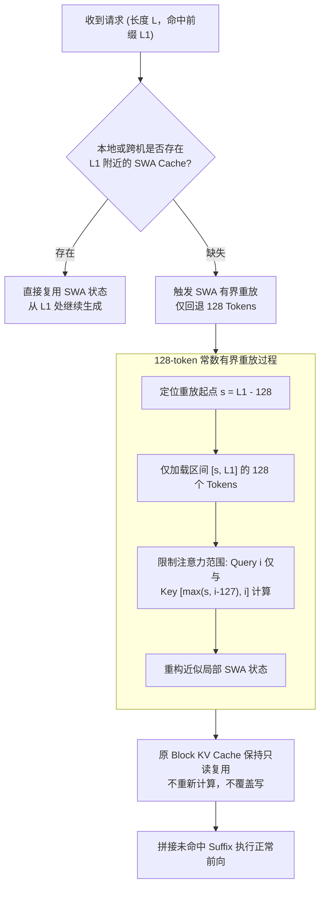

# 03 · SWA 滑动窗口与有界重放

> 滑动窗口注意力（SWA）以固定局部窗口斩断长文本历史注意力，结合 128-token 常数有界重放（Bounded Replay），实现了近似零代价的缓存缺失恢复与 Prefill 计算减半。
> **前置知识**：局部注意力机制（Local / Sliding Window Attention）、KV Cache 命中判定与状态机。
> **源码指引**：`deepinfer/model_executor/layers/tilelang_ops/state_cache.py`、`deepinfer/model_executor/layers/tilelang_ops/swa_index.py`、`doc/inference_deployment_qa.md`。

---

## 0. 本篇要回答的问题

- 既然 YOCO 架构在消费层丢弃了全局 KV Cache，系统如何保障注意力上下文的局部连贯性？
- SWA 的状态缓存（`StateBlock`）与常规分页物理块（Block KV Cache）在物理存储与生命周期上有何本质区别？
- 为什么 SWA 仅在 128 Token 整数倍边界处持久化，多出的 6 个 Token 环形缓冲区起到了什么作用？
- 所谓的「有界重放（Bounded Replay）」是如何在 $O(1)$ 常数时间内修补丢失的局部注意力状态的？

---

## 1. 局部注意力（SWA）与持久化困境

在长文本问答与 Agent 对话中，模型在自回归生成时具有极强的局部上下文依赖（如标点匹配、语法结构、最近指代）。完全依靠单次跨层全局特征（`shared_hidden`）会损失局部细节精度，因此消费层每一层都引入了**滑动窗口注意力（Sliding Window Attention, SWA）**。

在 DeepSeek-V4.1-Flash 中，SWA 的有效窗口大小被固定为 **$W = 128$ 个 Token**。这意味着：
对于任意位置 $i$，其查询向量 $Q_i$ 仅与键值区间 $[\max(0, i - 127), i]$ 进行注意力交互：

$$\text{Attention}(Q_i, K, V) = \text{Softmax}\left(\frac{Q_i K_{i-127:i}^T}{\sqrt{d_k}}\right) V_{i-127:i}$$

### 生产环境下的持久化难题
虽然 SWA 显存体积极小（每个序列每层仅维护 128 个历史 Token 的 KV），但在分布式弹性集群中面临严重挑战：
1. **网络写放大与小 I/O 惩罚**：若将每个请求每层的 128-token SWA 也写入远程 3FS 存储集群，极小尺寸的高频写操作将打爆存储元数据；
2. **跨请求缓存命中判定复杂化**：前缀缓存命中判定通常是粗粒度的（如 128 或 256 Token 块对齐），若 SWA 状态与块边界不对齐，微小的状态差异将迫使整条序列从头重算。

---

## 2. 状态缓存（State Cache）与环形内存布局

DeepInfer 对此给出的架构解法是：**分级存储与专用状态槽位（State Slot）**。

```text
+---------------------------------------------------------------------------------------+
|                               DeepInfer 分级 KV 缓存体系                                |
|                                                                                       |
| [Block KV Cache (全局)]  -----> 存储介质: 专用 3FS 分布式集群 (10+2 EC)                 |
|                                存储粒度: 128-token Paged Block                        |
|                                访问特征: 跨机器共享、长达 72 小时持久化                |
|                                                                                       |
| [SWA KV Cache (局部)]    -----> 存储介质: 计算节点本地 Host 共享内存 (不入 3FS)          |
|                                存储粒度: 固定槽位 StateBlock (20 层 x 134 tokens)     |
|                                访问特征: 本机瞬时复用、跨机靠 400G VLAN 拉取          |
+---------------------------------------------------------------------------------------+
```

### StateBlock 的数据结构排布
在 GPU 显存与宿主内存中，SWA 数据不进入通用的 `BlockManager` 链表，而是分配给专门的 `StateBlock`。每个并发序列独占一个固定尺寸的槽位：

```text
单个 Sequence 的 StateBlock (共 20 层 x 134 tokens x 528 字节 = 1,415,040 字节):
+-------------------------------------------------------------------+
| 存储保留区 (Stored Region): SWA 窗口 (128 Tokens) + 冗余 (6 Tokens)|
| ---> 针对 MXFP8 格式，每 Token 占 528 字节                          |
+-------------------------------------------------------------------+
| 丢弃区 (Dropped Region): YOCO 消费层重计算态与 C2 压缩边界状态     |
| ---> 随 Prefill 重放恢复，无需落盘与跨请求暂存                     |
+-------------------------------------------------------------------+
```

### 128 边界写入与 6 Token 环形缓冲区
SWA 状态**仅在序列长度达到 128 整数倍的位置执行保存**：
- **Prefill 阶段**：仅在序列最后一个完整分块处保存（末尾保留 1 个 Token 后向下按 128 对齐）；未满 128 Token 的尾部直接丢弃；
- **Decode 阶段**：GPU 显存内分配独立副本缓冲区，当序列生成跨越 128 边界时就地拷贝；
- **为何设置 134 个槽位？** 在推测解码（Speculative Decoding）中，模型单步可能输出多达 5 个 Draft Token。当推测失败发生回滚时，当前指针可能超出 128 边界最多 5 个 Token。为此，DeepInfer 将环形缓冲区扩容为 $128 + 6 = 134$ 个槽位，完全吸收推测回滚产生的边界抖动。

---

## 3. 有界重放（Bounded Replay）算法实现

当一个请求再次进入集群且命中了前缀缓存时，如果分布式节点上存在 Block KV Cache，但本地机器缺失了对应的 SWA 状态（例如请求被分发到了另一台未持有本地 SWA 的 Prefill 机器上），系统该如何恢复？

传统做法必须对整个命中前缀（可能长达数万 Token）重新跑一遍前向前缀计算，这使得前缀缓存完全失去意义。

DeepInfer 提出了**常数代价的有界重放（Bounded Replay）**机制：



### 算法数学推导与保真度
在有界重放中，对于重放区间内任意位置 $i$（$s \le i < L_1$）：
其局部注意力仅需覆盖 $\max(s, i - 127)$ 到 $i$。由于 $L_1 - s = 128$，对于重放末尾位置 $i = L_1 - 1$，其注意力跨度精确覆盖全部 128 个局部 Token，重构出的 SWA KV Cache 与从头全量计算的状态高度一致！

这意味着：
- **重放算力开销恒定为 $O(1)$**：无论上下文是 8K、32K 还是 1M Token，重放计算量严格固定为 128 个 Token 的局部前向；
- **Block KV Cache 零污染**：全局存储中的 Paged KV Cache 原样复用，既不重算也不覆写。

---

## 4. 双重放路径：Encoder 与 Decoder 的精细协同

根据白皮书披露，有界重放机制在 DeepInfer 中被深度复用于两大路径：

### 4.1 编码层 SWA 有界重放（Encoder Bounded Replay）
当用户请求的前缀只在 3FS 命中全局 Block KV，而本地 Host Memory 缺失 SWA Cache 时，Prefill 引擎将命中前缀的最后 128 个 Token 连同全新的用户输入（Non-cached Suffix）一同打包，执行局部重放，快速补齐编码层局部注意力。

### 4.2 解码层 SWA 有界重放（Decoder Bounded Replay）
在 YOCO 架构下，消费层解码层（Decoder Layers）的 Block KV Cache 是由最后一个编码层的隐状态一次性投影得到的，各解码层无需保存历史全局 KV，但每个解码层自身需要维护 SWA 状态。

如果要在 Prefill 阶段精确构建解码层的完整状态，需要让长文本的最后 2,560 个 Token 穿透全部 20 个解码层。
DeepInfer 采用了解码层有界重放：**在每个 Prefill 结束时，仅让 Prompt 的最后 128 个 Token 穿透解码层计算 SWA 状态，所得结果专供 Decode 第一步使用，且绝不写入前缀缓存库**。

这使得每个解码层在 Prefill 阶段的计算量被压缩到了绝对极限，将 Prefill 阶段解码部分的耗时削减了近 90%。

---

## 5. 关键设计取舍与代价

| 特性 | 朴素全量持久化方案 | DeepInfer SWA 有界重放体系 |
|---|---|---|
| **持久化写入带宽** | 每次生成均需落盘局部状态 | 严格按 128 整数倍对齐落盘，丢弃微小尾巴 |
| **缺失恢复成本** | $O(S)$，必须从 Token 0 全程重算 | $O(1)$，固定仅重算 128 个 Tokens |
| **存储介质开销** | 需昂贵的分布式存储持续支撑 | 沉淀于本地共享内存，72 小时后由本地 LRU 自动回收 |
| **数值精确度** | 100% 绝对精确 | 局部窗口边界存在极微小的近似截断（实测精度无损） |

---

## 6. 小结

- SWA 将消费层各层的注意力跨度约束在 128 个 Token，从数学上杜绝了长文本二次方增长的显存开销；
- `StateBlock` 将局部状态隔绝在计算节点本地宿主内存中，避免高频小数据包对分布式存储系统的冲击；
- 128-token 常数有界重放机制将缓存状态缺失的修补成本牢牢锁定在常数阶，并在 Prefill 解码层前向中斩获巨大算力节约。

---

## 延伸阅读 / 下一篇

- 下一篇：[`04-mhc-multi-head-hyper-connections.md`](04-mhc-multi-head-hyper-connections.md) · Multi-Head Hyper-Connections (MHC)，剖析 DeepSeek-V4 如何通过拓宽残差流维度突破深层网络的表达瓶颈。
- 状态算子源码：`deepinfer/model_executor/layers/tilelang_ops/state_cache.py`。
