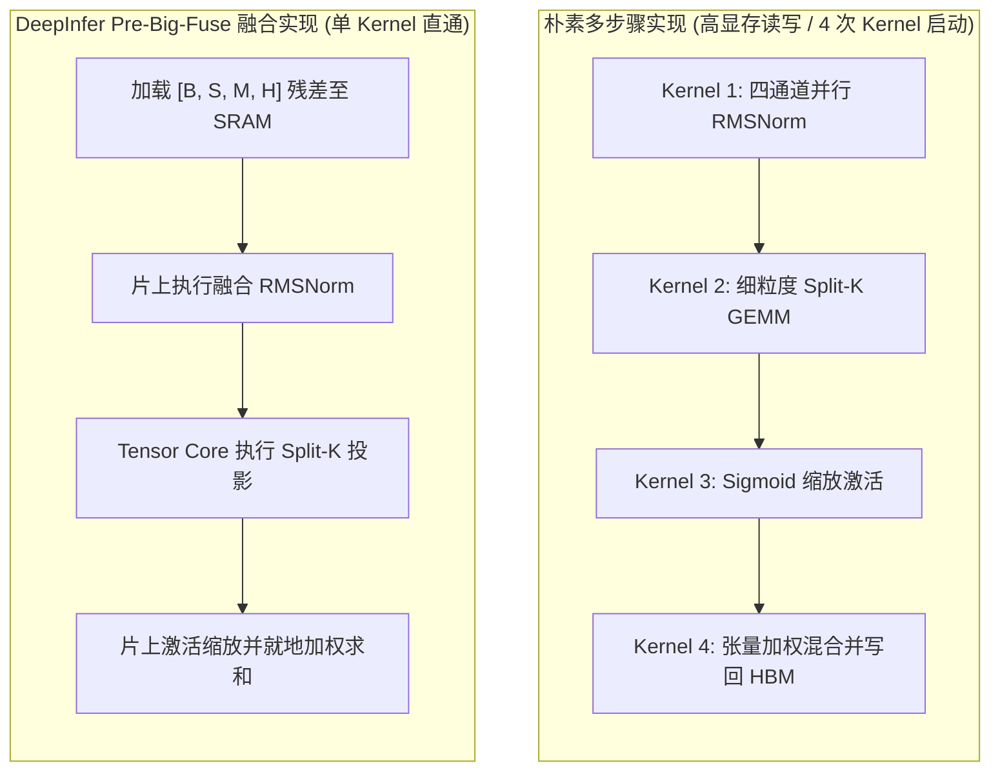

# 04 · Multi-Head Hyper-Connections (MHC)

> 多头超连接（MHC）将传统 Transformer 狭窄的单一残差流拓宽为多通道超连接流，并在 DeepInfer 中通过高度定制的预归一化大融合算子（Pre-Big-Fuse）实现极致吞吐。
> **前置知识**：ResNet 残差连接、层归一化（RMSNorm）、Split-K 矩阵乘法。
> **源码指引**：`deepinfer/model_executor/models/v4_modules/mhc_modeling.py`、`deepinfer/model_executor/models/v4_modules/mhc_ops.py`、`deepinfer/model_executor/models/v4_modules/hc.py`。

---

## 0. 本篇要回答的问题

- 传统 Transformer 的单通道残差流（Residual Stream）为何会随着网络加深出现「信息瓶颈」与梯度弥散？
- MHC（Multi-Head Hyper-Connections）是如何在张量维度上将单一残差流扩张为 $M$ 个并行流的？
- 引入多流混合后，若按照朴素方式依次调用多个 GEMM、Norm 与 Softmax 算子，为什么会导致推理时延大幅倒退？
- DeepInfer 的 `mhc_pre_big_fuse_fwd` 算子是如何将预归一化、Split-K GEMM 与 Sigmoid 混合投影深度融合在单个 GPU Kernel 内的？

---

## 1. 残差流的信息带宽瓶颈与 MHC 概念

自 Transformer 诞生以来，残差连接（Residual Connection）一直是深层神经网络可训练性的基石。其标准更新公式极为简洁：

$$x_{l+1} = x_l + F_l(\text{Norm}(x_l))$$

其中 $x_l \in \mathbb{R}^{B \times S \times H}$ 为第 $l$ 层的残差流状态，$F_l$ 为注意力层或前馈网络（FFN/MoE）。

### 单通道残差流的理论缺陷
1. **有限表征带宽**：所有注意力头与 FFN 专家的更新增量均被迫相加累积在同一维度为 $H$ 的单一向量空间中，不同层级的特征容易相互覆盖干扰；
2. **长距离信息跳跃能力受限**：低层级的浅层语义（如词法特征）很难不被中间数十层深层语义剧烈扰动而完整直达输出层。

```text
传统残差流 (单一通道串行相加):
Input ---> [Layer 0] ---> [Layer 1] ---> ... ---> [Layer L-1] ---> Output
   \__________+_____________+_______________________+
   
MHC 多头超连接流 (M=4 个通道并行演化与交叉混合):
Input ---> Stream 0:  ======================================> 
      ---> Stream 1:  ======[交叉混合 GEMM / Mix]============> Output
      ---> Stream 2:  ======================================> (经过 mhc_head 聚合)
      ---> Stream 3:  ======================================>
```

为了彻底打破这一带宽限制，DeepSeek-V4 引入了 **Multi-Head Hyper-Connections (MHC)**。残差张量被扩展为多维结构：

$$\text{Shape: } [B, S, M, H], \quad \text{其中 } M = \text{mhc\_mult} = 4$$

在每一层进入注意力或 MLP 子模块前，模型不再只是简单地执行加法，而是通过一组可学习的轻量级权重矩阵（`fn`、`scale`、`base`），计算 $M$ 个通道之间的仿射加权混合，并将更新增量写回超连接流。

---

## 2. 推理系统视角的严峻工程挑战

虽然 MHC 在算法层面显著提升了模型的表征容量与训练收敛速度，但对**推理引擎工程师**而言，它却是一场严峻的性能噩梦：

在朴素的 PyTorch 实现中，执行一次 MHC 层间混合需要依次经历以下操作：
1. 对 4 通道残差张量执行多头 RMSNorm；
2. 执行通道间投影 GEMM（权重形状 $[M, M \times H]$）；
3. 执行 Sigmoid 缩放与偏置相加；
4. 执行张量沿通道维度的加权求和（Apply Mix）。

如果模型拥有 60 个层，每层包含 Attention 与 MLP 两个子层，那么单次前向将凭空多出 $60 \times 2 \times 4 = 480$ 次细粒度 GPU Kernel 发射！
在自回归解码（Decode）场景下，这种极小计算密度的算子频繁读写显存，会导致严重的高延迟与 GPU 核心闲置。

---

## 3. DeepInfer 核心突破：Pre-Big-Fuse 大融合算子

针对上述工程痛点，DeepInfer 联合自研算子库 TileKernels，打造了专为推理设计的融合算子：`mhc_pre_big_fuse_fwd`（位于 `deepinfer/model_executor/models/v4_modules/mhc_modeling.py` 与 `tile_kernels`）。



### 3.1 融合算子调用接口
在 `mhc_modeling.py` 中，融合前向执行逻辑如下：
```python
from tile_kernels.mhc.pre_big_fuse_kernel import mhc_pre_big_fuse_fwd

def mhc_pre_big_fuse(
    residual: torch.Tensor,
    norm_weight: torch.Tensor,
    fn: torch.Tensor,
    scale: torch.Tensor,
    base: torch.Tensor,
    norm_eps: float = 1e-6,
    mhc_mult: int = 4,
    pre_eps: float = 1e-6,
    n_splits: int | None = None,
) -> tuple[torch.Tensor, torch.Tensor]:
    """
    单 Kernel 完成 Pre-Norm、通道混合 GEMM、Sigmoid 缩放与加权求和。
    返回:
        layer_input: [B, S, H]，送入后续 Linear/Attention 的输入
        mixed_residual: 更新后的超连接残差张量
    """
```

### 3.2 Split-K GEMM 与并行度优化
由于在 Decode 阶段批次序列总长度较小（如 Batch Size = 32 时，总 Token 数仅为 32），标准矩阵乘法无法填满 GPU 的流式多处理器（SM）。

DeepInfer 引入了 **Split-K 切分**（`default_n_splits()`）：
- 沿隐藏维度 $H$（K 维）切分为多个分块（Splits）；
- 多个 CUDA Block 并行计算部分和，并在 SRAM 内部原子累加归约；
- 将张量完全锚定在片上缓存，使得全局显存往返带宽消耗下降了 75% 以上。

---

## 4. 输出头聚合算子：`mhc_head`

当多通道超连接流流经全部解码层到达最终输出层时，必须将其重新压缩回单一通道维度 $H$，以便与最终的语言模型头（`lm_head`）进行矩阵乘：

$$[B, S, 4, H] \xrightarrow{\text{mhc\_head}} [B, S, H] \xrightarrow{\text{lm\_head}} [B, S, V]$$

在 `deepinfer/model_executor/models/v4_modules/mhc_modeling.py` 中，`mhc_head` 巧妙地复用了前置融合逻辑：
```python
def mhc_head(
    residual: torch.Tensor,
    fn: torch.Tensor,
    scale: torch.Tensor,
    base: torch.Tensor,
    *,
    norm_weight: torch.Tensor | None = None,
    norm_eps: float = 1e-6,
    mhc_mult: int = 4,
    pre_eps: float = 1e-6,
    n_splits: int | None = None,
) -> torch.Tensor:
    # 填充权重矩阵维度，确保其内存排布能够完全复用统一的 pre_norm_fn 算子模板
    mhc_mult3 = mhc_mult * (2 + mhc_mult)
    if fn.shape[0] < mhc_mult3:
        fn = F.pad(fn, (0, 0, 0, mhc_mult3 - fn.shape[0]))
    
    # 算子执行并提取单流特征送入 lm_head
    ...
```
通过利用动态 Pad 将输出头参数形状规整化，框架避免了为输出层单独编译定制 Kernel，大幅减少了二进制体积与 JIT 编译时间。

---

## 5. 关键设计取舍与代价

| 维度 | 传统标准单流残差 | DeepInfer MHC 多头超连接 | 代价与工程妥协 |
|---|---|---|---|
| **模型表达容量** | 单流带宽受限，深层易退化 | 4 通道并行表征，信息吞吐量大幅跃升 | 显存中残差张量占用由 $H$ 变为 $4H$ |
| **层间混合算力** | 简单的元素级加法 `add_` | 需执行 $[4, 4H]$ 维度的通道投影 GEMM | 增加了少量矩阵乘浮点开销 |
| **Kernel 启动次数** | 0 次（可完全被上游算子就地融合） | 融合后每子层仅需 1 次复合算子 | 需维护定制的 CUDA/TileLang Kernel 代码栈 |
| **精度保真度** | 浮点累加误差随层数线性积累 | 多通道动态归一化，梯度与数值稳定性极强 | 对半精度/FP8 动态缩放要求更苛刻 |

---

## 6. 小结

- MHC 通过在残差流中引入 4 个并行超连接通道，彻底消除了深层大模型的表征与梯度传递瓶颈；
- 针对多通道带来的算子碎片化开销，DeepInfer 构建了 `mhc_pre_big_fuse_fwd` 大融合算子，将归一化、GEMM 与通道混合融为一体；
- 配合 Split-K 硬件并行切分，DeepInfer 在实现强大模型容量的同时，成功将 MHC 的推理延迟损耗降至几乎可忽略的水平。

---

## 延伸阅读 / 下一篇

- 下一篇：[`05-engram-runtime.md`](05-engram-runtime.md) · Engram 运行时与压缩词表，剖析模型如何利用局部静态 N-gram 特征对大模型进行外挂知识注入与加速。
- 融合算子实现：`deepinfer/model_executor/models/v4_modules/mhc_modeling.py`。
