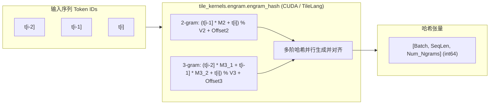
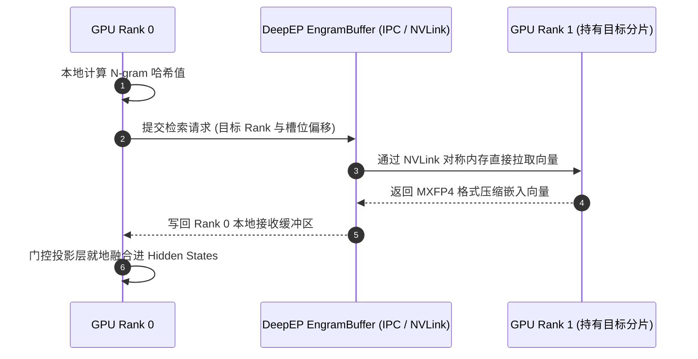

# 05 · Engram 运行时与压缩词表

> Engram 将局部短语与固定搭配的表征从 Transformer 的密集计算中剥离，通过 GPU 原生 N-gram 哈希、分片嵌入表与跨卡零拷贝 Gather 通信，实现精准的外挂记忆注入。
> **前置知识**：N-gram 语言模型、分词器（BPE / WordPiece）、分布式 All-to-All 集合通信。
> **源码指引**：`deepinfer/model_executor/models/v4_modules/engram.py`、`deepinfer/model_executor/models/v4_modules/engram_metadata.py`、`vendor/DeepEP`。

---

## 0. 本篇要回答的问题

- 大语言模型在处理成语、固定代码片段、专有名词等高度确定的局部 N-gram 模式时，为何会浪费巨大的注意力参数与算力？
- Engram 模块是如何在分词器与多阶 N-gram 之间构建高效的压缩词表映射（`CompressedVocabulary`）的？
- 在 GPU 上如何高效计算数万 Token 的多阶 N-gram 局部哈希并避免哈希冲突？
- 跨越多张 GPU 分片存储的庞大 Engram 嵌入表，如何依托 DeepEP 的 `EngramBuffer` 达成微秒级通信聚合与门控注入？

---

## 1. 局部模式的表征困境与 Engram 设想

在自然语言与源代码中，存在海量高度确定性的局部模式（Local Patterns）：
- 例如成语「不可名状」、固定语法结构 `if __name__ == '__main__':`、专有实体名词「中华人民共和国」等；
- 传统的 Transformer 必须依靠多层自注意力矩阵与前馈网络，耗费昂贵的浮点矩阵乘法去反复学习并重构这些确定性的局部 N-gram 关系；
- 这不仅挤占了模型的参数容量，还在推理长序列时消耗了大量不必要的注意力计算。

**Engram（记忆印迹）机制**的核心构想极为直观：**将局部 N-gram 关系的建模从模型参数中显式剥离，转化为一个外置的高性能稀疏查找表（Sparse Hash Table）**。

在序列输入时，框架并行提取 $2\text{-gram}, 3\text{-gram}, \dots$ 组合，计算哈希值并检索对应的 N-gram 向量表，最后通过门控单元（Gating Unit）将其就地注入到指定 Transformer 层的隐藏状态中。

---

## 2. 压缩分词器与词表映射（CompressedTokenizer）

如果直接使用大模型的原始大词表（如 128,000 个词元）进行 N-gram 组合，其可能的笛卡尔积空间将达到千万甚至千亿级别，无法在有限显存内建表。

为此，DeepInfer 设计了**双层压缩词表架构**（`deepinfer/model_executor/models/v4_modules/engram_metadata.py`）：

```text
原始 Token IDs (空间: 0 ~ 128000+):
[10432 ("Deep"), 8921 ("Seek"), 201 ("-"), 542 ("V4")]
                       |
                       v  CompressedTokenizer.lookup_table (GPU 查表)
压缩 Token IDs (空间: 0 ~ K, 压缩高频词并丢弃罕见词):
[1204, 852, 19, 45]
```

### CompressedVocabulary 实现细节
1. **高频过滤与重编号**：`CompressedVocabulary` 预先统计语料中词元出现频率，仅保留最高频的 $K$ 个词元并建立从原始 ID 到紧凑新 ID 的双向映射（`old2new`）；
2. **特殊标号隔离**：多模态图像标记（`IMAGE_SENTINEL = -1`）与填充符（`compressed_pad_token`）被分配专用哨兵值，哈希计算时自动短路避开；
3. **GPU 常驻单例**：在 `CompressedTokenizer.initialize()` 中，查找表被直接常驻于 GPU 显存（`lookup_table_gpu`），单步映射开销完全为片上常数级。

---

## 3. GPU 原生多阶 N-gram 哈希计算

在模型执行前向时，输入序列进入 `deepinfer/model_executor/models/deepseek.py`：
若当前模型启用了 Engram，系统将立即调用高性能定制内核 `tile_kernels.engram.engram_hash`：

```python
# deepseek.py 中的前向哈希检索
if self.engram_runtime is not None:
    assert input_metadata.ngram_token_ids is not None
    hashes = tile_kernels.engram.engram_hash(
        input_metadata.ngram_token_ids,
        self.ngram_multipliers,
        self.ngram_vocab_sizes,
        self.ngram_offsets,
        getattr(input_metadata, "images_seq_mask", None),
    )
    # 异步调度跨卡分片嵌入表聚合
    ngram_embed_hooks = self.engram_runtime.fetch(hashes)
```



该 Kernel 充分利用 GPU 的向量化访存指令，一个线程同时处理一个 Token 位置的 2-gram、3-gram 与 4-gram，通过乘加哈希算法（`ngram_multipliers` 与模数 `ngram_vocab_sizes`）在单个寄存器周期内算出最终表内槽位偏移。

---

## 4. 跨卡分片表与 DeepEP EngramBuffer 通信

由于 Engram 表体量通常高达数 GB 到数十 GB，在分布式推理中，该表被按行均匀切分（Sharded）在各个 GPU Rank 上。

因此，一张 GPU 算出的哈希值所指向的 N-gram 向量，极大概率驻留在另外一张 GPU 的显存中。这天然构成了一个**非对称的分布式 Sparse All-to-All 检索问题**：



### DeepEP 的深度协同优化
DeepInfer 摒弃了低效的通用 `dist.all_to_all`，转而使用专为 Engram 研发的 `deep_ep.EngramBuffer`（`vendor/DeepEP`）：
1. **NVLink 共享内存直写**：利用现代 NVLink 的统一虚拟编址能力，发起检索的 Rank 能够直接穿透硬件读取远端 GPU 显存中的参数，绕过一切 CPU 代理与通信握手；
2. **极低精度权重打包**：Engram 嵌入表采用 MXFP4（ue8m0 per-32）格式存储，传输带宽消耗仅为 FP16 的 25%；
3. **与计算流重叠**：`engram_runtime.fetch()` 在模型第一层执行 Embedding 计算时即刻以非阻塞方式异步触发，通信耗时完全被掩盖在底层矩阵乘法之内。

---

## 5. 门控注入与层级挂载

经过跨卡 Gather 获取的 N-gram 特征向量，通过一个轻量级的线性投影层映射回隐空间维度 $H$，并通过一个门控 Sigmoid 单元自适应调节注入强度：

$$h_l^{\text{new}} = h_l + \sigma(W_{\text{gate}} \cdot e_{\text{ngram}}) \odot (W_{\text{proj}} \cdot e_{\text{ngram}})$$

这一操作被封装为 `embed_hook`，在 `DeepseekDecoderLayer` 的前向过程中被挂载执行。模型得以在底层注意力开始前，直接获得关于当前词组的强语义偏置，显著增强了文本生成的连贯性与专业词汇准确度。

---

## 6. 关键设计取舍与代价

| 特性 | 纯 Transformer 密集计算 | DeepInfer Engram 记忆架构 |
|---|---|---|
| **显存占用** | 无额外参数，全部依赖模型权重 | 需额外占用 2~8 GB 显存存储分片嵌入表 |
| **局部短语准确率** | 依赖深层网络反复拟合 | 外挂记忆直接命中，实体与代码语法准确率大幅提高 |
| **跨卡通信压力** | 仅注意力层与 MoE 路由产生通信 | 额外产生一次轻量级 Engram Sparse All-to-All 通信 |
| **端到端加速比** | 基准 baseline | 降低深层注意力的建模负担，配合 YOCO 获得更高吞吐 |

---

## 7. 小结

- Engram 通过将局部 N-gram 静态模式外置为全局稀疏检索表，减轻了深层 Transformer 的表征负担；
- 紧凑词表映射与 GPU 并行哈希内核，确保了从海量词元到有限哈希槽位的高效规整映射；
- 基于 DeepEP `EngramBuffer` 的跨卡零拷贝直读技术，成功将分布式查表通信延迟压缩至可被计算完全重叠的微秒级水平。

---

## 延伸阅读 / 下一篇

- 下一篇：[`06-low-precision-fp4-mxfp8.md`](06-low-precision-fp4-mxfp8.md) · 极致低精度计算体系，探秘 DeepInfer 如何在 Main KV 与 MoE 专家权重中全面应用 MXFP8 与 MXFP4 极低精度格式。
- 核心源码：`deepinfer/model_executor/models/v4_modules/engram.py`。
