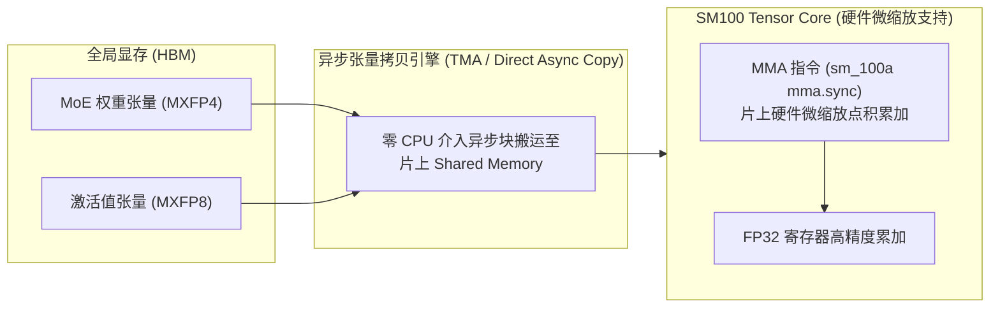

# 06 · 极致低精度计算体系

> 在访存带宽决定生成速度的解码时代，DeepInfer 全面落地 Microscaling（MX）极低精度体系：Main KV Cache 采用类似 NVFP4 的 e4m3 格式，MoE 路由专家权重与 Indexer KV 采用 MXFP4（ue8m0），实现 4 倍于 FP16 的带宽节约。
> **前置知识**：浮点表示法（IEEE 754）、张量量化（PTQ/QAT）、NVIDIA SM100 张量核心微缩放（Microscaling）指令集。
> **源码指引**：`deepinfer/model_executor/models/v4_modules/compress.py`、`deepinfer/model_executor/layers/tilelang_ops/compress.py`、`vendor/DeepGEMM`。

---

## 0. 本篇要回答的问题

- 传统的 INT8 / FP8 量化在超大规模模型中面临怎样的动态范围崩溃与异常值（Outliers）挑战？
- 什么是 Microscaling（MX）格式？为什么每 16 或 32 个元素共享一个微缩放因子能兼顾极高压缩率与数值精度？
- Main KV Cache（e4m3 per-16）与 MoE 专家权重（MXFP4 ue8m0 per-32）在内存中具体是如何按字节紧密打包的？
- `_pack_ue8m0_to_int` 算子是如何利用浮点指数位移，在无需浮点除法的情况下以极低代价完成尺度因子打包的？

---

## 1. 显存墙危机与 Microscaling 的崛起

自回归大模型的解码速度从根本上受制于 GPU 的**计算访存比（Arithmetic Intensity, FLOPs/Byte）**。
以一个 671B 参数、激活专家为 37B 的 MoE 模型为例：
- 在 Decode 阶段生成单个 Token 时，需要从显存读取数十 GB 的专家权重与海量历史 KV Cache；
- 如果采用标准的 FP16 / BF16 格式（每元素 2 字节），即使顶级 GPU 拥有 3~8 TB/s 的峰值带宽，单卡 TPS 也难以突破两位数；
- 传统的 FP8（E4M3 / E5M2）虽然将带宽减半，但在万亿 Token 生成中，激活值内部的极端异常值（Outliers）极易导致粗粒度量化（如 Per-Tensor 或 Per-Channel）发生精度雪崩。

为此，开放计算项目联盟（OCP）与硬件厂商联合定义了 **Microscaling（MX）数据格式标准**。其核心理念是：**将张量切分为极微小的固定块（如每 16 或 32 个元素一组），每个微块独占一个高精度的微缩放因子（Scale Factor, SF），块内元素采用 4-bit 浮点（FP4）表示**。

```text
标准量化 (Per-Channel):
[元素 0, 元素 1, ... 元素 4095]  <--- 整个通道 4096 个元素共用 1 个 Scale
(若局部出现一个 100.0 的异常值，其余 0.01 的正常值全部下溢为 0)

Microscaling 量化 (Per-32 块量化):
[元素 0 ... 元素 31]   <--- 独立 Scale 0 (紧密贴合局部动态范围)
[元素 32 ... 元素 63]  <--- 独立 Scale 1 (包含异常值，仅局域缩放)
[元素 64 ... 元素 95]  <--- 独立 Scale 2 (正常精度不受任何干扰)
```

DeepInfer 在深度整合 NVIDIA SM100 Blackwell 与华为昇腾 Ascend 950 硬件特性的基础上，在生产环境中全链路落地了这套极限低精度体系。

---

## 2. DeepInfer 低精度格式矩阵

根据官方生产部署规范（`doc/inference_deployment_qa.md`），DeepInfer 内部采用严格区分的四重精度方案：

| 数据对象 | 精度与格式 | 分块粒度 (Block Size) | 缩放因子格式 (Scale Format) | 核心应用场景与考量 |
|---|---|---|---|---|
| **Main KV Cache** | **e4m3 (NVFP4-like)** | Per-16 (16 elements) | 自定义紧凑缩放（无全局 Scale） | 注意力全局 KV 显存与访存压力最重，Per-16 极致压缩 |
| **Indexer KV Cache** | **MXFP4** | Per-32 (32 elements) | `ue8m0` (8-bit 无偏置纯指数) | 稀疏索引注意力检索，Per-32 保持极高召回率 |
| **MoE 路由专家权重** | **MXFP4** | Per-32 (32 elements) | `ue8m0` (8-bit 无偏置纯指数) | 静态权重持久化，结合 DeepGEMM 硬件直通执行 |
| **SWA 局部 KV Cache** | **MXFP8** | Per-32 (32 elements) | `e8m0` 缩放因子 | 局部滑动窗口，单 Token 占用压缩至 528 字节 |

---

## 3. MXFP4 与 `ue8m0` 尺度因子的内存物理排布

为了使 GPU 的 Tensor Core 能够以最高吞吐加载数据，内存中的张量排布必须符合严格的硬件对齐要求。

在 MXFP4（ue8m0 per-32）标准中：
- 32 个 4-bit 元素占据 $32 \times 0.5 = 16$ 字节；
- 缩放因子采用 `ue8m0` 格式（Unsigned Exponent 8-bit, 0 Mantissa），本质上是一个以 2 为底的纯幂次：$\text{Scale} = 2^{E - 127}$，占用 1 字节；
- 综合压缩比：原始 BF16 需要 64 字节，现在仅需 $16 + 1 = 17$ 字节，**压缩比高达 3.76:1**。

```text
MXFP4 内存物理块 (Per-32 结构):
+-------------------------------------------------------+-------------+
| 32 个 4-bit 浮点数值 (按低位/高位成对打包为 16 字节)    | Scale Factor|
| [E0|E1] [E2|E3] [E4|E5] ... [E30|E31]                 |  (ue8m0)    |
| <------------------- 16 字节 -------------------------> | <--- 1 字节 ->
+-------------------------------------------------------+-------------+
```

### 浮点无除法打包：`_pack_ue8m0_to_int` 算法
在 `deepinfer/model_executor/models/v4_modules/engram.py` 及 `compress.py` 中，DeepInfer 提供了一个极其优美的位运算打包实现：

```python
def _pack_ue8m0_to_int(x: torch.Tensor) -> torch.Tensor:
    """
    将以 fp32 表示的 ue8m0 尺度因子打包为 int32 (CUDA) / int16 (ASC)，每组 4/2 个。
    要求 x.dtype == torch.float32 且尾数位全部为 0。
    """
    assert x.dtype == torch.float32 and x.size(-1) % 4 == 0
    # 将 float32 重新解释为 int32 整数视图
    x_int32 = x.view(torch.int32)
    assert (x_int32 >= 0).all() and (x_int32 & 0x7FFFFF == 0).all()
    
    # 利用 IEEE 754 结构：float32 的指数部分占据 [23:30] 位
    # 彻底免除昂贵的 log2 浮点运算与浮点除法，直接位移 23 位提取指数！
    return torch.floor_divide(x_int32, 1 << 23).to(torch.uint8).view(PLATFORM.fp8_sf_type)
```

这种位操作利用了 IEEE 754 浮点数的二进制表示结构（符号位 1 位，指数位 8 位，尾数位 23 位），在纯整数 ALU 上以单周期指令完成量化尺度的剥离，完全避免了传统量化中开销巨大的浮点对数与除法运算。

---

## 4. DeepGEMM 底层硬件直通与反量化流水线

在传统的量化推理框架中，数据在送入 Tensor Core 计算前必须经历「从显存读出 -> 反量化为 FP16 -> 送入 Tensor Core」的低效软解压过程。

DeepInfer 联合 DeepSeek 自研的开源矩阵乘库 **DeepGEMM**（`vendor/DeepGEMM`），实现了**硬件级直通反量化计算**：



1. **异步传输（TMA）**：利用 NVIDIA SM100 的 Tensor Memory Accelerator，将打包好的 MXFP4 权重与 MXFP8 激活直接异步拷贝至 SM 片上共享内存（Shared Memory）；
2. **片上即时缩放点积**：调用硬件级微缩放点积指令，Tensor Core 原生支持在加载 4-bit 数据的同时将 8-bit 指数尺度乘入累加通道；
3. **彻底抹除反量化开销**：反量化不再作为独立的算子步骤存在，计算延迟与原生的低精度浮点矩阵乘完全持平，成功兑现了 FP4 的理论吞吐上限。

---

## 5. 关键设计取舍与代价

| 维度 | FP8 (E4M3 / E5M2) | DeepInfer MXFP4 / NVFP4 | 收益与工程代价 |
|---|---|---|---|
| **带宽节省比** | 2.0x (相对于 FP16) | **3.76x ~ 4.0x** | 显存带宽压力近乎归零，Decode TPS 逼近物理极致 |
| **静态显存占用** | 671B 需约 670 GB | 671B 仅需约 **340 GB** | 同样显存容量可容纳两倍以上的大并发 Batch Size |
| **数值精度偏差** | 极低（Per-Token 动态） | 需搭配特定训练对齐（QAT） | 未经微调的模型直接做 FP4 易损毁下游评测精度 |
| **硬件依赖门槛** | Hopper (SM90) / 昇腾 910B | **Blackwell (SM100) / 昇腾 950** | 早期老旧 GPU（如 Ampere）需软件模拟，性能反而倒退 |

---

## 6. 小结

- DeepInfer 全面落地 MXFP8 与 MXFP4 极低精度方案，将 Main KV Cache 与 MoE 专家权重压缩至极致；
- 采用 Per-16 与 Per-32 的细粒度微缩放因子，彻底解决了大模型自回归解码中的异常值发散难题；
- `_pack_ue8m0_to_int` 算法通过纯位运算实现极速尺度打包，配合 DeepGEMM 算子实现了片上零反量化开销的硬件直通。

---

## 延伸阅读 / 下一篇

- 下一篇：[`07-hardware-abstraction-and-topology.md`](07-hardware-abstraction-and-topology.md) · 异构加速器抽象与 NUMA 绑定，剖析 DeepInfer 如何抹平 NVIDIA 与华为昇腾之间的硬件架构鸿沟。
- 算子源码：`deepinfer/model_executor/models/v4_modules/compress.py`。
