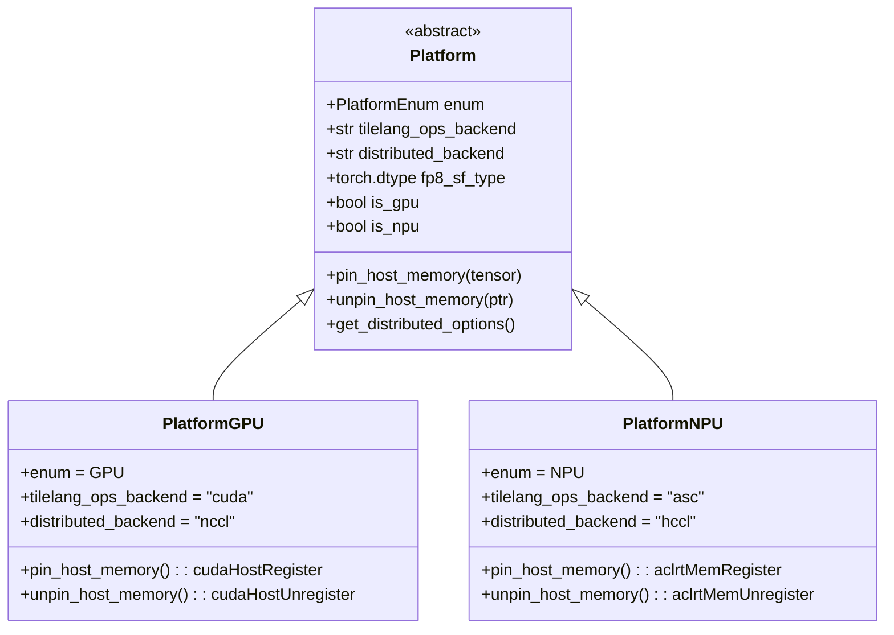

# 07 · 异构加速器抽象与 NUMA 绑定

> 支持多厂商硬件是云端大模型服务保持供应链弹性与成本最优的核心防线。DeepInfer 通过统一平台抽象层（`PLATFORM`）与硬核拓扑亲和性绑定，抹平了 NVIDIA SM100 与华为昇腾 Ascend 950 的异构鸿沟。
> **前置知识**：非一致性内存访问（NUMA）架构、Linux CPU 亲和性（Affinity）、PCIe / NVLink / HCCS 拓扑。
> **源码指引**：`deepinfer/platform.py`、`deep_cluster/hardware/device.py`、`deep_cluster/hardware/nvidia.py`、`deep_cluster/hardware/ascend.py`、`deep_cluster/topology/bind.py`。

---

## 0. 本篇要回答的问题

- 在面临 NVIDIA CUDA 与华为昇腾 CANN 两大异构生态时，如何设计一套无性能损耗的统一硬件抽象层（HAL）？
- 多卡并行系统在未做 NUMA 亲和性绑定的情况下，跨插槽（Cross-Socket）访存会导致怎样的吞吐崩塌？
- DeepInfer 的 `_bind_numa` 函数是如何自动识别每张 GPU 对应的物理 NUMA 节点与近端 CPU 核集合的？
- 在没有动态锁与虚函数调用的前提下，Python 侧的 `PLATFORM` 单例是如何实现硬件分发零运行时开销的？

---

## 1. 异构算力的工业化诉求与双生态挑战

在超大规模大模型服务集群中，算力供应链的单一依赖是巨大的战略风险。为了构建抗风险、成本最优的算力基础设施，DeepInfer 确立的首要原则便是：**全面支持多厂商异构加速器**。

然而，NVIDIA SM100 与华为昇腾 Ascend 950 在软硬件体系上存在显著差异：
1. **编程范式与运行时驱动**：NVIDIA 采用 CUDA 13 + PTX + SASS，通信依赖 NCCL；华为昇腾采用 CANN 9.2 + biSheng 编译器 + Ascend C，通信依赖 HCCL；
2. **底层显存模型与固定内存注册**：CUDA 通过 `cudaHostRegister` 实现页锁定（Page-Locked）内存以支持异步 DMA；昇腾则依赖 ACL 运行时的 `aclrtMemRegister`；
3. **低精度量化尺度表示**：FP8/FP4 的微缩放因子在 NVIDIA 上映射为特定的硬件数据类型，而在昇腾上则需要特定的位宽适配（如 int16/int32 打包）；
4. **自研融合算子体系**：TileLang 针对 CUDA 生成 PTX / CUBIN，针对昇腾则生成 Ascend C 源码并调用 `ccec` 交叉编译。

若在业务主代码中遍布 `if is_cuda: ... else: ...` 的脏分支，代码可维护性将迅速恶化。

---

## 2. 统一硬件抽象层（Platform）

DeepInfer 在 `deepinfer/platform.py` 中设计了极其轻量的静态抽象多态基类 `Platform`，并在模块加载时根据环境变量 `DEEPINFER_ACCELERATOR` 实例化全局唯一的不可变单例 `PLATFORM`：



### 核心属性与方法规范
- **算子后端路由**：`tilelang_ops_backend` 在 GPU 上返回 `"cuda"`，在 NPU 上返回 `"asc"`。上层算子加载器据此动态加载 `tilelang_ops/cuda/` 或 `tilelang_ops/asc/` 下的预编译 SO 库；
- **通信后端配置**：`distributed_backend` 分别映射至 `"nccl"` 或 `"hccl"`，透传至 `torch.distributed.init_process_group`；
- **低开销内存锁定**：
  ```python
  def pin_host_memory(self, tensor: torch.Tensor) -> None:
      """将 Host 内存注册为锁定页，启用 DMA 直通快速路径"""
  ```
  在 GPU 平台上直接调用底层的 `cudaHostRegister(ptr, size, cudaHostRegisterDefault)`，使 ZOS 的异步调度 Remap 向量能够零拷贝通过 PCIe DMA 发往显卡。

---

## 3. NUMA 拓扑感知与 CPU 亲和性硬绑定

在现代双路或四路服务器节点中，系统划分为多个非一致性内存访问（NUMA）节点。每组 CPU 核心直接连接一部分本地内存，并通过特定的 PCIe 控制器直连若干张 GPU：

```text
+-----------------------------------------------------------------------------------+
|                              典型双路 8 卡 GPU 服务器 NUMA 拓扑                      |
|                                                                                   |
|           Socket 0 (NUMA Node 0)                        Socket 1 (NUMA Node 1)     |
|     +--------------------------------+            +--------------------------------+
|     |  CPU 0-31, 64-95 + 本地内存 1TB |            |  CPU 32-63, 96-127 + 本地内存 1TB|
|     +---------------+----------------+            +---------------+----------------+
|                     |                                             |                |
|           PCIe Gen5 / CXL 总线                          PCIe Gen5 / CXL 总线        |
|     +---------------+----------------+            +---------------+----------------+
|     | GPU 0   GPU 1   GPU 2   GPU 3  |            | GPU 4   GPU 5   GPU 6   GPU 7  |
|     +--------------------------------+            +--------------------------------+
|                     \                                             /                |
|                      \====== UPI / Ultra Path Interconnect ======/                 |
|                             (跨 Socket 访问: 带宽减半，延迟激增 3x)                  |
+-----------------------------------------------------------------------------------+
```

如果运行在 GPU 0 上的 Worker 进程被操作系统调度到 Socket 1 的 CPU 核心上执行：
- 其发起的每一次 Host-to-Device 数据拷贝都要穿透跨插槽的 UPI 总线；
- 内存带宽骤降 50% 以上，PCIe 发射队列严重拥塞；
- ZOS 异步调度与 D2H 事件同步将出现不可预测的高延迟毛刺（Jitter）。

### DeepInfer 的自动 NUMA 绑定实现
在 `deep_cluster/topology/bind.py` 中，DeepInfer 实现了硬件拓扑自动化探测与绑定：
```python
def _bind_numa(local_rank: int) -> None:
    """根据加速卡编号自动探测并绑定其所属的近端 NUMA 节点与 CPU 亲和集"""
    # 1. 查询当前设备挂载的物理 PCI 设备路径
    # 例如 /sys/class/pci_bus/.../numa_node
    device = get_device_by_rank(local_rank)
    numa_node = device.get_numa_node()
    
    if numa_node >= 0:
        # 2. 获取该 NUMA 节点直接附着的物理 CPU 核心列表
        cpus = get_numa_cpus(numa_node)
        # 3. 调用 sched_setaffinity 锁定当前进程的 CPU 执行核
        os.sched_setaffinity(0, cpus)
        # 4. 调用 set_mempolicy 将内存分配策略设置为优先本地 NUMA 分配
        set_local_memory_policy(numa_node)
```

在启动阶段，每个 Worker 进程根据被分配的 `local_rank`，强行将自身上下文固定在该卡物理隶属的 NUMA Node 核心上。这保证了每一个张量构建、固定内存分配与 DMA 发起操作，都 100% 运行在本地内存通道上。

---

## 4. 运行时分发的性能零损耗实践

为了在保证双平台代码复用的同时避免引入任何额外的函数调用开销，DeepInfer 坚守以下设计原则：
1. **静态分支剥离**：核心热路径（Hot Path）中禁止使用字符串比对或字典查询，统一基于预先缓存的布尔值属性 `PLATFORM.is_gpu` 进行短路；
2. **算子符号动静结合**：算子层的平台特化在模型初始化阶段通过 `deepinfer/model_executor/layer_utils.py` 一次性绑定完成，执行期前向调用直接以直接函数指针调用；
3. **张量对齐抽象**：在计算对齐步长时，通过 `PLATFORM.get_alignment()` 一致化不同厂商对显存地址对齐（如 CUDA 的 128 字节对齐与昇腾的 512 字节对齐）的严苛要求。

---

## 5. 关键设计取舍与代价

| 架构策略 | 朴素动态分支方案 | DeepInfer 拓扑与 HAL 体系 |
|---|---|---|
| **代码组织** | 在算子内部大量混写平台特定宏 | 顶层单例抽象 + 底层目录（`cuda/` vs `asc/`）彻底物理隔离 |
| **NUMA 策略** | 完全交由操作系统默认调度 | 启动期强行检测 PCI 拓扑并做 `sched_setaffinity` 硬件硬绑定 |
| **内存通道利用率** | 频繁出现跨 Socket UPI 拥塞 | 100% 保持在本地 NUMA 内存通道，DMA 发射延迟极度平稳 |
| **新芯片适配成本** | 需重构核心调度流 | 仅需实现 `Platform` 子类并在 `deep_cluster` 中增添硬件探针 |

---

## 6. 小结

- DeepInfer 构建了统一且零运行时开销的硬件抽象层（`PLATFORM`），优雅屏蔽了 NVIDIA 与华为昇腾底层的生态分歧；
- 通过 `_bind_numa` 强行将 Worker 进程绑定在加速卡直连的本地物理 CPU 核心与内存节点上，杜绝了跨 Socket 访存毛刺；
- 双平台支持不仅保障了云端业务的供应链韧性，还使同一套高性能算法架构能够在异构硬件上充分兑现其理论峰值算力。

---

## 延伸阅读 / 下一篇

- 下一篇：[`08-parallelism-and-userbuffer.md`](08-parallelism-and-userbuffer.md) · 混合并行体系与 UserBuffer 零拷贝通信，探究在 Wide-EP 与超长上下文下，系统如何实现跨卡零拷贝张量搬运与 SM 资源切分。
- 拓扑源码：`deep_cluster/topology/bind.py`。
