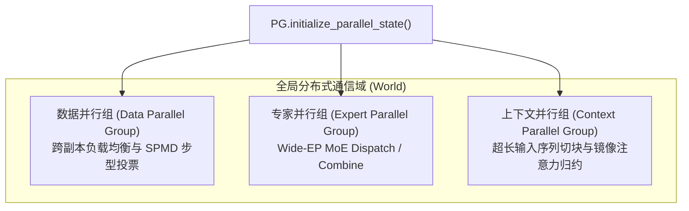
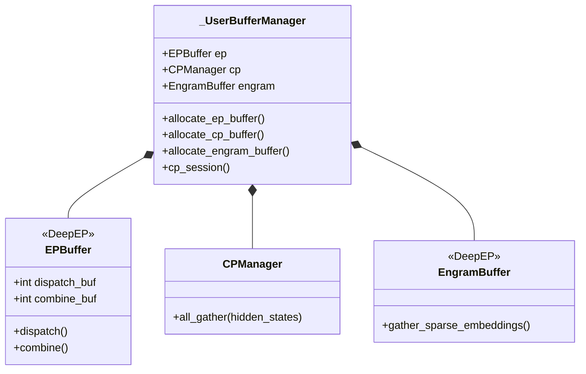

# 08 · 混合并行体系与 UserBuffer 零拷贝通信

> 针对 Prefill 与 Decode 截然不同的计算特征，DeepInfer 实施了差异化的混合并行战略（Prefill 窄并行度与 Decode 宽专家并行 Wide-EP），并通过 `UserBuffer` 预分配内存与动态 SM 配额隔离，实现跨卡近零拷贝通信与算网深度重叠。
> **前置知识**：张量并行（TP）、专家并行（EP）、上下文并行（CP）、NVLink 对称内存（Symmetric Memory）。
> **源码指引**：`deepinfer/model_executor/parallel_utils/parallel_state.py`、`deepinfer/model_executor/parallel_utils/userbuffer.py`、`deepinfer/model_executor/parallel_utils/cp.py`。

---

## 0. 本篇要回答的问题

- 为什么统一固定并行度（如全程固定 TP8 或 EP8）在超大规模长文本推理中会遭遇严重的算力与显存资源错配？
- 什么是 Wide-EP（EP64~EP128）？为什么超大专家并行度能够在 Decode 阶段成为突破访存墙的胜负手？
- 传统集合通信（如频繁的 `torch.cuda.empty_cache()` 与动态内存分配）为何会引发显存碎片与微秒级通信阻塞？
- DeepInfer 的 `UserBuffer` 管理器是如何统一统管 EPBuffer、CPManager 与 EngramBuffer 的？`limit_num_sms` 是如何防止通信抢占算力核心的？

---

## 1. 阶段解耦下的混合并行范式

传统大模型推理系统通常倾向于采用单一静态的并行拓扑（例如一组 8 卡 GPU 始终运行 TP=8 或 TP=4 + EP=2）。然而，在长文本与超大规模服务场景下，这种一刀切的设计存在严重缺陷：
- **Prefill 阶段**：序列极长，矩阵乘计算量极大。此时若盲目扩大专家并行（如 EP64），会导致通信域覆盖跨节点网络，All-to-All 跨机延迟将抵消矩阵乘的全部收益；
- **Decode 阶段**：单步仅生成单个 Token，计算量极小，瓶颈完全在于加载专家权重的显存带宽。若维持较小的并行度（如 EP8），单张卡必须持有大量专家，每个 Step 都要在显存中搬运庞大的参数，访存带宽瞬间见顶。

### DeepInfer 的并行度取舍矩阵
根据官方白皮书，DeepInfer 针对不同计算阶段采取了极具针对性的差异化并行策略：

```text
+-------------------+-----------------------------------+-----------------------------------+
| 计算阶段           | 并行配置策略                      | 核心架构目标                      |
+-------------------+-----------------------------------+-----------------------------------+
| **Prefill 节点池** | **EP2 ~ EP8 / DP2 ~ DP8**         | 采用 HBM 容量允许的**最小 EP/DP**，|
|                   | (单台 8 卡常规服务器内闭环)        | 避免跨机通信开销，最大化算力利用率 |
+-------------------+-----------------------------------+-----------------------------------+
| **Decode 超节点池**| **Wide-EP (EP64 ~ EP128)**        | 采用硬件互联允许的**最大 EP/DP**，|
|                   | (64~128 卡 NVLink/高带宽高阶互联)  | 极度摊薄每卡专家数量，打穿访存瓶颈 |
+-------------------+-----------------------------------+-----------------------------------+
| **超长序列上下文** | **平衡上下文并行 (Balanced CP)**   | 沿序列维度切分输入，保持卡间算力均衡|
+-------------------+-----------------------------------+-----------------------------------+
| **张量并行 (TP)**  | **完全不启用 (TP = 1)**           | 彻底杜绝逐层 All-Reduce 高频通信屏障|
+-------------------+-----------------------------------+-----------------------------------+
```

---

## 2. 进程组管理与全局并行状态（`PG`）

在 `deepinfer/model_executor/parallel_utils/parallel_state.py` 中，DeepInfer 通过单例对象 `PG`（Process Group）统管所有的通信拓扑：



每一个加速卡进程根据自身的 `world_rank`，自动推导并加入其所属的三组正交通信域：
1. **数据并行组（DP Group）**：负责跨副本分发独立请求，以及在调度阶段执行 SPMD 步型投票（详见第 10 篇）；
2. **专家并行组（EP Group）**：在 MoE 层接管所有路由专家的 Token 跨卡分发（Dispatch）与输出汇聚（Combine）；
3. **上下文并行组（CP Group）**：针对超长 Prompt，在第一层通过 `mirror_cp` 将激活值打散到多卡并行计算，并在最后通过 `all_gather` 缝合还原。

---

## 3. UserBuffer 统一预分配与显存零拷贝

在大模型分布式推理中，最忌讳在模型前向的热路径（Forward Loop）中频繁调用 `torch.empty`、`torch.zeros` 或 `cudaMalloc`。高频的显存动态分配会导致操作系统缺页中断、锁竞争以及显存碎片化。

DeepInfer 构建了专有的全局预分配管理体系：**`_UserBufferManager`**（位于 `deepinfer/model_executor/parallel_utils/userbuffer.py`）。



在模型加载完成后（`DeepseekForCausalLM.__init__`），系统立即显式触发 `allocate_userbuffer()`，根据批次最大 Token 上限、专家数量与隐层维度，**一次性预先向操作系统申请全生命周期的固定显存空间**：
- **`userbuffer.ep`**：为 DeepEP 预留用于跨卡 MoE 路由的对齐双向缓冲区；
- **`userbuffer.cp`**：为上下文并行全量汇聚预分配连续显存，杜绝临时申请；
- **`userbuffer.engram`**：预分配用于 N-gram 跨卡哈希检索的稀疏汇聚内存；
- **`symm_mem` 对称内存映射**：通过底层 NVLink IPC 机制，将所有卡上的预分配缓冲区映射为一个统一的全局虚拟地址空间，任何 GPU 可直接对远端卡执行 RDMA 级别的数据直写。

---

## 4. SM 动态配额隔离：`limit_num_sms`

在 GPU 体系架构中，流式多处理器（Streaming Multiprocessor, SM）是负责执行浮点计算与张量核心运算的核心单元。

传统集合通信库（如普通 NCCL Kernel）为了追求单次传输的带宽饱和，往往会默认申请占用 GPU 上全部的 SM 资源（例如 SM100 上的 100+ 个 SM）。这导致了一个严重的冲突：
**当通信 Kernel 霸占了所有 SM 时，本应与之并行重叠的模型计算 Kernel 只能挂起排队，算网重叠沦为空谈！**

DeepInfer 在 `userbuffer.py` 中设计了极其优雅的上下文管理器 **`limit_num_sms`**：

```python
@contextmanager
def limit_num_sms(num_sms: int, enabled: bool = True) -> Generator[None]:
    """
    动态限制当前上下文中通信与辅助算子能够使用的最大 SM 核心数量，
    为正在并发执行的高负载 GEMM 算子预留充裕的硬件计算单元。
    """
    if not enabled:
        yield
        return
    prev_sms = deep_gemm.get_num_sms()
    # 动态调低 TileLang 与 DeepGEMM 占用的 SM 线程块配额
    tile_kernels.set_num_sms(prev_sms - num_sms)
    deep_gemm.set_num_sms(prev_sms - num_sms)
    try:
        yield
    finally:
        # 恢复默认全局 SM 配额
        tile_kernels.set_num_sms(prev_sms)
        deep_gemm.set_num_sms(prev_sms)
```

通过这一精巧的机制，系统在触发 DeepEP 专家通信或跨卡分发时，强制将通信线程块（Thread Blocks）约束在少数预留的 SM 上（如保留 32 个 SM，由 `DEEPINFER_NCCL_NUM_SMS` 控制），其余 80% 以上的计算资源得以不受干扰地持续进行矩阵乘法。通信延迟被近乎 100% 隐藏在重叠计算窗口之中。

---

## 5. 关键设计取舍与代价

| 特性 | 常规通用集合通信 | DeepInfer UserBuffer 与 Wide-EP 体系 |
|---|---|---|
| **通信显存开销** | 每次通信按需动态临时分配 | 启动阶段预先钉死数 GB 专用通信显存（静态占用） |
| **显存碎片率** | 随着请求生命周期不断产生碎片 | 零碎片，通信缓冲区在整个服务周期内物理地址恒定 |
| **Decode 阶段 TPS** | 受困于每卡持有过多专家，访存成为死锁 | Wide-EP 极度分摊专家权重，TPS 逼近硬件天花板 |
| **硬件互联要求** | 支持以太网与普通 InfiniBand | 极度依赖无损高带宽 NVLink 拓扑（要求 64~128 卡单域） |

---

## 6. 小结

- DeepInfer 打破了传统的静态并行观念，在 Prefill 实施低并行度以换取计算密度，在 Decode 实施 Wide-EP 宽并行度以击穿访存墙；
- `UserBuffer` 体系将通信所需的显存全部实现静态预分配，配合 NVLink 对称内存消除了动态显存分配带来的所有抖动；
- 独创的 `limit_num_sms` 机制通过硬性约束通信算子的硬件核心配额，实现了工业级的大规模算网无冲突流水线重叠。

---

## 延伸阅读 / 下一篇

- 下一篇：[`09-engine-architecture.md`](09-engine-architecture.md) · LLMEngine 架构与生命周期，进入第三部分核心调度层，深入剖析 DeepInfer 的主服务进程状态机与多引擎模式。
- 核心源码：`deepinfer/model_executor/parallel_utils/userbuffer.py`。
