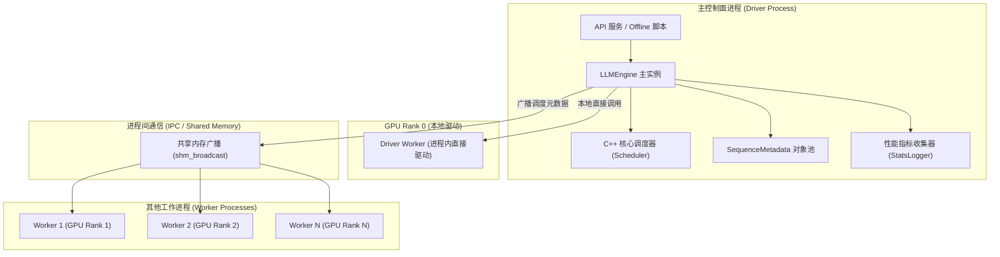
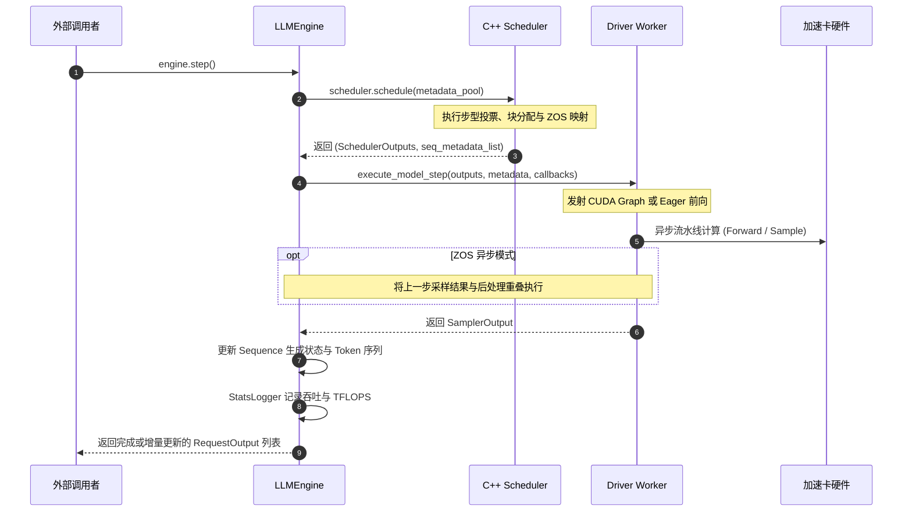

# 09 · LLMEngine 架构与生命周期

> `LLMEngine` 是 DeepInfer 的主控大脑与服务核心，统筹调度器状态推进、分布式 Worker 进程协同、显存块分配与流式输出生成。
> **前置知识**：多进程编程（Python `multiprocessing` / Spawn 模式）、状态机、异步事件循环。
> **源码指引**：`deepinfer/engine/llm_engine.py`、`deepinfer/engine/arg_utils.py`、`deepinfer/engine/engine_type.py`、`deepinfer/engine/stats_logger.py`。

---

## 0. 本篇要回答的问题

- `LLMEngine` 在单机与多节点环境下是如何组织 Driver Worker 与其他工作进程的拓扑关系的？
- `EngineType` 的三种枚举值（`NORMAL`、`PROMPT`、`COMPLETION`）分别对应哪种生产部署形态，彼此之间有何调度差异？
- 当外部调用者触发 `engine.step()` 时，内部经历了怎样完整的「调度 -> 执行 -> 采样 -> 统计」事件循环？
- 当面临用户中途断开连接（Abort）或系统内存报警时，引擎是如何安全回收显存与序列状态的？

---

## 1. LLMEngine 的定位与多进程拓扑

在现代推理系统中，`LLMEngine` 是连接外部高并发 API 请求（如 HTTP/gRPC 网关）与底层 GPU 计算集群的核心中枢。它既需要以微秒级的极致性能驱动底层的矩阵运算，又需要兼顾复杂的请求生命周期管理、超时熔断与性能可观测性。

### 进程拓扑与驱动模型
为了避开 Python 的全局解释器锁（GIL）并确保与 PyTorch 分布式通信库的完全隔离，DeepInfer 采用 **Multi-Process Spawn 架构**：



- **Rank 0 作为 Driver**：`LLMEngine` 直接驻留在 Rank 0 对应的物理进程中。Rank 0 上的 Worker（`Driver Worker`）直接通过函数调用驱动，消除了一切 IPC 额外开销；
- **从属 Worker 并行侦听**：Rank 1 到 Rank N 的 Worker 进程通过高性能无锁共享内存广播通道（`shm_broadcast`）被动接收每一步的调度输出，在微秒级完成 SPMD 步调对齐。

---

## 2. 三种引擎形态：`EngineType`

在 `deepinfer/engine/engine_type.py` 中，DeepInfer 定义了引擎的职能划分：

```python
class EngineType(enum.IntEnum):
    NORMAL = 0      # 混合模式：同时处理 Prompt 预填充与自回归 Decode
    PROMPT = 1      # 专职模式：仅处理 Prompt 预填充阶段
    COMPLETION = 2  # 专职模式：仅处理自回归 Decode 生成阶段
```

这三种形态直接映射了不同的生产服务角色：
1. **`NORMAL` 引擎**：单机开发、离线评测或中小规模服务的标准形态。单套节点池内部动态切换 Prefill 与 Decode 步型，兼顾灵活性与硬件利用率；
2. **`PROMPT` 引擎（PE）**：专为大型集群中的 Prefill 节点池定制。该引擎只从 `waiting` 队列抽取 Prompt，只执行高吞吐的预填充前向，生成首 Token 与持久化 KV Cache 后立即释放或移交上下文；
3. **`COMPLETION` 引擎（CE）**：专为大型集群中的 Wide-EP Decode 超节点池定制。该引擎不接纳全新长文本 Prompt，专门承接已完成预填充的序列，在极致的宽专家并行拓扑下持续推进批量 Decode。

---

## 3. 核心步进驱动循环：`engine.step()`

`LLMEngine` 的所有核心业务驱动都收敛在 `step()` 方法中。每一次调用推进一次全局推理步（Step）：



### 代码主干剖析
在 `deepinfer/engine/llm_engine.py` 的 `_step()` 中：
```python
def _step(self) -> list[RequestOutput]:
    # 1. 触发底层 C++ 调度器，执行请求挑选与内存块锁定
    scheduler_outputs, seq_metadata_list = self.scheduler.schedule(self.seq_metadata_pool)
    
    if scheduler_outputs.is_empty():
        return []

    # 2. 注入引擎级后处理回调（供 Worker 延后执行以重叠 CPU 开销）
    callbacks = EngineCallbacks(
        post_process_fn=self._post_process_step,
        pre_sampler_sync_fn=self._pre_sampler_sync,
    )

    # 3. 驱动 GPU 工作进程执行前向与采样
    step_state = self.driver_worker.execute_model_step(
        scheduler_outputs, seq_metadata_list, callbacks
    )

    # 4. 统计度量与请求完成回传
    self._update_stats(scheduler_outputs)
    return self._build_outputs(scheduler_outputs)
```

整个调度与发射逻辑极为精简，几乎没有任何多余的对象解包与显式循环，绝大部分耗时工作都在 C++ 扩展内部与 GPU 流水线上异步展开。

---

## 4. 异常处理、超时熔断与主动放弃（Abort）

在云端大规模高并发场景中，客户端随时可能主动中断 HTTP 连接，或者某个请求因超出最大长度、格式校验失败而必须提前终止。

### 显存安全释放的「防死锁」挑战
在大模型推理中，简单地使用 Python `del seq` 是极其危险的：
- 该请求的逻辑 KV 块可能分散在 `BlockManager` 的多个物理槽位中；
- 它的局部 SWA 状态正被锁定在 `StateBlock` 中；
- 它的推测预测槽位正挂在 `mtp_info_pool` 队列上。

DeepInfer 在 `csrc/engine/scheduler.hpp` 与 `llm_engine.py` 中实现了严格的 **安全下线管道（Safe Teardown Pipeline）**：
1. **状态标记**：调用 `engine.abort_request(request_id)` 时，系统不会粗暴销毁对象，而是将其状态就地置为 `SequenceStatus::FINISHED_ABORTED`；
2. **调度器被动清理**：在下一次调度循环中，无论是进入 `_schedule_prefill` 还是 `_schedule_decode`，调度器都会在第一时间扫描并收集所有已终结的 Sequence（`free_finished_seqs()`）；
3. **物理资源原位归还**：在持有 `BlockManagerMutexAcquire` 锁的安全窗口期内，无条件递减所有物理块与状态槽位的引用计数，确保即便在突发超大并发中断潮下，系统也不会发生任何显存泄漏或双重释放（Double Free）。

---

## 5. 关键设计取舍与代价

| 维度 | 常规推理框架实现 | DeepInfer LLMEngine 架构 | 收益与工程代价 |
|---|---|---|---|
| **进程模型** | 纯 Python 多进程，IPC 传递巨大张量 | Driver 进程直连 + 共享内存轻量广播 | 消除 IPC 序列化时延，单步开销极其平稳 |
| **部署模式** | 仅支持单一混合服务 | 明确解耦为 Normal/Prompt/Completion | 专职引擎消除了阶段干扰，方便集群级独立弹性扩缩 |
| **内存池化** | 频繁申请释放 Python 小对象 | C++ 底层统一对象池 `SequenceMetadataPool` | 彻底规避 Python GC 导致的偶发性长尾延迟（P99） |

---

## 6. 小结

- `LLMEngine` 作为核心控制中枢，以 Driver Worker 直驱与无锁共享内存广播构建了高性能多进程拓扑；
- 三种 `EngineType` 为现代云端 E/P/D 解耦部署奠定了软件形态基础；
- 精简的 `step()` 循环与完善的状态机被动清理管道，确保了引擎在面对高并发突发中断时兼具高吞吐与高健壮性。

---

## 延伸阅读 / 下一篇

- 下一篇：[`10-scheduler-core-and-step-voting.md`](10-scheduler-core-and-step-voting.md) · C++ 调度器核心与 SPMD 步型投票，深入探究多卡分布式环境下如何通过 AllReduce 投票保障数据并行步型一致。
- 核心源码：`deepinfer/engine/llm_engine.py`。
