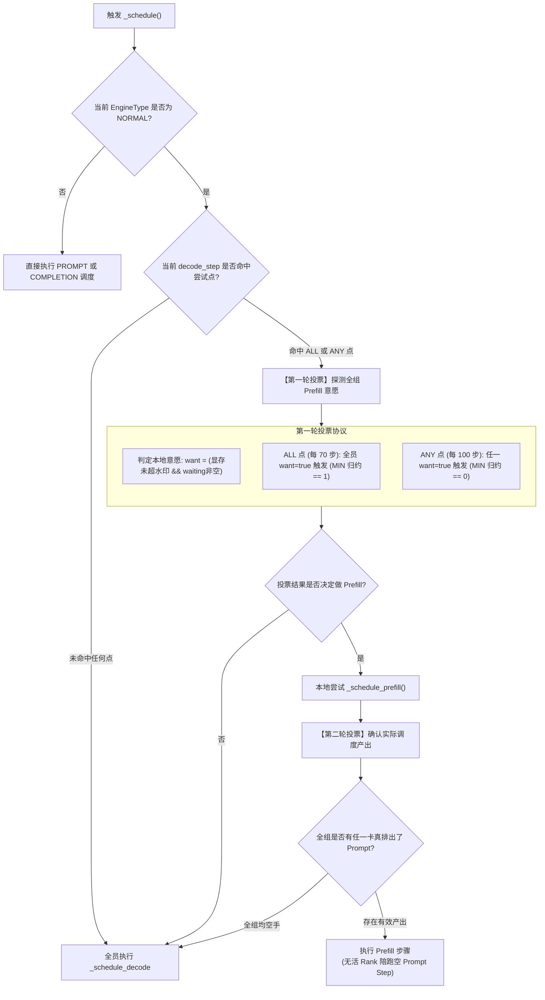

# 10 · C++ 调度器核心与 SPMD 步型投票

> 在多卡数据并行（DP）下，所有卡必须在同一时刻执行相同类型的推理步骤。DeepInfer 纯 C++ 调度器独创双阈值 AllReduce 步型投票协议，彻底化解分布式集群步调死锁风险。
> **前置知识**：单程序多数据（SPMD）范式、集合通信 AllReduce 归约、抢占与调度队列。
> **源码指引**：`csrc/engine/scheduler.hpp`、`csrc/engine/pybind_scheduler.cpp`、`csrc/engine/sequence.hpp`。

---

## 0. 本篇要回答的问题

- 在数据并行（DP）通信域内，为什么绝不能允许 Rank 0 执行 Prefill 而 Rank 1 并发执行 Decode？
- DeepInfer 是如何通过 `ALL` 周期与 `ANY` 周期双阈值规约投票，平衡群体批吞吐与个卡长尾延迟的？
- 为什么单凭「队列非空」判定步型会导致致命的死循环？第二轮投票是如何实现安全防回退的？
- 在显存块严重耗尽时，Decode 调度器是如何运用 LCFS（后到先服务）策略精准挑选抢占受害者的？

---

## 1. 数据并行（DP）下的 SPMD 步调死锁危机

在现代大规模大模型服务中，数据并行（Data Parallelism, DP）被广泛用于扩展整体并发吞吐。在 DP 模式下，多张 GPU 加速卡加载相同的一份模型权重，各自独立处理不同的用户请求。

然而，大模型并非孤立计算系统，其内部充斥着跨卡的集体通信操作：
- MoE 层的专家路由分发（All-to-All）；
- 跨层注意力与全局归约（All-Reduce）；
- 步长对齐与状态同步。

这引入了一条不可动摇的底层铁律：**同一通信域内的所有 GPU Rank，必须严格按照 SPMD（Single Program Multiple Data）范式，在同一物理 Step 执行相同类型的计算（要么全员做 Prefill，要么全员做 Decode）！**

```text
致命错误: 异构步调引发的分布式死锁
Rank 0: 执行 Prefill 前向 ---> 发起 Prefill 特定的通信或完全无通信
Rank 1: 执行 Decode 前向  ---> 在 MoE 层发射 All-to-All 期望与各卡交换 Token
结果: Rank 1 永久挂起等待 Rank 0 握手，集群瞬间进入不可逆死锁 (Hang)！
```

而在真实业务中，各个 Rank 接收外部请求的到达时间具有高度离散性：Rank 0 处可能积压了 5 个长文本 Prompt，而 Rank 1 上可能只有正在生成的解码请求。系统如何协调所有 Rank 达成一致决策？

---

## 2. 双阈值 AllReduce 步型投票协议

为了在微秒级完成全组决断，DeepInfer 将全部调度逻辑下沉至纯 C++ 实现（`csrc/engine/scheduler.hpp`）。在 `NORMAL` 引擎模式下，调度器在每次进入调度循环时触发**两级步型投票（Two-Round Voting Protocol）**。



### 2.1 第一轮投票：群意与孤立兜底的制衡
在代码 `scheduler.hpp`（行 308-322）中，系统设置了两个互补的尝试周期：
- **ALL 判定点（默认每 70 个 Decode Step）**：
  ```cpp
  bool is_all_point = (decode_step % prefill_attempt_interval == 0);
  do_prefill = (_dp_allreduce(want ? 1 : 0, c10d::ReduceOp::MIN) == 1);
  ```
  只有全组每一张卡都拥有待处理的 Prompt 且显存处于安全水位时，才触发 Prefill。这防止了「1 张卡干活、其余 7 张卡陪跑空转」的严重算力浪费；
- **ANY 判定点（默认每 100 个 Decode Step）**：
  ```cpp
  bool is_any_point = (decode_step != 0) && (decode_step % prefill_any_attempt_interval == 0);
  do_prefill = (_dp_allreduce(want ? 0 : 1, c10d::ReduceOp::MIN) == 0);
  ```
  为孤立的边缘 Rank 提供时延保底：如果某张卡长时间单独等待，最多经过 100 步解码，其余卡必须无条件停下协同执行一次 Prefill，杜绝饥饿现象。

---

## 3. 第二轮投票与防死循环回退设计

很多朴素设计的调度器之所以在生产中发生偶发性卡死，原因在于忽略了**意愿（Want）与现实（Capacity）的脱节**：
- 某张卡在第一轮投票时虽然 `want = true`（因为其 `waiting` 队列非空）；
- 但当真正调用 `_schedule_prefill()` 时，可能发现系统当前空闲物理块不足以分配该长序列，或者并发 Prompt 上限已满，导致**最终实际调度的有效请求数为 0**！

如果此时全组强行执行一次空的 Prompt Step：
根据设计规范，执行 Prompt Step 会将计数器 `decode_step` 重置清零；
下一步开始时，`decode_step == 0` 恰好又落在了 ALL 尝试点上；
各卡再次投票，再次尝试，再次空手……**整个集群将在微秒级陷入无限空转死循环！**

### 解决方案：基于产出判定的第二轮归约
DeepInfer 在 `scheduler.hpp`（行 328-335）设计了致命问题的解药：
```cpp
// 第二轮投票：确认这轮真有 rank 排出了 prefill
bool any_scheduled = (_dp_allreduce(outputs ? 0 : 1, c10d::ReduceOp::MIN) == 0);
if (!any_scheduled) {
    // 全组实际均无法调度出 prompt，必须紧急强制转为 decode！
    return _schedule_decode(acquire);
}
if (outputs) {
    return outputs;
}
// 组内确有 rank 排出了 prompt：本 rank 陪跑空 prompt step 以严格维持步型一致
return _make_outputs({}, true, 0, {}, {}, {}, 0);
```
通过第二轮 `c10d::ReduceOp::MIN` 归约，只要证实全组无一卡排出了有效 Prompt，全员立即安全回退为执行 Decode，彻底粉碎了死循环发生的前提。

---

## 4. LCFS 驱逐策略与受害者选择

在自回归解码（`_schedule_decode`）推进过程中，随着每个生成序列长度不断延展，物理 KV 缓存块终究会面临耗尽的极端压力。

当 `block_manager->can_allocate_single_nolock()` 返回 `false` 时，系统必须做出残酷的选择：抢占（Preempt）哪个序列以释放显存？

### LCFS（后到先服务）的抢占智慧
与操作系统常见的先来先服务相反，DeepInfer 采取了严格的 **LCFS 策略**：
```cpp
// 按 output_len 降序排列
std::sort(running.begin(), running.end(), [](const SequencePtr &a, const SequencePtr &b) {
    return a->get_output_len() > b->get_output_len();
});
```

```text
running 序列列表 (按已生成 Token 长度降序排序):
[Seq A (已生成 1200 Tokens)]  <--- 成本极其昂贵，绝对不可抢占！
[Seq B (已生成 850 Tokens)]
...
[Seq Y (已生成 12 Tokens)]
[Seq Z (已生成 2 Tokens)]    <--- 刚开始生成，沉没成本极低，优先挑选为 Victim！
```

- **沉没成本最小化**：已经生成上千 Token 的长序列蕴含着巨大的计算沉没成本，一旦抢占从头重算将严重损害系统整体 MFU 与端到端 SLA；
- **快速止血**：刚开始解码的短序列所占据的 KV 块极易被快速释放并归还全局空闲链表，使高价值的长序列能够顺利完成最后冲刺。

---

## 5. 关键设计取舍与代价

| 特性 | 传统单机无投票调度 | DeepInfer 纯 C++ 双轮投票调度 |
|---|---|---|
| **分布式通信安全性** | 极易因各卡决策不一致引发通信死锁 | 100% 数学证明的 SPMD 步型强同步 |
| **调度性能延迟** | 依赖 Python 层调用，单步延迟 > 1ms | 纯 C++ 纳秒级数据结构，调度 < 30 微秒 |
| **长尾请求响应** | 独立 Rank 容易被大并发请求彻底饿死 | ANY 周期强行插桩，保障最晚响应边界 |
| **通信规约开销** | 0 额外通信 | 每 Step 引入 1~2 次微秒级轻量标量 AllReduce |

---

## 6. 小结

- SPMD 步型一致性是现代大模型数据并行系统存活的基石；
- 双阈值机制（ALL=70 与 ANY=100）完美兼顾了群体算力密度与单卡长尾 SLA；
- 基于产出核实的第二轮投票机制彻底解决了调度层面的自锁死循环难题；
- LCFS 启发式受害者挑选策略最大程度保护了高价值计算资产。

---

## 延伸阅读 / 下一篇

- 下一篇：[`11-zos-zero-overhead-scheduler.md`](11-zos-zero-overhead-scheduler.md) · ZOS 零开销异步调度器，揭秘 DeepInfer 如何利用 CPU-GPU 流水线重叠彻底消除 Host-Device 交互开销。
- 调度器源码：`csrc/engine/scheduler.hpp`。
