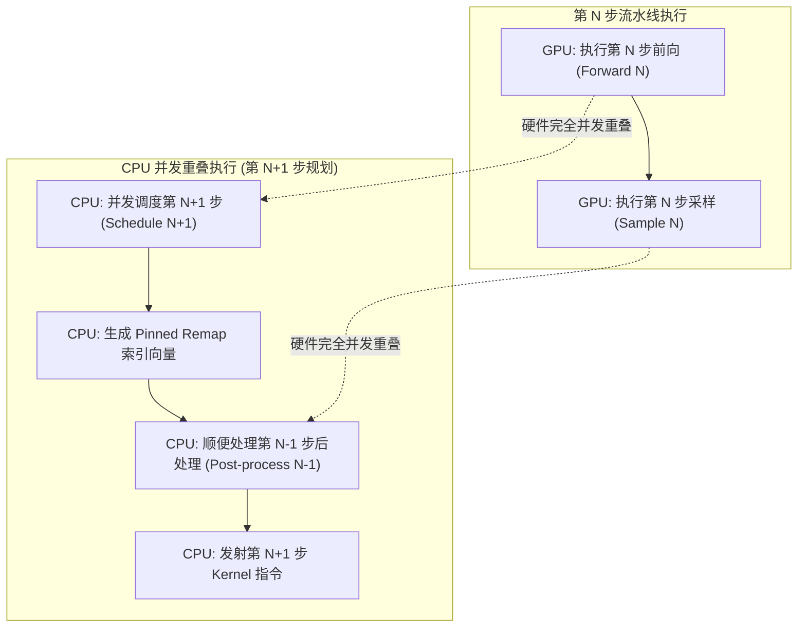
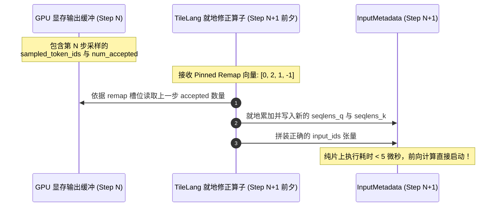

# 11 · ZOS 零开销异步调度器

> ZOS（Zero-Overhead Scheduler）打破了传统推理系统「每步同步」的枷锁，通过 CPU 批调度与 GPU 前向执行的异步流水线重叠，配合设备端就地序列修正算子，将 Host-Device 同步开销彻底削减至零。
> **前置知识**：CUDA 异步执行模型、流水线并行重叠、固定页内存（Pinned Memory）。
> **源码指引**：`csrc/engine/zos.hpp`、`csrc/engine/zos.cpp`、`deepinfer/worker/zos_status.py`、`deepinfer/model_executor/layers/tilelang_ops/compute_seqlens_k_zos.py`。

---

## 0. 本篇要回答的问题

- 传统的自回归解码循环为什么会在每一步产生严重的「GPU 饥饿气泡」？
- 当 CPU 正在准备第 $N+1$ 步调度时，第 $N$ 步的 GPU 采样结果甚至尚未产生，ZOS 是如何做到未卜先知的？
- 固定内存中的 `remap` 映射向量是如何将跨步请求的排布关联起来的？
- GPU 端的 `compute_seqlens_k_zos` 算子是如何在完全不打扰 CPU 的情况下，在显卡片上就地修正序列长度的？

---

## 1. 传统自回归循环的同步气泡之殇

在传统的大模型推理引擎（如早期的 vLLM 或原生 Hugging Face Pipelines）中，每一个自回归解码步（Decode Step）都严格按照同步串行模型执行：

```text
传统串行解码步 (存在严重 CPU-GPU 交互气泡):
CPU: [调度 N] ------------------------> [后处理 N] -> [调度 N+1] ------------------->
GPU:          [前向 N] -> [采样 N] (D2H 同步)                    [前向 N+1] -> [采样 N+1]
                          \________/                   \________/
                          GPU 活跃                      GPU 饥饿气泡 (空闲挂起!)
```

在上述循环中：
1. GPU 在完成第 $N$ 步的 `Forward` 与 `Sample` 后，必须通过 `cudaStreamSynchronize()` 强制等待结果从显存拷贝回主机内存（D2H）；
2. CPU 获取到采样出的新 Token ID 后，执行 Python 字符串反分词、停止词匹配（`post-process`），并计算显存块分配；
3. CPU 打包好第 $N+1$ 步的输入张量，发起下一次前向发射。

对于大模型服务而言，单步 GPU 前向计算仅需 3~15 毫秒，而 CPU 的调度、内存分配与同步开销往往高达 1~3 毫秒。这意味着 **GPU 算力有 15%~30% 的时间被硬生生闲置在等待 CPU 发射指令上**！

---

## 2. ZOS 异步流水线重叠模型

DeepInfer 提出的 **Zero-Overhead Scheduler (ZOS)** 彻底解除了这一耦合关系。其核心指导原则是：**永远不要为了让 CPU 知道上一步生成了什么而挂起 GPU 计算流！**



在 ZOS 模式下：
- 当 GPU 在流（Stream）上执行第 $N$ 步的密集计算时，CPU **不需要任何显卡同步屏障**，立即并发执行第 $N+1$ 步的调度规划；
- 当 GPU 结束第 $N$ 步时，第 $N+1$ 步的所有指令早已静静躺在 GPU 的硬件命令队列（Hardware Command Queue）中；
- GPU 无缝衔接直接进入第 $N+1$ 步前向，**GPU 计算利用率达到绝对的 100% 满载**。

---

## 3. 未知结果下的前向规划：Pinned Remap 机制

此时读者必然会提出一个极其关键的技术质疑：
> **如果 CPU 在第 $N$ 步尚未完成采样时就去规划第 $N+1$ 步，CPU 怎么可能知道第 $N+1$ 步要输入哪些 Token？推测解码到底接受了几个 Token？序列长度延展了多少？**

这正是 ZOS 架构的绝妙之处：**CPU 只规划「槽位对应关系」，具体的「数据更新与长度修正」完全下沉给 GPU 端就地计算！**

### Pinned Remap 向量的构造
在 `csrc/engine/zos.cpp` 的 `prepare_zos_inputs` 中，CPU 维护着一个固定页内存张量 `remap_cpu`：
```cpp
// csrc/engine/zos.cpp 核心映射构造
for (int32_t i = 0; i < static_cast<int32_t>(seq_metadata_list.size()); ++i) {
    auto prev = prev_indices.find(seq_metadata_list[i]->seq_id);
    // 若当前序列 i 在上一步 batch 中处于位置 j，则 remap[i] = j
    // 若当前序列为全新进入的序列，则 remap[i] = -1 (标记为 fresh)
    remap_indices[i] = (prev == prev_indices.end()) ? -1 : prev->second;
}
```

```text
Remap 向量映射模型:
当前第 N+1 步批次序列:  [Seq A,   Seq C,   Seq B,   Seq New]
上一第 N 步批次槽位:    [Seq A,   Seq B,   Seq C]
                         (Slot 0) (Slot 1) (Slot 2)
                            |        |        |
Remap 向量结果:        [   0,       2,       1,       -1    ]
说明:                   延续0    延续2    延续1    全新插入
```

1. 对于全新插入的序列（`remap[i] == -1`），CPU 负责将初始的 Prompt Token 填入 `fresh_input_ids`；
2. 对于历史延续的序列（`remap[i] >= 0`），CPU **根本不需要知道生成了什么**，只需将指针 `remap[i]` 指向上一步所在的槽位即可！

---

## 4. 设备端就地修正算子

在 GPU 端开始第 $N+1$ 步计算的前夕，DeepInfer 发射了两个微秒级的轻量 TileLang 算子：

### 4.1 Token 聚合算子：`gather_input_ids_zos`
GPU 线程依据 `remap` 向量就地寻址：
- 若 `remap[i] < 0`：从 CPU 传入的 `fresh_input_ids` 读取新 Token；
- 若 `remap[i] >= 0`：直接读取第 $N$ 步采样 Kernel 刚刚写入显存的输出缓冲区！
所有数据交换完全发生在 GPU 内部高带宽显存（HBM）甚至片上缓存中，完全杜绝了任何跨 PCIe 的数据回传与重新下发。

### 4.2 序列长度修正：`compute_seqlens_k_zos`
在 `deepinfer/model_executor/layers/tilelang_ops/compute_seqlens_k_zos.py` 中：
推测解码（MTP）到底接受了 1 个、3 个还是 5 个 Draft Token，是由第 $N$ 步设备端采样内核直接判定的。
TileLang 算子在片上直接执行：

$$\text{seqlen\_k}_{N+1}[i] = \text{seqlen\_k}_N[\text{remap}[i]] + \text{accepted\_tokens}_N[\text{remap}[i]]$$



---

## 5. 关键设计取舍与代价

| 特性维度 | 传统逐步同步解码 | DeepInfer ZOS 异步架构 |
|---|---|---|
| **GPU 核心气泡** | 每步存在 15%~30% 的发射空转 | **0 空转**，前后步前向计算紧密咬合 |
| **首字至尾字吞吐** | 受 CPU 单核性能严重制约 | 逼近显卡物理硬件纯算力极限 |
| **内存与算子要求** | 仅依赖标准 PyTorch API | 必须实现 GPU 原生就地重映射与修正算子 |
| **显存生命周期管理** | 状态当步释放 | 元数据（`MetadataZOS`）必须跨步滞后一个周期释放 |

---

## 6. 小结

- ZOS 零开销调度器通过时间维度的流水线重叠，将 CPU 调度与后处理耗时完全隐蔽在 GPU 计算背后；
- Pinned Remap 机制巧妙解耦了「请求槽位拓扑」与「具体生成内容」的依赖关系；
- 基于 TileLang 的设备端就地修正算子彻底替代了传统的主机-设备同步轮询，是 DeepInfer 实现超高 TPS 的核心王牌。

---

## 延伸阅读 / 下一篇

- 下一篇：[`12-block-manager-and-prefix-caching.md`](12-block-manager-and-prefix-caching.md) · BlockManager 与分块 KV 缓存管理，深入解析底层物理显存块的按需分配、前缀匹配哈希与写时复制机制。
- 核心源码：`csrc/engine/zos.cpp`。
