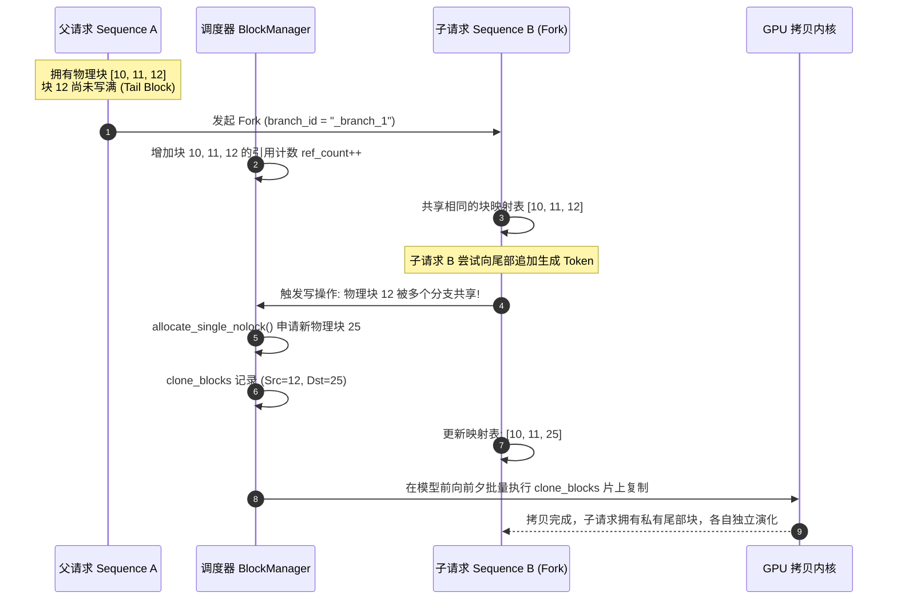

# 12 · BlockManager 与分块 KV 缓存管理

> 借鉴操作系统虚拟内存分页设计的 `BlockManager` 是高并发推理引擎的显存基石。DeepInfer 通过侵入式双向空闲链表、写时复制（CoW）与前缀哈希树，实现了显存碎片清零与多轮前缀即时复用。
> **前置知识**：操作系统虚拟内存分页（Paging）、写时复制（Copy-on-Write）、树形前缀树（Radix Tree）。
> **源码指引**：`csrc/engine/block_manager.hpp`、`csrc/engine/sequence.hpp`、`csrc/engine/scheduler.hpp`。

---

## 0. 本篇要回答的问题

- 传统的静态张量分配在长上下文与动态生成场景下，为什么会产生高达 60%~80% 的严重显存内部与外部碎片？
- DeepInfer 的 `Blocks` 数据结构是如何使用侵入式双向链表在 $O(1)$ 时间内完成显存块的分配与归还的？
- 为什么物理块 0（Block 0）被绝对禁止分配给任何真实数据？它在 CUDA Graph 中扮演了什么关键角色？
- 当出现多分支探索（Fork Branch）时，系统是如何通过 `clone_blocks` 批量列表与 GPU 算子实现异步写时复制（CoW）的？

---

## 1. 连续显存分配的灾难与分页化救赎

在早期的 Transformer 推理实现中，系统为每个请求分配显存时，通常按照该请求声明的「最大上下文长度」（如 `max_tokens = 4096`）一次性预分配一段连续的张量空间。

这种简单粗暴的分配方式在生产中面临两大致命缺陷：
1. **严重的内部碎片（Internal Fragmentation）**：绝大多数用户请求在生成几十个 Token 后便提前结束，为 4,096 预留的剩余庞大空间被白白闲置，导致集群显存利用率长期低于 30%；
2. **严峻的外部碎片（External Fragmentation）**：请求的生命周期高度动态，长短请求交替进出，连续显存空间被切得千疮百孔，即便总空闲显存尚存几十 GB，也无法再容纳一个连续的大张量。

```text
传统连续预分配 (碎片率极高):
[Request A (占用 100)] [     空闲闲置 3996     ] [Request B (占用 50)] [ 空闲闲置 4046 ]

Paged KV Cache 分页管理 (零内部与外部碎片):
物理显存池被均匀切分为固定 Block (如每个 Block 128 Tokens):
[Block 1] [Block 2] [Block 3] [Block 4] ... [Block N]
   ^         ^         ^
   |_________|_________|____ Request A 的逻辑块表只需记录离散的物理块号 [1, 2, 4]
```

正如操作系统用分页（Paging）与页表（Page Table）解耦了逻辑地址与物理物理内存一样，DeepInfer 的 `BlockManager` 将每个序列的 KV Cache 离散切分为固定大小的 **Paged Blocks**（如 16 或 128 Tokens 一个块）。

---

## 2. 侵入式双向链表与 `Blocks` 核心数据结构

为了追求极限的调度性能，DeepInfer 彻底摒弃了复杂的动态内存分配，在 `csrc/engine/block_manager.hpp` 中实现了纯静态预分配的高性能侵入式双向循环链表：

```cpp
struct Blocks {
    // 物理块 0 坚决不用，0 在系统全局指代空指针 / Dummy Slot
    Blocks(int _n) : _blocks(_n), _head(1), _tail(_n - 1), _size(_n - 1) {
        for (int i = 1; i < _n; ++i) {
            _blocks[i].prev = i - 1;
            _blocks[i].next = i + 1;
        }
        _blocks[_n - 1].next = 0;
    }
    
    // O(1) 头部出队分配
    int allocate_single_nolock();
    // O(1) 尾部就地归还
    void _push_back(int i);
};
```

```text
物理块池内存布局 (静态数组，由 prev / next 链表串联):
Index 0: [RESERVED / DUMMY]  <--- 永久保留，用于占位与防溢出
Index 1: [ref=0, prev=0, next=2]  <--- Free List Head
Index 2: [ref=0, prev=1, next=3]
...
Index N: [ref=0, prev=N-1, next=0]<--- Free List Tail
```

### 物理块 0（Block 0）的守护神职能
在 `block_manager.hpp` 的第 27 行明确注释：`NOTE: gpu blocks 0 是不用的，所以这里 0 代表空`。
这一设计具备双重精妙用途：
1. **空指针优雅表达**：类似 C 语言的 `nullptr`，逻辑块表中填入 0 即代表尚未映射物理显存；
2. **CUDA Graph 越界写吸收槽（Black Hole）**：在静态捕获的 CUDA Graph 中，批次中未占满的 Padding 行会被强行映射到物理块 0。算子在向显存写入垃圾数据时，所有脏写入全部集中在块 0 的受控区域内，杜绝了引发段错误或污染其他正常请求的可能！

---

## 3. 前缀缓存（Prefix Caching）与哈希匹配

在多轮对话与智能体（Agent）场景中，系统提示词（System Prompt）、少样本范例（Few-Shot Examples）与历史多轮对话会在多个用户请求间高度重合。

`BlockManager` 维护着全局的前缀树与哈希链映射表：
- **块内容哈希**：每一个完整的 128-token 物理块在写满后，其 Token 序列与前驱块哈希进行联合散列，生成唯一的 `block_hash`；
- **命中回溯机制**：新请求进入时，调度器顺着输入 Token 序列以 128 为步长在哈希表中探测：
  ```cpp
  // csrc/engine/scheduler.hpp 中的前缀命中探测
  int num_reserve_blocks = seq->cache.num_tokens / seq->cache.block_size;
  // 直接复用已命中物理块，增加对应块的引用计数（ref_count++）
  ```
- **立竿见影的收益**：一旦命中已有前缀，命中区间的全部 KV 既不需要重新执行 Prefill 计算，也不需要向显存分配新物理块，首字延迟（TTFT）与显存占用实现断崖式下降。

---

## 4. 分支探索（Fork）与异步写时复制（CoW）

在束搜索（Beam Search）、蒙特卡洛树搜索（MCTS）或智能体多路径试错场景中，同一个父请求可能会瞬间分叉出多个子分支（Fork Branches）。

如果为每个子分支全量克隆一份 KV Cache，显存与带宽将被瞬间击穿。DeepInfer 实现了完整的**写时复制（Copy-on-Write, CoW）**机制：



在 `scheduler.hpp` 中，所有写时复制操作并不立即在 CPU 侧同步执行，而是被收集到 `clone_blocks` 列表中：
```cpp
// 记录源块与目标块
clone_blocks.emplace_back(seq->cache.block_table[num_reserve_blocks]);
clone_blocks.emplace_back(new_block);
```
在 Worker 开始执行前向计算的前夕，一个批量显存拷贝 Kernel（如 `fused_transform` 或 PagedCopy）在 GPU 内部以数十 TB/s 的本地带宽完成尾块物理复制，CPU 侧全程仅耗费纳秒级的指针重赋。

---

## 5. 关键设计取舍与代价

| 特性 | 传统连续分配 | DeepInfer Paged BlockManager |
|---|---|---|
| **显存碎片率** | 外部碎片严重，利用率 < 35% | 内部碎片由块尺寸限制，**外部碎片严格为 0** |
| **显存分配复杂度** | 依赖复杂显存管理器（如 jemalloc） | 静态双向链表，分配与释放严格为 **$O(1)$** |
| **分支克隆开销** | 必须全量拷贝整个历史上下文 | 仅在修改尾块时执行 CoW，克隆开销几乎为 0 |
| **注意力算子要求** | 支持标准连续 GEMM 注意力 | 算子必须支持非连续寻址（如 FlashMLA / PagedAttention） |

---

## 6. 小结

- `BlockManager` 以分页理念重构了大模型 KV 缓存，彻底消除了动态推理中的外部显存碎片；
- 静态预分配的双向链表将内存分配与回收压缩到了纳秒级常数时间，物理块 0 的占位机制巧妙保障了 CUDA Graph 的静态安全性；
- 前缀缓存探测与基于 CoW 的异步分支克隆，为多轮智能体对话与高分支推测提供了强悍的底层支撑。

---

## 延伸阅读 / 下一篇

- 下一篇：[`13-worker-pipeline-and-overlap.md`](13-worker-pipeline-and-overlap.md) · Worker 执行流水线与重叠机制，进入第四部分运行时层，探秘 GPU 前向、采样与后处理的三段论协同。
- 核心源码：`csrc/engine/block_manager.hpp`。
