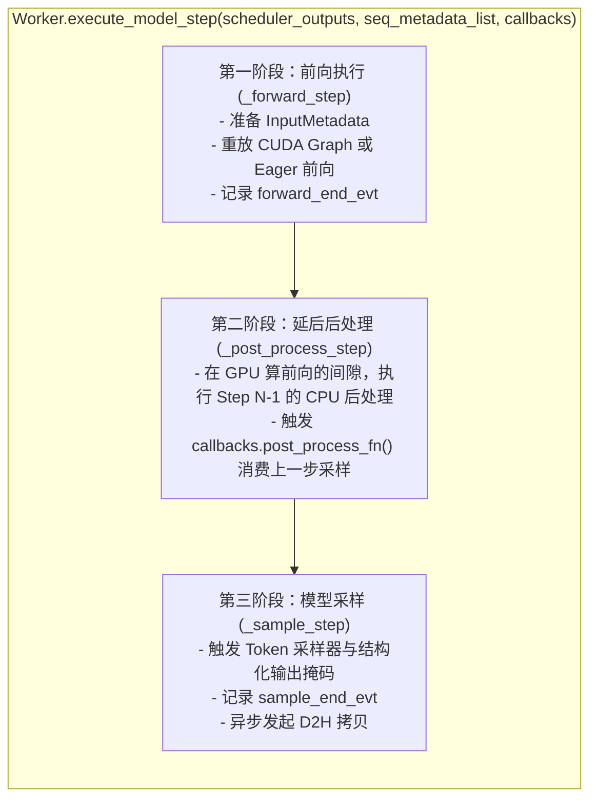
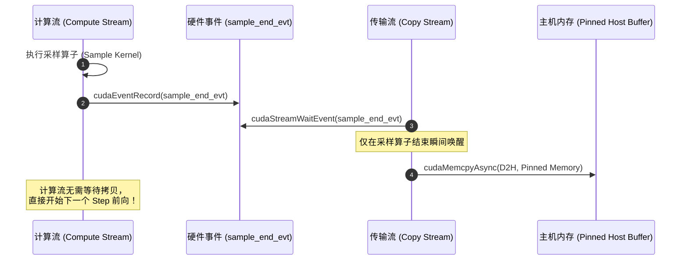

# 13 · Worker 执行流水线与重叠机制

> GPU 工作进程 `Worker` 是底层执行流水线的心脏。通过 Forward-PostProcess-Sample 三段论的严谨解耦与事件级联，DeepInfer 将计算、采样与主机回调完美织入异步交织的硬件流水线。
> **前置知识**：CUDA Streams 与 Events 异步编程、同步守护（Sync Guard）、PyTorch C++ 扩展。
> **源码指引**：`deepinfer/worker/worker.py`、`deepinfer/worker/base.py`、`deepinfer/worker/zos_status.py`、`csrc/cuda_utils.cpp`。

---

## 0. 本篇要回答的问题

- GPU 上的单步模型执行是如何被精准拆解为前向（Forward）、后处理（Post-Process）与采样（Sample）三部曲的？
- 为什么看似无关痛痒的 `torch.cuda.synchronize()` 或隐式 `.item()` 调用会成为现代高性能推理引擎的性能毒药？
- DeepInfer 的 `WorkerStepState` 是如何保存跨步上下文，使得后处理操作能够安全延后并与下一轮前向完全重叠的？
- 框架是如何通过 `test_cuda_sync_guards.py` 与底层守护机制，在 CI/CD 中绝对保证热路径（Hot Path）零非法同步的？

---

## 1. Worker 执行体架构与三段论解耦

在每个绑定了物理 GPU 的计算进程中，核心执行体为 `Worker` 类（`deepinfer/worker/worker.py`，继承自 `WorkerBase`）。
其核心方法 `execute_model_step` 负责驱动单步执行：



### 为何将后处理（Post-Process）插在中间？
传统引擎往往在 `Sample` 结束后立即执行 `Post-Process`，此时 GPU 必须等待 CPU 完成后处理才能继续。
而 DeepInfer 巧妙地将后处理移到了 **`_forward_step` 之后、`_sample_step` 之前**（或者在 ZOS 模式下跨步重叠）：
- 此时 GPU 正忙于执行深达数十层的密集矩阵乘法（Forward），耗时较长；
- CPU 正好利用这段算力填满的宝贵空闲，并发执行上一步采样结果的 Python 字符串解码与序列结束标记检测；
- CPU 与 GPU 各司其职，互不等待。

---

## 2. 状态载体：`WorkerStepState` 与跨步生命周期

为了支持后处理的跨步延后执行，当前步的全部上下文不能随函数返回而销毁，必须保存在结构化的状态快照中：

```python
# deepinfer/worker/zos_status.py
@dataclass
class WorkerStepState:
    seq_metadata_list: list[SequenceMetadata] | None
    """必须保持有效直到下一个 step 的 _post_process_step，由 engine post_process 将其归还给对象池"""
    scheduler_outputs: SchedulerOutputs | None
    sampler_output: SamplerOutput
    is_prompt: bool
    is_placeholder: bool
    sample_end_evt: torch.cuda.Event
    forward_events: tuple[torch.cuda.Event, torch.cuda.Event] | None = None
    sample_events: tuple[torch.cuda.Event, torch.cuda.Event] | None = None
    graph_size: int = 0
```

1. **生命周期延长**：`seq_metadata_list` 内部持有所有正在执行的序列指针。它在 Step $N$ 结束时被封存进 `WorkerStepState`，直到 Step $N+1$ 触发 `_post_process_step` 时，才被统一归还给全局对象池 `SequenceMetadataPool`；
2. **硬件事件锚定**：`sample_end_evt` 是一个非阻塞的 CUDA Event。它记录了采样内核在显卡硬件指令流中的完成标记，后续的数据拷贝或流同步严格依赖此 Event，坚决杜绝粗暴的全局设备同步。

---

## 3. 同步守护（Sync Guard）与零意外同步法则

在大模型推理系统研发中，最大的性能杀手往往来自**隐式的意外同步**：
- 在代码中不经意间调用了 `tensor.item()` 或 `tensor.tolist()`；
- 使用了打印调试语句 `print(tensor)`；
- 调用了未经异步改造的第三方库函数，内部偷偷执行了 `cudaStreamSynchronize()`。

这些调用会像急刹车一样瞬间打断 GPU 异步流水线，清空硬件流水线中的全部预取指令，使端到端吞吐暴跌 40% 以上！

### 自动化同步守护机制
在 `csrc/cuda_utils.cpp` 与 `deepinfer/environ.py` 中，DeepInfer 引入了严苛的 **Sync Guard 机制**：
```cpp
// 核心同步拦截桩 (Hook)
void hook_cuda_stream_synchronize(cudaStream_t stream) {
    if (!envs::DEEPINFER_DISABLE_SYNC_GUARD) {
        // 如果在热路径受保护区域内检测到了未经批准的显式同步
        // 立即抛出致命异常或记录 Crash Header 日志！
        LOG_FATAL("Illegal CUDA synchronization detected inside hot path!");
    }
    cudaStreamSynchronize(stream);
}
```

在持续集成（CI）套件 `tests/test_cuda_sync_guards.py` 中，框架对整个自回归循环进行全量插桩测试：只要在 1,000 次自回归生成中发生了一次非预期的 CUDA 同步调用，构建流水线将立即亮起红灯并阻断合并。这种严苛的工程纪律保障了热路径的绝对纯净。

---

## 4. D2H 异步拷贝与流级联机制

当采样内核完成时，新的 Token ID 必须回传给 CPU，以便向用户客户端发送 Server-Sent Events（SSE）流式响应。

DeepInfer 构建了双流级联架构：
- **默认计算流（Compute Stream）**：负责执行 Forward 与 Sample 内核；
- **专用传输流（Copy Stream）**：负责执行 Device-to-Host（D2H）异步显存搬运。



通过这一级联体系，采样结果的回传完全运行在 GPU 的独立 DMA 拷贝引擎上，绝不侵占计算核心时间片，实现了物理层面的零干扰流式输出。

---

## 5. 关键设计取舍与代价

| 特性 | 常规 PyTorch 驱动实现 | DeepInfer Worker 异步流水线 |
|---|---|---|
| **执行模型** | 串行 Forward -> Sample -> Sync | 三段论解耦 + 延后重叠 + 双流级联 |
| **同步开销** | 每步执行 1~2 次阻塞式同步 | 热路径全程零阻断同步，事件非阻塞监听 |
| **调试复杂度** | 简单直观，即时打印张量 | 异步并发度高，需依赖专属 Profiler 探针排障 |
| **CPU 单核利用率** | 频繁处于等待状态 | 算力与后处理完全饱和，CPU 周期被榨取至极限 |

---

## 6. 小结

- `Worker` 是 GPU 物理计算的驱动核心，通过将后处理延后执行，将 CPU 耗时完全掩盖在 GPU 矩阵乘法之下；
- `WorkerStepState` 精确维系了跨步上下文与硬件同步事件的生命周期；
- 严苛的 `Sync Guard` 守护体系从根本上阻断了热路径意外同步，确保了流水线永不停歇的高速运转。

---

## 延伸阅读 / 下一篇

- 下一篇：[`14-cuda-graph-runner.md`](14-cuda-graph-runner.md) · CUDA Graph 捕获与分级批处理执行，探究系统如何通过图捕获（Graph Capture）将小批次自回归的发射开销压缩至极限。
- 核心源码：`deepinfer/worker/worker.py`。
