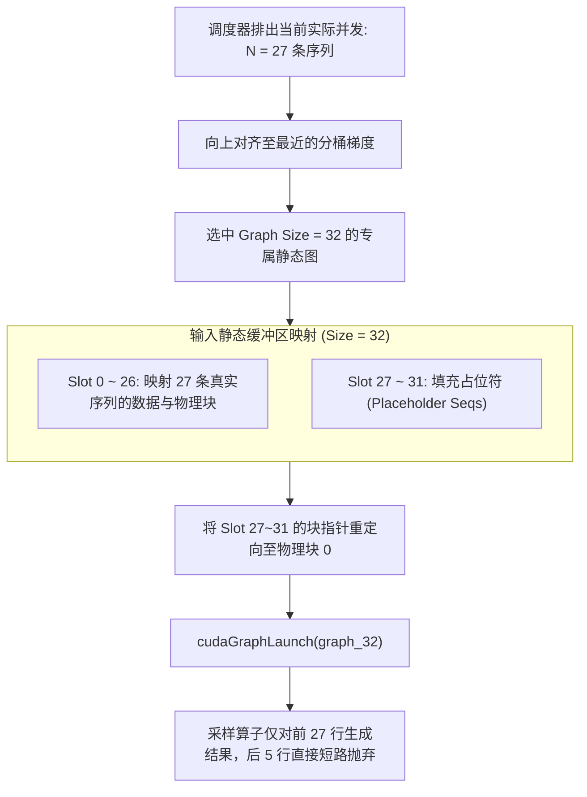

# 14 · CUDA Graph 捕获与分级批处理执行

> 在大模型小 Batch 解码场景下，CPU 发射上百个细粒度算子的耗时往往超过了 GPU 实际计算耗时。DeepInfer 通过静态地址绑定、分级批处理分桶与占位符安全陷阱，使 CUDA Graph 在动态推理负载下全面普及。
> **前置知识**：CUDA Graph 捕获与重放（`cudaGraphLaunch`）、算子发射开销、显存静态地址锁定。
> **源码指引**：`deepinfer/worker/cuda_graph_runner.py`、`deepinfer/worker/dflash_cuda_graph_runner.py`、`deepinfer/worker/model_runner.py`。

---

## 0. 本篇要回答的问题

- 自回归解码时，为什么即使 GPU 算力极其充裕，单步生成依然可能被 CPU 的算子发射（Kernel Launch）开销卡死？
- CUDA Graph 要求图内所有张量的显存物理地址和执行拓扑绝对不可变，这与动态进出的在线请求存在怎样的根本冲突？
- DeepInfer 是如何通过分级批处理分桶（Interval Bucketing）与占位符安全槽位（Placeholder on State 0）化解这一冲突的？
- DFlash 推测解码模块是如何拥有专属的 `DFlashCUDAGraphRunner` 并与主模型图协同重放的？

---

## 1. 小 Batch 解码下的发射开销墙

在自回归解码（Decode）阶段，每个 Step 的计算量相对较小。以一个 60 层的模型为例：
每层包含 RMSNorm、MLA QKV 投影、RoPE 旋转位置编码、FlashMLA 注意力、MHC 混合 GEMM、MoE 门控路由、DeepEP 通信与 FFN 矩阵乘等。
整网单步前向需要依次发射超过 **200~400 个细粒度 CUDA Kernel**！

在传统的 Eager 模式下：
- CPU 必须逐个向 CUDA 驱动提交每一个 Kernel 的执行参数；
- CPU 发射一个 Kernel 的驱动开销约为 3~5 微秒。发射 300 个 Kernel 累计耗时高达 **1.0 ~ 1.5 毫秒**；
- 在 Batch Size 较小（如并发 8~32 个序列）时，GPU 实际执行这些 Kernel 甚至只需要 0.8 毫秒！
- **CPU 发射速度远远跟不上 GPU 执行速度**，GPU 在算子之间频繁出现微停顿，硬件利用率惨不忍睹。

```text
Eager 模式 (CPU 逐个发射算子，耗时累积):
CPU: [Kernel 1] -> [Kernel 2] -> ... -> [Kernel 300] (总计耗时 1.2 ms)
GPU:    [K1]   气泡   [K2]    气泡        [K300]      (频繁微等待)

CUDA Graph 模式 (整图单次触发):
CPU: [单次启动图: cudaGraphLaunch()] (总计耗时 < 5 微秒!)
GPU: [================= 硬件直接按依赖流水线满载执行 =================]
```

CUDA Graph 技术允许在初始化阶段通过「干跑捕获（Capture）」预先录制好整张计算图的硬件指令序列。在推理执行期，CPU 仅需调用一次 `cudaGraphLaunch()`，GPU 硬件调度器便在芯片内部以微秒级延迟全速驱动全部 300 个算子。

---

## 2. 动态推理负载与静态图约束的矛盾

尽管 CUDA Graph 性能极其惊人，但它在在线服务中的落地面临着苛刻的**静态性约束**：
1. **显存地址不可变**：图中所有输入、输出与中间激活张量的物理显存地址在捕获后必须绝对固定，不能发生重分配；
2. **张量形状不可变**：捕获时的 Batch Size、序列长度必须是恒定的静态整数；
3. **然而在线请求是高度动态的**：上一秒并发 17 个请求，这一秒 3 个请求生成结束退出，同时新来 5 个请求……并发 Batch Size 无时无刻不在剧烈波动！

---

## 3. 分级批处理分桶（Interval Bucketing）

为了让动态负载适配静态图，DeepInfer 在 `deepinfer/worker/cuda_graph_runner.py` 中实现了**多阶分级捕获与分桶运行策略**。

系统通过环境变量 `DEEPINFER_CUDAGRAPH_BATCH_SIZE_INTERVAL`（默认间隔为 8）构建一组离散的分桶梯度：

$$\text{Graph Sizes} = [1, 2, 4, 8, 16, 24, 32, 40, 48, 56, 64, \dots, \text{max\_num\_seqs}]$$



### 占位符安全陷阱（Placeholder on State 0）
当实际并发数为 27、而执行的图尺寸为 32 时，多出来的 5 个槽位被称为 **占位符（Placeholder）**。
如果放任未初始化的占位符参与计算，它们持有的野指针极易导致显存越界崩溃（CUDA illegal memory access）。

DeepInfer 巧妙地利用了在前文中介绍的 `BlockManager` 物理块 0：
```python
# cuda_graph_runner.py 中的占位符安全绑定
def _patch_placeholders(self, actual_num_seqs: int, graph_size: int):
    # 将实际序列之后的 padding 槽位全部强行指向保留物理槽位 0
    # 物理块 0 是一块合法的显存黑洞，任何对它的写入都被安全吞噬
    self.static_block_table[actual_num_seqs:graph_size].fill_(0)
    self.static_state_slots[actual_num_seqs:graph_size].fill_(0)
```
通过将全部占位符安全绑定到物理槽位 0，整个 CUDA Graph 在执行过程中没有任何内核发生越界异常。在后置的采样阶段，系统仅读取前 27 行的真实 logits，尾部 Padding 数据直接被原地忽略。

---

## 4. DFlash 推测解码专属图：`DFlashCUDAGraphRunner`

在启用了 DSpark / DFlash 多词元推测解码（MTP）的环境下，系统不仅需要运行主模型，每一步还需要运行辅助推测小模型生成后续的 Draft Tokens。

若推测模型使用常规 Eager 模式执行，推测阶段节约的算力将被频繁的小算子发射开销吞噬殆尽。
在 `deepinfer/worker/dflash_cuda_graph_runner.py` 中，DeepInfer 为推测解码量身定制了独立的 Graph Runner：
- **独立的捕获与重放流水线**：推测模型拥有自己独立的 Batch 分桶静态图（由 `DEEPINFER_DFLASH_CUDAGRAPH_BATCH_SIZE_INTERVAL` 控制）；
- **主模型与推测模型事件串联**：主模型的 `CUDAGraphRunner` 与 DFlash 的 `DFlashCUDAGraphRunner` 通过内部 CUDA Event 紧密衔接，在完全不返回 CPU 的情况下实现「主模型验证 -> 即刻触发推测生成」的纯片上闭环。

---

## 5. 解码性能缓存：`decode_perf_cache.py`

不同批次大小在不同硬件平台上的耗时并非简单的线性函数。
在 `deepinfer/worker/decode_perf_cache.py` 中，系统在冷启动阶段通过 `examples/sweep/` 预先扫描各分桶尺寸下的基线耗时，并将结果持久化在本地磁盘：
```python
class DecodePerfCache:
    """缓存实测的图尺寸耗时特征，为调度器的 MTP 运行时耗时估计器提供高精度先验"""
    def lookup(self, graph_size: int) -> float | None:
        ...
```
调度器在运行时结合这一性能缓存与滑动窗口实测反馈，动态求解吞吐最优的推测预算，使系统时刻维持在最高 TPS 的工作点上。

---

## 6. 关键设计取舍与代价

| 特性 | Eager 逐算子动态发射 | DeepInfer CUDA Graph 分级分桶体系 |
|---|---|---|
| **CPU 发射耗时** | 1.0 ~ 2.0 毫秒 / Step | **< 0.005 毫秒 (单次图启动)** |
| **显存占用** | 显存随输入动态申请释放 | 需为各分桶预先分配固定的静态中间激活缓冲 |
| **动态弹性** | 任意 Batch 尺寸无缝支持 | 需向上垫平（Padding）至分桶边界，存在微小计算浪费 |
| **冷启动耗时** | 瞬间启动 | 初始化需花费数秒至数分钟预热并捕获各梯度计算图 |

---

## 7. 小结

- CUDA Graph 通过将数百个细粒度算子整合成单一硬件执行图，粉碎了小 Batch 解码下的 CPU 发射性能瓶颈；
- 分级批处理分桶将离散的动态请求巧妙映射至有限的静态图梯度上；
- 物理槽位 0 的安全陷阱机制化解了占位符越界风险，配合 DFlash 专属图运行器，全面释放了现代 GPU 的硬件潜能。

---

## 延伸阅读 / 下一篇

- 下一篇：[`15-memory-and-cache-engine.md`](15-memory-and-cache-engine.md) · CacheEngine 与显存-宿主内存层级管理，探究主显存、状态缓存与预热池在底层物理空间上的精密规划。
- 运行器源码：`deepinfer/worker/cuda_graph_runner.py`。
