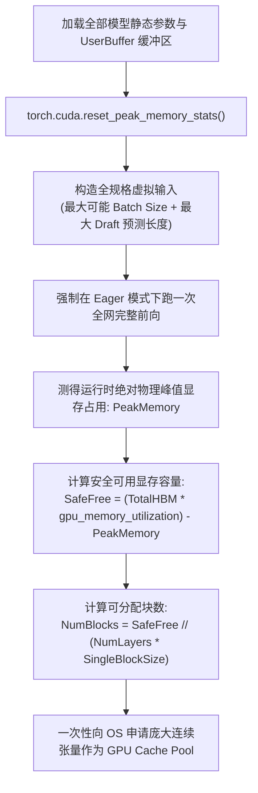
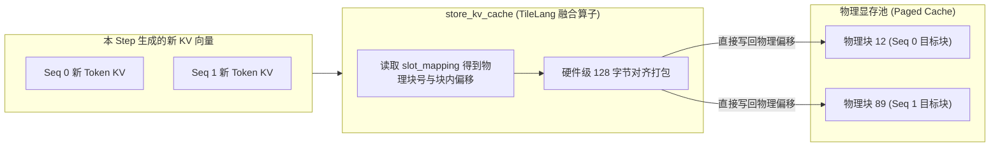

# 15 · CacheEngine 与显存-宿主内存层级管理

> 显存规划是高并发推理服务的生命线。`CacheEngine` 在系统初始化期通过干跑探针完成显存精准预算，精巧统筹主显存 Paged KV、SWA 状态缓存、UserBuffer 与宿主内存预热池。
> **前置知识**：GPU 显存物理分区、显存分析（Memory Profiling）、非连续寻址内存池。
> **源码指引**：`deepinfer/worker/cache_engine.py`、`deepinfer/config.py`、`deepinfer/model_executor/layers/tilelang_ops/cache_common.py`。

---

## 0. 本篇要回答的问题

- 在一张 80GB 或 192GB 的现代 GPU 上，物理显存是如何被静态权重、通信缓冲区、CUDA Graph 临时空间与动态 KV 缓存严密瓜分的？
- 系统冷启动时，`CacheEngine` 是如何通过干跑探针（Dry-Run Profiling）精确测出安全物理块数量而绝不引发 OOM 的？
- Main KV Cache（分块 Paged 格式）与 SWA State Cache（固定槽位格式）在物理张量层面上是如何区分排布的？
- 针对散落在非连续物理块上的 KV 数据，底层 TileLang 算子是如何实现超高吞吐的片上读写与异步搬运的？

---

## 1. GPU 显存物理版图的精密解剖

大模型服务启动时，显存管理绝不能采取「用到哪分配到哪」的动态申请模式，否则将在运行数小时后因碎片化和突发激活值暴涨导致致命的显存溢出（Out of Memory, OOM）。

DeepInfer 实施了严格的**全生命周期显存静态预算制**。在一张物理 GPU（如 NVIDIA SM100 或 H100）上，显存被划分为明确的四大硬分区：

```text
+-----------------------------------------------------------------------------------+
|                        DeepInfer 物理显存 (HBM) 静态分区模型                       |
|                                                                                   |
| 1. 模型静态权重 (Static Model Weights):                                            |
|    - 主干网络 Embeddings、Norm、MLA 投影权重                                      |
|    - 细粒度 MoE 路由专家权重 (MXFP4 压缩存储)                                     |
|    - DFlash MTP 辅助推测模型权重                                                  |
|                                                                                   |
| 2. 静态通信专用内存 (UserBuffer & Symmetric Memory):                               |
|    - DeepEP 专家路由 All-to-All 缓冲区 (EPBuffer)                                 |
|    - 上下文并行镜像归约区 (CPManager)                                              |
|    - Engram 稀疏哈希跨卡检索区 (EngramBuffer)                                      |
|                                                                                   |
| 3. 执行环境与图内存 (Runtime & CUDA Graph Buffers):                                |
|    - 各 Batch 分桶 CUDA Graph 捕获保留的中间激活值 (Static Activations)             |
|    - 算子临时 Scratchpad 空间                                                     |
|                                                                                   |
| 4. 动态缓存池 (Dynamic Cache Pool - 由 CacheEngine 独占管理):                      |
|    - Paged Block KV Cache (全局分块 KV 缓存，占可用显存的 90% 以上)                 |
|    - StateBlock Cache (局部 SWA 状态缓存槽位)                                      |
|    - 多模态特征缓冲池 (Multimodal Pool, 若启用)                                    |
+-----------------------------------------------------------------------------------+
```

---

## 2. 启动期干跑探针：`profile_num_available_blocks`

在服务启动时，系统如何知道到底能分配多少个物理 KV 块？
如果设置过于激进，在运行超大 Batch 时一旦触发短暂的显存峰值（如某一层的中间激活值由于动态形状增大），进程将立即崩溃；如果设置过于保守，则会浪费宝贵的显存容量，损害并发吞吐。

在 `deepinfer/worker/cache_engine.py` 与 `model_runner.py` 中，DeepInfer 实现了极度严谨的**干跑探针算法（Dry-Run Profiling）**：



通过这一干跑测试，框架实测获得了整个网络在极限工况下的真实激活值开销，将物理块数量 `num_gpu_blocks` 锚定在绝对安全的阈值之内。

---

## 3. CacheEngine 物理张量架构

一旦确定了块数量，`CacheEngine` 便一次性分配全量缓存张量（`deepinfer/worker/cache_engine.py`）：

### 3.1 主 KV 缓存张量（Main KV Cache）
主 KV 缓存用于存储编码层及全局长文本注意力特征。在底层物理张量上，它被组织为分层张量列表：
```python
# 每一层分配一个统一的大张量
# 形状: [num_blocks, 2, block_size, num_kv_heads, head_dim]
# 精度: 经 MXFP8 / e4m3 压缩打包后的底层格式
gpu_cache[layer_idx] = torch.empty(
    (num_gpu_blocks, 2, block_size, num_heads, head_dim),
    dtype=PLATFORM.kv_cache_dtype,
    device="cuda",
)
```
- `num_blocks`：由显存探针计算出的系统总块数（通常为数千至数万块）；
- `2`：分别对应 Key 与 Value；
- `block_size`：通常对齐为 16 或 128 个 Token。

### 3.2 局部 SWA 状态缓存（State Cache）
与按 Block 索引的主 KV 不同，SWA 状态缓存是**按并发槽位（Slot）**索引的（详见第 03 篇）：
- 槽位数量依据并发请求数上限配置：$\text{num\_slots} = \text{max\_num\_seqs} \times \text{DEEPINFER\_NUM\_STATE\_SLOTS\_RATIO}$；
- 显存布局高度规整，每个槽位固定分配 134 个 Token 的环形缓冲区；
- 与主 KV 缓存完全解耦，物理地址静态常驻，避免在分配链表中相互争抢。

---

## 4. 高吞吐片上散列读写算子

在执行自回归解码时，每个序列在每一步只生成一个（或推测解码下的数个）Token，但这些 Token 必须被写入各自专属的物理块中的特定偏移位置。

如果使用常规 PyTorch 索引切片（如 `cache[block_id, :, offset] = new_kv`），由于请求分布在完全离散的物理块上，频繁的细粒度写入将导致极其严重的 GPU 访存碎片化与极低的有效带宽利用率。

DeepInfer 在 `deepinfer/model_executor/layers/tilelang_ops/` 中提供了专用的 TileLang 高性能内核：
- **`store_kv_cache`**：在单次 Kernel 启动中，线程块按序列并行加载，依据 `block_table` 与 `slot_mapping` 将新生成的 Key/Value 向量以 128 字节对齐方式合并写入各自主块；
- **`load_paged_kv_cache`**：在执行注意力时，算子在片上直接完成离散块表的地址转换，无需在全局显存中将离散数据拼接为连续张量，彻底消除了显存搬运副本开销。



---

## 5. 关键设计取舍与代价

| 维度 | 传统动态缓存分配 | DeepInfer CacheEngine 体系 |
|---|---|---|
| **OOM 风险** | 突发长文本或大并发时极易意外崩溃 | 启动期干跑探针压测，**运行期 0 OOM 风险** |
| **内存池隔离性** | 权重、中间变量与缓存混在一块 | 严格划定四大物理分区，物理界限绝对隔离 |
| **访问局部性** | 碎片导致访存合并率极低 | TileLang 算子强制 128 字节硬件对齐合并读写 |
| **显存预留成本** | 显存随用随取，初始占用小 | 启动即占满指定比例显存（`gpu_memory_utilization`） |

---

## 6. 小结

- `CacheEngine` 建立了全生命周期的显存静态安全预算制，彻底根除了长时间服务运行中的 OOM 与碎片隐患；
- 干跑探针结合极限测试工况，精准解耦出安全可用块数；
- 专用 TileLang 读写算子使离散分块数据的片上加载与更新达到了逼近硬件总线极限的高性能。

---

## 延伸阅读 / 下一篇

- 下一篇：[`16-deepseek-v4-model-architecture.md`](16-deepseek-v4-model-architecture.md) · DeepSeek-V4 网络结构全景解析，进入第五部分模型层，系统剖析 DeepSeek-V4 的主干拓扑与跨层拓扑。
- 缓存源码：`deepinfer/worker/cache_engine.py`。
