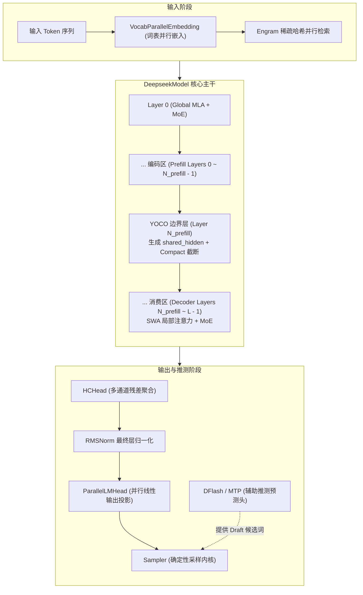
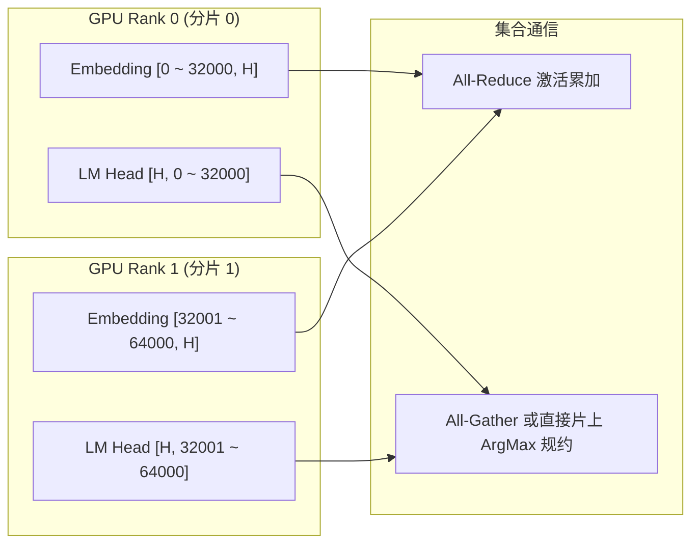

# 16 · DeepSeek-V4 网络结构全景解析

> DeepSeek-V4（DeepSeek-V4.1-Flash）融合了 MLA 低秩注意力、YOCO 单次缓存、MHC 多头超连接、细粒度 MoE 与 MTP 多词元预测，是算法与工程协同创新的集大成者。
> **前置知识**：标准 Transformer 解码层结构、词表并行（Vocab Parallelism）、残差网络。
> **源码指引**：`deepinfer/model_executor/models/deepseek.py`、`deepinfer/model_executor/models/decoder_layer.py`、`deepinfer/model_executor/models/v4_modules/cross_layer.py`。

---

## 0. 本篇要回答的问题

- `DeepseekModel` 与 `DeepseekForCausalLM` 的顶层模块是如何组装与划分职责的？
- 跨层拓扑运行时（`CrossLayerRuntime` 与 `SharedLayerTopology`）是如何使隐状态与 KV 索引在不增加参数的前提下跨越数十个物理层的？
- 嵌入层（`VocabParallelEmbedding`）与输出头（`ParallelLMHead`）是如何在大词表下实现分布式无损切分的？
- DFlash 辅助推测模型的目标层特征（`dflash_input`）是如何在主干网络中被就地采集并写入专用推测缓存的？

---

## 1. DeepSeek-V4 的宏观架构蓝图

DeepSeek-V4.1-Flash 是当前极具代表性的超大规模工业级大语言模型。其前向计算网络打破了经典 Transformer「层与层之间完全对称同构」的教条，呈现出高度结构化的功能分工：



---

## 2. 跨层拓扑与运行时传递：`CrossLayerRuntime`

在 DeepSeek-V4 中，很多层级需要消费其他层级的产物：
- 消费层需要访问第 $N_{\text{prefill}}$ 层的全局隐状态 `shared_hidden`；
- 某些注意力层共享前面某一层的未旋转 KV 投影张量 `pre_rope_kv`；
- MoE 路由的 Top-K 专家索引选择可能跨层复用。

若通过全局变量或反复克隆张量传递，会导致显存飞涨与逻辑混乱。
DeepInfer 在 `deepinfer/model_executor/models/v4_modules/cross_layer.py` 中设计了统一的轻量级载体 **`CrossLayerRuntime`**：

```python
class CrossLayerRuntime:
    """跨层持有的运行时值: 逐层传递同一引用，由各层原地写入并按需消费"""
    def __init__(self) -> None:
        self.shared_hidden: torch.Tensor | None = None
        self.pre_rope_kv: torch.Tensor | None = None
        self.moe_topk: torch.Tensor | None = None
        self.consumer_full_metadata: InputMetadata | None = None
```

在 `DeepseekModel.forward()` 的主循环中，同一个 `cross_layer_runtime` 实例被作为参数依序注入到每一层 `DeepseekDecoderLayer` 中：
```python
# deepseek.py 中的层间循环
cross_layer_runtime = CrossLayerRuntime()
for i in range(self.num_layers):
    hidden_states, residual = self.layers[i](
        hidden_states,
        kv_caches[i],
        input_metadata,
        residual,
        embed_hook=ngram_embed_hooks.get(i),
        cross_layer_runtime=cross_layer_runtime,
        dflash_input=dflash_input,
    )
```
- 第 $N_{\text{prefill}}$ 层将自身注意力后的归一化隐状态原地写入 `cross_layer_runtime.shared_hidden`；
- 后续所有的消费层解码层直接以无开销的只读指针消费该隐状态；
- 执行结束后，该临时上下文随前向函数一同离开作用域并销毁，零常驻显存开销。

---

## 3. 词表并行：`VocabParallelEmbedding` 与 `ParallelLMHead`

DeepSeek-V4 采用了高达 128,000+ 的超大词表。若单张 GPU 独占全量嵌入表与输出头：
- 单是权重矩阵就要占据 $128000 \times 7168 \times 2 \approx 1.83 \text{ GB}$ 显存；
- 在最终生成 Logits 时，需要计算 $[B \times S, 128000]$ 的超大矩阵乘法，单卡 SRAM 极易溢出。

DeepInfer 在 `deepinfer/model_executor/layers/vocab_parallel_embedding.py` 中实现了**基于张量并行的词表切分**：



1. **输入阶段（Embedding）**：词表沿行维度均匀切分到各卡。当某个 Token ID 落在当前 Rank 负责的区间内时，查出有效向量，否则填 0；最后通过一次快速的 All-Reduce 将各卡分片累加恢复；
2. **输出阶段（LM Head）**：线性投影层沿列维度切分。各卡各自计算局部的分块 Logits，并直接在采样器内部执行跨卡局部 Top-1 / Top-P 归约，无需在主显存中拼接庞大的全量 Logits 张量。

---

## 4. DFlash 推测特征的原地抽头采集

在开启了推测解码（`envs.DEEPINFER_USE_NEXTN_DECODE > 0`）的环境下，辅助推测模型需要以主模型某些特定深层的隐层特征（如第 20、40 层）作为输入，以预测后续数个 Draft Token。

传统做法往往需要在模型前向结束后，从中间张量缓存中做多次显存拷贝。
而在 DeepInfer 中，这一采集过程被完全**原地抽头（In-Place Tap）**：
```python
# deepseek.py 中的抽头张量初始化
dflash_input = (
    hidden_states.new_empty((hidden_states.size(0), self.dflash_input_size))
    if dflash is not None else None
)
```
每一层 `DeepseekDecoderLayer` 在初始化时被告知自身的 `dflash_input_index`：
当且仅当该层为推测模型的目标层时，算子在输出隐状态的同时，直接以切片视图将张量写入 `dflash_input` 的预留列区间中。
整个前向循环结束时，`dflash_input` 已经静静就绪，立即被 `dflash.update_main_cache` 捕获进推测模块，达到了绝对的零拷贝。

---

## 5. 关键设计取舍与代价

| 特性 | 经典标准 Transformer 实现 | DeepSeek-V4 网络设计 | 架构收益与代价 |
|---|---|---|---|
| **网络同构性** | 全层统一结构，调度无分支 | 编码层与消费层异构，引入 SWA 与 YOCO | 模型表征更灵活，但对动态张量图切分要求极高 |
| **层间数据交互** | 仅通过唯一的残差流严格向下传递 | 引入 `CrossLayerRuntime` 跨层直达 | 节约了海量全局 KV 显存，增加了局部状态维护复杂度 |
| **推测特征采集** | 独立的 Hook 机制或额外前向 | 主模型前向内部原地抽头切片 | 零显存二次拷贝开销，代码耦合度稍有提升 |
| **词表并行** | 单卡全量加载词表 | 分布式切分词表与并行输出头 | 降低单卡显存开销，需引入轻量词表通信归约 |

---

## 6. 小结

- `DeepseekModel` 完美集成了 YOCO、SWA、MHC 与细粒度 MoE，代表了当代大模型系统工程的最尖端拓扑；
- `CrossLayerRuntime` 实现了无垃圾回收负担的轻量跨层状态借调；
- 原地抽头机制与词表并行切分确保了模型在承载超大参数量与推测预测时，依旧维持极致纯净的计算流水线。

---

## 延伸阅读 / 下一篇

- 下一篇：[`17-mla-and-flashmla.md`](17-mla-and-flashmla.md) · Multi-Head Latent Attention (MLA) 与 FlashMLA 算子，深入推导 DeepSeek 独创的低秩注意力压缩数学原理与 SASS 级算子实现。
- 模型源码：`deepinfer/model_executor/models/deepseek.py`。
