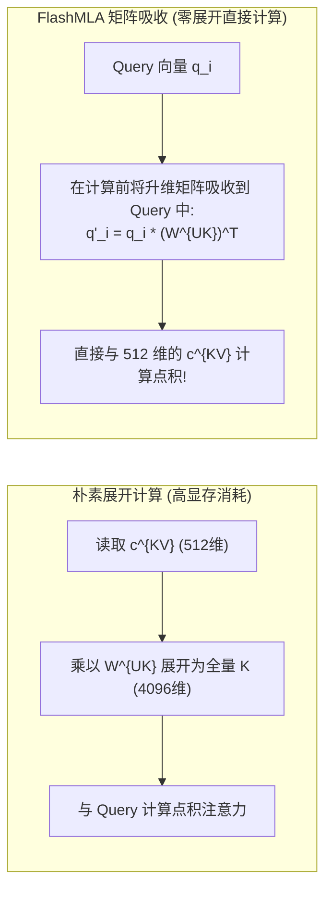

# 17 · Multi-Head Latent Attention (MLA) 与 FlashMLA 算子

> Multi-Head Latent Attention（MLA）通过低秩隐空间投影与解耦 RoPE，将自回归解码的 KV 缓存体积压缩了近 80%。DeepInfer 深度集成专用算子库 FlashMLA，以矩阵吸收与 SASS 级调优实现惊人的访存带宽利用率。
> **前置知识**：多头注意力（MHA）、分组查询注意力（GQA）、旋转位置编码（RoPE）、矩阵结合律。
> **源码指引**：`deepinfer/model_executor/models/v4_modules/mla_attn.py`、`deepinfer/model_executor/models/v4_modules/attn.py`、`vendor/FlashMLA`。

---

## 0. 本篇要回答的问题

- 传统的 MHA 与 GQA 在超长文本自回归解码时，面临怎样的 KV Cache 显存容量与总线带宽瓶颈？
- MLA 是如何通过低秩压缩矩阵 $W^{DKV}$ 将庞大的 Key 与 Value 张量合二为一压缩进低维隐空间（$c^{KV}$）的？
- 为什么旋转位置编码（RoPE）无法直接与低秩矩阵乘法结合？MLA 的「解耦 RoPE（Decoupled RoPE）」是如何解决这一数学矛盾的？
- FlashMLA 算子是如何利用矩阵吸收技术，做到**在完全不还原全量 Key/Value 的前提下直接计算注意力**的？

---

## 1. 注意力机制的显存演化史与 MLA 突破

在自回归解码中，注意力计算的瓶颈从来不在计算能力，而在显存访问带宽：
- **标准多头注意力（MHA）**：每个注意力头独占一份 Key 与 Value。每 Step 必须加载所有头的全量 KV，显存爆炸最严重；
- **分组查询注意力（GQA）**：多个 Query 头共享一组 Key-Value 头（例如 8 个 Query 头共享 1 组 KV）。虽然将显存减少了数倍，但在超长序列下仍需存储数百上千维度的张量，且对模型表征能力有一定损伤。

```text
各代注意力机制单 Token KV 缓存维度对比:
MHA (64 heads, head_dim 128):     64 x 128 x 2 = 16,384 维 (显存沉重)
GQA (8 KV groups, head_dim 128):  8 x 128 x 2  =  2,048 维 (折中方案)
DeepSeek MLA (低秩隐向量 + 解耦 RoPE): 512 + 64   =    576 维 (压缩比达 4x ~ 28x!)
```

DeepSeek 独创的 **Multi-Head Latent Attention (MLA)** 开创了全新的方向：**不再粗暴地砍掉注意力头数量，而是利用低秩投影将注意力键值压缩进一个紧凑的隐空间！**

---

## 2. MLA 数学原理与解耦 RoPE

### 2.1 低秩键值压缩（KV Low-Rank Compression）
对于当前时间步的隐状态 $h_t \in \mathbb{R}^H$，MLA 首先将其投影为一个极低维度的压缩潜变量 $c_t^{KV} \in \mathbb{R}^{d_c}$（通常 $d_c = 512$）：

$$c_t^{KV} = W^{DKV} h_t$$

在理想情况下，模型在需要计算注意力时，可以通过升维矩阵 $W^{UK} \in \mathbb{R}^{d_c \times (N_h \cdot d_h)}$ 与 $W^{UV} \in \mathbb{R}^{d_c \times (N_h \cdot d_h)}$ 重新还原出各个头的全量 Key 与 Value：

$$K_t = W^{UK} c_t^{KV}, \quad V_t = W^{UV} c_t^{KV}$$

### 2.2 旋转位置编码的数学冲突与解耦解决
然而，现代大模型无一例外依赖**旋转位置编码（RoPE）**来注入相对位置信息。
RoPE 的数学本质是对向量按二维平面执行正交旋转变换矩阵 $R_{\Theta, m}$：

$$\text{Rotated } K_{t} = R_{\Theta, t} (W^{UK} c_t^{KV})$$

这里出现了一个致命的代数冲突：**旋转矩阵 $R_{\Theta, t}$ 是与绝对位置 $t$ 强绑定的，它无法与升维矩阵 $W^{UK}$ 进行结合律交换！**
这就意味着：如果直接对还原后的 $K$ 加 RoPE，缓存就必须保存旋转后的高维 $K$，低秩压缩将彻底失效！

DeepSeek 的破局神来之笔正是 **解耦 RoPE（Decoupled RoPE）**：
将 Key 向量显式拆解为两个正交分量：
1. **不带位置的内容向量（Content Key）**：完全由低秩隐变量 $c_t^{KV}$ 表达，不含任何 RoPE；
2. **专属位置的解耦向量（Decoupled RoPE Key）**：从 $h_t$ 额外独立投影出一个极小的局部向量 $k_t^R \in \mathbb{R}^{d_R}$（如 $d_R = 64$），并对其单独应用 RoPE 旋转！

$$K_t = \begin{bmatrix} W^{UK} c_t^{KV} \\ R_{\Theta, t} (W^{KR} h_t) \end{bmatrix}$$

在显存中，系统**仅仅需要缓存紧凑的 $[c_t^{KV}, k_t^R]$**，总维度仅为 $512 + 64 = 576$！

```text
MLA 单 Token KV 缓存紧凑物理结构:
+-------------------------------------------------------+--------------------+
| 低秩内容隐向量 c^{KV} (512 维, 经 e4m3 / MXFP8 压缩)   | 解耦 RoPE 键 k^R    |
| (所有注意力头共享此内容隐状态，无需展开)               | (64 维, 携带位置)  |
+-------------------------------------------------------+--------------------+
```

---

## 3. FlashMLA 核心：矩阵吸收算子（Matrix Absorption）

即使显存中只存了 576 维，如果在 Decode 计算时，每次都要先在显存里把 $c_t^{KV}$ 乘以 $W^{UK}$ 展开为高维的 $K$、再算注意力，依然会带来巨大的临时显存分配与冗余搬运。

DeepInfer 集成的专属高性能算子库 **FlashMLA**（`vendor/FlashMLA`）运用矩阵结合律，实现了令人叹为观止的**矩阵吸收计算**：

$$Q_i K_t^T = (W^{UQ} c_i^Q) (W^{UK} c_t^{KV})^T = c_i^Q \left( W^{UQ} (W^{UK})^T \right) (c_t^{KV})^T$$



在解码前向中：
- 升维权重矩阵 $W^{UK}$ 预先与当前的 Query 向量在片上相乘，生成吸收后的转换向量 $q'_i$；
- 在注意力扫描历史块时，Tensor Core **直接读取 512 维的原始压缩向量 $c_t^{KV}$ 与 $q'_i$ 进行点积**！
- 全量高维的 Key 向量在整个物理生命周期中**根本从未在显存中真实存在过**！

---

## 4. 极致工程调优：SASS 级硬件特化

根据官方 Q&A 白皮书，开源版 FlashMLA 已经展现出卓越性能，能够将显存总线带宽利用率推升至 85% 以上：
1. **分块解码加速（Chunked Decode）**：针对超长上下文自回归，FlashMLA 沿 KV 块维度（`block_size`）进行自适应 Tile 切分，将局部累加和锚定在 SM 的 Shared Memory 与寄存器文件内；
2. **双重点积硬件流水线**：片上同时交替流水推进 Content 点积（基于低秩隐空间）与 RoPE 点积（基于解耦位置向量），最后在寄存器内原子相加；
3. **软硬件端到端协同**：在生产部署中，FlashMLA 配合 DeepSeek 内部特化的微缩放算子，解码时延较普通 FlashAttention-2 暴降 3~5 倍。

---

## 5. 关键设计取舍与代价

| 维度 | 标准 MHA / GQA | DeepInfer MLA + FlashMLA |
|---|---|---|
| **单 Token 显存开销** | 2,048 ~ 16,384 维 | **仅 576 维 (压缩近 80%)** |
| **Decode 阶段访存带宽** | 总线满载，算力严重饥饿 | 访存压力剧减，有效并发 Batch 提升 3~4 倍 |
| **矩阵乘算力需求** | 简单的 QKV 线性投影 | 增加了一次 $W^{DKV}$ 低秩压缩与片上投影计算 |
| **算子开发壁垒** | 通用注意力算子广泛支持 | 必须依赖高度定制的专属汇编级 SASS 内核 |

---

## 6. 小结

- MLA 从数学本质上重塑了注意力机制，通过低秩隐空间与解耦 RoPE 达成了惊人的 KV 缓存瘦身；
- 矩阵吸收技术打破了「必须先解压才能计算」的思维定势，使计算直接运行在压缩特征之上；
- FlashMLA 算子库代表了深度学习系统与硬件微架构融合调优的最高水准，是支撑 DeepSeek-V4 超低生成成本的核心功臣。

---

## 延伸阅读 / 下一篇

- 下一篇：[`18-deepgemm-and-tilelang-kernels.md`](18-deepgemm-and-tilelang-kernels.md) · DeepGEMM 与 TileLang 自研算子库，探究 JIT 编译特化与动态调度修正算子的底层黑科技。
- 算子源码：`vendor/FlashMLA`、`deepinfer/model_executor/models/v4_modules/mla_attn.py`。
