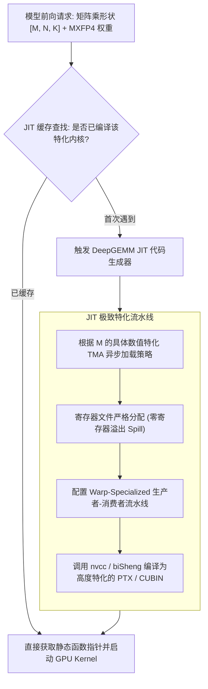
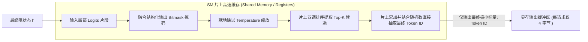

# 18 · DeepGEMM 与 TileLang 自研算子库

> 在超大规模推理系统中，通用计算库往往无法适应动态畸形 Batch 与细粒度量化。DeepInfer 深度集成 JIT 特化矩阵乘库 DeepGEMM，并全面以领域专用语言 TileLang 重构关键运行时算子，打造了算子级垂直闭环。
> **前置知识**：通用矩阵乘法（GEMM）、即时编译（JIT）、GPU 层次化存储体系（Register / Shared Memory / HBM）。
> **源码指引**：`vendor/DeepGEMM`、`deepinfer/model_executor/layers/tilelang_ops/`、`deepinfer/model_executor/models/v4_modules/mhc_ops.py`。

---

## 0. 本篇要回答的问题

- 传统的通用稠密计算库（如 cuBLAS、CUTLASS）在面对大模型自回归解码的非对齐动态 Batch（如 $M=17, 29$）时，为何会出现算力利用率暴跌？
- DeepGEMM 是如何利用 JIT 动态编译特化与细粒度微缩放支持，实现远超通用库的 FP8/FP4 矩阵乘性能的？
- 什么是 TileLang 算子编程语言？它如何在保持 Python 级敏捷开发的同时输出极致性能的汇编代码？
- DeepInfer 内部的数十个核心胶水算子（如 `fused_sample`、`schedule_mtp_varlen`）是如何通过 TileLang 消除显存往返（Round-Trip）的？

---

## 1. 动态自回归解码下的通用 GEMM 困境

在传统的深度学习训练中，矩阵维度通常是静态且高度规整的（如 $M, N, K$ 均为 1024 或 4096 的整倍数）。厂商提供的通用计算库（如 NVIDIA cuBLAS）能够通过针对规整形状的静态调优，轻松跑出 80%~90% 的硬件峰值。

但在**大模型云端推理的自回归解码阶段**，矩阵乘的形状呈现出截然不同的特征：
1. **极度扁平且动态多变（Extreme M-Shape Skew）**：解码时的 $M$ 维度代表当前批次活跃的有效 Token 总数（如 $M = 1, 7, 23, 49$），而 $N$ 与 $K$ 维度（隐藏层与专家参数）通常高达数千乃至数万；
2. **算子填充浪费（Padding Waste）**：传统 GEMM 算子往往强制要求 $M$ 维度按 64、128 或 256 对齐。若当前批次仅有 17 个 Token，算子内部被迫填充大量无意义的零，导致大量 Tensor Core 周期在空转；
3. **细粒度 Microscaling 不兼容**：主流 cuBLAS 对 Per-16 或 Per-32 的细粒度量化微缩放因子缺乏原生支持，迫使开发者在调用前后插入额外的反量化算子。

DeepSeek 团队开源的 **DeepGEMM** 与 **TileLang**，正是为了打破通用库的桎梏而生。

---

## 2. DeepGEMM：JIT 编译特化的高性能 GEMM 库

DeepGEMM（位于 `vendor/DeepGEMM` 与 `vendor/DeepGEMM-Ascend`）不是一个包含死板预编译内核的静态库，而是一个**面向动态形状与低精度的 JIT 编译执行引擎**：



### DeepGEMM 的三大核心技术突破
1. **Warp-Specialized 架构**：在 SM 内部，将 Warp 严格划分为「生产者 Warp（负责通过 TMA 将数据从 HBM 异步搬运至片上 Shared Memory）」与「消费者 Warp（负责驱动 Tensor Core 进行 MMA 乘加计算）」，软硬件流水线天然重叠；
2. **零解压硬件微缩放点积**：原生集成对 MXFP8（E4M3/E5M2）与 MXFP4（ue8m0 per-32）的支持，在读取微缩放因子的同时就地完成寄存器内点积累加；
3. **M 维度极致自适应分块**：当 $M=1$ 时自动退化为 GEMV 极限带宽优先模式；当 $M \ge 32$ 时平滑切换至 Split-K 计算密集型并行模式，确保任何批次尺寸下的性能曲线均平滑饱满。

---

## 3. TileLang：领域专用可定制算子编程语言

在大模型推理中，除了耗时最大的矩阵乘法外，还存在大量细粒度的「胶水算子」：
- 采样阶段的 Top-K / Top-P 过滤；
- ZOS 调度中的设备端长度修正（`compute_seqlens_k_zos`）；
- 推测解码中的置信度全局排序（`schedule_mtp_varlen`）；
- SWA 环形缓冲区指针更新。

如果使用纯 CUDA C++ 手写，开发周期漫长且难以跨硬件移植；如果使用 Triton 或普通 PyTorch，又难以精准控制底层硬件寄存器与 TMA 异步管道。

**TileLang** 是 DeepSeek 自研的领域专用语言（DSL）与编译器。它允许工程师用近乎 Python 的高层语法，表达底层 Tile（分块）级别的硬件并行逻辑：

```python
# TileLang 表达计算示例: compute_seqlens_k_zos
import tilelang as tl

@tl.jit
def compute_seqlens_k_kernel(
    remap_ptr, prev_accepted_ptr, seqlens_k_ptr, n_seq
):
    # 分配片上 Tile
    bid = tl.program_id(0)
    if bid < n_seq:
        remap_idx = tl.load(remap_ptr + bid)
        if remap_idx >= 0:
            accepted = tl.load(prev_accepted_ptr + remap_idx)
            orig_k = tl.load(seqlens_k_ptr + bid)
            tl.store(seqlens_k_ptr + bid, orig_k + accepted)
```

TileLang 编译器负责将上述高层 Tile 逻辑进行自动双缓冲流水线分析（Double-Buffering）、循环展开、向量化访存注入，并直接输出针对 NVIDIA SM100 与华为昇腾 950 硬件指令集优化的底层目标代码。

---

## 4. DeepInfer 核心胶水算子的极致融合

在 `deepinfer/model_executor/layers/tilelang_ops/` 下，DeepInfer 基于 TileLang 实现了数十个全融合算子，其中最具代表性的是 **`fused_sample`（融合采样算子）**：

### 传统多步骤采样的显存灾难
在传统架构中，采样操作需要先后执行：
1. `lm_head` 输出巨大的全词表 Logits（$[B, 128000]$，显存占用数 GB）；
2. 写入全局显存 HBM；
3. 读入 Temperature 缩放并做 Softmax；
4. 写回 Softmax 概率矩阵；
5. 读入执行 Top-P 累加，最后调用随机数采样。
海量的临时大张量在全局显存中反复读写，耗时甚至超过了模型主干前向！

### TileLang `fused_sample` 的片上融合


在 `deepinfer/model_executor/layers/tilelang_ops/fused_sample.py` 中，整个采样过程完全在片上高速寄存器内完成：
- 全量 $128,000$ 维度的浮点 Logits 根本不需要写回全局显存；
- 单步采样耗时从原生的 800 微秒骤降至 **50 微秒以内**；
- 显存带宽消耗被近乎完全抹平。

---

## 5. 关键设计取舍与代价

| 维度 | 通用库 (cuBLAS / Triton) | DeepInfer (DeepGEMM + TileLang) | 工程代价与收益 |
|---|---|---|---|
| **动态 M 形状性能** | 遇到非对齐形状时算力衰减 30%+ | JIT 深度特化，全尺寸维持 80%+ 硬件利用率 | 冷启动阶段需要少许时间执行 JIT 编译 |
| **低精度量化支持** | 仅支持标准 FP8 / INT8 | 原生支持 MXFP8、MXFP4、NVFP4 | 需维护定制的微缩放解码逻辑 |
| **细粒度算子融合** | 难以触及底层 TMA 与寄存器 | Tile 级直接硬件精细控制，全局零中间写回 | 代码库增加了专门的算子编译器技术栈 |
| **生态通用性** | 广泛适配几乎所有开源模型 | 深度契合 DeepSeek 体系（MLA/MoE/MHC） | 迁移至其他通用模型需要针对性调整 |

---

## 6. 小结

- DeepGEMM 通过动态 JIT 编译、Warp-Specialized 架构与硬件微缩放支持，解决了自回归小 Batch 解码下的算力饥饿难题；
- TileLang 为复杂控制流与胶水算子提供了高表达力、高可移植性的编程基础设施；
- 基于 TileLang 的 `fused_sample` 与 `compute_seqlens_k_zos` 等全融合算子彻底消除了显存往返冗余，构筑了 DeepInfer 强大的算子级护城河。

---

## 延伸阅读 / 下一篇

- 下一篇：[`19-deepseek-moe-and-deepep.md`](19-deepseek-moe-and-deepep.md) · DeepSeek-MoE 与 DeepEP 通信库，深入剖析数百位专家的大规模路由与专有低时延 All-to-All 优化。
- 算子目录：`deepinfer/model_executor/layers/tilelang_ops/`。
