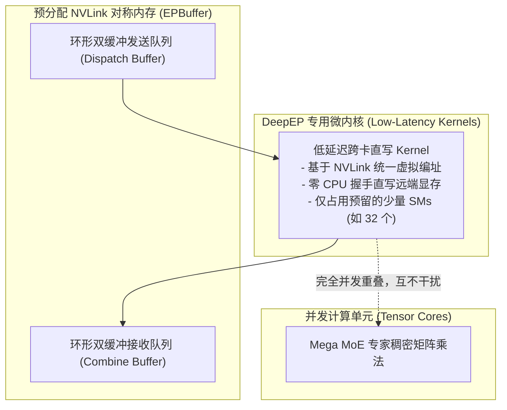

# 19 · DeepSeek-MoE 与 DeepEP 通信库

> 细粒度专家混合（DeepSeek-MoE）将大模型的容量扩展至极致，但随之而来的海量跨卡 All-to-All 通信成为了新的系统瓶颈。DeepInfer 携手自研通信库 DeepEP，以非对称低延迟内核与硬件直通，重构了分布式专家并行的通信底座。
> **前置知识**：专家混合模型（MoE）、分布式集合通信（All-to-All）、NVLink 跨卡点对点通信（P2P）。
> **源码指引**：`deepinfer/model_executor/models/v4_modules/moe.py`、`deepinfer/model_executor/models/v4_modules/mlp.py`、`vendor/DeepEP`。

---

## 0. 本篇要回答的问题

- 传统的粗粒度 MoE 架构（如 8 选 1 或 16 选 2）为什么在知识专业化分工与参数效率上面临天花板？
- DeepSeek-MoE 的「细粒度专家分割」与「共享专家常驻（Shared Experts）」是如何协同运作的？
- 在宽专家并行（Wide-EP）下，标准 NCCL All-to-All 通信库为何会遭遇严重的延迟爆炸与 SM 核心霸占？
- DeepEP 是如何通过专用低延迟 GPU 内核、NVLink 对称内存与算网双缓冲重叠，将跨卡专家分发延迟压缩至微秒级的？

---

## 1. 细粒度 MoE 的架构演进与通信风暴

在早期的专家混合架构（如 Switch Transformer、GShard）中，模型通常设置较少数量的庞大专家（例如 8 个或 16 个专家），每个 Token 仅路由至 1~2 个专家。

DeepSeek 团队的研究表明，这种粗粒度设计存在根本缺陷：
1. **专家知识泛化差**：庞大的专家内部依然充斥着通用公共知识，专家之间存在大量冗余学习，专业化分工不彻底；
2. **路由组合灵活性低**：可选择的专家组合空间极小，无法精准捕捉极其细分的语义上下文。

### DeepSeek-MoE 的两大创新
- **极细粒度的专家切分（Fine-Grained Experts）**：将传统的一个大专家进一步细分为多个极小的专家（如 256 个路由专家，每个 Token 激活 Top-8 个专家）；
- **共享专家常驻机制（Shared Experts）**：设置固定数量（如 1~2 个）的共享专家，**所有 Token 均无条件激活并计算共享专家**。公共知识被强制沉淀在共享专家中，释放了其余路由专家的专业化能力。

```text
DeepSeek-MoE 架构剖析:
输入 Hidden States (H)
       |
       +--------------------------------------------+
       |                                            |
       v                                            v
[共享专家 Shared Experts]                 [门控路由网络 Router]
(所有 Token 必经，沉淀常识知识)             (Top-K = 8 / 256 细粒度专家)
       |                                            |
       |                                   [All-to-All 通信分发]
       |                                            |
       |                                  [选中的 8 个细粒度路由专家]
       |                                            |
       |                                   [All-to-All 结果汇聚]
       |                                            |
       +--------------------(+)---------------------+
                             |
                   输出更新 Hidden States
```

然而，细粒度专家带来了剧烈的**通信风暴**：
每个 Token 被分发至多达 8 个不同的专家；在 Wide-EP64 或 EP128 架构下，这些专家分散在数十张不同的 GPU 加速卡上。
每一层都需要执行两次高频的集合通信：
1. **分发阶段（Dispatch All-to-All）**：将输入特征打包发送至各专家所在的物理 Rank；
2. **汇聚阶段（Combine All-to-All）**：将各专家计算后的输出结果拉回原序列对应的 Rank 并加权求和。

---

## 2. 标准 NCCL 在超大 EP 下的失效

如果直接使用标准的集合通信库（如普通 NCCL `all_to_all`）来驱动 DeepSeek-MoE 的前向，系统性能将发生严重倒退：
- **通信延迟沉重（Latency-Bound）**：标准 NCCL 是为大块连续数据传输设计的（带宽优先），在解码阶段每个 Rank 发送的 Token 数量极少（极小包通信），NCCL 内部复杂的握手协议和环形（Ring）/ 树形（Tree）算法导致延迟高达数百微秒；
- **过度侵占硬件计算资源**：NCCL 通信 Kernel 会默认霸占 GPU 上所有的流式多处理器（SM），导致模型局部的矩阵乘法无法并发推进；
- **显存与内存拷贝冗余**：输入张量必须先经过 CPU/GPU 打包重排（Scatter），通信后再解包（Gather），内存往返耗时严重。

---

## 3. DeepEP：专为 MoE 打造的高性能通信库

为了彻底击穿通信壁垒，DeepSeek 开源了底层专属通信库 **DeepEP**（`vendor/DeepEP` 与 `vendor/DeepEP-Ascend`）。
在 DeepInfer 中，DeepEP 与 `UserBuffer.ep`（`EPBuffer`）深度绑定，重构了专家并行的底层通信链：



### DeepEP 的四大核心技术特征
1. **纯片上 P2P 零拷贝直写**：利用 NVLink 的硬件级统一虚拟编址能力，发起端 GPU 通过专用原子写指令，直接将 Token 特征打入远端 GPU 的 `EPBuffer`，无需中转内存；
2. **低 SM 占用（Low SM Occupancy）**：通信内核被硬性限制在少数几个 SM 上运行，释放绝大多数计算资源供 Tensor Core 并发执行共享专家或主干矩阵乘；
3. **Mega MoE 融合算子**：在单机 Scale-Up 域内，DeepInfer 实现了 **Mega MoE** 极致融合算子。无论 EP 并行度或批次大小如何变化，Mega MoE 将专家寻址、数据解包、GEMM 与激活函数就地融合，性能显著超越未融合方案；
4. **非阻塞异步双缓冲**：分发通信、矩阵乘计算与汇聚通信被组织为紧凑的三级流水线，上一层的通信耗时完全被掩盖在当前层的计算之中。

---

## 4. 路由算法与专家选择：`DeepSelect`

在将 Token 发射给 DeepEP 之前，门控网络（Router）必须以极高速度计算出每个 Token 对 256 个专家的亲和度分数，并筛选出 Top-8。

在大规模并发下，针对 256 个专家的 Top-K 排序如果使用标准 PyTorch `torch.topk`，单步耗时将超过 150 微秒。
DeepInfer 引入了自研的 **`DeepSelect` 算子库**（`vendor/DeepSelect`）：
- 利用 GPU 共享内存与 Warp 原生洗牌指令（Shuffle Instructions），在单个线程块内完成局部直方图统计与双调排序；
- 直接输出紧凑的专家槽位索引与归一化 Softmax 权重；
- 输出张量直接对齐 DeepEP 的输入格式，排除了任何格式转换开销。

---

## 5. 关键设计取舍与代价

| 维度 | 传统 NCCL 专家并行 | DeepInfer + DeepEP 体系 | 架构收益与妥协 |
|---|---|---|---|
| **通信延迟** | 150 ~ 300 微秒 / 步 | **< 25 微秒 / 步** | 通信延迟降幅达 80% 以上，为 Wide-EP 奠定基础 |
| **SM 硬件资源争抢** | 通信霸占全卡 SM，计算被悬挂 | 通信严格隔离在预留 SM，算网深度重叠 | 预留 SM 在无通信窗口期略有闲置 |
| **显存静态占用** | 动态申请，占用不透明 | 启动期需预先锁定数 GB `EPBuffer` | 显存空间被刚性占用，需精确预算 |
| **拓扑兼容性** | 任意 TCP/IP 或普通网络 | 极致性能依赖高速无损 NVLink / HCCS | 在老旧低速网络下性能优势收窄 |

---

## 6. 小结

- DeepSeek-MoE 以细粒度专家与常驻共享专家，在维持同等算力开销的同时实现了极高的知识表征密度；
- 专属通信库 DeepEP 彻底打破了标准 NCCL 在小数据包通信下的延迟魔咒，使 Wide-EP64 在生产环境的大规模部署成为可能；
- 配合 `DeepSelect` 极速路由与 Mega MoE 融合算子，DeepInfer 构建了当代大模型最为强悍的高性能 MoE 推理底座。

---

## 延伸阅读 / 下一篇

- 下一篇：[`20-dspark-speculative-decoding.md`](20-dspark-speculative-decoding.md) · DSpark / DFlash MTP 推测解码全流程，进入第六部分高级特性层，揭开多词元投机生成的神秘面纱。
- 算子源码：`vendor/DeepEP`、`deepinfer/model_executor/models/v4_modules/moe.py`。
