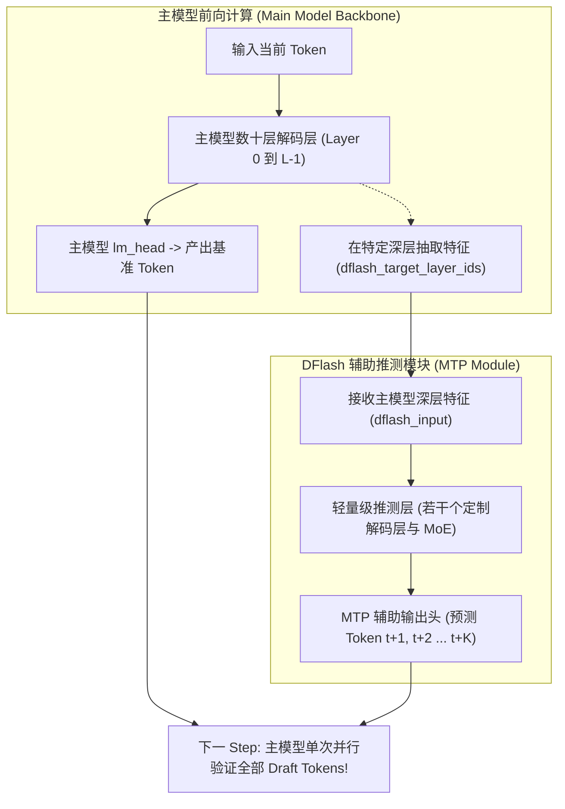
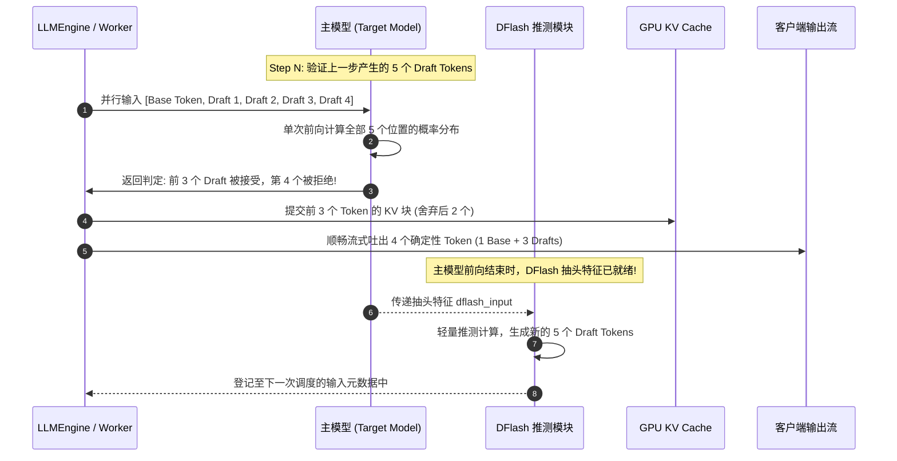

# 20 · DSpark / DFlash MTP 推测解码全流程

> 自回归生成逐 Token 串行推进是吞吐难以突破的物理枷锁。DeepInfer 通过 DSpark / DFlash 多词元预测（MTP）架构，以单步前向同时预测多个候选 Token，并在主模型单次前向中实现并行验证与状态同步。
> **前置知识**：自回归推测解码（Speculative Decoding）、多词元预测（Multi-Token Prediction, MTP）。
> **源码指引**：`deepinfer/model_executor/models/mtp/dflash.py`、`deepinfer/model_executor/layers/mtp_info_pool.py`、`deepinfer/model_executor/layers/tilelang_ops/dflash.py`。

---

## 0. 本篇要回答的问题

- 传统的 Draft-Model 投机采样方案（如小模型生成 + 大模型验证）为什么在分布式大规模生产环境中难以落地？
- DeepSeek 的 MTP（Multi-Token Prediction）辅助预测头是如何与主模型网络骨干无缝融合的？
- DFlash 模块在每一步是如何利用主模型抽头的深层隐状态，在微秒级并行预测出 5 个 Draft Token 的？
- 当主模型前向判定接受了前 $k$ 个 Token 时，主 KV Cache、推测专用 Cache 与采样器状态是如何在 GPU 片上完成瞬时对齐的？

---

## 1. 串行自回归的延迟天花板与推测解码

自回归语言模型生成的根本瓶颈在于**严格的时序因果依赖**：必须先生成第 $t$ 个 Token，将其追加至 KV Cache，才能计算第 $t+1$ 个 Token 的条件概率分布：

$$P(x_{1:T}) = \prod_{t=1}^T P(x_t \mid x_{<t})$$

这意味着生成 1,000 个 Token 必须强行执行 1,000 次模型全网前向计算。在显存带宽受限的 Decode 阶段，GPU 算力利用率极低。

### 传统推测解码的工业化落地痛点
学术界普遍采用的经典推测采样（如一个 1B 小模型 Draft + 一个 70B 主模型 Target）在云端超大规模服务中面临巨大挑战：
1. **显存与硬件部署分裂**：线上必须同时维护小模型与大模型两套独立的权重、KV Cache 与通信拓扑，显存占用与调度复杂度陡增；
2. **小模型表征漂移**：小模型独立训练，与大模型的概率分布差异较大，草稿词元接受率（Acceptance Rate）波动剧烈，在严苛任务（如代码编写、数学推理）下经常发生「猜 5 中 0」，性能反而大幅倒退。

---

## 2. DFlash / MTP 架构原理：同一体系下的内在投机

DeepSeek 团队在 DeepSeek-V3 / V4 中提出了原生内生的 **Multi-Token Prediction (MTP)** 范式，并在推理引擎中落地为 **DFlash 模块**（`deepinfer/model_executor/models/mtp/dflash.py`）：



- **参数内生协同**：MTP 模块在预训练阶段便与主模型共同联合训练。它共享主模型的 Embedding 词表与最终的 `ParallelLMHead` 权重，与主模型保持完全同构的语义空间；
- **深层特征抽头**：DFlash 不需要从最底层的 Token Embedding 开始重复计算，而是直接复用主模型深层（如最后几个隐藏层）抽头的强语义特征 `dflash_input`，以极小的浅层网络开销，瞬时并行推演未来 $K$ 个步骤的候选词元（默认 $K=5$，由 `DEEPINFER_USE_NEXTN_DECODE` 控制）；
- **分布高度对齐**：由于共享大部分主干表示，DFlash 产出的 Draft Token 接受率极高（生产实测平均接受长度高达 3.2~3.3 个词元）。

---

## 3. DFlash 单步执行时序与数据流

在实际自回归推理推进时，推测生成与验证被编织在一个紧密咬合的闭环循环中：



### 显存与状态同步机制：`update_main_cache`
在 `deepinfer/model_executor/models/deepseek.py` 中：
```python
if dflash is not None:
    # 目标层特征只在此消费：写 DFlash main cache
    # decode 时随主模型 CUDA graph 一并捕获，省去逐 kernel 的 CPU 发射开销
    dflash.update_main_cache(dflash_input, dflash_metadata, kv_caches)
```
DFlash 拥有自己的专属轻量 KV 缓存区。当主模型验证通过若干个 Token 后，系统通过 TileLang 高性能内核 `tilelang_ops/dflash_copy.py` 在 GPU 片上完成指针调整，无需在主机 CPU 介入下进行复杂的数据回退。

---

## 4. 元数据管理与对象池化：`MTPInfo`

对于每个正在生成的请求，推测解码需要追踪其动态变化的 Draft 候选列表、置信度分数以及实际接受数量。

如果为每个请求频繁创建 Python 字典或临时对象，将带来不可承受的内存开销。
DeepInfer 在 `deepinfer/model_executor/layers/mtp_info_pool.py` 中实现了 **`MTPInfo` 专用静态池化机制**：
- 每个正在运行（`RUNNING`）的序列在进入调度时，自动在池中领取一个唯一的 `mtp_slot`；
- 该槽位直接对应一段固定尺寸的显存缓冲区，用于存放当前步生成的 $[K]$ 个词元 ID 与浮点概率；
- 当请求完成时，槽位就地重置并归还池中，全程零堆内存分配。

---

## 5. 关键设计取舍与代价

| 特性 | 传统独立小模型推测解码 | DeepInfer DFlash / MTP 体系 |
|---|---|---|
| **模型部署运维** | 需维护两套异构模型拓扑 | 统一模型实例，主模型与推测头一体化加载 |
| **草稿接受率** | 分布漂移，接受率通常低于 50% | 深度特征共享，生产实测平均接受度达 **65%~70%** |
| **显存占用增量** | 额外加载一个小模型全部参数 | 仅增加极少量的辅助推测层与输出头参数 |
| **计算负荷** | 无论是否命中，每步均需算全量小模型 | 验证阶段需计算变长序列，对并行注意力算子要求高 |

---

## 6. 小结

- DFlash / MTP 架构将推测能力原生固化在模型骨干中，打破了外部小模型方案分布漂移与部署分裂的困境；
- 依托深层特征原地抽头，推测头以极小的计算代价实现了单步并行生成 5 个高质量 Draft Token；
- 紧密的片上状态同步与专用对象池化，确保了推测解码在生产环境下能够稳定输出 2~3 倍的生成加速比。

---

## 延伸阅读 / 下一篇

- 下一篇：[`21-confidence-scheduled-verification.md`](21-confidence-scheduled-verification.md) · 动态置信度调度与自适应验证长度，揭秘 DeepInfer 如何利用边际收益模型在推测验证中节约 30% 无效算力。
- 模块源码：`deepinfer/model_executor/models/mtp/dflash.py`。
