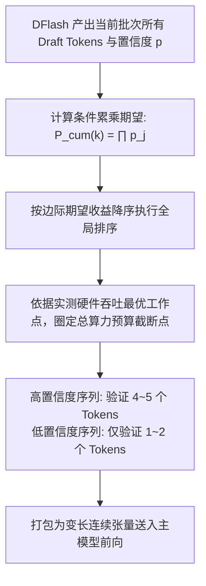
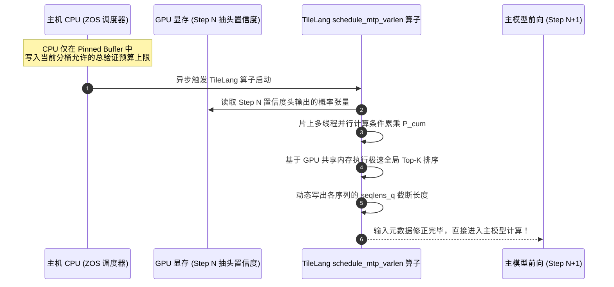

# 21 · 动态置信度调度与自适应验证长度

> 固定长度推测验证在低概率词元上浪费了大量算力。DeepInfer 的 DSpark 调度器利用置信度头（Confidence Head）预估边际收益，结合硬件吞吐曲线动态裁剪验证长度，以减少 30% 验证计算换取 5%~11% 的系统吞吐净增。
> **前置知识**：条件概率累乘、边际收益模型（Marginal Return）、变长批处理（Varlen Packing）。
> **源码指引**：`csrc/engine/mtp_varlen.hpp`、`deepinfer/model_executor/layers/tilelang_ops/schedule_mtp_varlen.py`、`doc/inference_deployment_qa.md`。

---

## 0. 本篇要回答的问题

- 传统的固定长度验证（如每条序列强制验证 5 个 Draft Token）存在怎样的算力浪费？
- 为什么当第 2 个 Draft Token 接受概率极低时，继续验证第 3、4、5 个 Token 的期望收益几乎为零？
- DSpark 是如何利用 Confidence Head 预测出的接受率，对整批草稿词元进行边际收益排序与自适应截断的？
- 在 ZOS 异步调度体系下，第 $N$ 步的置信度尚未回传 CPU，变长验证长度是如何由 GPU 端的 TileLang 算子在片上就地求出的？

---

## 1. 固定长度推测验证（Fixed-5）的算力陷阱

在多词元推测解码（MTP）中，最直观的实现方案是**固定长度验证（Fixed-Length Verification）**：无论当前请求的生成内容是极其确定的模板代码、还是充满高度随机性的发散创意写作，主模型在每一步均统一验证固定长度（如固定验证 5 个 Draft Token）。

然而，这种粗放的策略在工业化集群中暴露出了极其严重的**算力浪费**：
- **误差级联与不可逆截断**：根据推测解码的验证规则，草稿序列必须**从前往后严格连续匹配**。一旦第 $k$ 个 Token 被主模型拒绝，后续第 $k+1, \dots, 5$ 个 Token 无论概率多高均被强制作废；
- **低置信度盲目算力投入**：在困难文本区间，如果第 1 个 Token 的接受概率仅为 20%，那么第 5 个 Token 被有效接受的联合概率仅为 $0.2^5 = 0.032\%$！
- 主模型却必须为这无意义的 5 个 Token 分配完整的注意力头、投影权重与显存带宽，白白侵占了其他高价值请求的计算资源。

```text
Fixed-5 模式的算力浪费惨剧:
Draft Tokens:     [Token 1 (85%)] -> [Token 2 (10%)] -> [Token 3 (50%)] -> [Token 4 (40%)] -> [Token 5 (30%)]
主模型验证行为:    验证              验证              强行验证          强行验证          强行验证
实际接受结果:      接受              拒绝              强制抛弃          强制抛弃          强制抛弃
浪费的算力:                                            \_______________________________________/
                                                               3 个 Token 的验证算力彻底打水漂!
```

---

## 2. DSpark 动态自适应验证原理

为了消除这一巨大浪费，DeepInfer 提出了 **DSpark 动态置信度自适应验证体系**（由环境变量 `DEEPINFER_ENABLE_MTP_VARLEN=1` 启用）。

### 2.1 置信度预测头（Confidence Head）
在 DFlash 生成 Draft Tokens 的同时，模型内置的轻量级 Confidence Head 同步输出每个候选词元的先验接受概率预估值：

$$p_1, p_2, \dots, p_K \in [0, 1]$$

由于后续 Token 依赖前序 Token 的成立，第 $k$ 个 Token 能够被最终采纳的实际累积概率为条件概率的累乘：

$$P_{\text{cum}}(k) = \prod_{j=1}^k p_j$$

### 2.2 基于边际收益的贪心吞吐最优解
DSpark 将批次调度抽象为一个**非线性背包优化问题**：
在当前的系统硬件吞吐曲线约束下，如何在批次内各请求之间分配总验证配额（Total Verification Budget），使得全局产出的有效 Token 期望总数最大化？



算法按 $P_{\text{cum}}$ 对批次中所有候选位置进行全局降序排序，优先将前向算力倾斜给累积接受期望最高的候选位置，果断切断低期望的尾部词元。

---

## 3. 生产实测数据背后的数学奇迹

官方白皮书（`doc/inference_deployment_qa.md`）披露了一组震撼的工业实测数据：在 EP64/DP64 的超大规模真实集群上，对比 Fixed-5 与 DSpark 动态验证：

| 节点并发负载 (seqs/rank) | Fixed-5 验证长度 | DSpark 动态验证长度 | Fixed-5 最终接受长度 | DSpark 最终接受长度 | 单卡吞吐净增益 (TPS Gain) |
|---|---|---|---|---|---|
| 16 | 5.00 | 4.44 | 3.32 | 3.24 | -1.5% (轻微波动) |
| 32 | 5.00 | 3.65 | 3.25 | 3.17 | **+1.6%** |
| 48 | 5.00 | 3.94 | 3.30 | 3.26 | **+3.6%** |
| 60 (标准生产点) | 5.00 | **3.58 (-28.4%)** | 3.30 | **3.21 (-2.7%)** | **+5.4%** |
| 72 | 5.00 | 3.24 | 3.29 | 3.12 | **+6.7%** |
| 96 (高并发满载) | 5.00 | **3.24 (-35.2%)** | 3.30 | **3.15 (-4.5%)** | **+11.0%** |

### 数据背后的物理本质
- **验证计算量缩减近 30%~35%**：平均每步只需验证 3.24~3.58 个 Token，大幅削减了主模型前向的矩阵乘运算规模；
- **实际采纳长度几乎零损伤**：被剪裁掉的尾部 Token 本就是几乎不可能命中的垃圾预测，最终实际接受长度仅从 3.30 极其轻微地降至 3.21；
- **宏观吞吐全面暴涨**：节约出来的计算与带宽资源使 GPU 能够承载更高的并发批次，在生产满载工况下**系统总吞吐净增高达 +11.0%**！

---

## 4. ZOS 异步下的 GPU 片上动态求解

在第 11 篇中我们已经知晓，在 ZOS 零开销调度体系下，CPU 在准备第 $N+1$ 步调度时，第 $N$ 步的置信度甚至还没有从 GPU 传回 CPU！
CPU 既然拿不到实时的置信度，DSpark 又如何能在第 $N+1$ 步按置信度裁剪长度？

DeepInfer 的解法再次体现了极致的系统工程思维：**CPU 只下发总预算规则，具体的变长截断完全交由 GPU 片上内核就地完成！**



在 `deepinfer/model_executor/layers/tilelang_ops/schedule_mtp_varlen.py` 中，这一连串的条件概率累乘、全局排序与截断决策，被深度编译为单一 TileLang 算子。整个过程在 GPU 寄存器与片上共享内存内微秒级完成，完全不需要向 CPU 暴露任何中间状态。

---

## 5. 关键设计取舍与代价

| 特性 | Fixed-5 固定推测验证 | DSpark 动态置信度验证 |
|---|---|---|
| **算法实现复杂度** | 极低，张量维度固定 | 高，涉及条件概率累乘与非线性背包求解 |
| **算力浪费率** | 严重，30% 以上计算花在必然失败的预测上 | **极低**，算力高度聚焦在高置信度区间 |
| **生产吞吐收益** | 基准 baseline | 满载并发下吞吐净增 **+5% ~ +11%** |
| **底层算子要求** | 仅需规整注意力和 GEMM | 注意力算子必须原生支持变长非连续 Packing |

---

## 6. 小结

- 动态置信度调度突破了推测解码在固定长度下的算力内耗瓶颈；
- 边际收益模型在将验证计算削减 30% 的同时，完美守护了 97% 以上的草稿采纳率；
- 结合 TileLang 片上就地求解，DSpark 实现了在 ZOS 异步流水线下的平滑嵌入，构成了现代云端大模型推测架构的工业标杆。

---

## 延伸阅读 / 下一篇

- 下一篇：[`22-structured-outputs.md`](22-structured-outputs.md) · 结构化输出与 Grammar 匹配自动机，探究系统如何在推测解码与变长约束下实现 100% 格式遵从与回滚容错。
- 调度算子源码：`deepinfer/model_executor/layers/tilelang_ops/schedule_mtp_varlen.py`。
