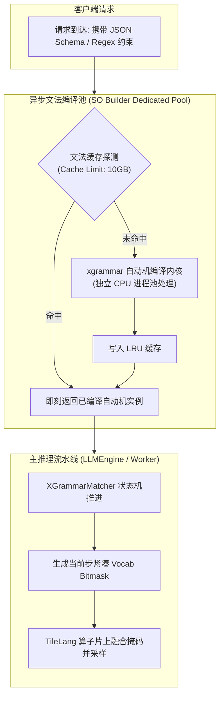

# 22 · 结构化输出与 Grammar 匹配自动机

> 结构化输出（Structured Outputs）强制大模型严格遵循 JSON Schema、正则表达式或 EBNF 文法，是智能体稳定调用工具的命脉。DeepInfer 实现了语法编译与推理执行的解耦、GPU 显存位图掩码（Bitmask）融合，以及针对推测解码的自适应回滚恢复。
> **前置知识**：形式语言与自动机（DFA / PDA）、上下文无关文法（CFG）、Logit 掩码（Logit Bias / Masking）。
> **源码指引**：`deepinfer/structure_output/compiler.py`、`deepinfer/structure_output/matcher.py`、`deepinfer/structure_output/mask.py`。

---

## 0. 本篇要回答的问题

- 传统的 Prompt 工程约束（如「请严格返回 JSON」）为什么无法杜绝语法错误与解析异常？
- 复杂语法编译（如解析复杂的 OpenAPI Schema）需要消耗大量 CPU 算力，DeepInfer 是如何将其从主推理流水线中剥离解耦的？
- 针对 128,000+ 词表的合法 Token 掩码生成，系统是如何利用紧凑位图（Bitmask）与 TileLang 算子实现片上零显存开销注入的？
- 当推测解码预测的多个 Draft Token 部分被拒绝时，语法匹配自动机是如何精准回退（Rollback）至历史有效状态的？

---

## 1. 智能体落地中的结构化死结

在智能体（Agent）工作流与企业级 API 中，大模型生成的内容往往需要直接输入下游解析器（如 SQL 执行引擎、微服务 RPC 接口）。
传统方法单纯依赖模型在提示词中「自觉」遵从格式：
- **无法律级确定性保证**：在大并发下，模型偶发性地缺失双引号、漏掉逗号或输出多余解释性文字，会导致下游解析器瞬间崩溃；
- **试错重试成本高昂**：一旦格式错误，系统必须重新发起前向重试，极大恶化了端到端 SLA 与推理成本。

**受约束生成（Constrained Decoding / Structured Outputs）**从根本上解决了这一问题：**在每一步采样之前，根据形式文法确定当前状态下所有合法的 Token 集合，将不合法 Token 的 Logits 强行置为 $-\infty$**。

然而，在工业化高并发集群中，这一机制面临两大严峻挑战：
1. **文法编译开销巨大**：将复杂的 JSON Schema 或 EBNF 转换为有限状态自动机（DFA）通常需要数毫秒乃至数十毫秒的 CPU 计算，若放在主推理进程中将直接引发集群卡顿；
2. **多词元推测回滚冲突**：推测解码会同时推测多个 Token，一旦其中某些 Token 语法合法但被主模型依据概率拒绝，自动机内部状态必须支持快速回溯。

---

## 2. 编译与推理的完全解耦架构

DeepInfer 在 `deepinfer/structure_output/` 中构建了**编译-匹配解耦体系**，并深度结合开源语法加速库 `xgrammar`：



- **专用编译进程池**：通过参数 `DEEPINFER_SO_BUILDER_CPUS`（默认 4 个专用核心），文法编译任务完全在后台异步线程池或独立专职节点上执行，绝不侵占主推理引擎的 CPU 周期；
- **超大容量 LRU 语法缓存**：通过 `DEEPINFER_XGRAMMAR_CACHE_LIMIT_BYTES` 维护高达 10 GB 的已编译文法缓存。线上常见工具调用（如搜索、计算器参数 Schema）首次编译后永久常驻，后续请求命中耗时完全为 0。

---

## 3. 紧凑位图掩码（Bitmask）与片上极速注入

大模型的词表通常高达 128,000+。如果为每个请求的每一步分配一个全量的布尔掩码向量：
- 每一个请求每一步需要消耗 $128000 \times 1 \text{ 字节} \approx 128 \text{ KB}$；
- 并发 256 时单步需搬运 32 MB 显存，极大地挤占了本就宝贵的显存总线带宽。

DeepInfer 采用**紧凑二进制位图（Bitmask）**表示法（`deepinfer/structure_output/mask.py`）：
- 32 个 Token 的合法性仅占用 1 个 32-bit 整数中的特定 Bit 位（0 表示非法，1 表示合法）；
- 全词表掩码体积直接缩减 32 倍（仅需 4 KB）；
- 掩码通过固定内存直接下发至 GPU。

```text
紧凑 Bitmask 内存压缩排布:
Token 0 ~ 31:   [0 0 1 0 1 1 0 0 ... 1] ---> 压缩为一个 uint32 数值
Token 32 ~ 63:  [1 1 0 0 0 1 1 0 ... 0] ---> 压缩为一个 uint32 数值
...
```

在采样阶段，TileLang 融合采样内核（`tilelang_ops/fused_sample.py`）在片上寄存器中以位运算直接解包掩码：
```python
# 伪代码：在片上将非法 Logits 瞬时置为负无穷
if not (bitmask[token_id // 32] & (1 << (token_id % 32))):
    logits[token_id] = -float("inf")
```
没有多余的显存分配，没有全词表张量搬运，掩码注入耗时完全被掩盖在采样排序的微秒窗口内。

---

## 4. 推测解码下的状态回滚容错机制

在推测解码（MTP / DFlash）开启时，推测头会单步生成多达 $K$ 个 Draft Token（如 `envs.DEEPINFER_USE_NEXTN_DECODE = 5`）。

自动机必须伴随推测序列向前推进 $K$ 步。但当主模型验证判定仅接受前 2 个 Token、拒绝后 3 个 Token 时：
**自动机必须能够精准「倒带」，回退到第 2 个 Token 匹配结束时的内部状态！**

在 `deepinfer/structure_output/matcher.py` 中，`XGrammarMatcher` 实现了强大的**历史栈回滚容错机制**：
```python
# matcher.py 核心回滚保障
MAX_ROLLBACK_TOKENS = envs.DEEPINFER_USE_NEXTN_DECODE + 2

class XGrammarMatcher:
    def __init__(self, ...):
        # 维护一个容量为 MAX_ROLLBACK_TOKENS 的环形状态历史栈
        self.history_stack = []

    def rollback(self, num_rollback_tokens: int) -> None:
        """当主模型拒绝部分推测 Token 时，强制将自动机回滚指定的步数"""
        assert num_rollback_tokens <= len(self.history_stack)
        for _ in range(num_rollback_tokens):
            prev_state = self.history_stack.pop()
        # 恢复底层 C++ 自动机指针与上下文规则
        self.inner_matcher.restore_state(prev_state)
```

通过这一自适应回滚设计，语法匹配状态机与推测解码流水线实现了天衣无缝的交织协作，无论推测接受长度如何剧烈波动，文法约束的合法性始终保持 100% 严丝合缝。

---

## 5. 关键设计取舍与代价

| 特性维度 | 传统 Prompt 软约束 | DeepInfer 语法自动机硬约束 | 架构收益与妥协 |
|---|---|---|---|
| **格式遵从率** | 85% ~ 95% (存在概率性幻觉) | **严格 100% (数学级确定性)** | 杜绝了解析错误导致的重试，降低业务综合成本 |
| **主流程延迟影响** | 0 影响 | 编译完全解耦，掩码注入 < 20 微秒 | 首请求冷编译阶段需异步等待毫秒级构建 |
| **显存带宽开销** | 0 额外开销 | 紧凑 Bitmask 方案占用极低 | 相比朴素全量掩码节约 96% 以上带宽 |
| **推测解码兼容** | 仅支持串行单步 | 原生支持最大 7 步多 Token 回退 | 状态机代码实现与状态栈管理复杂度显著增加 |

---

## 6. 小结

- 结构化输出从数学上杜绝了大模型在工具调用与严谨数据抽取场景下的格式漂移；
- 编译与推理阶段的彻底物理隔离，确保了主推理引擎的高吞吐稳定性不受复杂文法编译冲击；
- 紧凑 Bitmask 压缩表示与多步状态回滚机制，使结构化生成与 DFlash 推测解码在微秒级完美共存。

---

## 延伸阅读 / 下一篇

- 下一篇：[`23-batch-invariant-and-deterministic-sampling.md`](23-batch-invariant-and-deterministic-sampling.md) · 批次无关推理与确定性采样，剖析系统如何消除 GPU 浮点非结合律导致的「同输入不同结果」难题。
- 匹配源码：`deepinfer/structure_output/matcher.py`。
