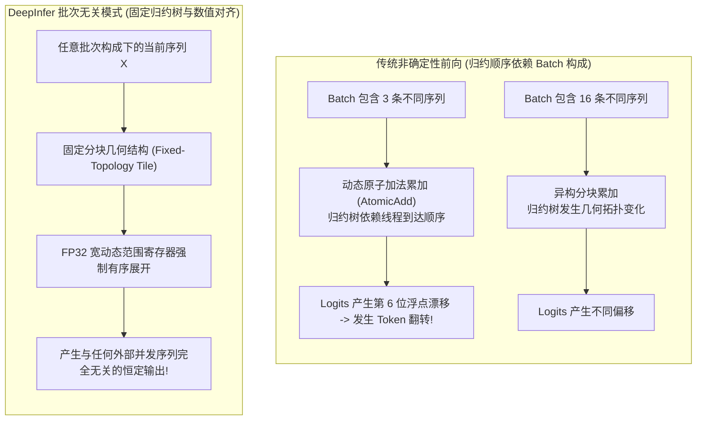

# 23 · 批次无关推理与确定性采样

> GPU 浮点数加法非结合律导致大模型在不同并发批次下同一 Prompt 会产生不同结果。DeepInfer 通过批次无关（Batch-Invariant）前向与序列级伪随机采样器，彻底实现了大模型推理的确定性可复现。
> **前置知识**：IEEE 754 浮点数非结合律、GPU 归约树（Reduction Tree）、伪随机数生成算法（Philox）。
> **源码指引**：`deepinfer/model_executor/layers/sampler.py`、`deepinfer/model_executor/layers/tilelang_ops/random_sampling.py`、`tests/models/test_batch_invariant.py`。

---

## 0. 本篇要回答的问题

- 为什么即便设置了 `temperature = 0`，同一个 Prompt 在服务空闲与高并发拥堵时依然会吐出完全不同的内容？
- GPU 上并行浮点求和的「非结合律」是如何导致模型每层的微小数值差异在深层网络中被雪崩式放大的？
- DeepInfer 的 `DEEPINFER_BATCH_INVARIANT` 是如何通过固定归约树与数值对齐技术，做到不同 Batch 组合下前向结果绝对一致的？
- 在存在推测解码与变长调度的复杂场景下，序列专属种子（`seq_seed`）是如何保障采样结果 100% 确定性可复现的？

---

## 1. 幽灵般的「同输入不同结果」困境

在软件工程的传统常识中，确定性函数（Deterministic Function）在给定相同输入时必须产生严格一致的输出。
然而在现代大模型在线推理中，开发者与评测团队经常遭遇令人匪夷所思的现象：
- 本地单请求离线测试时，模型给出了高水准的数学证明答案；
- 将完全相同的 Prompt 部署到线上高并发服务后，即使将采样随机性全部关闭（`temperature = 0`，贪心解码），模型却生成了完全不同的甚至错误的答案！
- 当研发团队尝试抓取 Bad Case 在测试集群复现时，Bug 却再次离奇消失（典型的海森堡 Bug）。

```text
生产服务中的批次干扰漂移:
场景 A (系统空闲, 单请求独占):
Prompt X 独占 Batch 1 ---> 前向矩阵计算 ---> 生成 Token "42" (正确)

场景 B (系统满载, 混排大批次):
[Prompt A, Prompt B, Prompt X, Prompt D] 同批执行前向 ---> 生成 Token "41" (漂移!)
```

这一现象的根本死穴不在于模型权重损坏，而在于现代并行计算体系结构的核心物理机制：**浮点数加法不满足结合律**。

---

## 2. 浮点非结合律与误差级联放大

在有限精度的计算机体系结构中（无论是 FP32、FP16 还是 FP8），浮点加法严格不满足结合律：

$$(a + b) + c \neq a + (b + c)$$

### GPU 树形并行归约的动态性
在 GPU 执行 LayerNorm、Softmax 或 All-Reduce 集合通信时，数千个线程同时计算部分和。为了追求最高的执行效率，GPU 调度器并不保证线程执行的绝对先后顺序：
- 当只有 1 个序列时，线程块分配紧凑，归约树以特定顺序折叠；
- 当有 16 个序列并发排在同一个 Batch 时，GPU 占有率改变，线程束（Warp）竞争调度导致加法累加的物理先后顺序发生改变！

虽然单次加法的数值微小漂移通常仅在第 $10^{-4}$ 量级，但在深达数十层的 Transformer 架构中：
- 每一层的 LayerNorm、MLA 注意力与 MoE 路由网络都会将这一微小数值差异逐层非线性放大；
- 最终在第 60 层的输出 Logits 上，两个候选 Token 的概率仅仅相差 $0.001$，微小的累加顺序差异便足以使 Top-1 发生翻转（ArgMax 翻转）！
- 生成的第 1 个 Token 一旦翻转，自回归机制便将这一误差作为历史输入继续滚雪球，后续生成内容彻底南辕北辙。

---

## 3. DeepInfer 批次无关推理（Batch-Invariant）

为了彻底根除这一工业痛点，DeepInfer 在底层深度重构了计算流水线，推出了由环境变量 `DEEPINFER_BATCH_INVARIANT=1` 控制的**批次无关推理（Batch-Invariant Inference）**模式。



### 3.1 归约树几何拓扑锁定
在 `tests/models/test_batch_invariant.py` 的严格检验下，DeepInfer 协同 TileLang 与 DeepGEMM，对所有层间核心算子执行了拓扑冻结：
- **消灭无序 AtomicAdd**：在涉及跨序列或跨头的归约时，禁用依赖硬件到达时序的无序全局原子加（Global Atomic Add）；
- **静态 Tile 分块对齐**：强制每个序列的矩阵块在片上按固定的树形结构进行归约，使累加顺序严格由 Token 在该序列内的相对逻辑位置决定，与该序列在批次中处于第几行、周围有哪些并发请求完全绝缘。

---

## 4. 确定性无锁采样器：`DeterministicSampler`

在解决了前向计算的数值一致性后，采样阶段自身的伪随机数生成（PRNG）是保证可复现性的最后一环。

在多线程高并发系统中，传统的全局随机数发生器（如共享全局种子）存在严重的互斥锁争抢，且当前序列摇出的随机数严重依赖于别的序列刚才摇了多少次，彻底丧失可复现性。

DeepInfer 在 `deepinfer/model_executor/layers/tilelang_ops/random_sampling.py` 中实现了**纯无状态、序列绑定的确定性采样器**：

```python
# 序列级独立随机种子调用范例
sampling_params = SamplingParams(
    temperature=0.7,
    top_p=0.9,
    seq_seed=42,  # 为该请求显式绑定独立随机数种子
)
```

### 基于 Philox 4x32 的无状态随机映射
采样算子内部采用著名的加密级伪随机算法 Philox 4x32：

$$\text{Random Number} = \text{Philox4x32}\Big(\text{Key} = \text{seq\_seed}, \quad \text{Counter} = (\text{seq\_id}, \text{step\_idx})\Big)$$

- **无需维护状态**：算法是一个纯数学双射函数，输入种子（Key）与当前步数（Counter），直接在寄存器内计算出高均匀度的伪随机浮点数；
- **全卡全序列独立**：序列 A 的采样绝不读取也不影响序列 B 的随机序列；
- **推测回退一致性**：即使推测解码发生回滚，采样器仅需重置当前 `step_idx` 计数器，即可精准重现历史采样轨迹。

在配置 `DEEPINFER_BATCH_INVARIANT=1 DEEPINFER_ENABLE_MTP_VARLEN=0` 并传入固定 `seq_seed` 的前提下，**DeepInfer 在数学上 100% 承诺：无论是在单卡离线还是在超大规模并发集群中，模型输出的 Token 序列将保持逐字逐标点的绝对一致！**

---

## 5. 关键设计取舍与代价

| 特性 | 传统动态优化模式 | DeepInfer 批次无关模式 | 架构代价与收益 |
|---|---|---|---|
| **结果可复现性** | 不可复现，随并发波动漂移 | **100% 绝对比特级确定性复现** | 为金融合规、代码评测与自动化排障提供基石 |
| **测试与基准评测** | 性能测试数据经常受偶发翻转干扰 | 每次 Run 获得完全闭环的稳定基准 | 极大提升了算法调优与 CI 回归测试的效率 |
| **GPU 计算吞吐** | 可利用极限动态无序优化 | 需维持规整归约，略有性能牺牲 | 生产环境默认关闭，评测与严苛场景按需开启 |
| **平台适配** | 全平台通用 | 目前深度调优于 NVIDIA 平台架构 | 昇腾等平台仍处于拓扑对齐攻关阶段 |

---

## 6. 小结

- 浮点非结合律是导致大模型在不同并发环境下结果漂移的物理根源；
- 批次无关前向通过锁定归约拓扑与对齐中间计算，斩断了跨序列的数值干扰链；
- 基于 Philox 的无状态伪随机采样器赋予了每个请求独立的随机确定性空间，构成了大模型工业级严谨落地的必要防线。

---

## 延伸阅读 / 下一篇

- 下一篇：[`24-deepseek-vl-multimodal.md`](24-deepseek-vl-multimodal.md) · DeepSeek-VL 多模态视觉编码与动态路由，进入第七部分分布式集群层，揭秘视觉编码器独立单卡部署与负载均衡。
- 采样源码：`deepinfer/model_executor/layers/sampler.py`。
