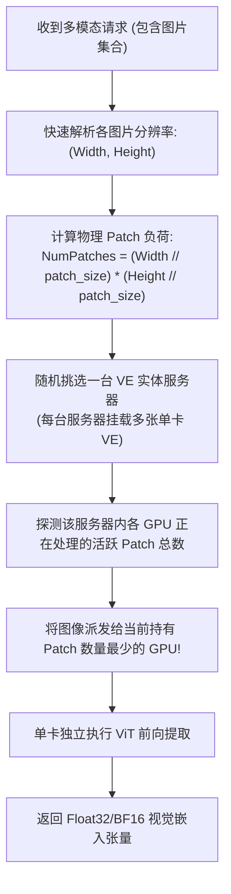

# 24 · DeepSeek-VL 多模态视觉编码与动态路由

> 多模态大模型中，高分辨率图像引发的 Token 暴增与计算异构极易阻塞昂贵的主语言模型集群。DeepInfer 采用独立的单卡视觉编码器（VE）解耦部署，配合图像 Patch 规模感知的动态负载均衡，实现了极简高效的多模态前向流水线。
> **前置知识**：视觉 Transformer（ViT）、Patch 分块投影、多模态对齐投影器（Aligner）。
> **源码指引**：`deepinfer/model_executor/models/deepseek_vl.py`、`deepinfer/ve/multimodal_processor.py`、`deepinfer/ve/prepare_tensor_input_vl.py`。

---

## 0. 本篇要回答的问题

- 为什么在超大规模分布式集群中，将视觉编码器（Vision Encoder）与主语言模型（LLM）强行混跑在相同 GPU 上是灾难性的经济与架构决策？
- DeepInfer 是如何将复杂的 Vision Encoder 剥离为轻量级单卡独立服务的？
- 面对分辨率差异悬殊的用户图像，视觉编码负载均衡器（VE Load Balancer）是如何利用 Patch 物理面积进行精准负载均衡的？
- 视觉特征张量是如何通过 Vision Aligner 投影器，无损替换 Prompt 文本流中的 `<｜image｜>` 占位符的？

---

## 1. 多模态推理的算力物理错配难题

随着通用大模型向视觉与全模态拓展，用户请求中不仅包含纯文本，还频繁夹杂着多张高分辨率图片、图表与文档截图。

在传统的单体推理引擎设计中，视觉编码器（Vision Encoder, ViT）通常作为模型的一部分被硬编码在同一张 GPU 或同一个 Tensor Parallel 组内执行。这种设计在生产环境中引发了剧烈的**算力错配**：
1. **机型成本错配**：用于运行 DeepSeek-V4 的主 Prefill 与 Decode 节点配备了顶级的高带宽互联（NVLink、400G RoCE 网卡）与极致昂贵的 GPU（如 SM100）。而 ViT 编码器只是一个参数量较小（如 300M ~ 2B）的标准视觉网络，不需要高阶通信互联，用顶级 GPU 跑 ViT 是巨大的资本浪费；
2. **时延气泡阻塞**：高分辨率图像需要切分为数百乃至上千个局部 Patch（例如 $1024 \times 1024$ 图像切分为数千个 Patch）。当一个 8 卡 Prefill 节点池收到该请求时，若在主卡上先跑几百毫秒的 ViT，整组 8 张卡的高昂算力在此期间必须全部停滞挂起等待，严重拉长 TTFT。

```text
传统单体混跑 (顶级 GPU 算力严重闲置):
[8 卡高配置 GPU 集群] ---> 收到图像输入
  \---> 其中 1 张卡执行 ViT 图像编码 (耗时 150 ms)
  \---> 其余 7 张卡完全闲置挂起等待! (造成 1050 ms-GPU 的算力浪费)
  \---> ViT 结束后，8 张卡才开始协同执行 LLM Prefill

DeepInfer E/P/D 解耦部署 (各司其职，经济最优):
用户请求 ---> [独立 VE 节点 (廉价单卡 GPU)] ---> 仅计算图像特征
                       | (通过局域网异步回传 Embedding 向量)
                       v
             [专业 Prefill 节点池 (8 卡高算力)] ---> 专注于文本+图像特征前向
```

---

## 2. 单卡解耦部署与 Patch 感知负载均衡

根据 DeepInfer 官方生产白皮书（`doc/inference_deployment_qa.md`），系统在架构上将视觉编码器（VE）彻底从主模型集群剥离：
- **物理硬件要求极低**：单卡独立运行，甚至推荐使用廉价的中低端 GPU 机型部署；
- **完全解耦弹性扩缩**：根据纯文本与图文请求的流量比例，独立横向扩容 VE 实例数量。

### 基于 Patch 面积的动态路由算法
用户上传的图像尺寸千差万别：有 $128 \times 128$ 的小图标，也有 $4096 \times 3072$ 的超大设计图纸。如果简单地采用轮询（Round-Robin）按「图片张数」分发，某些节点将被超大图像瞬间打爆。

DeepInfer 在 `deepinfer/ve/` 中实现了**基于物理 Patch 规模的极速路由策略**：



这一算法规避了复杂的反向代理会话追踪，仅仅通过读取图片头部尺寸元数据，便精准预估了计算耗时，将多模态预处理的卡间不均衡度压低到了几乎可以忽略的水平。

---

## 3. 动态图像处理与特征缝合：`MultimodalProcessor`

在 `deepinfer/ve/multimodal_processor.py` 中，DeepInfer 为高分辨率图文对齐设计了完整的特征缝合管道：

### 3.1 动态切块与分辨率自适应
针对大图输入，视觉预处理器将其划分为全局缩略图（Overview Image）与多个局部高分辨率分块（Local Patches）。每个分块独立送入 ViT 提取高维特征。

### 3.2 Vision Aligner 跨模态投影
视觉网络输出的特征维度（如 1024 维）与主语言模型的隐层维度 $H$（如 7168 维）并不一致。
在 `deepinfer/model_executor/models/vision_encoder/vl_aligner.py` 中：
```python
class VLAligner(nn.Module):
    """双层 MLP 投影器: 将视觉特征非线性映射至 LLM 的嵌入语义空间"""
    def __init__(self, visual_hidden_size: int, text_hidden_size: int):
        super().__init__()
        self.mlp = nn.Sequential(
            nn.Linear(visual_hidden_size, text_hidden_size),
            nn.GELU(),
            nn.Linear(text_hidden_size, text_hidden_size),
        )
```

### 3.3 Prompt 文本流的原地替换
在用户原始输入的文本序列中，图片位置通常由占位符 `<｜image｜>` 表示。
在 `deepinfer/ve/prepare_tensor_input_vl.py` 中：
```python
def merge_multimodal_embeddings(input_ids, image_embeddings, image_offsets):
    """
    在 Token Embedding 查找完成后，依据 image_offsets，
    将视觉投影特征就地覆盖填入对应的占位符槽位区间
    """
```
语言模型在第一层前向前夕，看到的是一个已经将视觉特征无缝嵌入在对应语境位置的规整张量，后续所有的自注意力与 MoE 计算与纯文本请求完全一致，实现了多模态能力的无感集成。

---

## 4. 关键设计取舍与代价

| 特性 | 单体混跑方案 | DeepInfer VE 独立解耦方案 | 架构收益与妥协 |
|---|---|---|---|
| **算力成本利用率** | 顶级 GPU 运行小 ViT，算力严重浪费 | 低端单卡 GPU 独立池化承载 | 主模型集群算力得以 100% 聚焦在核心 LLM 上 |
| **首字延迟 (TTFT)** | 存在 100~300ms 的 ViT 串行等待 | VE 前置异步提取，主模型无等待快速启动 | 增加了微秒级的网络通信数据回传步骤 |
| **调度复杂度** | 简单，单机内闭环 | 需维护独立的 VE 负载均衡与网络拉取 | 部署架构由单服务演进为轻量级微服务集群 |
| **多图超长序列** | 容易导致单机显存瞬间 OOM | Patch 级精细负载感知分发 | 有效平抑了极端异构图文输入下的负载冲击 |

---

## 5. 小结

- 视觉编码器与主语言模型的物理与经济解耦，是超大规模多模态推理工程落地的必由之路；
- 基于 Patch 面积的物理负载均衡算法彻底解决了不同分辨率图像引发的计算热点与调度抖动；
- 紧凑高效的 `VLAligner` 与原地特征缝合管道，使 DeepInfer 能够以极高吞吐优雅支撑复杂图文混合推理。

---

## 延伸阅读 / 下一篇

- 下一篇：[`25-eplb-dynamic-load-balancing.md`](25-eplb-dynamic-load-balancing.md) · EPLB 专家并行负载均衡，探究大规模 MoE 架构在面临长尾专家热点倾斜时，系统如何进行动态权重微秒级零拷贝热搬运。
- 多模态源码：`deepinfer/model_executor/models/deepseek_vl.py`。
