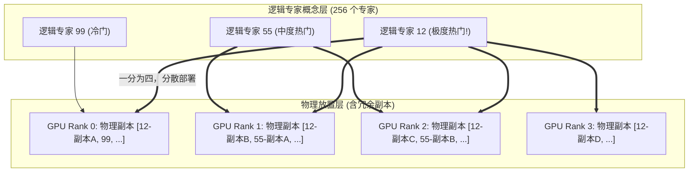
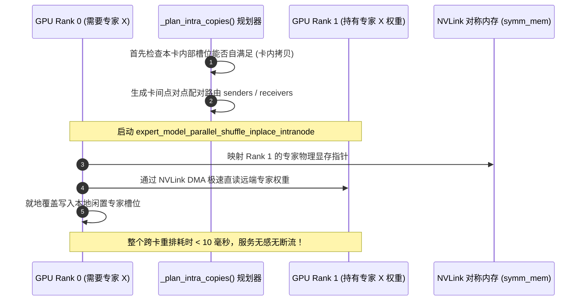

# 25 · EPLB 专家并行负载均衡

> 稀疏混合专家（MoE）的木桶效应由最慢的卡决定。DeepInfer 独创 EPLB（Expert-Parallel Load Balancing）体系：通过冗余物理专家副本、跨步贪心排布求解与 NVLink 零拷贝热重排，将专家负载不均衡度压低至 1.045 的极限平衡水平。
> **前置知识**：MoE 专家倾斜与长尾落后节点（Straggler）、NP-Hard 装箱问题、贪心近似算法。
> **源码指引**：`deepinfer/model_executor/eplb/policy.py`、`deepinfer/model_executor/eplb/shuffle.py`、`doc/inference_deployment_qa.md`。

---

## 0. 本篇要回答的问题

- 在数百个专家的真实业务流中，为什么某些「热门专家」会遭遇数十倍于普通专家的请求轰炸，从而引发全集群的木桶死锁？
- 什么是物理专家（Physical Expert）与逻辑专家（Logical Expert）？冗余副本机制是如何突破固有专家容量上限的？
- EPLB 的 `_batch_greedy_indices` 算法是如何在数学上建立历史步峰值最小化目标函数并快速贪心求解的？
- 在服务不中断、不断流的前提下，权重重排算子是如何通过 NVLink 对称内存（`symm_mem`）在微秒级完成跨卡参数热置换的？

---

## 1. MoE 系统的致命之疾：专家倾斜与木桶短板

在稠密模型（Dense Model）中，每个 Token 经历完全相同的参数矩阵，因此各 GPU 的计算量天然对齐。
而在稀疏混合专家（MoE）架构中，门控网络（Router）根据当前 Token 的语义特征，动态将其分发到 256 个专家中的特定几个：
- **语义分布的天然不均匀性**：人类语言中的常用虚词、标点符号、基础编程语法（如 `def`、`return`）出现的频次远远高于深奥的专业术语；
- **极端的热点专家涌现**：少数几个负责基础语法和常见逻辑的专家会被 80% 以上的输入序列反复选中，而冷门专家则门可罗雀；
- **木桶短板拉垮全组**：在分布式专家并行（EP）下，负责热门专家的 GPU（如 GPU 3）接收到了 10,000 个 Token 的计算量，而其他卡只分到了 500 个 Token。在最终的 All-to-All Combine 阶段，全组所有卡必须停下等待 GPU 3 算完，集群整体 MFU 暴跌 50%~70%！

```text
无 EPLB 时的灾难性不均衡 (以 4 卡为例):
GPU 0: [冷门专家 0~3]   ---> 仅处理 300 Tokens  (计算耗时 2 ms, 闲置等待 18 ms)
GPU 1: [普通专家 4~7]   ---> 处理 1500 Tokens   (计算耗时 6 ms, 闲置等待 14 ms)
GPU 2: [冷门专家 8~11]  ---> 仅处理 400 Tokens  (计算耗时 2 ms, 闲置等待 18 ms)
GPU 3: [★热门专家 12~15] ---> 暴击 8000 Tokens!  (计算耗时 20 ms, 全组被迫苦等它 20 ms!)
```

为了衡量这一失衡程度，工业界定义了失衡指标：

$$\text{moe\_lb} = \frac{\text{最慢 Rank 的计算量}}{\text{所有 Rank 的平均计算量}}$$

在未做均衡干预的原始集群中，$\text{moe\_lb}$ 往往高达 **2.0 ~ 4.0**，整个集群的实际有效算力被硬生生腰斩。

---

## 2. 核心架构原语：逻辑专家与冗余物理专家

DeepInfer 解决此问题的破局点在于**解耦专家概念**（`deepinfer/model_executor/eplb/policy.py`）：
- **逻辑专家（Logical Expert, log）**：模型算法在数学上定义的原始专家，数量恒定（如 $N_{\text{logical}} = 256$）；
- **物理专家（Physical Expert, phy）**：GPU 加速卡显存中实际放置的物理模型权重副本，数量大于逻辑专家：

$$N_{\text{physical}} = N_{\text{logical}} + N_{\text{redundant}}$$



### 生产部署参数配置
根据官方生产白皮书，冗余专家的配置遵循极具针对性的规则：
- **Prefill 阶段**：每张 GPU 预留 **4 个冗余物理专家**（向上取整以确保专家总数是 `ep_size` 的倍数）。收集 100 步负载统计，每 1,000 步重新编排一次物理放置；
- **Decode 阶段**：每张 GPU 预留 **1 个冗余物理专家**（在 EP64 下，每卡持有 7 个物理专家而不是原始的 4 个）。收集 1,000 步统计，每 10,000 步执行一次重排。

当一个逻辑专家被判定为高频热门时，系统自动在多张 GPU 上同时创建它的只读副本。门控网络在分发 Token 时，可以将涌向该逻辑专家的海量 Token 均匀分流至不同卡上的物理副本中，瞬间抚平单卡热点。

---

## 3. 跨步动态贪心求解：`_batch_greedy_indices`

在给定了冗余物理专家名额后，系统面临一个极其复杂的运筹优化问题：**如何将这些物理专家分配到各个 Rank 上，使得所有卡的历史负载峰值最小化？**

这是一个典型的 NP-Hard 多维多阶段装箱问题。在 `deepinfer/model_executor/eplb/policy.py` 中，DeepInfer 实现了极具数学美感的**历史批次贪心近似算法**：

### 数学优化目标
对于给定的层，优化目标是寻找物理专家到 Rank 的映射方案，使得在收集到的所有历史时间步 $i$ 中，负载最大的那个 Rank 的计算负荷之和最小：

$$\min \sum_{\text{step } i} \max_{\text{rank } j} \left( \sum_{e \in \text{rank } j} \text{Load}(e, i) \right)$$

### 算法执行流剖析
```python
# policy.py 核心贪心求解流
def _batch_greedy_indices(tokens_per_expert, physical_to_logical_map, logical_count, capacity):
    # 1. 计算每个专家副本的历史归一化平均负荷，降序排序
    weights = tokens_per_expert.sum(dim=0) / logical_count
    expert_order = physical_experts.gather(-1, physical_order)
    
    # 2. 逐层维护当前各 rank 在各历史 step 的累积负载 loads 和峰值 peaks
    loads = vectors.new_zeros((num_layers, num_ranks, num_steps))
    peaks = vectors.new_zeros((num_layers, num_steps))
    
    # 3. 贪心迭代放置每一个待分配的专家
    for job_index in range(num_physical):
        # 尝试将当前物理专家放置在各个 rank j 上
        # 计算放置后该 rank 在所有历史 step 的新负载，并与当前全局 peaks 取最大值
        torch.add(loads, vector.unsqueeze(1), out=candidates)
        torch.maximum(candidates, peaks.unsqueeze(1), out=candidates)
        torch.sum(candidates, dim=-1, out=scores)
        
        # 挑选令全局综合评分 scores 增量最小的那个 rank 落地放置
        best_rank = scores.argmin(dim=-1)
        ...
```

通过这一贪心算法，高负荷专家与低负荷专家被高度互补地穿插打包在不同 GPU 上，从数学上杜绝了「多个热门专家扎堆同一张卡」的恶劣情况。

---

## 4. NVLink 零拷贝热重排：`shuffle.py`

算出了最新的最优物理分布之后，如何将几 GB 的庞大专家权重在运行中的 GPU 之间完成物理搬迁？
如果需要停止线上服务或进行漫长的主机中转，任何算法收益都将被停机时间抵消。

DeepInfer 在 `deepinfer/model_executor/eplb/shuffle.py` 中实现了**就地零拷贝热重排（In-Place Hot Shuffling）**：



- **卡内优先（Intra-Copy First）**：通过 `_plan_intra_copies`，若某张卡原本就持有该专家但槽位发生移动，直接执行极速的卡内显存拷贝，不产生任何卡间总线流量；
- **NVLink 直读直写**：利用 `symm_mem` 统一虚拟编址，接收卡直接跨越 NVLink 读取发送卡的原始权重，无需开辟任何额外的临时中转显存；
- **配对轮转通信**：通过 `_paired_sender` 精巧配对，确保所有卡在重排期间发送与接收负载绝对均衡，避免出现通信交叉死锁。

---

## 5. 生产实测效果与收益

经过 EPLB 动态热重排治理后，DeepInfer 在超大规模集群中的专家负载平衡指标展现了惊人的跃升：
- **Prefill 阶段（EP4DP4）**：$\text{moe\_lb}$ 由原始的 2.3+ 骤降至 **1.074**；在 EP2DP2 下达到惊人的 **1.045**；
- **Decode 阶段（EP64）**：在 Wide-EP64 这一极其严苛的 64 卡跨机通信拓扑下，$\text{moe\_lb}$ 稳定压制在 **1.090** 以内！
- **业务最终收益**：整体端到端集群吞吐直接达到了理论完全均衡离线 Benchmark 的 **80% 以上**，彻底清除了大模型分布式推理中的木桶落后节点瓶颈。

---

## 6. 关键设计取舍与代价

| 特性 | 静态无重排专家并行 | DeepInfer EPLB 动态体系 | 架构收益与妥协 |
|---|---|---|---|
| **负载均衡度 (moe_lb)** | 2.0 ~ 4.0 (严重长尾木桶效应) | **1.045 ~ 1.090 (逼近绝对平衡)** | 集群有效吞吐翻倍，算力瓶颈彻底消除 |
| **显存占用开销** | 仅容纳原始逻辑专家参数 | 每卡需额外预留 1~4 个冗余物理专家 | 牺牲约 5%~10% 的显存用于换取全局算力平衡 |
| **重排运行时扰动** | 0 扰动 | 重排瞬时产生极小 NVLink 流量 (<10ms) | 重排周期长达数千步，摊薄到单步完全无感 |
| **算法实现壁垒** | 简单静态切分 | 包含多维贪心背包运筹与跨卡直写通信 | 调度器与模型层的协同复杂度大幅增加 |

---

## 7. 小结

- 稀疏专家天然存在的语义不平衡是 MoE 模型在分布式推理中的最大杀手；
- 冗余物理专家打破了逻辑专家的刚性边界，使热门专家能够多点分流并发；
- 基于历史步峰值最小化的贪心装箱算法与基于 NVLink 对称内存的就地热搬迁算子，在保障零服务停顿的前提下，交出了几乎完美的工程答卷。

---

## 延伸阅读 / 下一篇

- 下一篇：[`26-cluster-serving-and-3fs-kv-storage.md`](26-cluster-serving-and-3fs-kv-storage.md) · E/P/D 分离部署与 3FS 分布式 KV 存储，登顶全书生产架构最高峰，解密 100 PiB 级 72 小时持久化存储与 155 万亿 Token 日吞吐底座。
- 策略源码：`deepinfer/model_executor/eplb/policy.py`。
