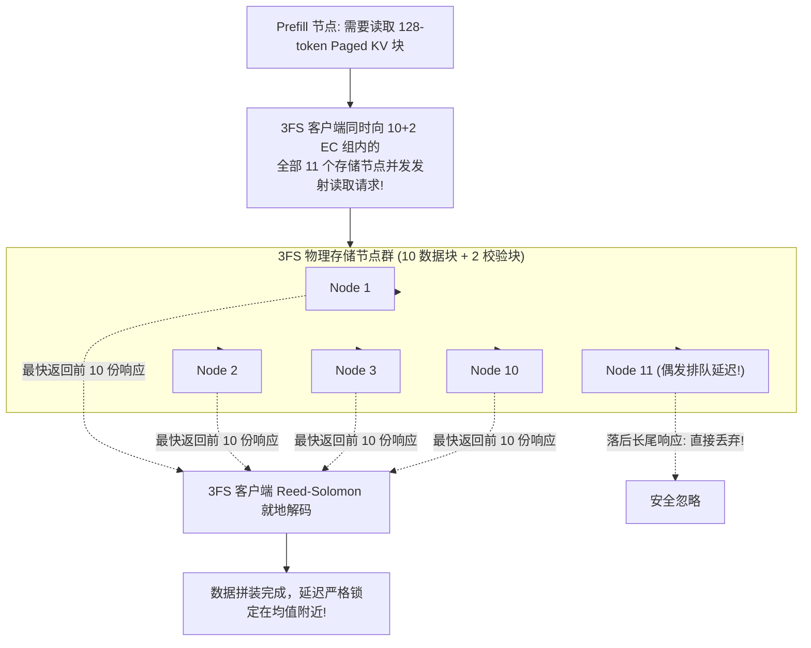
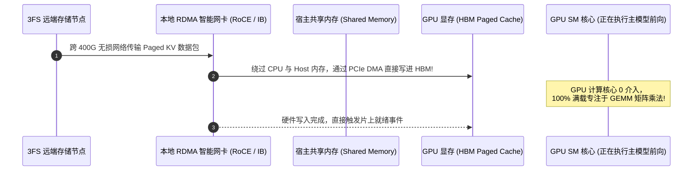

# 26 · E/P/D 分离部署与 3FS 分布式 KV 存储

> 单集群日吞吐 155 万亿 Token、每卡时 38 美元收益的背后，是彻底将计算与存储分离的超级工程体系：E/P/D 物理跨数据中心解耦、3FS 分布式文件系统 10+2 纠删码冗余，以及基于 GPUDirect RDMA（GDR）的近零 CPU 介入高速换入。
> **前置知识**：存算分离架构、纠删码（Erasure Coding）、GPUDirect RDMA（GDR）、分布式文件系统。
> **源码指引**：`doc/inference_deployment_qa.md`、`deepinfer/engine/llm_engine.py`。

---

## 0. 本篇要回答的问题

- 支撑日均 155 万亿 Token 的超大规模推理系统，其物理机房拓扑、机架组网与硬件配比是怎样规划的？
- 为什么 DeepInfer 坚决不将 Paged Block KV Cache 放在本地宿主内存，而是沉淀在独立的 3FS 存储集群中？
- 3FS 是如何利用「10+2 纠删码并发读 11 节点」的机制，从物理上消灭分布式存储的长尾访问抖动的？
- 在海量历史 KV 换入（Swap-In）至 GPU 显存时，GPUDirect RDMA 是如何在完全不消耗 GPU SM 计算核心的前提下跑满 PCIe 带宽的？

---

## 1. 155 万亿 Token 的工业级生产版图

当大模型从实验室算法迈入支撑亿级用户的国民级超级应用时，工程考量的首要指标从单纯的 MFU 演变为**每 GPU 卡时的商业产出（Revenue per GPU-Hour）**。

在 DeepSeek-V4.1-Flash 的生产实践中：
- 单一超大规模集群每天稳定吐出 **155 万亿（$1.55 \times 10^{14}$）个 Token**；
- 在低谷优惠电价核算下，全集群实现了**每 GPU 卡时 38 美元**的超高经济净收益；
- 能够达成这一奇迹的前提，是其彻底跳出了单机框架的狭隘视角，在数据中心机房级维度重构了整套推理基础设施。

```text
+-----------------------------------------------------------------------------------+
|                        DeepSeek 生产级数据中心集群物理布局                         |
|                                                                                   |
|  [跨数据中心 400G 高速骨干互联 (每 8 卡预留 400 Gbps 专用带宽)]                     |
|                                                                                   |
|  机房 A (预填充算力中心):                  机房 B (超节点解码中心):                 |
|  +-------------------------------+       +-------------------------------+        |
|  | 大规模 Prefill 节点池 (PE)     |       | 大规模 Decode 超节点池 (CE)   |        |
|  | - 标准 8 卡通用 GPU 机型       |       | - 64~128 卡超节点 (Wide-EP)   |        |
|  | - EP2~8 / DP2~8 低通信开销     |       | - 专注极速 TBT 自回归生成     |        |
|  +---------------+---------------+       +---------------+---------------+        |
|                  |                                       |                        |
|                  +-------------------+-------------------+                        |
|                                      |                                            |
|                                      v 400G 无损 RDMA 存储专用网络                 |
|  专用存储机房 (持久化资产中心):                                                    |
|  +-----------------------------------------------------------------------------+  |
|  | 3FS 分布式 KV 存储集群 (100 PiB+ SSD 池化存储, 每 GPU 配比约 14.4 TB 逻辑容量) |  |
|  | - 单台存储服务器配备 20 x 30.73 TB 企业级 NVMe SSD                            |  |
|  | - 持续提供 > 40 GB/s 并发读取与 > 5 GB/s 持久化写入带宽                       |  |
|  +-----------------------------------------------------------------------------+  |
+-----------------------------------------------------------------------------------+
```

---

## 2. 存算完全分离的哲学抉择

在传统大模型系统中，为了追求极速的缓存命中，通常采用「分层缓存（Tiered Storage）」：将 KV Cache 缓存在计算节点本地的 Host 内存或本地挂载的 NVMe 盘中。

DeepInfer 经过严格的工程推演，在生产架构中**坚决否定了本地内存分层方案，全面拥抱独立的专用 3FS 存储集群**：
1. **打破前缀亲和性路由对全局负载均衡的绑架**：若缓存绑定在特定计算节点上，为了提高命中率，网关必须实施「前缀亲和性路由（Prefix-Affinity Routing）」，强行将相同前缀的请求送往同一台机器。然而，当突发热点流量涌向某个公共前缀时，该节点瞬间被流量打瘫，而其余机器却无活可干！在存算分离架构下，任何计算节点均可通过高速网络命中任何历史前缀，全局调度器能够以绝对的自由度执行算力最优分配；
2. **计算节点故障与缓存资产的安全解耦**：现代 GPU 加速节点因高频运行、显存超频与剧烈温升，其硬件年化故障率比纯存储服务器高出一个数量级以上。若缓存放在计算节点，单张 GPU 掉线将导致本地几十 TB 的珍贵 KV 资产全部随之灰飞烟灭；
3. **独立的弹性生命周期**：存储集群与计算节点可以完全按照各自独立的经济周期采购、折旧与扩缩容。

---

## 3. 3FS 分布式存储与 10+2 纠删码消灭长尾

在海量节点并发读取 KV 缓存时，分布式存储系统最惧怕的不是均值吞吐不足，而是**长尾网络抖动（Tail Latency Jitter）**：只要有一个存储节点出现微秒级的排队堵塞，整个大模型的 Prefill 就会被彻底悬挂。

DeepInfer 依托专为 AI 打造的 **3FS 分布式文件系统**，提出了革命性的**对抗抖动并发读设计**：



### 10+2 纠删码与并发读的精妙平衡
- **容灾强韧**：采用 10+2 Reed-Solomon 纠删码，任意一个存储卷同时挂掉 2 台物理存储服务器，数据依然比特级完好无损；
- **消除尾部毛刺（Tail-Cutting）**：读取时向全组 11 个节点同时广播请求。数学上，只要有**任意 10 个节点**返回数据，客户端即刻通过数学公式解方程还原出原始数据并立即返回，滞后的那个节点被彻底无视。这一设计彻底清除了坏盘、网络轻微拥塞对线上推理时延的扰动；
- **分级 TTL 与 LRU 垃圾回收**：3FS 部署常驻 `GC Worker` 守护进程。为智能体（Agent）流量配置 3 天 TTL，为普通聊天（Chatbot）配置 7 天 TTL（聊天流量具有极其明显的长尾二次访问收益），将 SSD 磁盘水位始终严密压制在安全线以内。

---

## 4. GPUDirect RDMA（GDR）近零 CPU 介入高速换入

当 3FS 异步将 KV Cache 拉回主机共享内存后，如何以最高速度将其灌入 GPU 显存（HBM）？

常规的 CUDA 显存拷贝引擎（Copy Engine）在面对细碎的 Paged KV 块时表现极其糟糕，且需要频繁占用 GPU 的通用 SM 核心来调度 DMA 描述符，挤占了主模型的正常计算。

DeepInfer 祭出了底层终极武器：**基于 GPUDirect RDMA（GDR）的硬件级直传**：



通过这一通道：
- RDMA 智能网卡在收到网络数据包后，直接穿透 PCIe 总线将数据写入由 `CacheEngine` 预留的物理显存地址中；
- 彻底绕过了主机 CPU 的内存拷贝与中断触发；
- 在前向计算进行的同时，换入带宽完全打满 PCIe Gen5 峰值（> 60 GB/s），计算与缓存拉取达成了真正的纯硬件级物理重叠。

---

## 5. 跨节点弹性扩缩与故障转移（Failover）

在由成千上万张 GPU 组成的超大规模云端集群中，节点硬件故障不再是罕见的异常，而是每天都在发生的必然常态：

### 5.1 Decode 节点的 1 分钟优雅宽限期（Grace Period）
当某个 Decode 节点（CE）收到平台下发的缩容或下线维护指令时：
- 该实例并不立即粗暴关闭，而是立即进入 1 分钟的优雅宽限期；
- 停止接收全新请求，将当前正在生成的未完成请求连同对应的 SWA 状态与活跃 KV，一次性通过 400G VLAN 整体打包移交并转发给邻近健康的 CE 实例继续解码；
- 终端用户完全无感，对话连接零中断。

### 5.2 动态 EP 故障降级（Dynamic EP Failover）
在 Wide-EP64 或 EP128 架构下，若单张 GPU 突发显存 ECC 致命错误导致节点掉线：
- 传统系统必须整台机器停机重启（耗时数分钟），其余健康卡被迫陪葬闲置；
- DeepInfer 控制面在重启实例时，**动态重新探测当前节点内实际健康的物理 GPU 数量**，就地重新配置并自适应降级调整实例的实际 `ep_size`；
- 极大化地挽救了高昂的算力资产，使集群整体有效利用率长期稳定在 95% 以上。

---

## 6. 关键设计取舍与代价

| 特性 | 传统单机分层缓存架构 | DeepInfer 3FS 存算分离体系 | 架构收益与妥协 |
|---|---|---|---|
| **路由拓扑自由度** | 被前缀亲和性强行绑定，易生热点 | **全局无状态自由路由**，算力利用率拉满 | 增加了跨机房网络通信基础设施要求 |
| **KV 资产容灾能力** | 计算节点宕机，本地缓存瞬间全失 | 独立 10+2 纠删码存储，容忍双节点并发死亡 | 需搭建并维护独立的 3FS 分布式存储集群 |
| **存储访问长尾** | 极易受单机坏道与网络毛刺干扰 | 11 节点并发竞速读，物理级切断长尾 | 相比单机直接读取存在微秒级的网络基线开销 |
| **跨节点硬件要求** | 普通以太网局域网 | 依赖 400G 无损高速网络与 RDMA 网卡集群 | 基础设施准入门槛与初期资本开销较高 |

---

## 7. 小结

- E/P/D 解耦部署突破了单体机型的资源配比枷锁，使商品化硬件能够以最优经济模型发挥最大能效；
- 存算完全分离将大模型的推理计算从前缀亲和性约束中彻底解放；
- 3FS 分布式文件系统依托 10+2 纠删码并发读与 GPUDirect RDMA 直传，构筑了高吞吐、高可用、低抖动的现代工业级大模型服务底座。

---

## 延伸阅读 / 下一篇

- 下一篇：[`27-configuration-and-env-reference.md`](27-configuration-and-env-reference.md) · 配置体系与环境变量全参考，进入附录速查篇，完整归纳 DeepInfer 的全部环境变量与运行标志位。
- 架构参考：`doc/inference_deployment_qa.md`。
