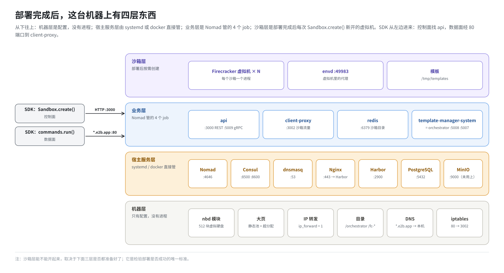
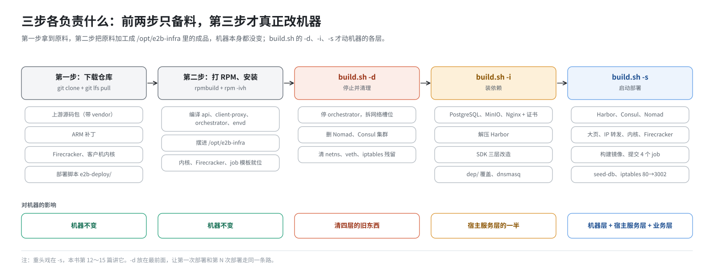

# 第 1 篇｜从三条命令说起：把一台裸机变成沙箱平台

> **本篇目标**：先不钻细节，看清楚全书要讲的那件事：一台只装了操作系统的 ARM 服务器，经过“下载仓库、打包安装、执行 `build.sh`”三步，变成一个能用 SDK 开沙箱的平台。中间机器上多了哪些东西，它们分成几层，三步各负责哪一层。读完这一篇，你手里会有一张全书地图，后面每一篇都在这张图上放大某一块。

---

## 一、一个场景

一台刚装好 openEuler 的鲲鹏服务器，IP 是 `192.168.10.23`。你在上面做了三件事：

```bash
# 第一步：下载仓库
git clone https://github.com/AustinJiangg/e2b-infra.git
cd e2b-infra

# 第二步：打成 RPM 包，装到 /opt/e2b-infra
rpmbuild -bb e2b-infra.spec --define "_sourcedir $PWD"   # 之前还要拉源码包、改 .env，第 7 篇细讲
rpm -ivh ~/rpmbuild/RPMS/aarch64/e2b-infra-2026.09-3.aarch64.rpm

# 第三步：停掉旧的、装依赖、启动部署
cd /opt/e2b-infra
bash build.sh -d
bash build.sh -i
bash build.sh -s
```

等它跑完，再用 SDK 建好一个叫 `base` 的模板（第 17 篇讲），然后在这台机器上运行一段 Python：

```python
from e2b import Sandbox

sbx = Sandbox.create("base")
print(sbx.commands.run("uname -m"))   # aarch64
sbx.kill()
```

不到一秒，你就拿到了一台独立的 Linux 虚拟机，在里面执行了一条命令，然后把它销毁。

这本书要回答的就是：**这三步之间，机器上到底多了什么？**

答案比想象中多。数下来大约有：

- 十来个常驻进程；
- 四五个 docker 容器；
- 几十个新目录；
- 几条内核参数、一个内核模块的配置、几百 GB 被预留的内存；
- 好几处 DNS 和防火墙规则；
- 两个数据库里的初始数据。

每一样都有它的理由，少了任何一样，最后那行 `Sandbox.create()` 都会失败，而且失败时的报错往往离真正的原因很远。

---

## 二、“部署”到底是什么

先给“部署”下一个朴素的定义：

> **把源码变成在某台机器上持续运行、能互相找到、出了问题能自动拉起的一组进程。**

这句话里藏着三个问题，全书反复回到这三个问题：

| 问题 | 通俗说法 | 在这套环境里的答案 |
|---|---|---|
| **跑什么** | 可执行的东西从哪来 | 上游源码打上 ARM 补丁，离线编译成二进制；再加上客户机内核、定制的 Firecracker、部署脚本，一起打进一个 RPM 包 |
| **在哪跑、谁管它** | 谁把它启动起来，崩了谁拉起，别人怎么找到它 | 周边依赖（数据库、镜像仓库等）由 systemd 或 docker 直接管；E2B 自己的服务交给调度器 Nomad 管，Consul 负责让它们互相找到 |
| **机器要先准备成什么样** | 内核和系统要提前调好哪些东西 | 内核模块、大页内存、网络转发开关、DNS、目录、防火墙入口 |

打个比方：开一家餐厅。

- “跑什么”是菜谱和食材；
- “在哪跑、谁管它”是厨师、排班表、前台怎么把订单交到对的厨师手里；
- “机器要准备成什么样”是厨房本身：灶台、水电、通风。

三样缺一样都开不了张。很多人第一次部署失败，是因为只盯着“跑什么”（二进制有没有、配置对不对），忘了另外两样。

---

## 三、部署完成后的样子：全书地图



部署完成后，这台机器可以分成四层来看，从下往上：

### 3.1 机器层

操作系统和内核为跑沙箱做的准备：

- 一个内核模块 nbd，最多提供 512 块“虚拟硬盘”，每个运行中的沙箱占一块；
- 几百 GB 的**大页**内存，专门给沙箱当内存条；
- 打开 IP 转发，否则沙箱的网络包转不出去；
- 几十个目录：`/orchestrator`、`/fc-kernels`、`/fc-versions`、`/mnt/hugepages` 等；
- DNS：本机的 dnsmasq 负责回答“`xxx.e2b.app` 在哪”“`redis.service.consul` 在哪”；
- 两条 iptables 规则：把访问 80 端口的流量交给 E2B 的入口程序。

这一层没有“进程”，全是配置，所以最容易被忽略。

### 3.2 宿主服务层

直接由操作系统（systemd）或 docker 管理的服务：

| 服务 | 作用 | 谁管 |
|---|---|---|
| Nomad | 调度器：决定 E2B 的服务怎么跑，挂了负责重启 | systemd |
| Consul | 服务目录：让服务按名字找到彼此 | systemd |
| dnsmasq | 本机 DNS | systemd |
| Nginx | 给镜像仓库加一层 HTTPS | systemd |
| MinIO | 对象存储（装了，但目前没用上，第 16 篇解释） | systemd |
| PostgreSQL | 存团队、密钥、模板等数据 | docker |
| Harbor | 本机的私有镜像仓库 | docker compose |
| Docker | 跑容器的引擎（需要自备） | systemd |

### 3.3 业务层

E2B 自己的服务，全部交给 Nomad 管理，一共 4 个 Nomad “任务”（job）：

| job | 里面跑的是什么 | 跑法 |
|---|---|---|
| `api` | 对外的 REST 接口，开沙箱、管模板都找它 | docker 容器 |
| `client-proxy` | 沙箱流量的入口，SDK 和沙箱说话都经过它 | docker 容器 |
| `redis` | 记录“哪个沙箱在哪台机器上” | docker 容器 |
| `template-manager-system` | orchestrator：真正创建和管理沙箱；同时负责把 Dockerfile 构建成模板 | 直接在宿主机上跑 |

### 3.4 沙箱层

每个沙箱是一个 Firecracker 进程，里面是一台完整的小虚拟机，虚拟机里跑着 E2B 的代理程序 envd。这一层不是部署时创建的，是部署完成后，SDK 每调用一次 `Sandbox.create()` 就多一个。

但沙箱能不能开起来，取决于下面三层是否都准备好了。这就是为什么讲部署的书也要讲沙箱：它是检验部署是否成功的唯一标准。

---

## 四、三步各负责什么



现在把“三步”放到四层地图上：

**第一步：下载仓库。** 只是把“原料”拿到手：

- 上游 E2B 的源码包；
- 一个近 900 KB 的 ARM 适配补丁；
- 客户机内核、定制 Firecracker 等预编译文件；
- 部署脚本。

这一步什么都不改。

**第二步：打 RPM、安装。** 把原料加工成成品，放到 `/opt/e2b-infra`：

- 编译出 api、client-proxy、orchestrator、envd 等二进制；
- 把内核、Firecracker、脚本、Nomad 任务模板摆好。

此时**机器本身还没变**：没有新进程、没改内核参数。`/opt/e2b-infra` 像一个打包好的工具箱，放在了工作台上。

**第三步：`build.sh`。** 真正动手改机器。拆成三个动作：

| 动作 | 负责哪几层 | 一句话 |
|---|---|---|
| `build.sh -d` | 清理四层里的旧东西 | 上一次部署的残留（进程、网络设备、防火墙规则）清干净，为重来做准备 |
| `build.sh -i` | 宿主服务层的一半 | 装周边依赖：PostgreSQL、MinIO、Nginx，解压 Harbor；装 Python SDK 并打补丁；把改过的部署脚本覆盖到位 |
| `build.sh -s` | 机器层、宿主服务层的另一半、业务层 | 启动 Harbor、Consul、Nomad；调内核参数、预留大页、放内核和 Firecracker；构建镜像、提交 4 个 job；写入初始数据；加防火墙入口 |

可以看出：真正的重头戏在 `-s`。全书第三部分有 4 篇讲它（第 12～15 篇）。

---

## 五、为什么是 `-d`、`-i`、`-s` 这个顺序

**`-i` 必须在 `-s` 前面**，原因很直接：`-s` 要用到 `-i` 准备的东西。

- `-s` 启动 Harbor，用的是 `-i` 解压并改好的 Harbor 配置；
- `-s` 启动 Nomad，用的是 `-i` 放进 `/tmp` 的 Nomad 安装包；
- `-s` 提交的 api，第一件事就是连 `-i` 启动的 PostgreSQL；
- `-s` 执行的那些脚本，是 `-i` 用改过的版本覆盖过的。

**`-d` 放在最前面**，是因为这套部署经常要“推倒重来”。比如：

- 改了源码，重新打了包；
- 换了一个参数；
- 上一次部署中途失败了。

如果不先停，会遇到这类问题：

- 旧的 orchestrator 还占着端口，新的启动不了；
- 旧的沙箱进程还在执行 Firecracker 二进制，新的拷不进去（`Text file busy`）；
- 上一轮留下的几千个网络设备让 Nomad 启动慢到几分钟。

第一次部署时机器是干净的，`-d` 什么都找不到，会打印一些“未找到进程”“403”之类的提示，属于正常现象（第 18 篇讲）。把它固定写在最前面，是为了让“第一次部署”和“第 N 次部署”走同一条路，不用人去判断现在属于哪种情况。

这里已经能看出这套部署脚本的一条设计原则：**同一个命令反复执行，结果应该一样**（幂等）。后面你会看到，脚本里处处是“先检查有没有，没有才加”的写法，就是为了这条原则。

---

## 六、这套环境和“原版 E2B”有什么不同

如果你去看 E2B 官方仓库的部署文档，会发现它和这里讲的几乎是两回事：

- 官方是在 Google Cloud 上用 Terraform 建一整个集群，几类机器各司其职；
- 官方用云厂商的存储桶、镜像仓库、数据库；
- 官方的机器镜像是用 Packer 预先做好的。

这套环境做了一次“搬家”：从云上的多台 x86 机器，搬到一台离线的 ARM 服务器上。搬家带来的改动，大部分就落在这个仓库里，主要是：

- 补丁里改过的部署文件；
- `e2b-deploy/` 目录下的脚本；
- RPM 打包配方。

第 5 篇会把“原版怎么部署”“改了什么、为什么改”专门讲一遍。现在先记住一句话：

> 这个仓库里很大一部分代码，不是 E2B 本身的功能，而是**让 E2B 能在一台离线 ARM 机器上一键跑起来**的部署代码。

---

## 七、贯穿全书的几个事实

下面这些事实会在后面反复出现，先在这里集中列一遍。现在看不懂没关系，读到对应的篇章再回来看。

| 事实 | 在哪一篇展开 |
|---|---|
| 只有一台机器，它同时是 Nomad 的 server（排班的人）和 client（干活的人），也是 Consul 的 server | 第 4、12 篇 |
| Nomad 上只跑 4 个 job：`redis`、`template-manager-system`、`client-proxy`、`api` | 第 15 篇 |
| orchestrator 和 template-manager 是同一个二进制、同一个进程，直接跑在宿主机上，不进容器 | 第 2、15 篇 |
| api 和 client-proxy 跑在容器里，它们的镜像是部署时现场构建、推进本机 Harbor 的 | 第 14 篇 |
| PostgreSQL、MinIO、Harbor、Nginx、dnsmasq 不归 Nomad 管，由 `build.sh -i` 直接装 | 第 10 篇 |
| `e2b-deploy/dep/` 是一层“覆盖”：RPM 先放上游的脚本，`-i` 再用改过的版本盖上去，实际生效的是 `dep/` 那份 | 第 8、11 篇 |
| `.env` 里的值要经过 `deploy.sh` 的过滤才能进到服务里；服务配置里写死的值会压过 `.env` | 第 14、16 篇 |
| 基本离线：编译器、Go 依赖、镜像、安装包都提前备好；只有 `yum`、`pip` 两处要一个可用的软件源（可以是内网镜像源） | 第 6～8、10、11 篇 |

---

## 八、本书路线图

全书 20 篇，分四部分，正好对应部署的顺序：

| 部分 | 篇目 | 讲什么 |
|---|---|---|
| 一、打地基 | 第 1～5 篇 | E2B 由哪些部件组成；服务在 Linux 上怎么跑；容器、Nomad、Consul 是什么；原版怎么部署、为什么改成单机 |
| 二、第一、二步 | 第 6～8 篇 | 仓库里有什么；RPM 怎么打；装好后 `/opt/e2b-infra` 里每个文件从哪来；动手前机器要自己备好什么 |
| 三、第三步 | 第 9～16 篇 | `build.sh` 逐个模式拆开讲；4 个 job 逐个读；所有配置项从哪来、到哪去 |
| 四、部署之后 | 第 17～20 篇 | 怎么验证；怎么停干净；改了东西怎么生效；排障和风险 |

阅读建议：

- 完全的新手，从头顺着读。第 3、4 篇是概念基础，后面大量用到。
- 已经熟悉 Linux 服务和容器的读者，可以跳过第 3 篇，第 4 篇的 Nomad 部分建议看一下，因为这套环境用 Nomad 的方式有些特别。
- 只想解决眼前问题的读者，直接翻第 20 篇的速查表，再按表里的指引回到对应篇章。

网络和存储的细节，本书只讲到够用为止。想深入的读者可以看本仓库另外两本：《E2B 沙箱网络从零讲透》《E2B 沙箱存储从零讲透》。

---

## 本篇小结

| 概念 | 一句话解释 |
|---|---|
| 部署 | 把源码变成持续运行、能互相找到、能自动拉起的一组进程 |
| 三个问题 | 跑什么；在哪跑、谁管它；机器要准备成什么样 |
| 四层 | 机器层、宿主服务层、业务层、沙箱层 |
| 第一步 | 下载仓库，拿到原料，不改机器 |
| 第二步 | 打 RPM 装到 `/opt/e2b-infra`，摆好工具箱，仍不改机器 |
| 第三步 | `build.sh -d` 清理、`-i` 装依赖、`-s` 启动部署，真正改机器 |
| 幂等 | 同一个命令反复执行结果一样，脚本处处“先检查再添加” |

**下一篇预告**：[《E2B 由哪些部件组成：一次 `Sandbox.create()` 经过谁》](02-components.md)。在讲“怎么部署”之前，先认识要部署的东西：api、client-proxy、orchestrator、template-manager、envd，以及它们依赖的数据库、镜像仓库和存储，看一次开沙箱的请求依次经过谁。
