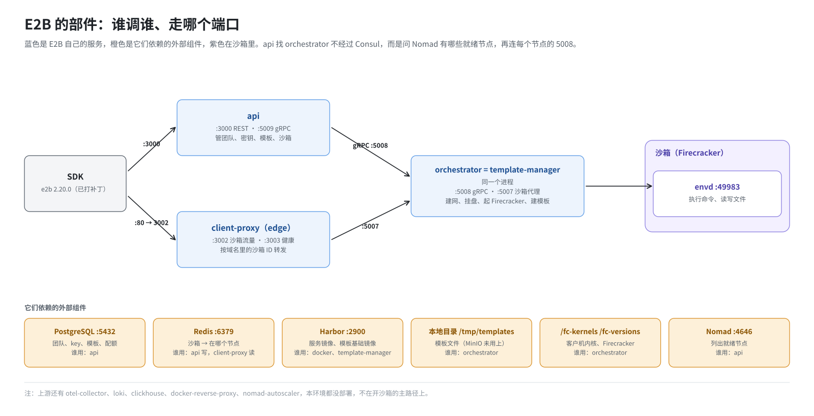
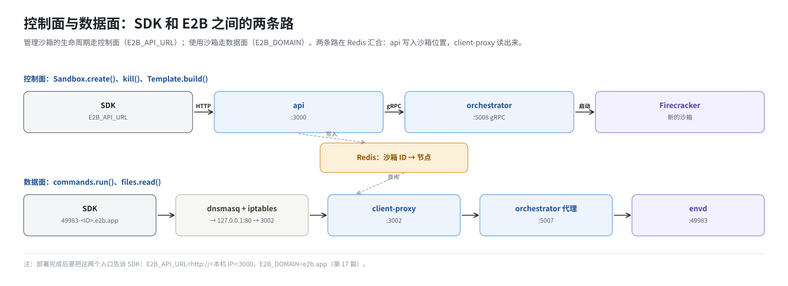

# 第 2 篇｜E2B 由哪些部件组成：一次 `Sandbox.create()` 经过谁

> **本篇目标**：部署之前，先认识要部署的东西。本篇不谈怎么装，只看运行时：E2B 有哪几个自己的服务，每个负责什么、监听哪个端口、依赖谁；它们又依赖哪些外部组件。最后跟着一次 `Sandbox.create()` 和一次 `commands.run()` 走一遍，看请求依次经过谁。读完你会明白，后面部署的每一样东西，都是为了让这条路走得通。

---

## 一、先看全貌



E2B 的部件可以分成三类：

1. **E2B 自己的服务**：api、client-proxy、orchestrator、template-manager、envd，以及两个一次性工具 db-migrator 和 seed-db。这些是 E2B 仓库里的 Go 代码编译出来的。
2. **它们依赖的外部组件**：PostgreSQL、Redis、镜像仓库、对象存储、Firecracker、客户机内核。这些不是 E2B 写的，是拿来用的。
3. **让它们跑起来、互相找到的基础设施**：Nomad、Consul、dnsmasq、docker。这一类留到第 3、4 篇讲。

下面逐个认识前两类。

---

## 二、E2B 自己的服务

### 2.1 api：前台

api 是整个系统的“前台”。SDK 的大部分管理操作都找它：

- 创建、查询、暂停、删除沙箱；
- 构建、删除模板；
- 管理团队、API key。

它监听两个端口：

| 端口 | 协议 | 谁访问 |
|---|---|---|
| 3000 | HTTP（REST） | SDK、命令行工具 |
| 5009 | gRPC | 内部组件（本环境基本不用） |

api 自己不创建沙箱。它像餐厅前台：

- 记录订单（写 PostgreSQL）；
- 检查顾客有没有资格（验证 API key、检查配额）；
- 决定交给哪个厨师（选一台计算节点）；
- 再把活派过去（用 gRPC 调用那台机器上的 orchestrator）。

所以 api 依赖：

- **PostgreSQL**：团队、密钥、模板、配额都存在这里；
- **Redis**：沙箱创建成功后，把“沙箱 ID → 在哪台机器”记进去；
- **orchestrator**：真正干活的人。api 通过问 Nomad“现在有哪些就绪的节点”找到它们，再去每个节点的 5008 端口连 orchestrator。

最后这一点很重要，第 15 篇会看到它的后果：**只要一个 orchestrator 都连不上，api 的健康检查就一直返回 503**，整个部署看起来像是 api 坏了，其实问题在 orchestrator。

### 2.2 client-proxy：沙箱流量的入口

沙箱创建好之后，SDK 要在里面执行命令、读写文件。这些请求不走 api，而是走 client-proxy（代码里也叫 edge）。

每个沙箱有一个自己的域名，形如：

```
49983-i2k3abcd5678efgh.e2b.app
```

- 前面的 `49983` 是沙箱里的端口号；
- 中间是沙箱 ID；
- 后缀 `e2b.app` 是 E2B 的域名。

client-proxy 收到请求后：

1. 从域名里解析出沙箱 ID 和端口；
2. 去 Redis 查这个沙箱在哪台机器上；
3. 把请求转给那台机器上 orchestrator 的沙箱代理（5007 端口），由它转进沙箱。

client-proxy 监听：

| 端口 | 作用 |
|---|---|
| 3002 | 沙箱流量（主入口） |
| 3003 | 健康检查 |

本环境用两条 iptables 规则把 80 端口的流量交给 3002，这样 SDK 访问 `http://xxx.e2b.app` 就能到达 client-proxy。为什么要这样做，以及 `xxx.e2b.app` 为什么会解析到本机，第 11、14 篇讲。

### 2.3 orchestrator：沙箱管家

orchestrator 是每台计算节点上的“沙箱管家”，真正创建沙箱的就是它。收到 api 的创建请求后，它要做一长串事：

1. 从本地缓存或存储里取出模板文件；
2. 准备一套网络：网络命名空间、虚拟网卡、防火墙规则；
3. 把模板的磁盘镜像挂成一块虚拟硬盘（NBD 设备）；
4. 准备内存：从快照按需加载，用大页承载；
5. 启动一个 Firecracker 进程，从快照恢复出虚拟机；
6. 等虚拟机里的 envd 就绪。

它监听的端口比较多：

| 端口 | 作用 |
|---|---|
| 5008 | gRPC：接收 api 的创建、删除请求 |
| 5007 | 沙箱代理：client-proxy 把沙箱流量转到这里 |
| 5010～5012 | 沙箱访问宿主服务的几个内部通道 |
| 5016～5018 | 沙箱出站流量的防火墙代理 |

orchestrator 需要直接操作宿主机的内核：

- 创建网络命名空间；
- 写 iptables 规则；
- 打开 `/dev/nbd*`；
- 映射大页内存；
- 启动 Firecracker。

这些操作需要 root 权限，而且要看得见宿主机的全部设备。所以它**不能放进普通容器里**，只能直接跑在宿主机上。这是部署时它和 api、client-proxy 最大的区别（第 4、15 篇）。

### 2.4 template-manager：模板工厂

模板是沙箱的“出生证”：一个磁盘镜像加一份内存快照。沙箱不是冷启动的，而是从模板恢复出来的，所以才能在一百多毫秒内开好。

template-manager 负责把用户的 Dockerfile 变成模板：

1. 拉取基础镜像（本环境从本机 Harbor 拉）；
2. 把镜像内容做成 ext4 磁盘镜像；
3. 用这块磁盘启动一台虚拟机，执行构建步骤；
4. 等虚拟机准备好，打一个内存快照；
5. 把磁盘和快照存起来。

可以看出，template-manager 也要启动虚拟机，需要的宿主机能力和 orchestrator 一模一样。上游的代码本来就允许把这两个角色放进同一个程序：用环境变量 `ORCHESTRATOR_SERVICES` 选择启用哪几个角色。本环境的做法是：

```
ORCHESTRATOR_SERVICES = "orchestrator,template-manager"
```

**一个进程同时担任两个角色**。这个进程的可执行文件叫 `/usr/bin/template-manager`，但它和 `/usr/bin/orchestrator` 是同一个二进制的两份拷贝（第 12 篇）。名字容易让人误会，后面提到“template-manager 进程”时，请记住它也是 orchestrator。

### 2.5 envd：沙箱里的代理

envd 是跑在每台沙箱（虚拟机）**里面**的小程序，监听 49983 端口。SDK 的 `commands.run()`、`files.write()` 最终都由它执行。

envd 不是部署时启动的，而是在构建模板时被放进模板的磁盘里，随沙箱一起启动。部署要做的是把 envd 的二进制放到 orchestrator 能找到的位置（`/fc-envd`，第 13 篇）。

### 2.6 两个一次性工具

| 工具 | 什么时候跑 | 做什么 |
|---|---|---|
| db-migrator | 每次 api 启动前 | 检查 PostgreSQL 里的表结构，缺什么建什么（数据库迁移） |
| seed-db | 部署时只跑一次 | 造出第一个团队“E2B”，生成 access token 和 team API key |

没有 db-migrator，api 一启动就会因为表不存在而报错；没有 seed-db，你没有任何 key 可以调用 api。

---

## 三、它们依赖的外部组件

| 组件 | 存什么、做什么 | 谁用它 | 本环境怎么提供 |
|---|---|---|---|
| PostgreSQL | 团队、API key、模板、构建记录、配额 | api、db-migrator、seed-db | docker 容器，`build.sh -i` 启动 |
| Redis | 运行中沙箱的目录：哪个沙箱在哪个节点 | api 写，client-proxy 读 | Nomad job `redis` |
| 镜像仓库 | api、client-proxy 等服务的镜像；建模板用的基础镜像 | docker、template-manager | Harbor，`build.sh -i`/`-s` 安装 |
| 对象存储 | 模板文件（磁盘、内存快照） | orchestrator、template-manager | 本环境实际用本地目录；MinIO 装了但没启用 |
| Firecracker | 创建和运行虚拟机的程序 | orchestrator | RPM 自带定制版 |
| 客户机内核 | 虚拟机里跑的 Linux 内核 | orchestrator | RPM 自带，放到 `/fc-kernels` |

从这张表能看出部署要准备的一大块东西：上面六样，每一样都要有人装、有人启动、有人告诉 E2B 的服务“它在哪”。

---

## 四、控制面与数据面

SDK 和 E2B 之间有两条路：



**控制面**：管理沙箱的生命周期。

```
SDK ──HTTP :3000──► api ──gRPC :5008──► orchestrator ──► Firecracker
```

`Sandbox.create()`、`sbx.kill()`、`Template.build()` 走这条路。

**数据面**：使用沙箱。

```
SDK ──HTTP :80──► (iptables) ──► client-proxy :3002 ──► orchestrator 代理 :5007 ──► 沙箱里的 envd :49983
```

`commands.run()`、`files.read()` 走这条路。

两条路在 Redis 汇合：api 创建好沙箱后把位置写进 Redis，client-proxy 从 Redis 读出来。

SDK 怎么知道这两条路的入口在哪？靠两个配置：

- `E2B_API_URL`：控制面入口，本环境是 `http://<本机 IP>:3000`；
- `E2B_DOMAIN`：数据面的域名后缀，SDK 用它拼出 `49983-<沙箱ID>.e2b.app` 这样的地址。

部署完成后要把这两项告诉 SDK（第 17 篇）。

---

## 五、跟着一次请求走一遍

把上面的东西串起来。假设模板 `base` 已经建好。

**第一步：`Sandbox.create("base")`**

1. SDK 向 `http://192.168.10.23:3000/sandboxes` 发请求，带上 API key。
2. api 查 PostgreSQL：
   - 这个 key 属于哪个团队；
   - 这个团队还能不能再开沙箱（配额）；
   - `base` 对应哪个模板版本。
3. api 从已知的 orchestrator 节点里挑一个。本环境只有一台机器，只能挑它。
4. api 通过 gRPC（5008）让 orchestrator 创建沙箱。
5. orchestrator 准备网络、磁盘、内存，启动 Firecracker，等 envd 就绪，返回成功。
6. api 把“这个沙箱在这个节点上”写进 Redis，把沙箱 ID 返回给 SDK。

**第二步：`sbx.commands.run("uname -m")`**

1. SDK 拼出地址 `http://49983-<沙箱ID>.e2b.app/...` 并发请求。
2. 本机 DNS（dnsmasq）把 `*.e2b.app` 解析到 `127.0.0.1`。
3. 请求打到 80 端口，被 iptables 规则改到 3002，到达 client-proxy。
4. client-proxy 从域名里取出沙箱 ID，查 Redis，得知沙箱在本节点，转给 orchestrator 的 5007。
5. orchestrator 的代理把请求送进沙箱的网络，到达 envd 的 49983。
6. envd 执行 `uname -m`，结果原路返回。

这两段路径上每一个环节，都对应着部署的某一步。比如：

| 路径上的环节 | 由部署的哪一步准备 |
|---|---|
| api 在 3000 端口监听 | `-s` 构建 api 镜像并提交 job |
| api 能连上 PostgreSQL | `-i` 启动 PostgreSQL；api 的 prestart 任务建表 |
| SDK 有可用的 API key | `-s` 末尾运行 seed-db |
| orchestrator 能建网络 | `-s` 打开 IP 转发 |
| orchestrator 能挂磁盘 | 部署前手工装好 nbd 模块 |
| orchestrator 能分配内存 | `-s` 预留大页 |
| `*.e2b.app` 能解析 | `-i` 配置 dnsmasq |
| 80 端口能到 client-proxy | `-s` 最后加的 iptables 规则 |
| client-proxy 能找到 Redis | `-s` 提交 redis job；Consul 提供 `redis.service.consul` |

你可以把这张表当成部署的“验收单”。第 17 篇讲验证时，就是顺着这张表往下核对。

---

## 六、上游有、本环境没部署的东西

上游 E2B 还有一批组件，本环境一个都没部署：

| 组件 | 作用 |
|---|---|
| otel-collector | 收集指标和调用链 |
| loki、logs-collector | 收集日志 |
| clickhouse | 存沙箱的资源用量、事件 |
| docker-reverse-proxy | 让用户用自己的 docker 客户端往 E2B 推镜像 |
| nomad-autoscaler | 按负载自动加减机器 |

它们都属于“可观测性”或“规模化运营”，不在创建和使用沙箱的主路径上。去掉以后，E2B 照样能开沙箱，只是：

- 看不到监控图表；
- 日志只能到各组件本机去翻；
- 没有用量统计。

你会在配置文件里看到它们的痕迹，例如 `.env` 里的 `CLICKHOUSE_*`、`LOKI_*`、`OTEL_*`。这些配置项填了值，但没有对应的服务在跑。第 16 篇整理配置时会把它们单独列出来，免得你以为改了它们有用。

---

## 本篇小结

| 部件 | 一句话 | 端口 | 本环境的跑法 |
|---|---|---|---|
| api | 前台：记订单、查资格、派活 | 3000、5009 | 容器，Nomad 管 |
| client-proxy | 沙箱流量入口，按域名找沙箱 | 3002、3003 | 容器，Nomad 管 |
| orchestrator | 沙箱管家：建网、挂盘、起虚拟机 | 5007、5008 等 | 宿主机进程，Nomad 管 |
| template-manager | 模板工厂；和 orchestrator 是同一个进程 | 同上 | 同上 |
| envd | 沙箱里的代理，执行命令和文件操作 | 49983 | 随模板进入虚拟机 |
| db-migrator | api 启动前建表 | — | api 的前置任务 |
| seed-db | 造第一个团队和密钥 | — | 部署时跑一次 |
| 控制面 | SDK → api → orchestrator | | |
| 数据面 | SDK → client-proxy → orchestrator 代理 → envd | | |

**下一篇预告**：[《部署基础（一）：一个服务在 Linux 上怎么“跑起来”》](03-how-a-service-runs.md)。认识了要部署的东西，接下来补两块基础知识：一个程序要长期运行，需要解决哪些问题；systemd 和 docker 分别怎么解决；镜像仓库和证书又是怎么回事。
