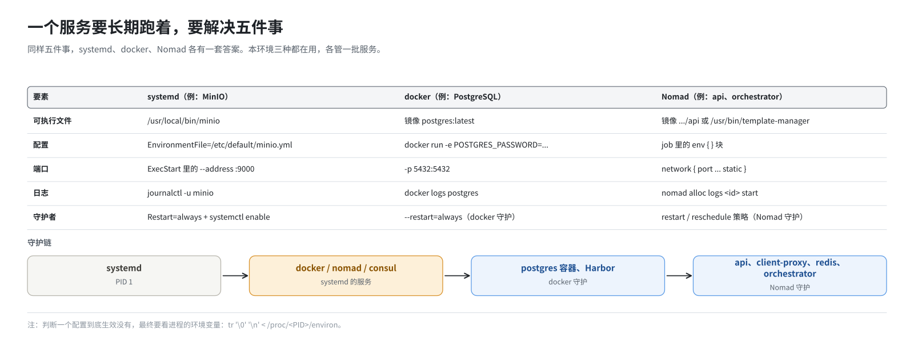
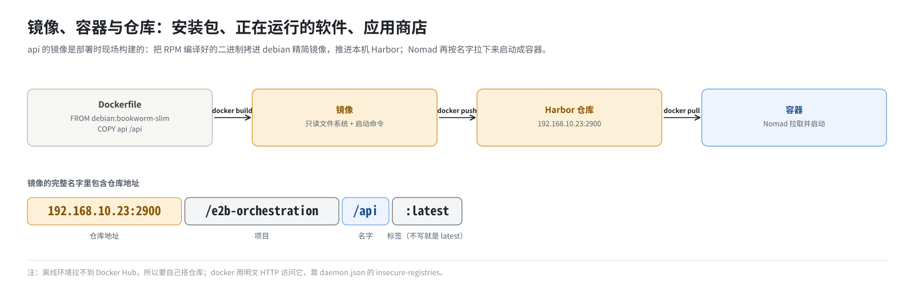

# 第 3 篇｜部署基础（一）：一个服务在 Linux 上怎么“跑起来”

> **本篇目标**：补一块基础知识。一个程序要作为“服务”长期运行，需要解决哪几件事；Linux 上管理服务的 systemd 怎么解决它们；容器又是什么，镜像、容器、镜像仓库三者什么关系；为什么离线环境要自己搭镜像仓库，为什么要折腾自签证书。这些概念在后面每一篇都会用到。熟悉这些的读者可以跳过本篇。

---

## 一、“跑起来”需要解决的五件事

你在终端里敲 `./api --port 3000`，程序就跑起来了。但这不叫“部署好了”。你一关终端，它就没了；它崩了，没人管；机器重启，它不会自己回来。

一个程序要作为**服务**长期运行，至少要解决五件事：

| 事情 | 问题 |
|---|---|
| 可执行文件 | 程序本体放在哪 |
| 配置 | 它从哪里读配置：命令行参数、环境变量、配置文件 |
| 端口 | 它在哪个端口等别人来访问 |
| 日志 | 它的输出写到哪，出了问题去哪看 |
| 守护者 | 谁负责启动它、崩了重启它、开机拉起它 |



这一篇讲 Linux 上解决这五件事的两种常见方式：systemd 和 docker。第 4 篇再讲第三种：Nomad。本环境三种都在用，各管一批服务。

---

## 二、进程、参数与环境变量

**进程**是一个正在运行的程序。同一个可执行文件可以启动多个进程，每个进程有自己的编号（PID）。

程序启动时有两种主要的输入渠道：

- **命令行参数**：`./template-manager --port 5008` 里的 `--port 5008`；
- **环境变量**：一组“名字=值”，从启动它的那个进程继承下来。

可以这样看一个进程实际拿到的环境变量：

```bash
tr '\0' '\n' < /proc/<PID>/environ
```

E2B 的 Go 服务几乎**全靠环境变量读配置**。比如 orchestrator 用到的：

```
SANDBOXES_HOST_NETWORK_CIDR=10.13.0.0/16
STORAGE_PROVIDER=Local
ORCHESTRATOR_SERVICES=orchestrator,template-manager
```

这有一个重要的推论，本书会反复用到：

> **判断一个配置到底生效没有，最终要看进程的环境变量**，而不是看你改的那个文件。

从你改的文件到进程的环境变量之间，可能隔着好几道转手：

```
.env → 模板替换 → Nomad 任务定义 → Nomad 启动进程
```

哪一道断了，你的改动就到不了进程。第 16 篇专门讲这条链。

---

## 三、端口

一个服务通过**端口**对外提供访问。端口是 0～65535 之间的一个数字，同一台机器上同一个端口同一时刻只能被一个进程监听（准确地说，是同一个地址、同一种协议）。

两个服务抢同一个端口，后启动的那个会报错退出：

```
listen tcp :5008: bind: address already in use
```

这个报错在本环境很常见。典型场景是：上一轮的 orchestrator 没停干净，新的启动不了。

看谁在监听哪个端口：

```bash
ss -lntp
# State   Recv-Q  Send-Q  Local Address:Port   Peer Address:Port  Process
# LISTEN  0       4096          *:3000              *:*          users:(("api",pid=2311,fd=7))
# LISTEN  0       4096          *:5008              *:*          users:(("template-manage",pid=1987,fd=12))
```

- `-l` 只看监听中的；
- `-n` 显示数字端口；
- `-t` 只看 TCP；
- `-p` 显示进程。

本环境用到的端口有二十多个，第 15 篇末尾有一张总表。

---

## 四、systemd：操作系统自带的守护者

### 4.1 是什么

现代 Linux 开机后启动的第一个进程（PID 1）通常是 **systemd**。它负责把其他所有服务拉起来，也负责在它们崩溃时重启。

你告诉 systemd“有这么一个服务”，靠的是一个 **unit 文件**，一般放在 `/etc/systemd/system/<名字>.service`。

### 4.2 读一个 unit 文件

以本环境的 MinIO 为例，`build.sh -i` 会把它放到 `/etc/systemd/system/minio.service`：

```ini
[Unit]
Description=MinIO
After=network-online.target
AssertFileIsExecutable=/usr/local/bin/minio

[Service]
EnvironmentFile=-/etc/default/minio.yml
ExecStart=/usr/local/bin/minio server $MINIO_DIR --address :9000 --console-address :9001
Restart=always
LimitNOFILE=65536

[Install]
WantedBy=multi-user.target
```

逐行对应前面的五件事：

| 行 | 解决哪件事 | 含义 |
|---|---|---|
| `AssertFileIsExecutable`、`ExecStart` 里的路径 | 可执行文件 | 程序在 `/usr/local/bin/minio` |
| `EnvironmentFile` | 配置 | 从 `/etc/default/minio.yml` 读环境变量（数据目录、账号密码） |
| `--address :9000 --console-address :9001` | 端口 | 9000 给程序访问，9001 是网页控制台 |
| （没写） | 日志 | 默认交给 systemd 的日志系统 journald |
| `Restart=always` | 守护 | 进程退出就重启 |
| `WantedBy=multi-user.target` | 守护 | 开机进入多用户模式时自动启动（需要 `enable`） |
| `After=network-online.target` | 启动顺序 | 等网络就绪后再启动 |

### 4.3 常用命令

```bash
systemctl daemon-reload          # 改了 unit 文件后，让 systemd 重新读
systemctl start minio            # 立即启动
systemctl enable minio           # 设为开机自启（写一个链接，不会立即启动）
systemctl status minio           # 看状态：是否在跑、PID、最近几行日志
systemctl restart minio          # 重启
journalctl -u minio -f           # 看日志，-f 持续跟踪
```

`start` 和 `enable` 是两回事，新手常混：

- `start` 是“现在启动”；
- `enable` 是“以后开机时启动”。

部署脚本里一般两个都执行。

### 4.4 本环境由 systemd 管的服务

| 服务 | unit 从哪来 |
|---|---|
| docker | 自备（第 8 篇） |
| dnsmasq | `yum install` 自带 |
| nginx | `yum install` 自带 |
| minio | `build.sh -i` 从 `dep/minio.service` 拷过去 |
| consul | `build.sh -s` 里的 `run-consul.sh` 现场生成 |
| nomad | `build.sh -s` 里的 `run-nomad.sh` 现场生成 |

也就是说，Nomad 自己也是 systemd 管的服务。systemd 管 Nomad，Nomad 再管 E2B 的服务，是一个两层的“守护”结构（第 4 篇）。

---

## 五、容器：把程序和它的环境一起打包

### 5.1 为什么要容器

一个程序能跑，不光要有它自己，还要有它依赖的东西：

- 动态库；
- 某个版本的 Python；
- 某些系统工具；
- 证书文件。

在你的机器上能跑，换一台机器可能就因为缺了某个库而跑不了。

**容器**的思路是：把程序和它依赖的整个文件系统一起打包，运行时给它一个隔离的环境。不管宿主机装了什么，容器里看到的永远是打包时的那套文件。

### 5.2 镜像、容器、仓库



三个概念，用“软件安装”来类比：

| 概念 | 类比 | 说明 |
|---|---|---|
| 镜像（image） | 安装包 | 一个只读的文件系统快照加启动命令。有名字和标签，如 `postgres:latest`、`redis:7.4.4-alpine` |
| 容器（container） | 装好、正在运行的软件 | 从镜像启动的一个实例。同一个镜像可以启动多个容器 |
| 镜像仓库（registry） | 应用商店 | 存放镜像的服务器。`docker push` 上传，`docker pull` 下载 |

镜像的完整名字里包含了仓库地址：

```
192.168.10.23:2900/e2b-orchestration/api:latest
└────仓库地址─────┘ └──项目──┘ └名字┘ └标签┘
```

不写仓库地址时，默认是 Docker Hub。

### 5.3 Dockerfile：怎么做一个镜像

镜像由 Dockerfile 描述。本环境 api 的 Dockerfile 只有几行：

```dockerfile
FROM debian:bookworm-slim

COPY api /api
RUN chmod +x /api

ENV GIN_MODE=release
ENTRYPOINT [ "/api"]
```

意思是：以 debian 精简版为底，把编译好的 `api` 二进制拷进去，启动时运行它。

上游的 Dockerfile 原本更复杂：在容器里下载 Go 依赖、编译源码。ARM 补丁把它改成了上面这样：**二进制在打 RPM 时就编译好了，镜像只负责“装进去”**。好处是构建镜像不需要联网，也不需要在容器里再编译一遍（第 5、14 篇）。

### 5.4 `docker run` 的常用参数

以本环境的 PostgreSQL 为例（`build.sh -i` 里的写法，略有简化）：

```bash
docker run -d --name postgres \
    -e POSTGRES_USER=postgres \
    -e POSTGRES_PASSWORD=local \
    -e POSTGRES_DB=mydatabase \
    -p 5432:5432 \
    --restart=always \
    --health-cmd="pg_isready -U postgres" \
    postgres:latest
```

| 参数 | 作用 | 对应五件事 |
|---|---|---|
| `-d` | 后台运行 | |
| `--name postgres` | 给容器起名，以后用名字操作它 | |
| `-e` | 设环境变量 | 配置 |
| `-p 5432:5432` | 把宿主机的 5432 端口转到容器的 5432 | 端口 |
| `--restart=always` | 容器退出就重启；docker 启动时也拉起它 | 守护 |
| `--health-cmd` | 定期执行这个命令判断容器是否健康 | |
| `postgres:latest` | 用哪个镜像 | 可执行文件 |

日志用 `docker logs postgres` 看。

注意这里的“守护者”是 docker 自己。docker 又由 systemd 守护。所以 PostgreSQL 的守护链是 systemd → docker → 容器。

### 5.5 本环境的容器

| 容器 | 谁启动的 | 谁守护 |
|---|---|---|
| postgres | `build.sh -i` 直接 `docker run` | docker（`--restart=always`） |
| Harbor 的一组容器 | `build.sh -s` 用 docker compose 启动 | docker compose 的重启策略 |
| api、client-proxy、redis | Nomad | Nomad |

后三个虽然也是 docker 容器，但启动和重启都由 Nomad 负责，它们的“守护者”是 Nomad，不是 docker。

---

## 六、私有镜像仓库：为什么要自己搭一个

在能上网的环境里，镜像从 Docker Hub 拉就行。本环境有两个原因必须自己搭一个仓库：

1. **离线**：机器不能访问外网，Docker Hub 拉不到。
2. **自己构建的镜像要有地方放**：api、client-proxy 的镜像是部署时现场构建的（第 14 篇）。Nomad 启动容器时按名字拉镜像，这些镜像必须在某个仓库里。

本环境用的仓库是 **Harbor**，一个带网页管理界面的开源镜像仓库，跑在本机 2900 端口。里面建了一个项目 `e2b-orchestration`，放三类东西：

- E2B 服务的镜像：api、client-proxy、db-migrator；
- 第三方镜像：redis；
- 建模板用的基础镜像：`ubuntu:22.04-custom`。

---

## 七、HTTPS 与自签证书

最后一个基础概念：证书。只讲到能看懂部署脚本为止。

**HTTPS** 是加密的 HTTP。客户端连上服务器后，服务器出示一张**证书**，证明“我就是你要找的那个域名”。客户端要验证这张证书，而验证的依据是：它是不是由一个**受信任的机构**签发的。操作系统里存着一份受信任机构的清单，叫**信任库**。

在内网里，没有公共机构给你签证书，只能自己签一张，叫**自签证书**。自签证书默认不被任何人信任，客户端会报错：

```
x509: certificate signed by unknown authority
```

解决办法是把这张自签证书**手工加进客户端的信任库**。麻烦在于不同程序读的信任库不同：

- docker 读 `/etc/docker/certs.d/<仓库地址>/ca.crt`；
- 大多数 Go 程序读系统信任库（openEuler 上由 `update-ca-trust` 管理）；
- 也可以用环境变量 `SSL_CERT_FILE` 直接指定一个证书文件。

本环境的模板构建要求从 `harbor:443` 用 HTTPS 拉基础镜像，所以 `build.sh -i` 生成了一张 CN 为 `harbor` 的自签证书。这张证书被加进了上面所有三处，第 10 篇详细讲。

还有一种绕开证书的办法：告诉 docker“这个仓库不用 HTTPS”。这就是 docker 配置里的 `insecure-registries`。本环境推送镜像走的是 `IP:2900` 的明文 HTTP，就靠这一项（第 8 篇）。

---

## 本篇小结

| 概念 | 一句话解释 |
|---|---|
| 服务的五件事 | 可执行文件、配置、端口、日志、守护者 |
| 环境变量 | E2B 服务的主要配置方式；生效没有，看 `/proc/<PID>/environ` |
| 端口冲突 | `bind: address already in use`，用 `ss -lntp` 查谁占着 |
| systemd | 系统自带的守护者；unit 文件描述服务；`start` 是现在启动，`enable` 是开机启动 |
| `journalctl -u` | 看 systemd 服务的日志 |
| 镜像 / 容器 / 仓库 | 安装包 / 正在运行的软件 / 应用商店 |
| Dockerfile | 描述怎么做镜像；本环境只是把编译好的二进制拷进 debian |
| Harbor | 本机的私有镜像仓库，端口 2900，项目 `e2b-orchestration` |
| 自签证书 | 内网自己签的证书，要手工加进每个客户端读的信任库 |
| `insecure-registries` | 让 docker 用明文 HTTP 访问某个仓库 |

**下一篇预告**：[《部署基础（二）：调度与服务发现——Nomad 和 Consul》](04-nomad-and-consul.md)。服务多了以后，谁决定它们跑在哪、挂了谁来管、换了地址别人怎么找到？这一篇讲 E2B 用的调度器 Nomad 和服务目录 Consul，以及它们在单机上的特殊用法。
